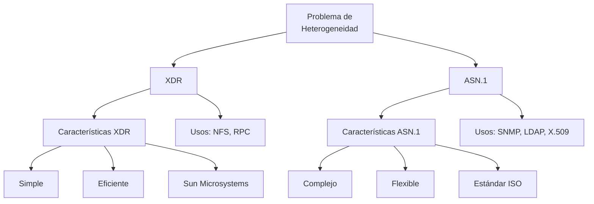

# Redes de Computadoras - Aplicaciones

## 6.1 Problemas de representación de la información (XDR, ASN.1).

---

En redes de computadoras, uno de los problemas fundamentales es la representación de la información entre sistemas heterogéneos. Diferentes arquitecturas de computadoras utilizan distintas convenciones para representar datos básicos como enteros, números de punto flotante y caracteres.

### El Problema de la Heterogeneidad

#### Representación de Datos en Diferentes Arquitecturas

- **Big Endian**: El byte más significativo se almacena en la dirección más baja
- **Little Endian**: El byte menos significativo se almacena en la dirección más baja
- **Problemas de alineación**: Diferentes arquitecturas requieren diferentes alineaciones de datos

**Ejemplo de representación del entero 0x12345678:**

| Arquitectura  | Dirección 0 | Dirección 1 | Dirección 2 | Dirección 3 |
| ------------- | ----------- | ----------- | ----------- | ----------- |
| Big Endian    | 0x12        | 0x34        | 0x56        | 0x78        |
| Little Endian | 0x78        | 0x56        | 0x34        | 0x12        |

### XDR (External Data Representation)

#### Definición

XDR es un estándar para la descripción y codificación de datos desarrollado por Sun Microsystems. Proporciona una representación canónica de datos que es independiente de la arquitectura del computador.

#### Características Principales

- **Independencia de arquitectura**: Los datos se representan de forma consistente
- **Autodescriptivo**: La estructura de datos se define explícitamente
- **Eficiencia**: Balance entre overhead y portabilidad

#### Esquema de Codificación XDR

```c
// Ejemplo de definición de estructura en XDR
struct ejemplo_xdr {
    int entero;
    string cadena<100>;
    float decimal;
};
```

#### Reglas de Codificación

1. **Enteros**: 32 bits en formato big-endian
2. **Punto flotante**: IEEE 754
3. **Strings**: Longitud (32 bits) seguida de los caracteres
4. **Arrays y vectores**: Siempre de longitud fija a menos que se especifique
5. **Padding**: Los datos se alinean a límites de 4 bytes

**Fórmula de padding:**
$$ \text{padding} = (4 - (l \mod 4)) \mod 4 $$
donde $l$ es la longitud actual en bytes.

#### Ejemplo de Codificación

```c
// Especificación XDR para un mensaje
struct MensajeLogin {
    string usuario<64>;
    string contraseña<64>;
    int version;
};
```

**Proceso de codificación:**

1. Codificar longitud del usuario (32 bits)
2. Codificar caracteres del usuario + padding
3. Codificar longitud de contraseña (32 bits)
4. Codificar caracteres de contraseña + padding
5. Codificar versión (32 bits)

### ASN.1 (Abstract Syntax Notation One)

#### Definición

ASN.1 es un estándar internacional (ISO/IEC 8824, 8825) para describir estructuras de datos de forma independiente de la máquina y lenguaje de programación.

#### Características

- **Notación abstracta**: Describe qué son los datos, no cómo se representan
- **Múltiples reglas de codificación**: BER, DER, PER, XER
- **Extensible**: Puede evolucionar sin romper compatibilidad

#### Tipos de Datos Básicos en ASN.1

```asn.1
-- Ejemplo de definición ASN.1
ModuloEjemplo DEFINITIONS ::= BEGIN
    Persona ::= SEQUENCE {
        nombre      UTF8String,
        edad        INTEGER,
        correo      UTF8String OPTIONAL,
        activo      BOOLEAN DEFAULT TRUE
    }

    ListaPersonas ::= SEQUENCE OF Persona
END
```

#### Reglas de Codificación BER (Basic Encoding Rules)

La codificación BER utiliza el formato TLV (Tag-Length-Value):

- **Tag**: Identifica el tipo de dato
- **Length**: Especifica la longitud del valor
- **Value**: Contiene los datos codificados

**Estructura TLV:**

```
+------+--------+----------------+
| Tag  | Length | Value          |
+------+--------+----------------+
| 1 byte | 1-5 bytes | longitud especificada |
```

##### Cálculo de longitud en BER:

Para longitudes menores a 128:

$$ \text{formato simple} = \text{longitud} $$

Para longitudes mayores o iguales a 128:

$$ \text{bytes longitud} = \lceil \frac{\log_2(\text{longitud} + 1)}{8} \rceil $$

$$ \text{byte inicial} = 0x80 + \text{número de bytes} $$

#### Ejemplo de Codificación BER

```asn.1
-- Definición del dato
EnteroEjemplo ::= INTEGER 255
```

**Codificación:**

- Tag: 0x02 (INTEGER)
- Length: 0x02 (2 bytes)
- Value: 0x00FF (255 en big-endian)

**Resultado:** `02 02 00 FF`

### Comparación entre XDR y ASN.1

#### Diagrama de Comparación



#### Tabla Comparativa

| Característica         | XDR               | ASN.1               |
| ---------------------- | ----------------- | ------------------- |
| Complejidad            | Simple            | Complejo            |
| Eficiencia             | Alta              | Variable            |
| Flexibilidad           | Limitada          | Alta                |
| Estándar               | Propietario (Sun) | Internacional (ISO) |
| Autodescriptivo        | No                | Sí                  |
| Reglas de codificación | Una única         | Múltiples           |

### Aplicaciones Prácticas

#### XDR en NFS (Network File System)

```c
// Ejemplo de estructura XDR en NFS
struct nfs_fh3 {
    opaque data<NFS3_FHSIZE>;
};

struct diropargs3 {
    nfs_fh3 dir;
    filename3 name;
};
```

#### ASN.1 en SNMP (Simple Network Management Protocol)

```asn.1
SNMPv2-MIB DEFINITIONS ::= BEGIN
    sysDescr OBJECT-TYPE
        SYNTAX      DisplayString
        MAX-ACCESS  read-only
        STATUS      current
        DESCRIPTION "Textual description of the entity"
        ::= { system 1 }
END
```

#### ASN.1 en Certificados Digitales (X.509)

```asn.1
Certificate ::= SEQUENCE {
    tbsCertificate       TBSCertificate,
    signatureAlgorithm   AlgorithmIdentifier,
    signature            BIT STRING
}

TBSCertificate ::= SEQUENCE {
    version         [0] EXPLICIT Version DEFAULT v1,
    serialNumber    CertificateSerialNumber,
    signature       AlgorithmIdentifier,
    issuer          Name,
    validity        Validity,
    subject         Name,
    subjectPublicKeyInfo SubjectPublicKeyInfo
}
```

### Ejercicios Propuestos

#### Ejercicio 1: Codificación XDR

Dada la siguiente estructura en C:

```c
struct DatosUsuario {
    char nombre[8];  // "Juan"
    int id;          // 1000
    float saldo;     // 1500.50
};
```

Asumiendo:

- Arquitectura little-endian
- "Juan" en ASCII: 4A 75 61 6E
- 1000 en hexadecimal: 0x000003E8
- 1500.50 en IEEE 754: 0x44BB8800

**Calcular:**

1. La representación en memoria en little-endian
2. La codificación XDR resultante
3. El overhead introducido por XDR

#### Ejercicio 2: Codificación ASN.1 BER

Codificar la siguiente estructura usando BER:

```asn.1
Persona ::= SEQUENCE {
    nombre  UTF8String "Ana",
    edad    INTEGER 25
}
```

**Pasos:**

1. Codificar cada elemento individualmente
2. Calcular longitudes totales
3. Construir la codificación TLV completa

#### Ejercicio 3: Diseño de Esquema

Diseñar un esquema ASN.1 para un sistema de mensajería que incluya:

- Remitente y destinatario
- Fecha y hora
- Cuerpo del mensaje
- Lista de archivos adjuntos (opcional)

### Soluciones a Ejercicios Selectos

#### Solución Ejercicio 1

**Representación en memoria (little-endian):**

```
Nombre: 4A 75 61 6E 00 00 00 00  (8 bytes con padding)
ID: E8 03 00 00                  (1000 en little-endian)
Saldo: 00 88 BB 44               (1500.50 en IEEE 754 little-endian)
```

**Codificación XDR:**

```
Nombre: 00 00 00 04 4A 75 61 6E 00 00 00 00  (12 bytes: 4 longitud + 8 datos)
ID: 00 00 03 E8                             (4 bytes en big-endian)
Saldo: 44 BB 88 00                          (4 bytes en big-endian)
```

**Overhead:** 8 bytes adicionales (4 por el string + 4 por realineación)

### Implementación Práctica

#### Ejemplo de Uso de XDR en C

```c
#include <rpc/xdr.h>

// Definición de estructura
struct datos_empleado {
    char nombre[50];
    int edad;
    float salario;
};

// Función de serialización XDR
bool_t xdr_empleado(XDR *xdrsp, struct datos_empleado *empleado) {
    if (!xdr_string(xdrsp, &empleado->nombre, 50))
        return FALSE;
    if (!xdr_int(xdrsp, &empleado->edad))
        return FALSE;
    if (!xdr_float(xdrsp, &empleado->salario))
        return FALSE;
    return TRUE;
}
```

#### Ejemplo de Uso de ASN.1 con Python

```python
from pyasn1.type import univ, namedtype
from pyasn1.codec.ber import encoder

# Definición de estructura
class Mensaje(univ.Sequence):
    componentType = namedtype.NamedTypes(
        namedtype.NamedType('id', univ.Integer()),
        namedtype.NamedType('datos', univ.OctetString())
    )

# Creación y codificación
mensaje = Mensaje()
mensaje['id'] = 123
mensaje['datos'] = 'Hola mundo'
codificado = encoder.encode(mensaje)
```

### Consideraciones de Rendimiento

#### Overhead de Codificación

**XDR:**

- Strings: 4 bytes de overhead por string
- Padding: 0-3 bytes por elemento
- Enteros: Siempre 4 bytes

**ASN.1 BER:**

- Tags: 1+ bytes por elemento
- Lengths: 1-5 bytes por elemento
- TLV completo por cada campo

#### Fórmula de Eficiencia

Eficiencia de codificación:

$$ E = \frac{\text{tamaño datos útiles}}{\text{tamaño total transmitido}} $$

Para XDR:

$$ E_{XDR} = \frac{\sum \text{tamaño datos}}{\sum (\text{tamaño datos} + \text{overhead})} $$

### Referencias

#### Bibliografía Citada

1. **Kurose & Ross** (2010): Capítulo 7 - Representación de datos en aplicaciones distribuidas
2. **Tanenbaum & Wetherall** (2010): Sección 7.3 - Codificación de datos
3. **Peterson & Davie** (2011): Capítulo 11 - Formatos de datos en red
4. **Stallings** (2010): Apéndice A - Estándares de codificación

#### Estándares Relevantes

- **RFC 4506**: XDR Standard
- **ISO/IEC 8824**: ASN.1 Specification
- **ISO/IEC 8825**: ASN.1 Encoding Rules (BER, DER, PER)
- **RFC 2578**: Structure of Management Information (SMIv2)

### Tendencias y Tecnologías Modernas

#### Alternativas Contemporáneas

- **Protocol Buffers** (Google)
- **Apache Thrift**
- **MessagePack**
- **JSON Schema**
- **Avro**

#### Migración desde XDR/ASN.1

```json
// Ejemplo equivalente en JSON Schema
{
  "type": "object",
  "properties": {
    "nombre": { "type": "string", "maxLength": 50 },
    "edad": { "type": "integer" },
    "salario": { "type": "number" }
  },
  "required": ["nombre", "edad", "salario"]
}
```
