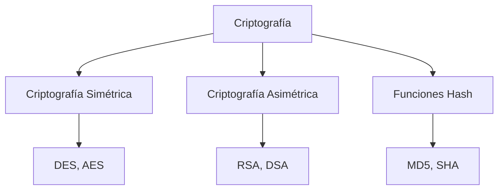
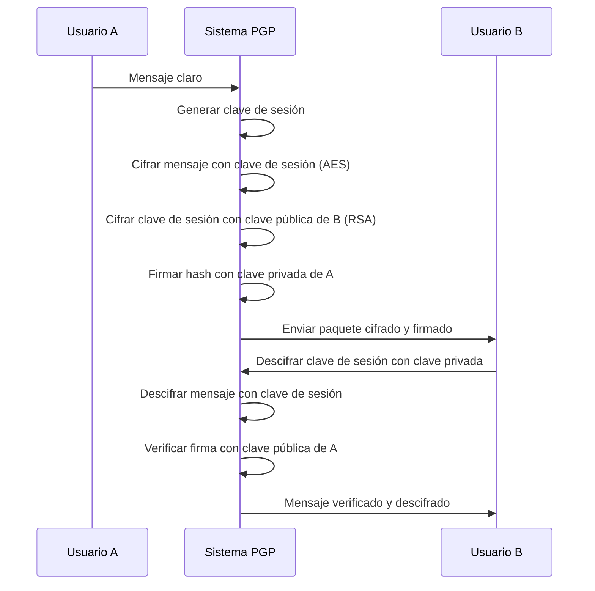
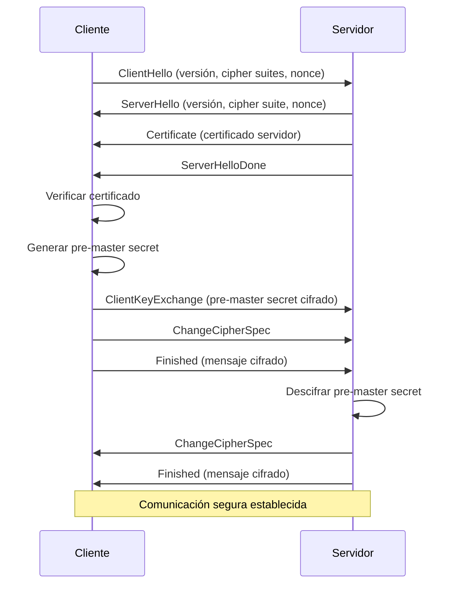

# Redes de Computadoras - Aplicaciones

## 6.2 Transferencias seguras. Cifrado (DES, RSA, MD5); mecanismos de seguridad (PGP, SSL, HTTPS).

---

La seguridad en aplicaciones de red es fundamental para proteger la confidencialidad, integridad y autenticidad de los datos transmitidos. Las transferencias seguras emplean diversos mecanismos de cifrado y protocolos específicos.

### Fundamentos de Criptografía

#### Conceptos Básicos

**Criptografía**: Ciencia que estudia técnicas matemáticas para proteger información.

**Objetivos de seguridad:**

- **Confidencialidad**: Solo destinatarios autorizados pueden leer la información
- **Integridad**: Los datos no han sido alterados
- **Autenticación**: Verificación de identidades
- **No repudio**: Imposibilidad de negar la autoría

#### Tipos de Criptografía



### Cifrado Simétrico: DES (Data Encryption Standard)

#### Definición

DES es un algoritmo de cifrado simétrico que utiliza una clave de 56 bits para transformar bloques de 64 bits.

#### Estructura de DES

**Fórmula básica de cifrado:**
$$ C = E_K(P) $$
$$ P = D_K(C) $$
donde:

- $C$ = texto cifrado
- $P$ = texto plano
- $K$ = clave
- $E$ = función de cifrado
- $D$ = función de descifrado

#### Proceso de Cifrado DES

```python
# Pseudocódigo del algoritmo DES
def des_encrypt(plaintext, key):
    # Permutación inicial (IP)
    permuted = initial_permutation(plaintext)

    # Dividir en bloques izquierdo y derecho (32 bits cada uno)
    left, right = split_blocks(permuted)

    # 16 rondas Feistel
    for round in range(16):
        # Expansión de right a 48 bits
        expanded = expansion(right)

        # XOR con subclave
        mixed = xor(expanded, subkeys[round])

        # Sustitución S-Box (48 a 32 bits)
        substituted = s_box_substitution(mixed)

        # Permutación P
        permuted_result = p_permutation(substituted)

        # XOR con left
        new_right = xor(left, permuted_result)

        # Actualizar para siguiente ronda
        left = right
        right = new_right

    # Permutación final (IP⁻¹)
    ciphertext = final_permutation(right + left)
    return ciphertext
```

#### Ejemplo de Clave DES

**Clave de 64 bits (56 bits efectivos + 8 de paridad):**

```
Clave hexadecimal: 01 23 45 67 89 AB CD EF
Bits de paridad: cada byte tiene 1 bit de paridad impar
```

#### Fortalezas y Debilidades

- **Fortaleza**: Rápido en hardware
- **Debilidad**: Clave de 56 bits es vulnerable a ataques de fuerza bruta
- **Triple DES (3DES)**: Aplica DES tres veces con claves diferentes

### Cifrado Asimétrico: RSA (Rivest-Shamir-Adleman)

#### Fundamentos Matemáticos

**Teorema de Euler:**
$$ a^{\phi(n)} \equiv 1 \pmod{n} $$
donde $\phi(n)$ es la función totient de Euler.

**Para números primos:**
$$ \phi(p) = p-1 $$
$$ \phi(pq) = (p-1)(q-1) $$ para $p$ y $q$ primos.

#### Generación de Claves RSA

**Algoritmo de generación:**

1. **Seleccionar dos primos grandes** $p$ y $q$
2. **Calcular** $n = p \times q$
3. **Calcular** $\phi(n) = (p-1)(q-1)$
4. **Elegir** $e$ tal que $1 < e < \phi(n)$ y $mcd(e, \phi(n)) = 1$
5. **Calcular** $d$ tal que $d \times e \equiv 1 \pmod{\phi(n)}$

**Claves resultantes:**

- **Clave pública**: $(e, n)$
- **Clave privada**: $(d, n)$

#### Fórmulas de Cifrado/Descifrado

**Cifrado:**
$$ C = M^e \mod n $$

**Descifrado:**
$$ M = C^d \mod n $$

#### Ejemplo Práctico RSA

```python
def rsa_key_generation():
    # Paso 1: Seleccionar primos
    p = 61  # primo
    q = 53  # primo

    # Paso 2: Calcular n
    n = p * q  # 3233

    # Paso 3: Calcular φ(n)
    phi_n = (p-1) * (q-1)  # 3120

    # Paso 4: Elegir e
    e = 17  # coprimo con 3120

    # Paso 5: Calcular d
    d = modular_inverse(e, phi_n)  # 2753

    return (e, n), (d, n)

def rsa_encrypt(message, public_key):
    e, n = public_key
    # Convertir mensaje a número
    m = string_to_int(message)
    # Cifrar
    ciphertext = pow(m, e, n)
    return ciphertext

def rsa_decrypt(ciphertext, private_key):
    d, n = private_key
    # Descifrar
    message_num = pow(ciphertext, d, n)
    # Convertir a texto
    message = int_to_string(message_num)
    return message
```

### Funciones Hash: MD5 (Message Digest 5)

#### Definición

MD5 es una función hash criptográfica que produce un resumen de 128 bits a partir de datos de entrada arbitrarios.

#### Propiedades de las Funciones Hash

1. **Determinística**: Misma entrada → mismo hash
2. **Computacionalmente eficiente**
3. **Resistente a preimágenes**: Dado $h$, difícil encontrar $m$ tal que $H(m) = h$
4. **Resistente a colisiones**: Difícil encontrar $m_1 \neq m_2$ con $H(m_1) = H(m_2)$

#### Proceso MD5

```python
def md5(message):
    # Preprocesamiento
    message = pad_message(message)  # Añadir padding
    blocks = split_blocks(message)  # Bloques de 512 bits

    # Inicializar variables
    a = 0x67452301
    b = 0xEFCDAB89
    c = 0x98BADCFE
    d = 0x10325476

    # Procesar cada bloque
    for block in blocks:
        # 64 operaciones en 4 rondas
        for i in range(64):
            # Operaciones no lineales
            if 0 <= i <= 15:
                f = (b & c) | ((~b) & d)
                g = i
            elif 16 <= i <= 31:
                f = (d & b) | ((~d) & c)
                g = (5*i + 1) % 16
            elif 32 <= i <= 47:
                f = b ^ c ^ d
                g = (3*i + 5) % 16
            else:  # 48-63
                f = c ^ (b | (~d))
                g = (7*i) % 16

            # Actualizar variables
            temp = d
            d = c
            c = b
            b = b + left_rotate((a + f + k[i] + block[g]), r[i])
            a = temp

    # Concatenar resultado final
    return concatenate(a, b, c, d)
```

#### Vulnerabilidades de MD5

- **Colisiones**: Es posible encontrar colisiones en tiempo práctico
- **No recomendado** para aplicaciones críticas de seguridad

### Mecanismos de Seguridad Aplicados

#### PGP (Pretty Good Privacy)

##### Arquitectura PGP



##### Implementación PGP

```python
class PGPSystem:
    def encrypt_and_sign(self, message, recipient_public_key, sender_private_key):
        # Generar clave de sesión aleatoria
        session_key = generate_random_key()

        # Cifrar mensaje con clave de sesión (simétrica)
        encrypted_message = aes_encrypt(message, session_key)

        # Cifrar clave de sesión con RSA
        encrypted_session_key = rsa_encrypt(session_key, recipient_public_key)

        # Calcular hash y firmar
        message_hash = md5(message)
        signature = rsa_sign(message_hash, sender_private_key)

        # Crear paquete PGP
        pgp_package = {
            'encrypted_session_key': encrypted_session_key,
            'encrypted_message': encrypted_message,
            'signature': signature
        }

        return pgp_package

    def decrypt_and_verify(self, pgp_package, recipient_private_key, sender_public_key):
        # Descifrar clave de sesión
        session_key = rsa_decrypt(
            pgp_package['encrypted_session_key'],
            recipient_private_key
        )

        # Descifrar mensaje
        message = aes_decrypt(
            pgp_package['encrypted_message'],
            session_key
        )

        # Verificar firma
        message_hash = md5(message)
        verification = rsa_verify(
            message_hash,
            pgp_package['signature'],
            sender_public_key
        )

        return message, verification
```

#### SSL/TLS (Secure Sockets Layer/Transport Layer Security)

##### Handshake SSL/TLS



##### Estructura de Mensajes SSL/TLS

```python
def ssl_handshake():
    # Fase 1: Negotiation
    client_hello = {
        'version': 'TLS 1.2',
        'random': generate_random(),
        'cipher_suites': ['TLS_RSA_WITH_AES_128_CBC_SHA', ...],
        'compression_methods': ['null']
    }

    server_hello = {
        'version': 'TLS 1.2',
        'random': generate_random(),
        'cipher_suite': 'TLS_RSA_WITH_AES_128_CBC_SHA',
        'compression_method': 'null'
    }

    # Fase 2: Autenticación y key exchange
    certificate = load_server_certificate()

    # Fase 3: Key generation
    pre_master_secret = generate_random(48)
    encrypted_pre_master = rsa_encrypt(pre_master_secret, server_public_key)

    # Calcular master secret
    master_secret = prf(pre_master_secret, "master secret",
                       client_random + server_random, 48)

    # Derivar keys
    key_block = prf(master_secret, "key expansion",
                   server_random + client_random, 40)

    client_mac_key = key_block[0:20]
    server_mac_key = key_block[20:40]
    client_enc_key = key_block[40:56]
    server_enc_key = key_block[56:72]
```

#### HTTPS (HTTP Secure)

##### Funcionamiento de HTTPS

HTTPS = HTTP + SSL/TLS

**Proceso de conexión HTTPS:**

1. Resolución DNS del dominio
2. Conexión TCP al puerto 443
3. Handshake TLS
4. Verificación de certificado
5. Cifrado de datos HTTP

##### Ejemplo de Solicitud HTTPS

```http
# Solicitud HTTP normal (NO SEGURA)
GET /index.html HTTP/1.1
Host: www.ejemplo.com

# Solicitud HTTPS (cifrada)
TLS Application Data:
  Encrypted HTTP:
    GET /index.html HTTP/1.1
    Host: www.ejemplo.com
```

##### Implementación Server HTTPS

```python
from http.server import HTTPServer, BaseHTTPRequestHandler
import ssl

class SecureHTTPHandler(BaseHTTPRequestHandler):
    def do_GET(self):
        # Solo se ejecuta después del handshake TLS
        self.send_response(200)
        self.send_header('Content-type', 'text/html')
        self.end_headers()
        self.wfile.write(b'<h1>Conexión Segura</h1>')

# Configurar servidor HTTPS
httpd = HTTPServer(('localhost', 443), SecureHTTPHandler)
httpd.socket = ssl.wrap_socket(
    httpd.socket,
    certfile="server.crt",
    keyfile="server.key",
    server_side=True,
    ssl_version=ssl.PROTOCOL_TLS
)
httpd.serve_forever()
```

### Ejercicios Propuestos

#### Ejercicio 1: Cifrado DES Manual

Dado el texto plano: `0123456789ABCDEF` (hexadecimal)
y la clave: `133457799BBCDFF1` (hexadecimal)

**Calcular:**

1. La permutación inicial IP
2. La primera ronda de Feistel
3. El texto cifrado final

#### Ejercicio 2: Generación de Claves RSA

**Parámetros:**

- p = 17
- q = 23
- e = 5

**Calcular:**

1. n y φ(n)
2. Clave privada d
3. Cifrar el mensaje M = 65
4. Descifrar el resultado

#### Ejercicio 3: Análisis de Handshake TLS

Dado un capture de handshake TLS, identificar:

1. Mensajes ClientHello y ServerHello
2. Cipher suite negociada
3. Longitud del pre-master secret
4. Algoritmo de intercambio de claves utilizado

#### Ejercicio 4: Implementación PGP

Implementar un sistema simplificado de PGP que:

1. Genere pares de claves RSA
2. Cifre mensajes con AES-128
3. Firme digitalmente con SHA-256
4. Verifique integridad y autenticidad

### Soluciones a Ejercicios Selectos

#### Solución Ejercicio 2 (RSA)

**Cálculos:**

1. $n = p \times q = 17 \times 23 = 391$
2. $\phi(n) = (p-1)(q-1) = 16 \times 22 = 352$
3. $d = e^{-1} \mod \phi(n) = 5^{-1} \mod 352 = 141$ ( verificar: $5 \times 141 = 705 ≡ 1 \mod 352$ )

**Cifrado:**
$C = M^e \mod n = 65^5 \mod 391$

$65^2 = 4225 ≡ 345 \mod 391$
$65^4 = 345^2 = 119025 ≡ 101 \mod 391$
$65^5 = 101 \times 65 = 6565 ≡ 272 \mod 391$

**Descifrado:**
$M = C^d \mod n = 272^{141} \mod 391 = 65$

### Consideraciones de Seguridad Práctica

#### Mejores Prácticas

1. **Claves RSA**: Mínimo 2048 bits
2. **Hash**: Usar SHA-256 o superior en lugar de MD5
3. **TLS**: Versión 1.2 o superior
4. **Certificados**: Validar cadena de confianza

#### Vulnerabilidades Comunes

- **MD5**: Vulnerable a colisiones
- **DES**: Clave muy corta
- **RSA con exponente pequeño**: Puede ser vulnerable
- **SSLv2/v3**: Obsoletos e inseguros

### Referencias Bibliográficas

#### Bibliografía Básica

1. **Kurose & Ross** (2010): Capítulo 8 - Seguridad en redes de computadoras
2. **Tanenbaum & Wetherall** (2010): Capítulo 8 - Seguridad de red
3. **Stallings** (2010): Partes 4 y 5 - Criptografía y seguridad de red
4. **Peterson & Davie** (2011): Capítulo 8 - Seguridad de red

#### Estándares y RFCs

- **RFC 1321**: The MD5 Message-Digest Algorithm
- **RFC 2313**: PKCS #1: RSA Encryption
- **RFC 4880**: OpenPGP Message Format
- **RFC 5246**: The Transport Layer Security (TLS) Protocol

#### Bibliografía Complementaria

1. **Schneier, B.** - Applied Cryptography
2. **Stallings, W.** - Cryptography and Network Security
3. **RFC 4251**: The Secure Shell (SSH) Protocol Architecture
