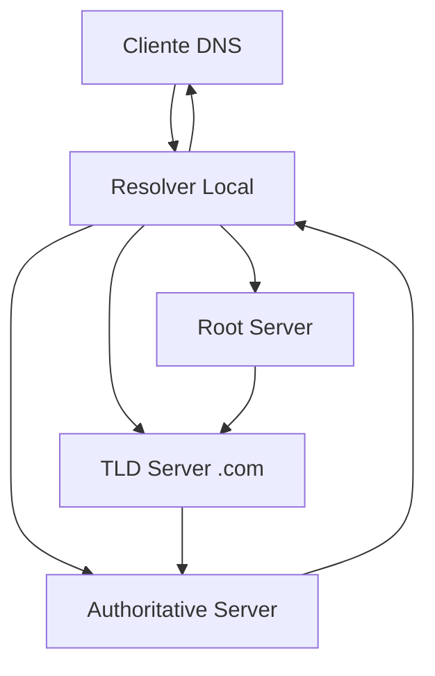
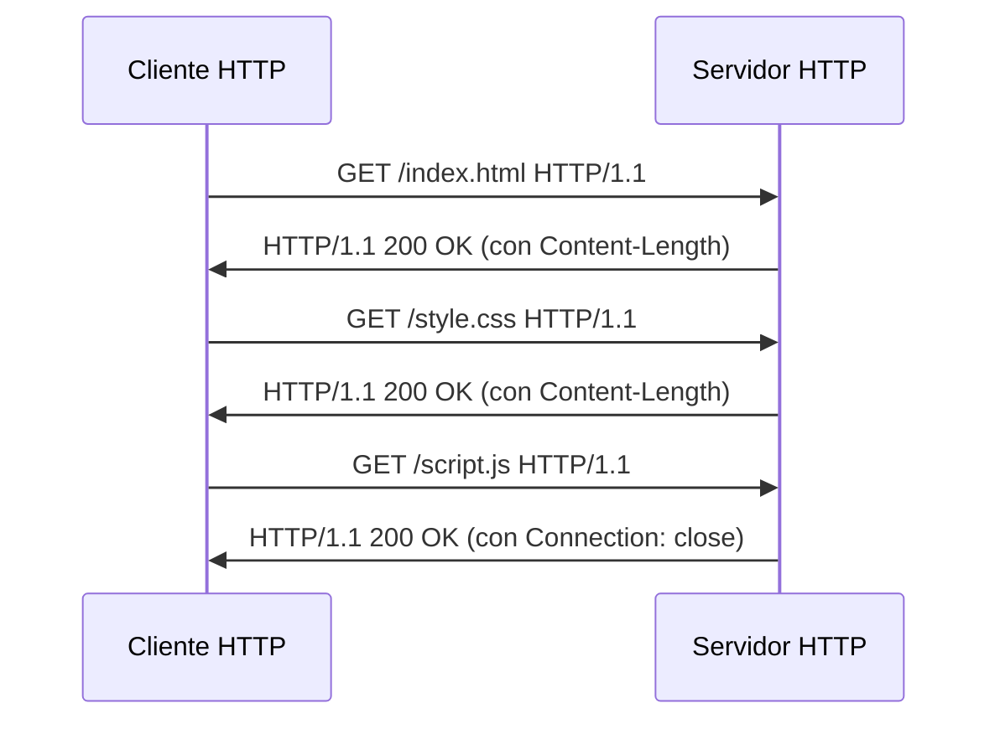
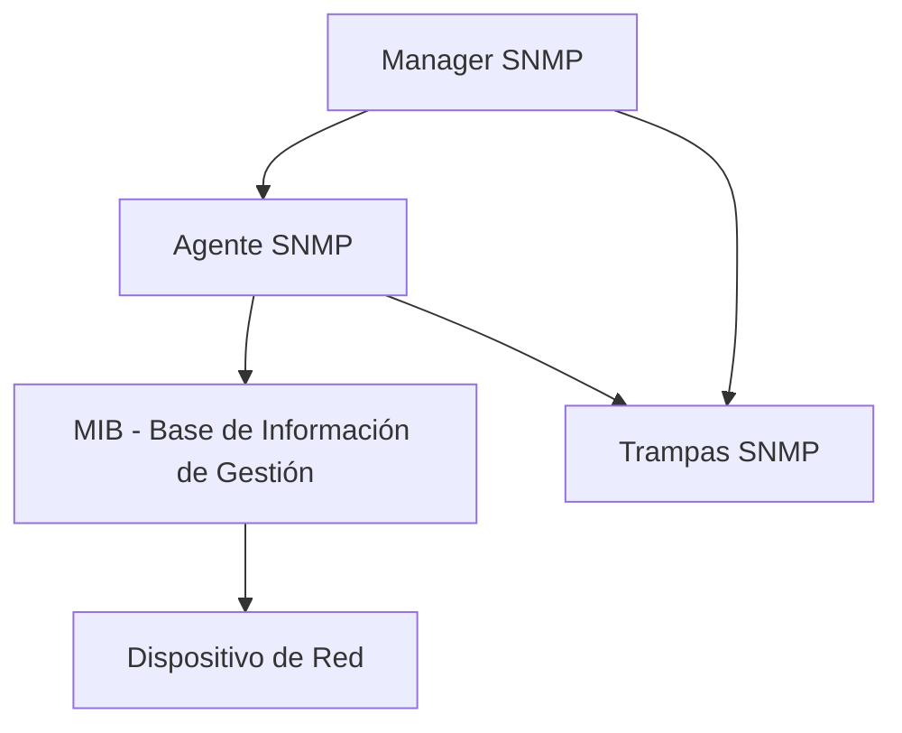

# Redes de Computadoras - Aplicaciones

## 6.3 Protocolos para aplicaciones específicas (DNS, SMTP, HTTP, SNMP).

---

Los protocolos de aplicación definen las reglas y formatos de mensaje para la comunicación entre procesos de aplicación a través de una red. Constituyen la capa más alta del modelo TCP/IP y operan sobre los servicios de transporte.

### DNS (Domain Name System)

#### Definición

DNS es un sistema de nomenclatura jerárquico y distribuido que traduce nombres de dominio legibles por humanos en direcciones IP numéricas.

#### Arquitectura DNS



#### Estructura de Mensajes DNS

**Formato del mensaje DNS:**

```
 0                   1                   2                   3
 0 1 2 3 4 5 6 7 8 9 0 1 2 3 4 5 6 7 8 9 0 1 2 3 4 5 6 7 8 9 0 1
+--+--+--+--+--+--+--+--+--+--+--+--+--+--+--+--+--+--+--+--+--+-------+
|             ID                   |QR| Opcode |AA|TC|RD|RA| Z | RCODE |
+--+--+--+--+--+--+--+--+--+--+--+--+--+--+--+--+--+--+--+--+--+-------+
|            QDCOUNT               |           ANCOUNT                 |
+--+--+--+--+--+--+--+--+--+--+--+--+--+--+--+--+--+--+--+--+--+-------+
|            NSCOUNT               |           ARCOUNT                 |
+--+--+--+--+--+--+--+--+--+--+--+--+--+--+--+--+--+--+--+--+--+-------+
|                             QUESTIONS                                |
+--+--+--+--+--+--+--+--+--+--+--+--+--+--+--+--+--+--+--+--+--+-------+
|                             ANSWERS                                  |
+--+--+--+--+--+--+--+--+--+--+--+--+--+--+--+--+--+--+--+--+--+-------+
|                     AUTHORITY RECORDS                                |
+--+--+--+--+--+--+--+--+--+--+--+--+--+--+--+--+--+--+--+--+--+-------+
|                     ADDITIONAL RECORDS                               |
+--+--+--+--+--+--+--+--+--+--+--+--+--+--+--+--+--+--+--+--+--+-------+
```

#### Tipos de Registros DNS

| Tipo  | Valor | Propósito                |
| ----- | ----- | ------------------------ |
| A     | 1     | Dirección IPv4           |
| AAAA  | 28    | Dirección IPv6           |
| CNAME | 5     | Alias de nombre canónico |
| MX    | 15    | Intercambio de correo    |
| NS    | 2     | Servidor de nombres      |
| PTR   | 12    | Puntero inverso          |
| SOA   | 6     | Inicio de autoridad      |
| TXT   | 16    | Texto arbitrario         |

#### Proceso de Resolución DNS

```python
import socket
import struct

class DNSMessage:
    def __init__(self):
        self.id = 0
        self.flags = 0
        self.questions = []
        self.answers = []

    def build_query(self, domain, record_type):
        # Construir encabezado DNS
        header = struct.pack('!HHHHHH',
                           self.id,
                           self.flags | 0x0100,  # RD flag
                           1,  # QDCOUNT
                           0,  # ANCOUNT
                           0,  # NSCOUNT
                           0)  # ARCOUNT

        # Construir pregunta
        question = self._encode_domain(domain)
        question += struct.pack('!HH', record_type, 1)  # Clase IN

        return header + question

    def _encode_domain(self, domain):
        labels = domain.split('.')
        encoded = b''
        for label in labels:
            encoded += bytes([len(label)]) + label.encode()
        return encoded + b'\x00'

# Ejemplo de uso
dns = DNSMessage()
query = dns.build_query('www.ejemplo.com', 1)  # Tipo A
```

#### Ejemplo de Resolución Iterativa

```
Cliente: ¿Cuál es la IP de www.ejemplo.com?
Resolver Local: No sé, preguntemos al root

Root: Para .com, consulta estos servidores TLD
TLD: Para ejemplo.com, consulta estos servidores autoritativos
Autoritativo: www.ejemplo.com = 192.0.2.1
```

### SMTP (Simple Mail Transfer Protocol)

#### Definición

SMTP es un protocolo para la transferencia de correo electrónico entre servidores. Opera sobre el puerto TCP 25.

#### Modelo de Comandos y Respuestas

**Formato de comandos SMTP:**

```
COMANDO [parámetros]\r\n
```

**Formato de respuestas:**

```
código texto-explicativo\r\n
```

#### Comandos SMTP Principales

| Comando   | Sintaxis            | Propósito                       |
| --------- | ------------------- | ------------------------------- |
| HELO      | HELO <dominio>      | Saludo inicial                  |
| EHLO      | EHLO <dominio>      | Saludo extendido (ESMTP)        |
| MAIL FROM | MAIL FROM:<reverso> | Especificar remitente           |
| RCPT TO   | RCPT TO:<destino>   | Especificar destinatario        |
| DATA      | DATA                | Iniciar transferencia de cuerpo |
| QUIT      | QUIT                | Finalizar sesión                |

#### Sesión SMTP Completa

```python
import socket

def send_email(sender, recipient, subject, body):
    # Conectar al servidor SMTP
    smtp_socket = socket.socket(socket.AF_INET, socket.SOCK_STREAM)
    smtp_socket.connect(('smtp.ejemplo.com', 25))

    # Leer banner de bienvenida
    response = smtp_socket.recv(1024)
    print(f"Servidor: {response.decode()}")

    # Secuencia de comandos SMTP
    commands = [
        f"EHLO cliente.ejemplo.com\r\n",
        f"MAIL FROM:<{sender}>\r\n",
        f"RCPT TO:<{recipient}>\r\n",
        "DATA\r\n",
        f"Subject: {subject}\r\n",
        f"\r\n{body}\r\n.\r\n",
        "QUIT\r\n"
    ]

    for command in commands:
        smtp_socket.send(command.encode())
        response = smtp_socket.recv(1024)
        print(f"Cliente: {command.strip()}")
        print(f"Servidor: {response.decode()}")

    smtp_socket.close()

# Ejemplo de uso
send_email("remitente@ejemplo.com",
          "destinatario@ejemplo.com",
          "Asunto de prueba",
          "Este es el cuerpo del mensaje.")
```

#### Formato de Mensaje de Correo

```
From: remitente@ejemplo.com
To: destinatario@ejemplo.com
Subject: Prueba de SMTP
Date: Mon, 15 Jan 2024 10:00:00 -0500
MIME-Version: 1.0
Content-Type: text/plain; charset="utf-8"

Este es el cuerpo del mensaje.
Puede contener múltiples líneas.
```

#### Códigos de Respuesta SMTP

| Código | Significado               |
| ------ | ------------------------- |
| 220    | Servicio listo            |
| 250    | Comando completado        |
| 354    | Iniciar entrada de correo |
| 421    | Servicio no disponible    |
| 450    | Buzón no disponible       |
| 550    | Comando no ejecutado      |

### HTTP (HyperText Transfer Protocol)

#### Definición

HTTP es un protocolo de aplicación para sistemas de información hipermedia distribuidos y colaborativos. Opera sobre el puerto TCP 80 (HTTP) o 443 (HTTPS).

#### Métodos HTTP

| Método  | Idempotente | Seguro | Descripción                |
| ------- | ----------- | ------ | -------------------------- |
| GET     | Sí          | Sí     | Obtener recurso            |
| POST    | No          | No     | Enviar datos al servidor   |
| PUT     | Sí          | No     | Crear o reemplazar recurso |
| DELETE  | Sí          | No     | Eliminar recurso           |
| HEAD    | Sí          | Sí     | Solo encabezados           |
| OPTIONS | Sí          | Sí     | Opciones de comunicación   |

#### Estructura de Mensajes HTTP

**Formato de petición:**

```
METHOD URI HTTP/VERSION
Header1: valor1
Header2: valor2

cuerpo (opcional)
```

**Formato de respuesta:**

```
HTTP/VERSION STATUS_CODE STATUS_TEXT
Header1: valor1
Header2: valor2

cuerpo (opcional)
```

#### Códigos de Estado HTTP

| Código | Categoría      | Ejemplos                            |
| ------ | -------------- | ----------------------------------- |
| 1xx    | Informativo    | 100 Continue                        |
| 2xx    | Éxito          | 200 OK, 201 Created                 |
| 3xx    | Redirección    | 301 Moved, 304 Not Modified         |
| 4xx    | Error cliente  | 400 Bad Request, 404 Not Found      |
| 5xx    | Error servidor | 500 Internal Error, 503 Unavailable |

#### Implementación de Cliente HTTP

```python
import socket
import ssl

class HTTPClient:
    def __init__(self):
        self.socket = None

    def request(self, method, url, headers=None, body=None):
        # Parsear URL
        protocol, host, port, path = self._parse_url(url)

        # Conectar al servidor
        self._connect(host, port, protocol == 'https')

        # Construir petición
        request = self._build_request(method, path, host, headers, body)

        # Enviar petición
        self.socket.send(request.encode())

        # Recibir respuesta
        response = self._receive_response()

        self.socket.close()
        return response

    def _parse_url(self, url):
        if url.startswith('https://'):
            protocol = 'https'
            url = url[8:]
            default_port = 443
        else:
            protocol = 'http'
            url = url[7:]
            default_port = 80

        parts = url.split('/', 1)
        host_port = parts[0].split(':')
        host = host_port[0]
        port = int(host_port[1]) if len(host_port) > 1 else default_port
        path = '/' + parts[1] if len(parts) > 1 else '/'

        return protocol, host, port, path

    def _connect(self, host, port, use_ssl):
        self.socket = socket.socket(socket.AF_INET, socket.SOCK_STREAM)
        self.socket.connect((host, port))

        if use_ssl:
            context = ssl.create_default_context()
            self.socket = context.wrap_socket(self.socket, server_hostname=host)

    def _build_request(self, method, path, host, headers, body):
        request_lines = [
            f"{method} {path} HTTP/1.1",
            f"Host: {host}",
            "Connection: close"
        ]

        if headers:
            for key, value in headers.items():
                request_lines.append(f"{key}: {value}")

        if body:
            request_lines.append(f"Content-Length: {len(body)}")
            request_lines.append("")
            request_lines.append(body)
        else:
            request_lines.append("")
            request_lines.append("")

        return "\r\n".join(request_lines)

    def _receive_response(self):
        response = b""
        while True:
            data = self.socket.recv(4096)
            if not data:
                break
            response += data
        return response.decode()

# Ejemplo de uso
client = HTTPClient()
response = client.request("GET", "http://www.ejemplo.com/index.html")
print(response)
```

#### Sesión HTTP/1.1 con Conexión Persistente



### SNMP (Simple Network Management Protocol)

#### Definición

SNMP es un protocolo para la gestión y monitorización de dispositivos de red. Opera sobre UDP puerto 161.

#### Arquitectura SNMP



#### Componentes SNMP

1. **Manager**: Sistema que monitorea y controla agentes
2. **Agente**: Software que ejecuta en dispositivos gestionados
3. **MIB**: Base de información que define objetos gestionados
4. **SMI**: Esquema para definir objetos MIB

#### Operaciones SNMP

| Operación | Descripción                           |
| --------- | ------------------------------------- |
| GET       | Obtener valor de objeto               |
| GETNEXT   | Obtener siguiente objeto en secuencia |
| SET       | Modificar valor de objeto             |
| TRAP      | Notificación asíncrona del agente     |
| GETBULK   | Múltiples operaciones GETNEXT         |

#### Estructura de Mensajes SNMP

**Formato PDU SNMPv2:**

```
SNMP Message
├── Version
├── Community String
└── PDU (Protocol Data Unit)
    ├── PDU Type
    ├── Request ID
    ├── Error Status
    ├── Error Index
    └── Variable Bindings
        ├── OID1 + Value1
        ├── OID2 + Value2
        └── ...
```

#### Implementación de Manager SNMP

```python
import socket
import struct
from pyasn1.type import univ, namedtype
from pyasn1.codec.ber import encoder, decoder

class SNMPManager:
    def __init__(self, community='public'):
        self.community = community
        self.request_id = 1

    def get_request(self, oid, agent_ip):
        # Construir mensaje SNMP
        message = self._build_snmp_message('get', [oid])

        # Enviar via UDP
        sock = socket.socket(socket.AF_INET, socket.SOCK_DGRAM)
        sock.sendto(message, (agent_ip, 161))

        # Recibir respuesta
        response, addr = sock.recvfrom(4096)
        sock.close()

        return self._parse_snmp_response(response)

    def _build_snmp_message(self, pdu_type, oids):
        # Versión SNMPv2c
        version = univ.Integer(1)
        community = univ.OctetString(self.community)

        # Variable bindings
        var_binds = univ.Sequence()
        for oid in oids:
            var_bind = univ.Sequence().setComponents(
                univ.ObjectIdentifier(oid),
                univ.Null()
            )
            var_binds = var_binds + var_bind

        # PDU
        if pdu_type == 'get':
            pdu = univ.Sequence().setComponents(
                univ.Integer(self.request_id),
                univ.Integer(0),  # error status
                univ.Integer(0),  # error index
                var_binds
            )

        self.request_id += 1
        return encoder.encode(univ.Sequence().setComponents(
            version, community, pdu
        ))

    def _parse_snmp_response(self, response):
        decoded, _ = decoder.decode(response)
        return decoded

# Ejemplo de uso
snmp = SNMPManager()
result = snmp.get_request('1.3.6.1.2.1.1.1.0', '192.168.1.1')
print(result)
```

#### Ejemplos de OIDs SNMP Comunes

| OID                    | Descripción                             |
| ---------------------- | --------------------------------------- |
| 1.3.6.1.2.1.1.1.0      | sysDescr - Descripción del sistema      |
| 1.3.6.1.2.1.1.3.0      | sysUpTime - Tiempo activo               |
| 1.3.6.1.2.1.2.2.1.10.1 | ifInOctets.1 - Bytes entrada interfaz 1 |
| 1.3.6.1.2.1.25.1.1.0   | hrSystemUptime - Uptime del host        |

### Ejercicios Propuestos

#### Ejercicio 1: Análisis de Mensaje DNS

Dado el siguiente mensaje DNS en hexadecimal:

```
ID: 0x1234
Flags: 0x0100 (query, RD set)
QDCOUNT: 1
QNAME: www.google.com
QTYPE: A (1)
QCLASS: IN (1)
```

**Calcular:**

1. La codificación completa del mensaje
2. La longitud total del mensaje
3. La estructura del campo QNAME

#### Ejercicio 2: Sesión SMTP Completa

Diseñar una sesión SMTP completa para:

- Remitente: alice@dominio.com
- Destinatario: bob@otrodominio.com
- Asunto: "Reunión importante"
- Cuerpo: "La reunión es mañana a las 10:00"

**Incluir:**

1. Todos los comandos SMTP necesarios
2. Las respuestas esperadas del servidor
3. El formato completo del mensaje de correo

#### Ejercicio 3: Cliente HTTP Simple

Implementar un cliente HTTP que:

1. Realice una petición GET a un servidor web
2. Parseé la respuesta y extraiga:
   - Código de estado
   - Encabezados
   - Cuerpo de la respuesta
3. Maneje redirecciones 301/302

#### Ejercicio 4: Monitor SNMP

Crear un monitor SNMP que:

1. Consulte periódicamente sysUpTime de un router
2. Detecte cambios en el estado de interfaces de red
3. Genere alertas cuando el tráfico exceda umbrales

### Comparativa de Protocolos

#### Tabla Comparativa

| Protocolo | Puerto | Transporte | Estado     | Seguridad |
| --------- | ------ | ---------- | ---------- | --------- |
| DNS       | 53     | UDP/TCP    | Sin estado | DNSSEC    |
| SMTP      | 25     | TCP        | Con estado | STARTTLS  |
| HTTP      | 80     | TCP        | Sin estado | HTTPS     |
| SNMP      | 161    | UDP        | Sin estado | SNMPv3    |

#### Overhead y Eficiencia

**Tamaño típico de mensajes:**

- DNS query: 50-100 bytes
- SMTP command: 20-100 bytes + cuerpo mensaje
- HTTP request: 200-500 bytes + cuerpo
- SNMP GET: 60-120 bytes

### Consideraciones de Implementación

#### Mejores Prácticas

1. **DNS**: Implementar caching y usar TCP para respuestas largas
2. **SMTP**: Validar entradas y usar STARTTLS para cifrado
3. **HTTP**: Usar conexiones persistentes y compresión
4. **SNMP**: Usar SNMPv3 para autenticación y cifrado

#### Consideraciones de Seguridad

- **DNS spoofing**: Usar DNSSEC
- **SMTP injection**: Validar y sanitizar entradas
- **HTTP hijacking**: Usar HTTPS siempre que sea posible
- **SNMP community strings**: Cambiar valores por defecto

### Referencias Bibliográficas

#### Bibliografía Básica

1. **Kurose & Ross** (2010):
   - Capítulo 2 - Application Layer (DNS, HTTP, SMTP)
   - Capítulo 9 - Network Management (SNMP)

2. **Tanenbaum & Wetherall** (2010):
   - Capítulo 7 - The Application Layer
   - Sección 7.3 - DNS
   - Sección 7.4 - Electronic Mail

3. **Stallings** (2010):
   - Capítulo 2 - Protocol Architecture
   - Capítulo 25 - Internet Applications

4. **Peterson & Davie** (2011):
   - Capítulo 9 - Applications

#### RFCs Específicos

- **RFC 1034/1035**: DNS Specification
- **RFC 5321**: SMTP
- **RFC 7230-7235**: HTTP/1.1
- **RFC 3411-3418**: SNMP Framework

#### Bibliografía Complementaria

1. **Albitz & Liu** - DNS and BIND
2. **RFC 2616** - HTTP/1.1 (obsoleto pero histórico)
3. **RFC 821/822** - SMTP original
