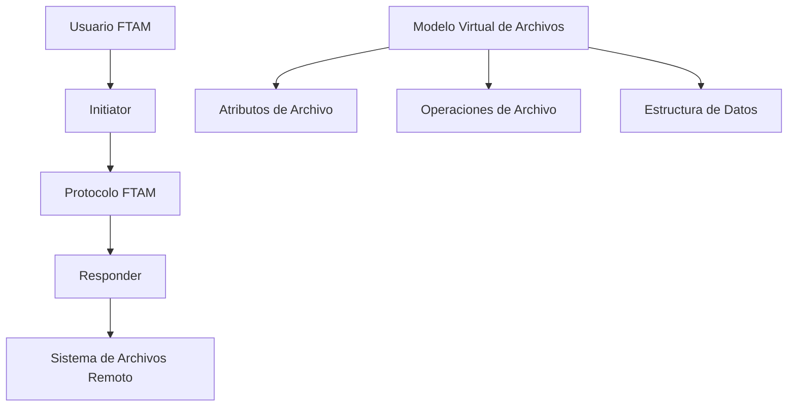
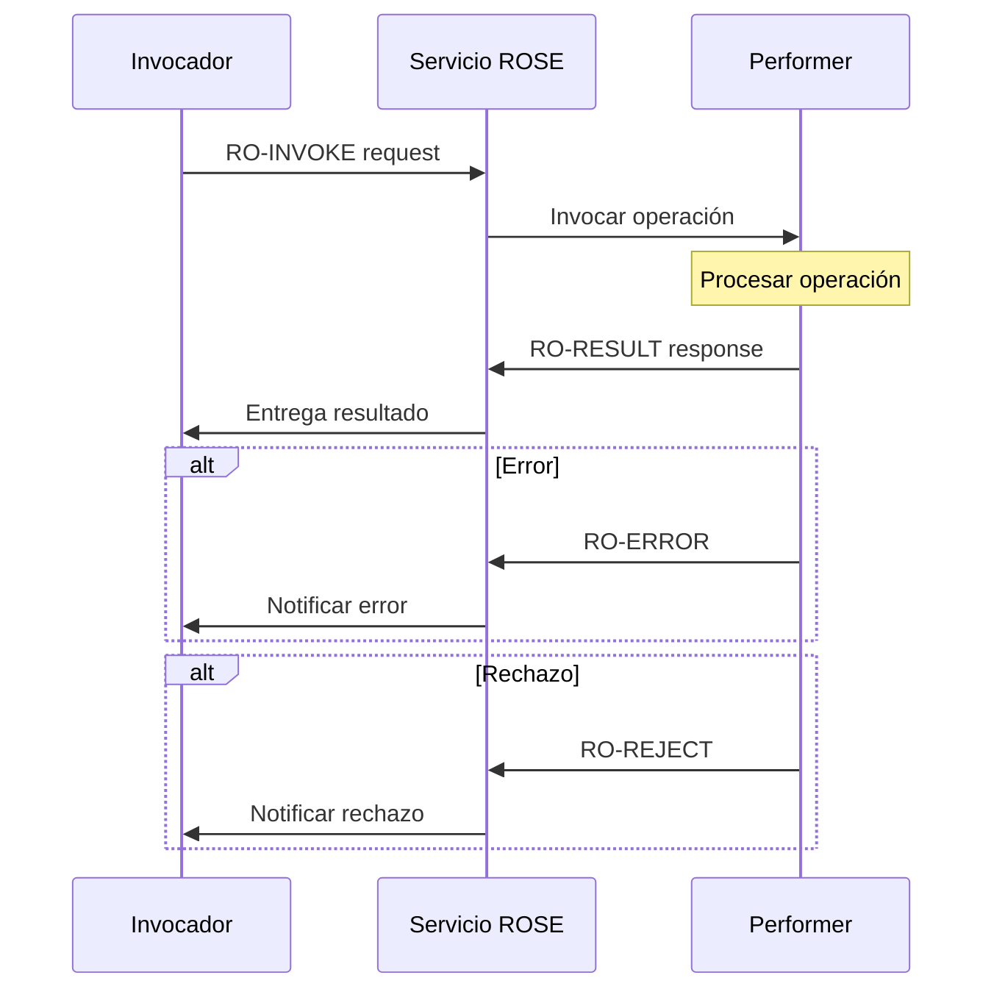
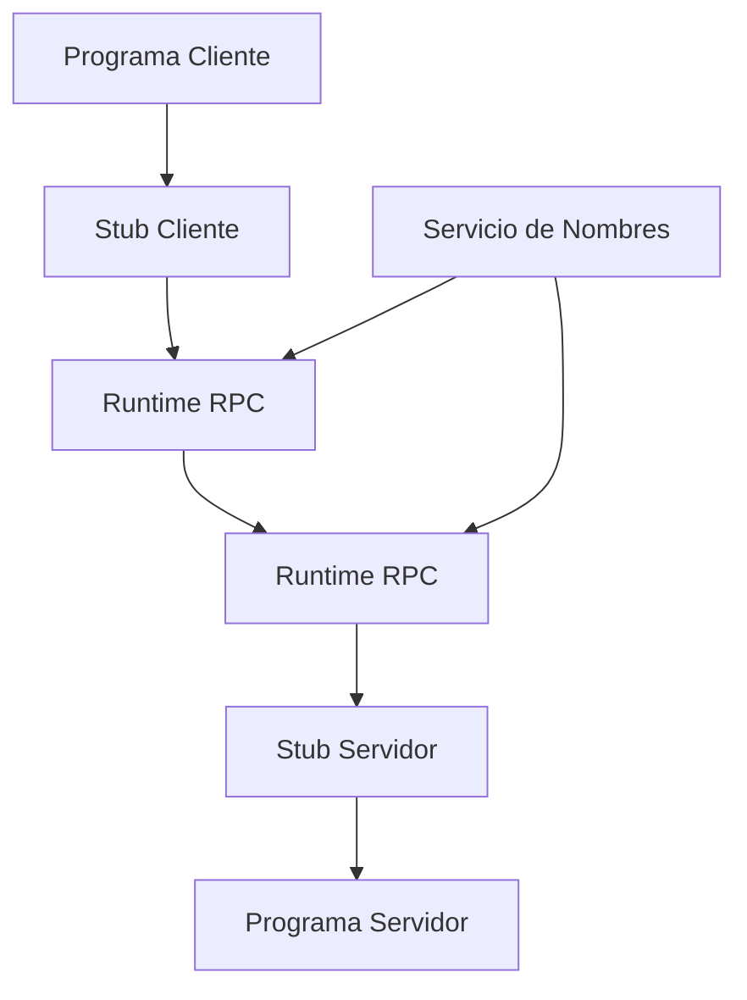
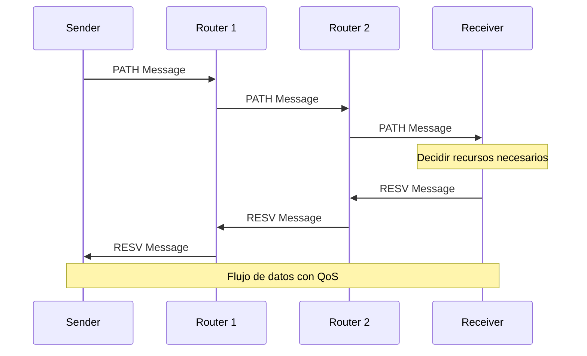

# Redes de Computadoras - Aplicaciones

## 6.4 Protocolos para aplicaciones generales (FTAM, ROSE, RPC, RSVP).

---

Los protocolos para aplicaciones generales proporcionan servicios fundamentales que pueden ser utilizados por múltiples aplicaciones distribuidas. Estos protocolos abstractos forman la base sobre la cual se construyen aplicaciones específicas.

### FTAM (File Transfer, Access and Management)

#### Definición

FTAM es un protocolo estándar ISO (ISO 8571) para la transferencia, acceso y gestión de archivos en sistemas distribuidos. Proporciona un modelo abstracto de sistema de archivos independiente del sistema operativo.

#### Modelo de Arquitectura FTAM



#### Componentes del Modelo FTAM

**Modelo Virtual de Archivos (VFS):**

- **Atributos de archivo**: Nombre, tamaño, fechas, permisos
- **Estructura de datos**: Secuencia, registros, árboles
- **Conjuntos de atributos**: Grupos de atributos relacionados

#### Fases de una Operación FTAM

1. **Establecimiento de asociación**
2. **Selección de archivo**
3. **Operación de transferencia/acceso**
4. **Desestablecimiento de asociación**

#### Operaciones FTAM Principales

| Operación    | Descripción               |
| ------------ | ------------------------- |
| F-INITIALIZE | Inicializar entorno FTAM  |
| F-SELECT     | Seleccionar archivo       |
| F-READ       | Leer datos del archivo    |
| F-WRITE      | Escribir datos al archivo |
| F-CREATE     | Crear nuevo archivo       |
| F-DELETE     | Eliminar archivo          |
| F-OPEN       | Abrir archivo             |
| F-CLOSE      | Cerrar archivo            |

#### Implementación FTAM

```python
class FTAMProtocol:
    def __init__(self):
        self.association_id = None
        self.file_context = None

    def establish_association(self, remote_system, authentication):
        """Establecer asociación FTAM"""
        # Negociación de parámetros
        negotiation_params = {
            'protocol_version': 'ISO8571-1',
            'functional_units': ['read', 'write', 'management'],
            'file_service_class': 'transfer'
        }

        # Autenticación
        if not self.authenticate(authentication):
            raise FTAMError("Authentication failed")

        self.association_id = self.generate_association_id()
        return self.association_id

    def select_file(self, filename, access_mode):
        """Seleccionar archivo para operaciones"""
        file_attributes = self.get_file_attributes(filename)

        if not file_attributes:
            raise FTAMError("File not found")

        if access_mode == 'read' and not file_attributes.readable:
            raise FTAMError("File not readable")

        self.file_context = {
            'filename': filename,
            'access_mode': access_mode,
            'current_offset': 0,
            'file_size': file_attributes.size
        }

        return file_attributes

    def read_file(self, offset, length):
        """Leer datos del archivo seleccionado"""
        if not self.file_context:
            raise FTAMError("No file selected")

        if offset >= self.file_context['file_size']:
            return b''  # Fin de archivo

        # Calcular lectura real
        actual_length = min(length,
                          self.file_context['file_size'] - offset)

        # Realizar lectura
        data = self.perform_read(offset, actual_length)
        self.file_context['current_offset'] = offset + actual_length

        return data

    def write_file(self, offset, data):
        """Escribir datos al archivo"""
        if not self.file_context:
            raise FTAMError("No file selected")

        if self.file_context['access_mode'] != 'write':
            raise FTAMError("File not open for writing")

        self.perform_write(offset, data)

        # Actualizar contexto
        new_size = max(self.file_context['file_size'], offset + len(data))
        self.file_context['file_size'] = new_size
        self.file_context['current_offset'] = offset + len(data)

# Ejemplo de uso
ftam = FTAMProtocol()
association = ftam.establish_association("server.example.com",
                                       {"username": "user", "password": "pass"})
file_attrs = ftam.select_file("/documents/report.txt", "read")
data = ftam.read_file(0, 1024)  # Leer primeros 1024 bytes
```

#### Atributos de Archivo FTAM

**Conjunto básico de atributos:**

```python
class FTAMFileAttributes:
    def __init__(self):
        self.filename = ""           # Nombre del archivo
        self.size = 0               # Tamaño en bytes
        self.created = None         # Fecha de creación
        self.modified = None        # Fecha de modificación
        self.owner = ""             # Propietario
        self.permissions = 0o644    # Permisos UNIX-style
        self.file_type = "flat"     # Tipo de estructura
        self.account = ""           # Cuenta asociada
```

### ROSE (Remote Operations Service Element)

#### Definición

ROSE es un protocolo de servicio de aplicaciones (ISO 9072) que proporciona un marco para operaciones remotas síncronas y asíncronas entre entidades de aplicación.

#### Modelo ROSE



#### Operaciones ROSE

**Primitivas de servicio:**

- **RO-INVOKE**: Invocar operación remota
- **RO-RESULT**: Retornar resultado exitoso
- **RO-ERROR**: Retornar error de operación
- **RO-REJECT**: Rechazar operación

#### Parámetros de Invocación

**Estructura RO-INVOKE:**

```
invoke-id: Identificador único de invocación
operation-value: Código de operación
argument: Parámetros de entrada
linked-id: ID de operación relacionada (opcional)
```

#### Implementación ROSE

```python
class ROSEProtocol:
    def __init__(self):
        self.invoke_id_counter = 0
        self.pending_operations = {}
        self.operation_handlers = {}

    def register_operation(self, operation_code, handler):
        """Registrar manejador para operación"""
        self.operation_handlers[operation_code] = handler

    def invoke_operation(self, remote_entity, operation_code, arguments,
                        linked_id=None, timeout=30):
        """Invocar operación remota"""
        invoke_id = self.generate_invoke_id()

        # Construir mensaje RO-INVOKE
        invoke_pdu = {
            'invoke_id': invoke_id,
            'operation_code': operation_code,
            'arguments': arguments,
            'linked_id': linked_id
        }

        # Enviar a entidad remota
        self.send_pdu(remote_entity, 'RO-INVOKE', invoke_pdu)

        # Registrar operación pendiente
        self.pending_operations[invoke_id] = {
            'operation_code': operation_code,
            'arguments': arguments,
            'start_time': time.time(),
            'timeout': timeout,
            'status': 'pending'
        }

        return invoke_id

    def handle_invoke(self, remote_entity, invoke_pdu):
        """Manejar invocación entrante"""
        invoke_id = invoke_pdu['invoke_id']
        operation_code = invoke_pdu['operation_code']
        arguments = invoke_pdu['arguments']

        # Verificar si existe manejador
        if operation_code not in self.operation_handlers:
            # Enviar RO-REJECT
            reject_pdu = {
                'invoke_id': invoke_id,
                'problem': 'unrecognized-operation'
            }
            self.send_pdu(remote_entity, 'RO-REJECT', reject_pdu)
            return

        try:
            # Ejecutar operación
            handler = self.operation_handlers[operation_code]
            result = handler(arguments)

            # Enviar RO-RESULT
            result_pdu = {
                'invoke_id': invoke_id,
                'result': result
            }
            self.send_pdu(remote_entity, 'RO-RESULT', result_pdu)

        except Exception as e:
            # Enviar RO-ERROR
            error_pdu = {
                'invoke_id': invoke_id,
                'error_code': 'operation-failed',
                'error_parameters': str(e)
            }
            self.send_pdu(remote_entity, 'RO-ERROR', error_pdu)

    def handle_result(self, result_pdu):
        """Manejar resultado de operación"""
        invoke_id = result_pdu['invoke_id']
        result = result_pdu['result']

        if invoke_id in self.pending_operations:
            operation = self.pending_operations[invoke_id]
            operation['status'] = 'completed'
            operation['result'] = result
            del self.pending_operations[invoke_id]

            # Notificar a aplicación
            self.notify_application(invoke_id, result)

# Ejemplo de uso
rose = ROSEProtocol()

# Registrar operación de cálculo
def calculate_sum_handler(arguments):
    numbers = arguments.get('numbers', [])
    return {'sum': sum(numbers)}

rose.register_operation('calculate-sum', calculate_sum_handler)

# Invocar operación remota
invoke_id = rose.invoke_operation(
    remote_entity="server.example.com",
    operation_code="calculate-sum",
    arguments={'numbers': [1, 2, 3, 4, 5]}
)
```

### RPC (Remote Procedure Call)

#### Definición

RPC es un mecanismo que permite a un programa ejecutar procedimientos en espacios de direcciones remotos, proporcionando la abstracción de llamada a procedimiento local.

#### Arquitectura RPC



#### Proceso de Llamada Remota

1. **Cliente llama a stub local**
2. **Stub empaqueta parámetros (marshalling)**
3. **Runtime envía mensaje al servidor**
4. **Stub servidor desempaqueta parámetros (unmarshalling)**
5. **Servidor ejecuta procedimiento**
6. **Respuesta sigue ruta inversa**

#### Modelo Matemático de RPC

**Tiempo total de llamada RPC:**
$$ T_{RPC} = T_{marshalling} + T_{transporte} + T_{unmarshalling} + T_\text{ejecución} $$

**Overhead de comunicación:**
$$ O_{RPC} = T_{marshalling} + T_{transporte} + T_{unmarshalling} $$

#### Implementación RPC Básica

```python
import pickle
import socket
import threading

class RPCServer:
    def __init__(self, host='localhost', port=8000):
        self.host = host
        self.port = port
        self.functions = {}
        self.socket = socket.socket(socket.AF_INET, socket.SOCK_STREAM)

    def register_function(self, name, function):
        """Registrar función para llamada remota"""
        self.functions[name] = function

    def start(self):
        """Iniciar servidor RPC"""
        self.socket.bind((self.host, self.port))
        self.socket.listen(5)
        print(f"RPC Server listening on {self.host}:{self.port}")

        while True:
            client_socket, addr = self.socket.accept()
            thread = threading.Thread(target=self.handle_client,
                                    args=(client_socket,))
            thread.start()

    def handle_client(self, client_socket):
        """Manejar cliente RPC"""
        try:
            # Recibir datos
            data = client_socket.recv(4096)
            if not data:
                return

            # Deserializar llamada
            call = pickle.loads(data)
            function_name = call['function']
            args = call['args']
            kwargs = call['kwargs']

            # Ejecutar función
            if function_name in self.functions:
                result = self.functions[function_name](*args, **kwargs)
                response = {'success': True, 'result': result}
            else:
                response = {'success': False, 'error': 'Function not found'}

            # Enviar respuesta
            response_data = pickle.dumps(response)
            client_socket.send(response_data)

        except Exception as e:
            error_response = {'success': False, 'error': str(e)}
            client_socket.send(pickle.dumps(error_response))
        finally:
            client_socket.close()

class RPCClient:
    def __init__(self, server_host='localhost', server_port=8000):
        self.server_host = server_host
        self.server_port = server_port

    def __getattr__(self, name):
        """Interceptar llamadas a métodos no definidos"""
        def remote_method(*args, **kwargs):
            return self.call_remote(name, args, kwargs)
        return remote_method

    def call_remote(self, function_name, args, kwargs):
        """Llamar función remota"""
        # Crear llamada
        call = {
            'function': function_name,
            'args': args,
            'kwargs': kwargs
        }

        # Serializar
        call_data = pickle.dumps(call)

        # Conectar y enviar
        sock = socket.socket(socket.AF_INET, socket.SOCK_STREAM)
        sock.connect((self.server_host, self.server_port))
        sock.send(call_data)

        # Recibir respuesta
        response_data = sock.recv(4096)
        sock.close()

        # Deserializar respuesta
        response = pickle.loads(response_data)

        if response['success']:
            return response['result']
        else:
            raise RemoteError(response['error'])

class RemoteError(Exception):
    pass

# Ejemplo de uso
if __name__ == "__main__":
    # Servidor
    server = RPCServer()

    def multiply(x, y):
        return x * y

    def get_server_info():
        return {"name": "Test Server", "version": "1.0"}

    server.register_function("multiply", multiply)
    server.register_function("get_server_info", get_server_info)

    # Iniciar servidor en hilo separado
    server_thread = threading.Thread(target=server.start)
    server_thread.daemon = True
    server_thread.start()

    # Cliente
    client = RPCClient()

    # Llamadas remotas
    result = client.multiply(5, 3)  # 15
    info = client.get_server_info()  # {"name": "Test Server", ...}
```

#### Marshalling y Unmarshalling

**Proceso de serialización:**

```python
def marshal_parameters(params):
    """Convertir parámetros a formato de red"""
    marshalled = {}
    for key, value in params.items():
        if isinstance(value, (int, float, str, bool)):
            marshalled[key] = {'type': type(value).__name__, 'value': value}
        elif isinstance(value, (list, tuple)):
            marshalled[key] = {'type': 'array', 'value': list(value)}
        elif isinstance(value, dict):
            marshalled[key] = {'type': 'object', 'value': value}
        else:
            # Serialización compleja
            marshalled[key] = {'type': 'binary', 'value': pickle.dumps(value)}
    return marshalled

def unmarshal_parameters(marshalled_params):
    """Reconstruir parámetros desde formato de red"""
    params = {}
    for key, data in marshalled_params.items():
        if data['type'] in ['int', 'float', 'str', 'bool']:
            params[key] = data['value']
        elif data['type'] == 'array':
            params[key] = data['value']
        elif data['type'] == 'object':
            params[key] = data['value']
        elif data['type'] == 'binary':
            params[key] = pickle.loads(data['value'])
    return params
```

### RSVP (Resource Reservation Protocol)

#### Definición

RSVP es un protocolo de señalización de red (RFC 2205) que permite a las aplicaciones reservar recursos en la red para flujos de datos específicos, proporcionando Calidad de Servicio (QoS).

#### Modelo RSVP



#### Mensajes RSVP Principales

| Mensaje  | Dirección         | Propósito                         |
| -------- | ----------------- | --------------------------------- |
| PATH     | Sender → Receiver | Establecer ruta y características |
| RESV     | Receiver → Sender | Reservar recursos                 |
| PATHERR  | Receiver → Sender | Error en mensaje PATH             |
| RESVERR  | Sender → Receiver | Error en mensaje RESV             |
| TEARDOWN | Ambos             | Liberar reservas                  |

#### Objetos RSVP

**Estructura de objetos:**

```
 0                   1                   2                   3
 0 1 2 3 4 5 6 7 8 9 0 1 2 3 4 5 6 7 8 9 0 1 2 3 4 5 6 7 8 9 0 1
+--+--+--+--+--+--+--+--+--+--+--+--+--+--+--+--+--+--+--+--+--+--+
|        Length (bytes)       |  Class-Num  |   C-Type    |
+--+--+--+--+--+--+--+--+--+--+--+--+--+--+--+--+--+--+--+--+--+--+
|                       Object Contents                           |
+--+--+--+--+--+--+--+--+--+--+--+--+--+--+--+--+--+--+--+--+--+--+
```

#### Tipos de Servicio RSVP

1. **Controlado por carga (Load-controlled)**
2. **Garantizado (Guaranteed)**
3. **Servicio de mejor esfuerzo (Best-effort)**

#### Implementación RSVP Simplificada

```python
class RSVPProtocol:
    def __init__(self):
        self.sessions = {}
        self.reservations = {}
        self.router_interfaces = {}

    def send_path_message(self, session_spec, sender_tspec, adspec, route):
        """Enviar mensaje PATH"""
        path_message = {
            'type': 'PATH',
            'session': session_spec,
            'sender_template': sender_tspec,
            'sender_tspec': sender_tspec,
            'adspec': adspec,
            'previous_hop': self.get_local_address()
        }

        # Almacener estado PATH
        path_state = {
            'sender_tspec': sender_tspec,
            'adspec': adspec,
            'incoming_interface': self.get_local_address(),
            'outgoing_interfaces': []
        }

        self.sessions[session_spec] = path_state

        # Enviar a siguiente hop
        for next_hop in route:
            self.forward_message(next_hop, path_message)

    def handle_path_message(self, message, incoming_interface):
        """Manejar mensaje PATH entrante"""
        session = message['session']

        # Actualizar estado PATH
        if session not in self.sessions:
            self.sessions[session] = {}

        self.sessions[session].update({
            'sender_tspec': message['sender_tspec'],
            'adspec': message['adspec'],
            'incoming_interface': incoming_interface,
            'previous_hop': message['previous_hop']
        })

        # Actualizar ADSPEC (características de la ruta)
        updated_adspec = self.update_adspec(message['adspec'])

        # Reenviar PATH si no somos el receptor final
        if not self.is_final_receiver(session):
            self.forward_path_message(session, updated_adspec)

    def send_resv_message(self, session_spec, style, flow_spec, filter_spec):
        """Enviar mensaje RESV"""
        resv_message = {
            'type': 'RESV',
            'session': session_spec,
            'style': style,
            'flow_spec': flow_spec,
            'filter_spec': filter_spec
        }

        # Realizar reserva local
        if self.make_reservation(session_spec, flow_spec):
            # Enviar RESV hacia el emisor
            previous_hop = self.sessions[session_spec]['previous_hop']
            self.forward_message(previous_hop, resv_message)
        else:
            # Enviar RESVERR
            self.send_resv_error(session_spec, "Insufficient resources")

    def handle_resv_message(self, message, incoming_interface):
        """Manejar mensaje RESV entrante"""
        session = message['session']
        flow_spec = message['flow_spec']

        # Verificar recursos disponibles
        if self.check_resources(flow_spec):
            # Realizar reserva
            reservation_id = self.create_reservation(
                session, flow_spec, message['filter_spec']
            )

            self.reservations[reservation_id] = {
                'session': session,
                'flow_spec': flow_spec,
                'filter_spec': message['filter_spec'],
                'incoming_interface': incoming_interface
            }

            # Reenviar RESV hacia el emisor
            if session in self.sessions:
                previous_hop = self.sessions[session]['previous_hop']
                self.forward_message(previous_hop, message)
        else:
            # Enviar RESVERR
            self.send_resv_error(session, "Resource allocation failed")

    def make_reservation(self, session, flow_spec):
        """Realizar reserva de recursos locales"""
        required_bandwidth = flow_spec.get('bandwidth', 0)
        required_latency = flow_spec.get('max_latency', float('inf'))

        # Verificar disponibilidad
        available_bandwidth = self.get_available_bandwidth()
        current_latency = self.get_current_latency()

        if (available_bandwidth >= required_bandwidth and
            current_latency <= required_latency):

            # Asignar recursos
            self.allocate_bandwidth(required_bandwidth)
            self.configure_qos(flow_spec)
            return True

        return False

# Ejemplo de uso para aplicación de video
def setup_video_stream(rsvp, source, destination, bandwidth_mbps, max_latency_ms):
    # Especificación de sesión
    session_spec = {
        'destination_address': destination,
        'protocol_id': 17,  # UDP
        'destination_port': 5000
    }

    # Especificación de tráfico del emisor
    sender_tspec = {
        'bandwidth': bandwidth_mbps * 1000000,  # bps
        'peak_rate': bandwidth_mbps * 1000000,
        'burst_size': 1500 * 10,  # 10 paquetes
        'min_packet_size': 100,
        'max_packet_size': 1500
    }

    # ADSPEC inicial
    adspec = {
        'available_bandwidth': bandwidth_mbps * 1000000,
        'min_latency': 0,
        'cumulative_latency': 0
    }

    # Enviar PATH
    rsvp.send_path_message(session_spec, sender_tspec, adspec,
                          get_route(source, destination))

    # En el receptor, enviar RESV
    flow_spec = {
        'bandwidth': bandwidth_mbps * 1000000,
        'max_latency': max_latency_ms,
        'service_type': 'controlled_load'
    }

    filter_spec = {
        'sender_address': source,
        'sender_port': 5000
    }

    rsvp.send_resv_message(session_spec, 'fixed-filter', flow_spec, filter_spec)
```

#### Cálculos de Recursos RSVP

**Ancho de banda requerido:**
$$ BW_{req} = R_{peak} \times (1 + \alpha) $$
donde $\alpha$ es el factor de overhead (típicamente 0.1-0.2).

**Buffer necesario:**
$$ Buffer_{size} = R_{peak} \times T_{burst} $$
donde $T_{burst}$ es la duración máxima de ráfaga.

### Ejercicios Propuestos

#### Ejercicio 1: Implementación FTAM

Implementar un cliente FTAM simplificado que:

1. Establezca asociación con servidor
2. Liste archivos en directorio remoto
3. Descargue archivo seleccionado
4. Muestre progreso de transferencia

**Parámetros:**

- Tamaño de bloque: 4096 bytes
- Timeout: 30 segundos
- Reintentos: 3

#### Ejercicio 2: Sistema ROSE Distribuido

Diseñar un sistema distribuido usando ROSE para:

- Servicio de autenticación centralizado
- Sistema de mensajería entre nodos
- Monitorización de estado de servicios

**Incluir:**

1. Definición de operaciones
2. Manejo de errores
3. Mecanismos de timeout y reintento

#### Ejercicio 3: RPC con Múltiples Transportes

Extender la implementación RPC para soportar:

1. Comunicación via TCP y UDP
2. Compresión de datos
3. Cifrado de llamadas
4. Balanceo de carga entre servidores

#### Ejercicio 4: RSVP para Aplicación de Voz sobre IP

Configurar reservas RSVP para aplicación VoIP que:

- Requiere 64 kbps por canal
- Latencia máxima de 150 ms
- Pérdida de paquetes < 1%

**Calcular:**

1. Recursos necesarios en cada hop
2. ADSPEC acumulado
3. Políticas de admisión

### Comparativa de Protocolos

#### Tabla Comparativa

| Protocolo | Capa OSI     | Orientación    | Estado     | Aplicaciones Típicas   |
| --------- | ------------ | -------------- | ---------- | ---------------------- |
| FTAM      | Aplicación   | Archivos       | Con estado | Transferencia archivos |
| ROSE      | Aplicación   | Operaciones    | Sin estado | Servicios distribuidos |
| RPC       | Presentación | Procedimientos | Sin estado | Cliente-servidor       |
| RSVP      | Sesión       | Recursos       | Con estado | QoS, multimedia        |

#### Overhead y Complejidad

**Comparación de overhead:**

- FTAM: Alto (gestión de archivos compleja)
- ROSE: Medio (operaciones remotas)
- RPC: Bajo-Medio (llamadas a procedimiento)
- RSVP: Medio (reserva de recursos)

### Consideraciones de Implementación

#### Mejores Prácticas

1. **FTAM**: Usar tamaños de bloque óptimos para la red
2. **ROSE**: Implementar timeout y mecanismos de recuperación
3. **RPC**: Validar parámetros y manejar excepciones
4. **RSVP**: Monitorear utilización de recursos

#### Consideraciones de Seguridad

- **Autenticación**: Verificar identidades en operaciones remotas
- **Autorización**: Controlar acceso a recursos y operaciones
- **Confidencialidad**: Cifrar datos sensibles en tránsito
- **Integridad**: Verificar que los datos no sean modificados

### Referencias Bibliográficas

#### Bibliografía Básica

1. **Tanenbaum & Wetherall** (2010):
   - Capítulo 1 - Introduction (protocolos generales)
   - Capítulo 8 - Network Security (aspectos de seguridad)

2. **Stallings** (2010):
   - Capítulo 12 - Network Security
   - Apéndice A - Protocols and Standards

3. **Peterson & Davie** (2011):
   - Capítulo 9 - Applications

#### RFCs y Estándares

- **ISO 8571**: FTAM Specification
- **ISO 9072**: ROSE Specification
- **RFC 1831**: RPC Protocol Specification
- **RFC 2205**: RSVP Protocol Specification
- **RFC 2206**: RSVP Management Information Base

#### Bibliografía Complementaria

1. **Uyless D. Black** (1993):
   - Computer Networks: Protocols, Standards, and Interfaces
   - Capítulos sobre protocolos de aplicación OSI

2. **Gerard J. Holzmann** (1991):
   - Design and Validation of Computer Protocols
   - Metodologías para diseño de protocolos
