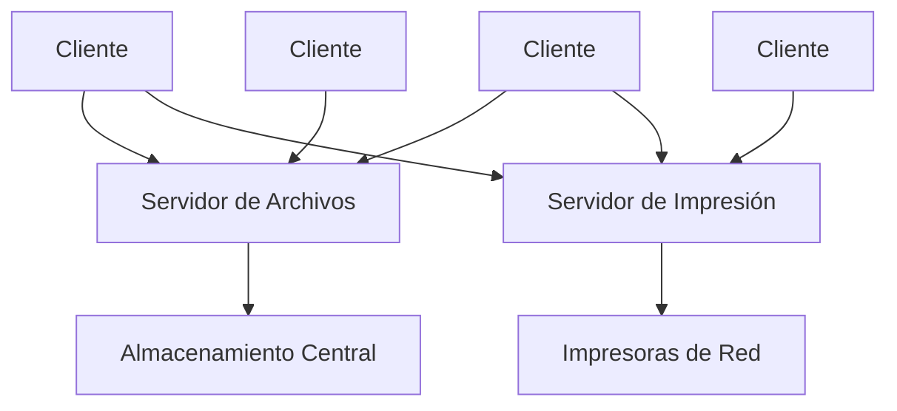
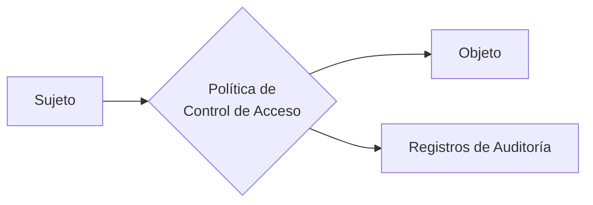

# Redes de Computadoras - Temas opcionales

## 7.1 Sistemas operativos para redes de computadoras.

---

### Introducción a los Sistemas Operativos de Red

Un Sistema Operativo de Red (NOS - Network Operating System) es un software especializado que permite la interconexión de múltiples computadoras y dispositivos para compartir recursos, servicios e información a través de una red. Según Tanenbaum (2010), "un NOS extiende las funciones básicas de un sistema operativo para incluir capacidades de red que permiten la comunicación entre sistemas distribuidos".

#### Características Fundamentales

- Gestión centralizada de usuarios y recursos
- Servicios de directorio
- Seguridad y control de acceso
- Compartición de archivos e impresoras
- Administración de red

### Arquitectura de los Sistemas Operativos de Red

#### Modelo Cliente-Servidor



#### Componentes Principales

**Núcleo del Sistema Operativo:** Gestiona recursos hardware y proporciona servicios básicos.

**Subsistema de Red:** Implementa protocolos y servicios de comunicación.

**Servicios de Directorio:** Mantienen información sobre recursos y usuarios de la red.

### Protocolos y Servicios Implementados

#### Protocolos Comunes

- **TCP/IP:** Protocolo fundamental para comunicación en redes
- **NetBIOS/NetBEUI:** Usado en redes Microsoft
- **IPX/SPX:** Utilizado en redes Novell NetWare
- **AppleTalk:** Para redes Apple

#### Fórmula de Rendimiento de Red

El throughput efectivo se puede calcular como:

$$ T_{efectivo} = \frac{Datos_\text{útil}}{Tiempo_{total}} = \frac{MSS}{RTT + \frac{MSS}{R}} $$

Donde:

- $MSS$ = Maximum Segment Size
- $RTT$ = Round Trip Time
- $R$ = Tasa de transmisión del enlace

### Sistemas Operativos de Red Principales

#### Windows Server

**Características:**

- Active Directory para gestión de usuarios
- Servicios de dominio
- Group Policy para administración centralizada
- IIS (Internet Information Services)

**Ejemplo de configuración básica:**

```powershell
# Instalar rol de Active Directory
Install-WindowsFeature -Name AD-Domain-Services -IncludeManagementTools

# Promover a controlador de dominio
Install-ADDSForest -DomainName "empresa.com" -DomainNetbiosName "EMPRESA"
```

#### Linux-Based NOS

**Distribuciones comunes:**

- Red Hat Enterprise Linux
- Ubuntu Server
- SUSE Linux Enterprise Server

**Servicios típicos:**

- Samba para compartición de archivos con Windows
- BIND para servicios DNS
- Apache o Nginx para servicios web
- OpenLDAP para directorio

**Ejemplo de configuración Samba:**

```bash
# /etc/samba/smb.conf
[compartido]
    comment = Recursos Compartidos
    path = /srv/compartido
    browseable = yes
    read only = no
    valid users = @grupo_red
```

#### Novell NetWare

Aunque menos usado actualmente, fue pionero en sistemas operativos de red con su arquitectura basada en IPX/SPX y el sistema de directorio NDS (Novell Directory Services).

### Gestión de Recursos en Red

#### Algoritmo de Planificación de Procesos

Para sistemas distribuidos, se utiliza frecuentemente el algoritmo de colas múltiples:

$$
T_{espera} = \frac{\sum_{i=1}^{n} T_{servicio_i}}{n}
$$

#### Gestión de Memoria Distribuida

Los sistemas modernos implementan memoria compartida distribuida (DSM - Distributed Shared Memory):

```c
// Ejemplo conceptual de acceso a memoria distribuida
typedef struct {
    int page_id;
    void *physical_addr;
    int node_owner;
} distributed_page_t;

// Función para acceder a página remota
distributed_page_t* access_remote_page(int page_id, int requesting_node) {
    // Lógica de localización y acceso
    return locate_page(page_id, requesting_node);
}
```

### Seguridad en Sistemas Operativos de Red

#### Mecanismos de Autenticación

**Protocolo Kerberos:**

- Autenticación mutua
- Tickets con tiempo limitado
- Evita replay attacks

**Fórmula de verificación:**

$$
Ticket = E_{K_{TGS}}(K_{C,TGS} + ID_C + AD_C + ID_{TGS} + TS_2 + Lifetime_2)
$$

#### Control de Acceso

Modelo DAC (Discretionary Access Control) y MAC (Mandatory Access Control):



### Virtualización y Cloud Computing

#### Hipervisores

**Tipo 1 (Bare-metal):** Ejecutan directamente sobre hardware

- VMware ESXi
- Microsoft Hyper-V
- Citrix XenServer

**Tipo 2 (Hosted):** Ejecutan sobre SO anfitrión

- VMware Workstation
- VirtualBox
- Parallels Desktop

#### Ejemplo de Configuración de Red Virtual

```bash
# Configuración de bridge network en Linux
brctl addbr br0
brctl addif br0 eth0
brctl addif br0 vnet0
ifconfig br0 192.168.1.10 netmask 255.255.255.0 up
```

### Ejercicios Propuestos

#### Ejercicio 1: Diseño de Red Corporativa

Diseñe la arquitectura de un sistema operativo de red para una empresa con:

- 3 departamentos (Ventas, Contabilidad, IT)
- 150 usuarios totales
- 5 servidores físicos
- Requisitos de alta disponibilidad

**Preguntas:**

1. ¿Qué sistema operativo de red elegiría y por qué?
2. Describa la estructura de dominios o unidades organizativas
3. Especifique los servicios necesarios

#### Ejercicio 2: Cálculo de Rendimiento

Una red tiene los siguientes parámetros:

- MSS = 1460 bytes
- RTT = 50 ms
- Ancho de banda = 100 Mbps

Calcule:

1. El throughput máximo teórico
2. El throughput efectivo considerando overhead de protocolo
3. El porcentaje de eficiencia

#### Ejercicio 3: Configuración de Servicios

Implemente un script que configure:

- Un servidor de archivos con cuotas por usuario
- Políticas de backup automático
- Control de acceso basado en grupos

### Tendencias Actuales

#### Containerización

```yaml
# docker-compose.yml para servicios de red
version: '3'
services:
  dns-server:
    image: bind9
    ports:
      - '53:53/udp'
    networks:
      - backend

  file-server:
    image: samba
    volumes:
      - ./data:/shared
    networks:
      - backend
```

#### Software-Defined Networking (SDN)

Arquitectura que separa el plano de control del plano de datos, permitiendo una gestión más flexible de la red.

### Referencias

#### Bibliografía Básica

1. Tanenbaum, A. S., & Wetherall, D. J. (2010). Computer Networks. Prentice Hall.
   - Capítulo 1: Introducción a redes
   - Capítulo 5: Capa de red

2. Kurose, J. F., & Ross, K. W. (2010). Computer Networking: A Top-Down Approach. Addison-Wesley.
   - Capítulo 3: Capa de transporte
   - Capítulo 8: Seguridad en redes

3. Stallings, W. (2010). Data and Computer Communications. Prentice Hall.
   - Capítulo 15: Arquitecturas de red

#### Bibliografía Complementaria

1. Black, U. (2000). IP Routing Protocols: RIP, OSPF, BGP, PNNI and Cisco Routing Protocols. Prentice-Hall.

### Evaluación del Tema

#### Preguntas de Revisión

1. Compare Windows Server y Linux como sistemas operativos de red
2. Explique el funcionamiento de Active Directory
3. Describa los mecanismos de seguridad implementados en NOS
4. ¿Cómo afecta la virtualización a la gestión de redes?
5. Analice ventajas y desventajas de arquitecturas cliente-servidor vs peer-to-peer

#### Caso de Estudio

Analice una organización real y proponga:

- Arquitectura de NOS adecuada
- Esquema de seguridad
- Plan de implementación
- Métricas de evaluación de rendimiento
