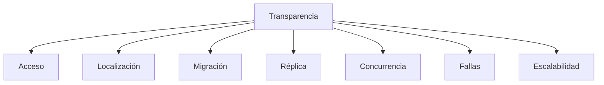
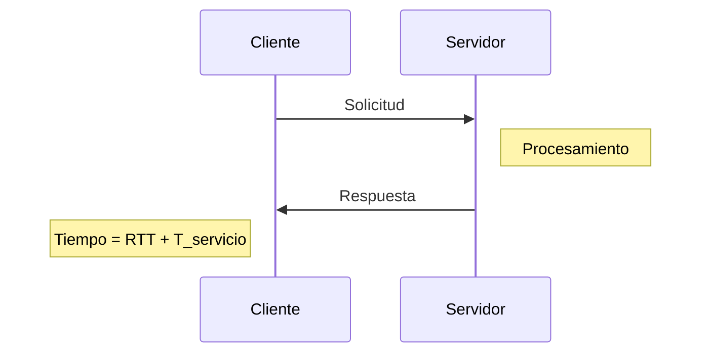
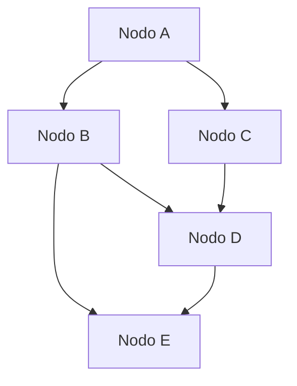
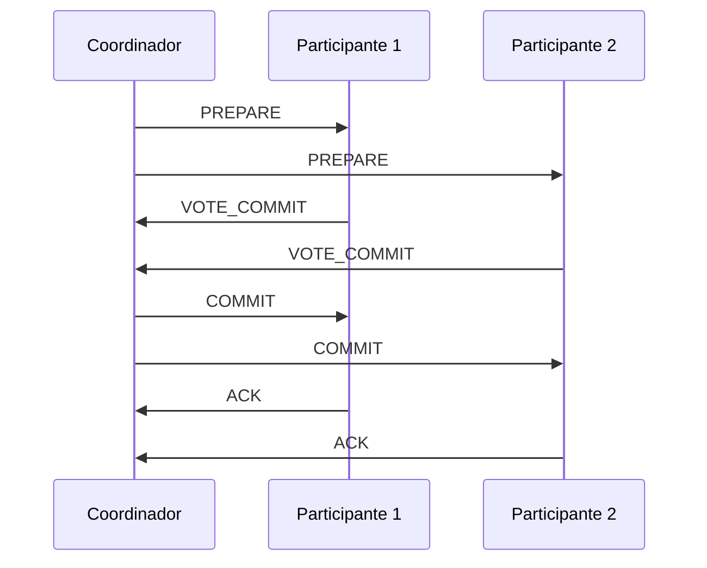
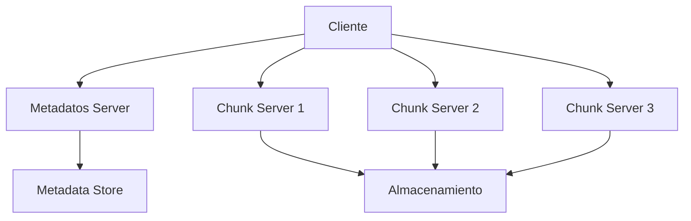

# Redes de Computadoras - Temas opcionales

## 7.2 Sistemas distribuidos. Características generales; problemas de comunicación en sistemas distribuidos.

---

Un **sistema distribuido** es una colección de computadoras autónomas interconectadas a través de una red que aparece ante los usuarios como un solo sistema coherente. Según Tanenbaum (2010), "un sistema distribuido es aquel en el que componentes localizados en computadoras en red se comunican y coordinan sus acciones solamente pasándose mensajes".

**Característica clave:**

$$ \text{Transparencia} = \sum_{i=1}^{n} \text{OCULTACIÓN\_PROPIEDAD}_i $$

#### Características Generales

##### 1. Transparencia



##### 2. Tolerancia a Fallos

Los sistemas distribuidos deben continuar operando correctamente incluso cuando algunos componentes fallan.

##### 3. Escalabilidad

Capacidad del sistema para crecer y manejar carga adicional sin degradación significativa del rendimiento.

### Arquitecturas de Sistemas Distribuidos

#### Modelos Arquitectónicos Principales

##### Modelo Cliente-Servidor



##### Modelo Peer-to-Peer (P2P)



#### Fórmula de Rendimiento en Sistemas Distribuidos

El tiempo de respuesta en un sistema cliente-servidor se calcula como:

$$
T_{respuesta} = T_\text{transmisión} + T_\text{propagación} + T_{procesamiento} + T_{cola}
$$

Donde:

- $T_\text{transmisión} = \frac{L}{B}$ (L = tamaño mensaje, B = ancho de banda)
- $T_\text{propagación} = \frac{D}{V}$ (D = distancia, V = velocidad propagación)
- $T_{procesamiento}$ = tiempo en servidor
- $T_{cola}$ = tiempo en colas de red

### Problemas de Comunicación en Sistemas Distribuidos

#### 1. Comunicación por Mensajes

##### Protocolos de Comunicación

```python
class MessageProtocol:
    def __init__(self, node_id):
        self.node_id = node_id
        self.message_queue = []

    def send_message(self, destination, message, protocol='TCP'):
        """Envía mensaje a nodo destino"""
        header = {
            'source': self.node_id,
            'destination': destination,
            'protocol': protocol,
            'timestamp': time.time(),
            'sequence': self.get_sequence_number()
        }
        packet = {'header': header, 'payload': message}
        return self.transmit(packet)

    def receive_message(self):
        """Recibe y procesa mensajes"""
        if self.message_queue:
            message = self.message_queue.pop(0)
            return self.process_message(message)
        return None
```

#### 2. Sincronización de Relojes

##### Algoritmo de Cristian para Sincronización

$$
T_{cliente} = T_{servidor} + \frac{(T_1 - T_0) + (T_2 - T_1)}{2}
$$

```python
import time

class ClockSynchronization:
    def __init__(self):
        self.offset = 0
        self.delay = 0

    def cristian_algorithm(self, time_server):
        T0 = time.time()  # Tiempo de envío
        # Simular comunicación con servidor
        T_server = time_server.get_time()  # Tiempo del servidor
        T1 = time.time()  # Tiempo de recepción

        self.offset = T_server - T0 + (T1 - T0)/2
        self.delay = T1 - T0

        return self.offset
```

#### 3. Exclusión Mutua Distribuida

##### Algoritmo de Ricart-Agrawala

```python
class DistributedMutex:
    def __init__(self, node_id, all_nodes):
        self.node_id = node_id
        self.all_nodes = all_nodes
        self.requesting = False
        self.timestamp = 0
        self.replies_received = 0
        self.deferred_replies = []

    def request_critical_section(self):
        self.requesting = True
        self.timestamp = time.time()
        self.replies_received = 0

        # Enviar solicitud a todos los nodos
        for node in self.all_nodes:
            if node != self.node_id:
                self.send_request(node, self.timestamp)

    def receive_request(self, from_node, their_timestamp):
        if not self.requesting or (their_timestamp < self.timestamp) or \
           (their_timestamp == self.timestamp and from_node < self.node_id):
            self.send_reply(from_node)
        else:
            self.deferred_replies.append(from_node)

    def receive_reply(self, from_node):
        self.replies_received += 1
        if self.replies_received == len(self.all_nodes) - 1:
            self.enter_critical_section()
```

#### 4. Acuerdo y Consenso Distribuido

##### Algoritmo de Two-Phase Commit (2PC)



#### 5. Problemas de Elección de Líder

##### Algoritmo de Bully

```python
class BullyAlgorithm:
    def __init__(self, node_id, all_nodes):
        self.node_id = node_id
        self.all_nodes = sorted(all_nodes)
        self.leader = max(all_nodes)
        self.active = True

    def start_election(self):
        """Inicia proceso de elección"""
        higher_nodes = [n for n in self.all_nodes if n > self.node_id]

        if not higher_nodes:
            # Este nodo es el de mayor ID
            self.declare_victory()
        else:
            # Enviar mensaje de elección a nodos superiores
            for node in higher_nodes:
                if self.send_election_message(node):
                    # Esperar respuesta
                    if not self.wait_for_ok():
                        continue
            self.declare_victory()

    def declare_victory(self):
        """Declara victoria en la elección"""
        self.leader = self.node_id
        # Notificar a todos los nodos
        for node in self.all_nodes:
            if node != self.node_id:
                self.send_coordinator_message(node)
```

### Modelos de Consistencia

#### Tipos de Consistencia

##### Fórmula de Consistencia Secuencial

$$ \forall op_i, op_j \in Ops: (op_i \rightarrow op_j \Rightarrow \forall P_k: op_i \prec_k op_j) $$

##### Consistencia Eventual

```python
class EventualConsistency:
    def __init__(self):
        self.data = {}
        self.vector_clock = {}

    def update(self, key, value, node_id):
        # Actualizar reloj vectorial
        if node_id in self.vector_clock:
            self.vector_clock[node_id] += 1
        else:
            self.vector_clock[node_id] = 1

        # Aplicar actualización
        self.data[key] = {
            'value': value,
            'timestamp': self.vector_clock.copy(),
            'node': node_id
        }

    def resolve_conflict(self, key, update1, update2):
        """Resuelve conflictos usando relojes vectoriales"""
        if self.is_concurrent(update1['timestamp'], update2['timestamp']):
            # Conflictos concurrentes - usar política de resolución
            return self.custom_resolution_policy(update1, update2)
        elif self.happens_before(update1['timestamp'], update2['timestamp']):
            return update2
        else:
            return update1
```

### Ejercicios Propuestos

#### Ejercicio 1: Análisis de Rendimiento

Un sistema distribuido tiene las siguientes características:

- 5 nodos de procesamiento
- Latencia de red promedio: 50ms
- Ancho de banda: 1 Gbps
- Tamaño promedio de mensaje: 10KB

Calcule:

1. El throughput máximo del sistema
2. El tiempo total para procesar 1000 operaciones distribuidas
3. El overhead de comunicación como porcentaje del tiempo total

**Fórmulas:**

$$ T_\text{operación} = T_{comp} + T_{comm} $$

$$ T_{comm} = 2 \times (Latencia + \frac{\text{Tamaño}_{msg}}{AnchoBanda}) $$

#### Ejercicio 2: Implementación de Consenso

Implemente el algoritmo Paxos simplificado para lograr consenso en un sistema distribuido con 3 nodos. Considere:

```python
class PaxosNode:
    def __init__(self, node_id, all_nodes):
        self.node_id = node_id
        self.all_nodes = all_nodes
        self.proposal_number = 0
        self.accepted_value = None
        self.accepted_proposal = 0

    def prepare_phase(self, value):
        # Implementar fase de preparación
        pass

    def accept_phase(self, proposal_num, value):
        # Implementar fase de aceptación
        pass
```

#### Ejercicio 3: Tolerancia a Fallos

Diseñe un sistema distribuido que pueda tolerar la falla de hasta 2 nodos de un total de 5. Incluya:

1. Estrategia de replicación de datos
2. Mecanismo de detección de fallos
3. Protocolo de recuperación

#### Ejercicio 4: Balanceo de Carga

Implemente un algoritmo de balanceo de carga que distribuya trabajos entre nodos basado en:

```python
class LoadBalancer:
    def __init__(self, nodes):
        self.nodes = nodes
        self.load_metrics = {node: 0 for node in nodes}

    def select_node(self, job_size):
        # Implementar selección basada en métricas de carga
        pass

    def update_metrics(self, node, load_change):
        # Actualizar métricas de carga
        pass
```

### Casos de Estudio y Aplicaciones

#### Sistema de Archivos Distribuido



#### Bases de Datos Distribuidas

**Teorema CAP:** Un sistema distribuido no puede garantizar simultáneamente:

- **C**onsistencia
- **A**vailability
- **P**artition tolerance

Solo puede garantizar 2 de 3 en cualquier momento.

### Referencias Bibliográficas

#### Bibliografía Básica

1. **Tanenbaum, A. S., & Wetherall, D. J. (2010). Computer Networks. Prentice Hall.**
   - Capítulo 1: Introducción
   - Capítulo 8: Seguridad en redes (para comunicación segura)

2. **Kurose, J. F., & Ross, K. W. (2010). Computer Networking: A Top-Down Approach. Addison-Wesley.**
   - Capítulo 2: Capa de aplicación (P2P, DNS)
   - Capítulo 3: Capa de transporte (TCP para sistemas distribuidos)

3. **Peterson, L. L., & Davie, B. S. (2011). Computer Networks: A Systems Approach. Morgan Kaufmann.**
   - Capítulo 9: Aplicaciones (sistemas distribuidos)

#### Bibliografía Complementaria

1. **Coulouris, G., Dollimore, J., & Kindberg, T. (2011). Distributed Systems: Concepts and Design.**
   - Teoría completa de sistemas distribuidos

### Evaluación del Tema

#### Preguntas de Revisión

1. Explique las 8 formas de transparencia en sistemas distribuidos
2. Compare los algoritmos de elección de líder Bully y Ring
3. Describa el problema de los generales bizantinos y su solución
4. Analice las diferencias entre consistencia fuerte y eventual
5. Explique cómo funciona el reloj vectorial para ordenamiento de eventos

#### Proyecto Práctico

Implemente un sistema de chat distribuido con:

- Descubrimiento automático de nodos
- Tolerancia a fallos
- Consistencia eventual de mensajes
- Interfaz de usuario básica

**Criterios de evaluación:**

- Correcta sincronización entre nodos
- Manejo adecuado de fallos
- Eficiencia en el uso de recursos de red
- Documentación del diseño
