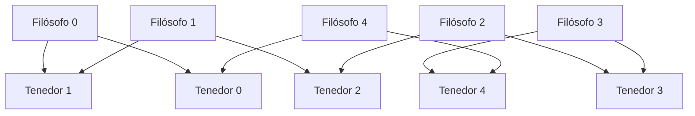

# Computación Concurrente - Introducción

## 1.1 Sincronización.

---

La sincronización es un mecanismo fundamental en la programación concurrente que permite coordinar la ejecución de múltiples procesos o hilos que comparten recursos. Sin mecanismos de sincronización adecuados, pueden surgir problemas como condiciones de carrera, interbloqueos e inanición.

### Conceptos Fundamentales

#### Condición de Carrera

Ocurre cuando el resultado de una operación depende del orden temporal de ejecución de los hilos.

```java
// Ejemplo de condición de carrera
public class Contador {
    private int valor = 0;

    public void incrementar() {
        valor++; // Operación no atómica
    }
}
```

#### Sección Crítica

Porción de código que accede a recursos compartidos y que no puede ser ejecutada concurrentemente por múltiples hilos.

#### Exclusión Mutua

Garantiza que solo un hilo puede ejecutar una sección crítica en un momento dado.

### Mecanismos de Sincronización

#### Semáforos

Estructura de datos que controla el acceso a recursos mediante un contador.

**Definición formal:**
Un semáforo $S$ es una variable entera que solo puede ser accedida mediante dos operaciones atómicas:

- **wait(S):**

  ```pseudocode
  while S ≤ 0 do no-op;
  S = S - 1;
  ```

- **signal(S):**
  ```pseudocode
  S = S + 1;
  ```

**Implementación en Java:**

```java
import java.util.concurrent.Semaphore;

public class EjemploSemaphore {
    private Semaphore semaforo = new Semaphore(1);
    private int recursoCompartido = 0;

    public void accederRecurso() throws InterruptedException {
        semaforo.acquire(); // wait
        try {
            // Sección crítica
            recursoCompartido++;
        } finally {
            semaforo.release(); // signal
        }
    }
}
```

#### Monitores

Estructura de alto nivel que encapsula datos y procedimientos, garantizando exclusión mutua.

```java
public class MonitorContador {
    private int contador = 0;

    public synchronized void incrementar() {
        contador++;
    }

    public synchronized int obtenerValor() {
        return contador;
    }
}
```

#### Cerraduras (Locks)

Mecanismos que proporcionan exclusión mutua de forma más flexible.

```java
import java.util.concurrent.locks.Lock;
import java.util.concurrent.locks.ReentrantLock;

public class ContadorConLock {
    private int valor = 0;
    private Lock lock = new ReentrantLock();

    public void incrementar() {
        lock.lock();
        try {
            valor++;
        } finally {
            lock.unlock();
        }
    }
}
```

### Problemas Clásicos de Sincronización

#### Problema de Productor-Consumidor


```java
public class BufferCompartido {
    private Queue<Integer> buffer = new LinkedList<>();
    private int capacidad;
    private Semaphore espacios;
    private Semaphore elementos;
    private Semaphore mutex;

    public BufferCompartido(int capacidad) {
        this.capacidad = capacidad;
        this.espacios = new Semaphore(capacidad);
        this.elementos = new Semaphore(0);
        this.mutex = new Semaphore(1);
    }

    public void producir(int item) throws InterruptedException {
        espacios.acquire();
        mutex.acquire();

        buffer.offer(item);
        System.out.println("Producido: " + item);

        mutex.release();
        elementos.release();
    }

    public int consumir() throws InterruptedException {
        elementos.acquire();
        mutex.acquire();

        int item = buffer.poll();
        System.out.println("Consumido: " + item);

        mutex.release();
        espacios.release();
        return item;
    }
}
```

#### Problema de los Lectores-Escritores

**Fórmula de prioridad:**

- **Lectores-prioritarios:** $lectores \geq 0$, $escritores = 0 \vee 1$
- **Escritores-prioritarios:** $escritores = 0$, $lectores = 0$

```java
public class RecursoCompartido {
    private int lectores = 0;
    private Semaphore mutex = new Semaphore(1);
    private Semaphore escritura = new Semaphore(1);

    public void iniciarLectura() throws InterruptedException {
        mutex.acquire();
        lectores++;
        if (lectores == 1) {
            escritura.acquire();
        }
        mutex.release();
    }

    public void finalizarLectura() throws InterruptedException {
        mutex.acquire();
        lectores--;
        if (lectores == 0) {
            escritura.release();
        }
        mutex.release();
    }

    public void iniciarEscritura() throws InterruptedException {
        escritura.acquire();
    }

    public void finalizarEscritura() {
        escritura.release();
    }
}
```

#### Problema de los Filósofos



```java
public class Filosofo implements Runnable {
    private final int id;
    private final Semaphore[] tenedores;
    private final Semaphore mesa;

    public Filosofo(int id, Semaphore[] tenedores, Semaphore mesa) {
        this.id = id;
        this.tenedores = tenedores;
        this.mesa = mesa;
    }

    @Override
    public void run() {
        try {
            while (true) {
                pensar();
                mesa.acquire();
                tenedores[id].acquire();
                tenedores[(id + 1) % tenedores.length].acquire();
                comer();
                tenedores[id].release();
                tenedores[(id + 1) % tenedores.length].release();
                mesa.release();
            }
        } catch (InterruptedException e) {
            Thread.currentThread().interrupt();
        }
    }

    private void pensar() throws InterruptedException {
        System.out.println("Filósofo " + id + " está pensando");
        Thread.sleep(1000);
    }

    private void comer() throws InterruptedException {
        System.out.println("Filósofo " + id + " está comiendo");
        Thread.sleep(1000);
    }
}
```

### Modelos Formales de Sincronización

#### Álgebra de Procesos

Utilizando notación matemática para describir comportamientos concurrentes:

$$
P \parallel Q \quad \text{// Composición paralela}
$$

$$
P \mid Q \quad \text{// Composición por elección}
$$

#### Invariantes de Sincronización

Para un sistema con $n$ procesos y $m$ recursos:

$$
\sum_{i=1}^{n} uso\_recurso_i \leq m
$$

### Ejercicios Propuestos

#### Ejercicio 1: Implementación de Semáforo Binario

Implemente un semáforo binario utilizando solo operaciones atómicas de lectura y escritura.

**Solución propuesta:**

```java
public class SemáforoBinario {
    private volatile boolean disponible = true;

    public void acquire() {
        while (!disponible) {
            // Espera activa
        }
        disponible = false;
    }

    public void release() {
        disponible = true;
    }
}
```

#### Ejercicio 2: Simulación de Cajeros Automáticos

Modele un sistema de cajeros automáticos donde máximo 3 personas pueden usar los cajeros simultáneamente.

#### Ejercicio 3: Sistema de Reservas

Implemente un sistema de reservas de asientos para un teatro con 100 butacas, donde múltiples clientes pueden intentar reservar simultáneamente.

### Patrones de Sincronización

#### Barrera de Sincronización

```java
public class Barrera {
    private final int numeroHilos;
    private int hilosEsperando = 0;
    private Semaphore mutex = new Semaphore(1);
    private Semaphore barrera = new Semaphore(0);

    public Barrera(int numeroHilos) {
        this.numeroHilos = numeroHilos;
    }

    public void esperar() throws InterruptedException {
        mutex.acquire();
        hilosEsperando++;

        if (hilosEsperando == numeroHilos) {
            for (int i = 0; i < numeroHilos - 1; i++) {
                barrera.release();
            }
            hilosEsperando = 0;
            mutex.release();
        } else {
            mutex.release();
            barrera.acquire();
        }
    }
}
```

#### Exchange Point

```java
public class PuntoIntercambio<T> {
    private T dato;
    private Semaphore productorListo = new Semaphore(0);
    private Semaphore consumidorListo = new Semaphore(0);

    public T intercambiar(T item) throws InterruptedException {
        dato = item;
        productorListo.release();
        consumidorListo.acquire();
        return dato;
    }

    public T recibir() throws InterruptedException {
        productorListo.acquire();
        T resultado = dato;
        consumidorListo.release();
        return resultado;
    }
}
```

### Consideraciones de Rendimiento

#### Métricas de Evaluación

- **Throughput:** $\frac{\text{trabajos completados}}{\text{tiempo}}$
- **Latencia:** $T_{fin} - T_{inicio}$
- **Escalabilidad:** $\frac{\text{rendimiento con N hilos}}{\text{rendimiento con 1 hilo}}$

#### Overhead de Sincronización

El costo de la sincronización puede representarse como:

$$
T_{total} = T_{computacion} + T_{sincronizacion} + T_{espera}
$$

### Referencias

#### Bibliografía Básica

1. **Taubenfeld, G. (2006).** _Synchronization Algorithms and Concurrent Programming_. Pearson/Prentice Hall.
   - Capítulo 2: The Mutual Exclusion Problem
   - Capítulo 3: Semaphores and Locks

2. **Herlihy, M., & Shavit, N. (2008).** _The Art of Multiprocessor Programming_. Morgan Kaufmann.
   - Capítulo 2: Mutual Exclusion
   - Capítulo 3: Concurrent Objects

#### Bibliografía Complementaria

3. **Lamport, L. (2002).** _Specifying Systems: The TLA+ Language and Tools for Hardware and Software Engineers_. Pearson Education.
   - Capítulo 4: The PlusCal Algorithm Language
   - Capítulo 5: Temporal Logic of Actions

#### Recursos Adicionales

- Java Documentation: java.util.concurrent package
- Oracle Tutorial: Java Concurrency
- POSIX Threads Programming Guide

### Buenas Prácticas

1. **Minimizar el tiempo en secciones críticas**
2. **Evitar el anidamiento de cerraduras**
3. **Utilizar timeouts en operaciones de bloqueo**
4. **Preferir estructuras de alto nivel** (java.util.concurrent)
5. **Realizar testing de estrés** en condiciones de alta concurrencia
