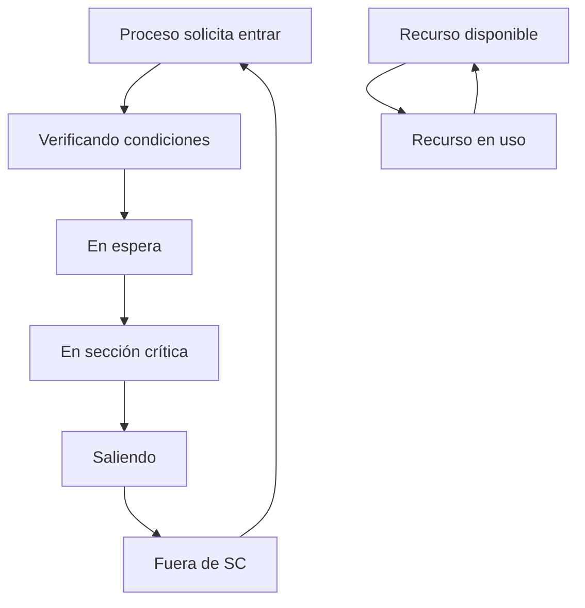

# Computación Concurrente - Introducción

## 1.2 El problema de la exclusión mutua.

---

La exclusión mutua es el problema fundamental en computación concurrente que consiste en garantizar que solo un proceso acceda a un recurso compartido o ejecute una sección crítica en un momento dado.

### Definición Formal

#### Sección Crítica

Porción de código donde un proceso accede a recursos compartidos que no pueden ser utilizados concurrentemente por múltiples procesos.

#### Condiciones para la Solución

Una solución correcta al problema de exclusión mutua debe satisfacer:

1. **Exclusión Mutua:** Si el proceso $P_i$ está ejecutando su sección crítica, entonces ningún otro proceso puede estar ejecutando su sección crítica.

2. **Progreso:** Si ningún proceso está ejecutando su sección crítica y existen procesos que desean entrar a su sección crítica, entonces la selección del proceso que entrará no puede postponerse indefinidamente.

3. **Espera Limitada:** Existe un límite en el número de veces que otros procesos pueden entrar a sus secciones críticas después de que un proceso ha solicitado entrar a la suya.

### Soluciones al Problema de Exclusión Mutua

#### Soluciones por Software

##### Algoritmo de Dekker

Primera solución correcta para dos procesos que combina turnos y banderas.

```java
public class AlgoritmoDekker {
    private boolean[] quiereEntrar = {false, false};
    private int turno = 0;

    public void entrarSeccionCritica(int id) {
        int otro = 1 - id;
        quiereEntrar[id] = true;

        while (quiereEntrar[otro]) {
            if (turno == otro) {
                quiereEntrar[id] = false;
                while (turno == otro) {
                    // Espera activa
                }
                quiereEntrar[id] = true;
            }
        }

        // Sección crítica
        ejecutarSeccionCritica(id);

        salirSeccionCritica(id);
    }

    private void salirSeccionCritica(int id) {
        turno = 1 - id;
        quiereEntrar[id] = false;
    }

    private void ejecutarSeccionCritica(int id) {
        System.out.println("Proceso " + id + " en sección crítica");
    }
}
```

##### Algoritmo de Peterson

Solución elegante para dos procesos que utiliza banderas y turno.

```java
public class AlgoritmoPeterson {
    private boolean[] quiereEntrar = new boolean[2];
    private int turno = 0;

    public void entrarSeccionCritica(int id) {
        int otro = 1 - id;
        quiereEntrar[id] = true;
        turno = otro;

        while (quiereEntrar[otro] && turno == otro) {
            // Espera activa
        }

        // Sección crítica
    }

    public void salirSeccionCritica(int id) {
        quiereEntrar[id] = false;
    }
}
```

##### Algoritmo de Bakery (Panadería)

Solución para n procesos basada en números de ticket.

```java
public class AlgoritmoBakery {
    private boolean[] eligiendo;
    private int[] numero;
    private final int n;

    public AlgoritmoBakery(int n) {
        this.n = n;
        this.eligiendo = new boolean[n];
        this.numero = new int[n];
    }

    public void entrarSeccionCritica(int i) {
        eligiendo[i] = true;

        // Obtener número
        numero[i] = 1 + max(numero);
        eligiendo[i] = false;

        for (int j = 0; j < n; j++) {
            if (j != i) {
                while (eligiendo[j]) {
                    // Esperar mientras j está eligiendo
                }
                while (numero[j] != 0 &&
                      (numero[j] < numero[i] ||
                      (numero[j] == numero[i] && j < i))) {
                    // Esperar en cola
                }
            }
        }

        // Sección crítica
    }

    public void salirSeccionCritica(int i) {
        numero[i] = 0;
    }

    private int max(int[] array) {
        int max = 0;
        for (int value : array) {
            if (value > max) max = value;
        }
        return max;
    }
}
```

#### Soluciones por Hardware

##### Instrucciones Atómicas

```java
public class SolucionHardware {
    private volatile boolean cerrojo = false;

    // Test-and-Set
    public boolean testAndSet() {
        boolean valorAnterior = cerrojo;
        cerrojo = true;
        return valorAnterior;
    }

    // Compare-and-Swap
    public boolean compareAndSwap(boolean esperado, boolean nuevo) {
        if (cerrojo == esperado) {
            cerrojo = nuevo;
            return true;
        }
        return false;
    }

    public void entrarSeccionCritica() {
        while (testAndSet()) {
            // Espera activa
        }
    }

    public void salirSeccionCritica() {
        cerrojo = false;
    }
}
```

### Análisis de Correctitud

#### Verificación Formal

Para verificar la exclusión mutua en el algoritmo de Peterson, podemos usar lógica temporal:

$$
\square \neg (enSC_0 \land enSC_1)
$$

Donde:

- $enSC_i$: proceso i está en su sección crítica
- $\square$: operador "siempre" en lógica temporal

#### Diagrama de Estados



### Modelo Formal del Problema

#### Especificación TLA+

Basado en Lamport (2002), podemos especificar el problema:

```tla
MODULE MutualExclusion

VARIABLES
    pc,      \* Contador de programa de cada proceso
    turno,   \* Variable de turno
    flag     \* Bandera de intención

TypeInvariant ==
    /\ pc \in [0..3]   \* Estados: 0=Rem, 1=Req, 2=Crit, 3=Exit
    /\ turno \in {0,1}
    /\ flag \in [{0,1} -> {0,1}]

Request(i) ==
    /\ pc[i] = 0
    /\ pc' = [pc EXCEPT ![i] = 1]
    /\ flag' = [flag EXCEPT ![i] = 1]
    /\ turno' = 1 - i

Enter(i) ==
    /\ pc[i] = 1
    /\ flag[1-i] = 0 \/ turno = i
    /\ pc' = [pc EXCEPT ![i] = 2]

Exit(i) ==
    /\ pc[i] = 2
    /\ pc' = [pc EXCEPT ![i] = 3]
    /\ flag' = [flag EXCEPT ![i] = 0]

MutualExclusion ==
    \A i,j \in {0,1}: i \neq j => ~(pc[i] = 2 /\ pc[j] = 2)
```

### Ejercicios Propuestos

#### Ejercicio 1: Análisis del Algoritmo de Peterson

Demuestre que el algoritmo de Peterson satisface las tres condiciones de correctitud.

**Pistas:**

1. Para exclusión mutua: Suponga que ambos procesos están en SC y derive contradicción.
2. Para progreso: Muestre que si un proceso quiere entrar, eventualmente lo hará.
3. Para espera limitada: Analice el comportamiento del turno.

#### Ejercicio 2: Implementación para N Procesos

Extienda el algoritmo de Peterson para trabajar con N procesos manteniendo las propiedades de correctitud.

```java
public class PetersonNProcesos {
    private int n;
    private int[] nivel;
    private int[] ultimo;

    public PetersonNProcesos(int n) {
        this.n = n;
        this.nivel = new int[n];
        this.ultimo = new int[n];
    }

    // Implementar aquí la solución para N procesos
}
```

#### Ejercicio 3: Simulación de Condiciones de Carrera

Implemente un programa que demuestre condiciones de carrera sin sincronización y luego aplique exclusión mutua.

```java
public class ContadorSinSincronizacion {
    private int contador = 0;

    public void incrementar() {
        int temp = contador;
        temp = temp + 1;
        contador = temp;
    }

    // Ejecutar con múltiples hilos para observar condición de carrera
}
```

### Métricas de Evaluación

#### Overhead de Sincronización

El tiempo adicional introducido por los mecanismos de exclusión mutua:

$$
T_{overhead} = T_{con\_sincronizacion} - T_{sin\_sincronizacion}
$$

#### Throughput del Sistema

Para un sistema con N procesos y tiempo de sección crítica $T_{SC}$:

$$
Throughput = \frac{N}{T_{SC} + T_{espera}}
$$

### Casos de Estudio

#### Sistema de Reservas de Vuelo

```java
public class SistemaReservas {
    private final int totalAsientos;
    private int asientosDisponibles;
    private final Object lock = new Object();

    public SistemaReservas(int totalAsientos) {
        this.totalAsientos = totalAsientos;
        this.asientosDisponibles = totalAsientos;
    }

    public boolean reservarAsiento(int cantidad) {
        synchronized(lock) {
            if (asientosDisponibles >= cantidad) {
                // Simular procesamiento
                try { Thread.sleep(10); } catch (InterruptedException e) {}
                asientosDisponibles -= cantidad;
                return true;
            }
            return false;
        }
    }
}
```

#### Contador Compartido con Exclusión Mutua

```java
public class ContadorSeguro {
    private long valor = 0;
    private final ReentrantLock lock = new ReentrantLock();

    public void incrementar() {
        lock.lock();
        try {
            valor++;
        } finally {
            lock.unlock();
        }
    }

    public long getValor() {
        lock.lock();
        try {
            return valor;
        } finally {
            lock.unlock();
        }
    }
}
```

### Patrones de Diseño

#### Patrón Monitor

```java
public class MonitorPattern {
    private final Object monitor = new Object();
    private RecursoCompartido recurso;

    public void operacionSegura() {
        synchronized(monitor) {
            // Operaciones sobre recurso compartido
            recurso.operacion();
        }
    }

    public RecursoCompartido getRecurso() {
        synchronized(monitor) {
            return copiaDefensiva(recurso);
        }
    }
}
```

### Referencias

#### Bibliografía Básica

1. **Taubenfeld, G. (2006).** _Synchronization Algorithms and Concurrent Programming_
   - **Capítulo 2:** The Mutual Exclusion Problem
   - **Sección 2.1:** The Problem Specification
   - **Sección 2.2:** Basic Solutions
   - **Algoritmo 2.5:** Peterson's Algorithm (p. 24)
   - **Teorema 2.8:** Correctness of Peterson's Algorithm (p. 26)

2. **Herlihy, M., & Shavit, N. (2008).** _The Art of Multiprocessor Programming_
   - **Capítulo 2:** Mutual Exclusion
   - **Sección 2.2:** Two-Thread Solutions
   - **Figura 2.6:** Peterson's Algorithm (p. 26)
   - **Sección 2.7:** The Bakery Algorithm (p. 41)

#### Bibliografía Complementaria

3. **Lamport, L. (2002).** _Specifying Systems: The TLA+ Language and Tools_
   - **Capítulo 6:** Temporal Logic
   - **Sección 6.4:** The Mutual Exclusion Example
   - **Algoritmo 6.1:** Mutual Exclusion Specification (p. 75)

#### Lecturas Recomendadas

- **Dijkstra, E. W. (1965).** "Solution of a problem in concurrent programming control"
- **Lamport, L. (1974).** "A new solution of Dijkstra's concurrent programming problem"
- **Peterson, G. L. (1981).** "Myths About the Mutual Exclusion Problem"

### Ejercicios de Implementación

#### Ejercicio 4: Verificación Experimental

Implemente un test que verifique la exclusión mutua ejecutando múltiples hilos simultáneamente:

```java
public class TestExclusionMutua {
    private static final int NUM_HILOS = 10;
    private static final int ITERACIONES = 1000;

    public static void main(String[] args) throws InterruptedException {
        ContadorSeguro contador = new ContadorSeguro();
        Thread[] hilos = new Thread[NUM_HILOS];

        for (int i = 0; i < NUM_HILOS; i++) {
            hilos[i] = new Thread(() -> {
                for (int j = 0; j < ITERACIONES; j++) {
                    contador.incrementar();
                }
            });
        }

        for (Thread hilo : hilos) hilo.start();
        for (Thread hilo : hilos) hilo.join();

        System.out.println("Valor esperado: " + (NUM_HILOS * ITERACIONES));
        System.out.println("Valor obtenido: " + contador.getValor());
    }
}
```

#### Ejercicio 5: Análisis de Rendimiento

Compare el rendimiento de diferentes mecanismos de exclusión mutua:

```java
public class BenchmarkExclusionMutua {
    public long probarRendimiento(Runnable estrategia, int numHilos) {
        long inicio = System.currentTimeMillis();
        // Implementar prueba de rendimiento
        long fin = System.currentTimeMillis();
        return fin - inicio;
    }
}
```
