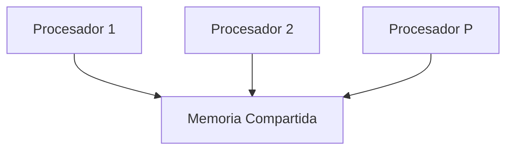
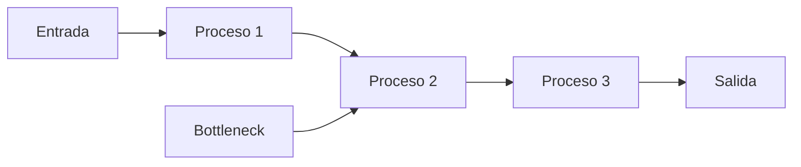

# Computación Concurrente - Introducción

## 1.3 Medidas de complejidad.

---

En computación concurrente, las medidas de complejidad evalúan la eficiencia de algoritmos y sistemas en entornos paralelos. Estas métricas son esenciales para comparar diferentes aproximaciones y optimizar el rendimiento.

### Conceptos Fundamentales

#### Complejidad Temporal vs Espacial

**Complejidad Temporal:** $T(n,p)$ - Tiempo de ejecución para n elementos con p procesadores

**Complejidad Espacial:** $S(n,p)$ - Memoria requerida para n elementos con p procesadores

#### Work y Span

**Work $(T_1)$:** Tiempo total de operaciones realizadas por un procesador

$$T_1 = \sum_{i=1}^{n} t_i$$

**Span $(T_∞)$:** Tiempo del camino crítico (longitud de la dependencia más larga)

$$T_∞ = \max_{\text{caminos}} \sum_{i \in \text{camino}} t_i$$

### Modelos de Computación Paralela

#### Modelo PRAM (Parallel Random Access Machine)



**Tipos de PRAM:**

- **CREW:** Concurrent Read, Exclusive Write
- **EREW:** Exclusive Read, Exclusive Write
- **CRCW:** Concurrent Read, Concurrent Write

#### Ley de Amdahl

El speedup máximo está limitado por la fracción secuencial:

$$S_p = \frac{1}{s + \frac{1-s}{p}}$$

Donde:

- $S_p$: Speedup con p procesadores
- $s$: Fracción secuencial del programa
- $p$: Número de procesadores

### Métricas Principales

#### Speedup

$$S_p = \frac{T_1}{T_p}$$

#### Eficiencia

$$E_p = \frac{S_p}{p} = \frac{T_1}{p \cdot T_p}$$

#### Paralelismo

$$P = \frac{T_1}{T_∞}$$

### Análisis de Algoritmos Concurrentes

#### Complejidad de Operaciones Atómicas

```java
public class ContadorAtomico {
    private AtomicLong valor = new AtomicLong(0);

    // Complejidad: O(1) en caso sin contención
    public void incrementar() {
        valor.incrementAndGet();
    }

    // Complejidad: O(k) donde k es el número de intentos en CAS
    public boolean compararYCambiar(long esperado, long nuevo) {
        return valor.compareAndSet(esperado, nuevo);
    }
}
```

#### Análisis de Algoritmos de Sincronización

##### Semáforos

```java
public class AnalisisSemáforo {
    private Semaphore semaforo;

    // T_acquire: O(1) en mejor caso, O(n) en peor caso con contención
    public void adquirir() throws InterruptedException {
        semaforo.acquire();  // Complejidad depende de la implementación
    }
}
```

##### Algoritmo de Peterson

$$T_{peterson} = O(1) \text{ por entrada a sección crítica}$$
$$S_{peterson} = O(1) \text{ espacio por proceso}$$

### Complejidad en Estructuras de Datos Concurrentes

#### Lista Enlazada Concurrente

```java
public class ListaConcurrente<T> {
    private final ReentrantLock lock = new ReentrantLock();
    private Nodo<T> cabeza;

    // Complejidad: O(n) - misma que versión secuencial
    public boolean contiene(T elemento) {
        lock.lock();
        try {
            Nodo<T> actual = cabeza;
            while (actual != null) {
                if (actual.dato.equals(elemento)) {
                    return true;
                }
                actual = actual.siguiente;
            }
            return false;
        } finally {
            lock.unlock();
        }
    }

    // Análisis de contención
    public metricas obtenerMetricas() {
        return new metricas(
            lock.getQueueLength(),    // Longitud de cola
            lock.getHoldCount(),      // Número de adquisiciones
            lock.isFair()            // Si es justo
        );
    }
}
```

#### Tabla Hash Concurrente

```java
public class TablaHashConcurrente<K, V> {
    private final Segmento<K,V>[] segmentos;
    private final int numSegmentos;

    static class Segmento<K,V> extends ReentrantLock {
        Map<K,V> mapa = new HashMap<>();
    }

    // Complejidad: O(1) en mejor caso (sin contención)
    // O(n) en peor caso (todo en mismo segmento)
    public V obtener(K clave) {
        int hash = clave.hashCode();
        int segmento = hash % numSegmentos;

        segmentos[segmento].lock();
        try {
            return segmentos[segmento].mapa.get(clave);
        } finally {
            segmentos[segmento].unlock();
        }
    }
}
```

### Análisis de Work-Stealing

#### Modelo Fork-Join

```java
public class AlgoritmoMergeSort extends RecursiveTask<int[]> {
    private final int[] array;
    private final int inicio, fin;

    public AlgoritmoMergeSort(int[] array, int inicio, int fin) {
        this.array = array;
        this.inicio = inicio;
        this.fin = fin;
    }

    @Override
    protected int[] compute() {
        if (fin - inicio < UMBRAL) {
            return ordenarSecuencial();
        }

        int medio = (inicio + fin) / 2;
        AlgoritmoMergeSort izquierda = new AlgoritmoMergeSort(array, inicio, medio);
        AlgoritmoMergeSort derecha = new AlgoritmoMergeSort(array, medio + 1, fin);

        izquierda.fork();  // Ejecutar en otro hilo
        int[] resultadoDerecha = derecha.compute();
        int[] resultadoIzquierda = izquierda.join();

        return mezclar(resultadoIzquierda, resultadoDerecha);
    }

    // Análisis de complejidad:
    // Work: T_1 = O(n log n)
    // Span: T_∞ = O(n) (debido a la mezcla)
    // Paralelismo: P = O(log n)
}
```

### Métricas de Throughput y Latencia

#### Modelo de Rendimiento

$$Throughput = \frac{\text{Número de operaciones}}{\text{Tiempo total}}$$

$$Latencia = T_{fin} - T_{inicio}$$

$$ \text{Utilización} = \frac{\text{Tiempo activo}}{\text{Tiempo total}} \times 100\%$$

#### Análisis de Bottlenecks



### Complejidad en Algoritmos de Consenso

#### Algoritmo de Test-and-Set

```java
public class TestAndSet {
    private AtomicBoolean cerrojo = new AtomicBoolean(false);

    // Complejidad en paso: O(1)
    // Complejidad en rondas: O(n) en peor caso
    public void adquirir() {
        while (cerrojo.getAndSet(true)) {
            // Espera activa
        }
    }

    public void liberar() {
        cerrojo.set(false);
    }
}
```

#### Algoritmo de Colección de Firmas

$$T_{consenso} = O(f + 1) \text{ donde f es número de fallas}$$

$$M_{mensajes} = O(n^2) \text{ en peor caso}$$

### Ejercicios Propuestos

#### Ejercicio 1: Análisis de Speedup

Implemente y analice el speedup de un algoritmo de multiplicación de matrices:

```java
public class MultiplicacionMatrices {
    public double[][] multiplicarSecuencial(double[][] A, double[][] B) {
        int n = A.length;
        double[][] C = new double[n][n];

        for (int i = 0; i < n; i++) {
            for (int j = 0; j < n; j++) {
                for (int k = 0; k < n; k++) {
                    C[i][j] += A[i][k] * B[k][j];
                }
            }
        }
        return C;
    }

    public double[][] multiplicarParalelo(double[][] A, double[][] B, int numHilos) {
        // Implementar versión paralela
        // Calcular speedup: S_p = T_secuencial / T_paralelo
        // Calcular eficiencia: E_p = S_p / p
    }
}
```

**Preguntas:**

1. ¿Cuál es el work $T_1$ del algoritmo?
2. ¿Cuál es el span $T_∞$ ideal?
3. ¿Cómo varía el speedup con el tamaño de la matriz?

#### Ejercicio 2: Análisis de Contención

Analice la contención en una estructura de datos concurrente:

```java
public class AnalisisContencion {
    private final Lock[] cerrojos;
    private final int numParticiones;

    public void medirContencion() {
        int[] contadorContencion = new int[numParticiones];
        long inicio = System.nanoTime();

        // Ejecutar operaciones concurrentes
        // Medir longitud de cola en cada cerrojo
        // Calcular: Contención = Σ(queue_length) / num_operaciones
    }
}
```

#### Ejercicio 3: Ley de Amdahl vs Gustafson

**Amdahl:**
$$S = \frac{1}{(1-p) + \frac{p}{n}}$$

**Gustafson:**
$$S = n + (1-n) \times p$$

Donde:

- $p$: fracción paralelizable
- $n$: número de procesadores

**Ejercicio:** Para p = 0.95 y n = 100, calcule el speedup según ambos modelos y discuta las diferencias.

### Herramientas de Medición

#### Benchmarking con JMH

```java
@State(Scope.Thread)
@BenchmarkMode(Mode.AverageTime)
@OutputTimeUnit(TimeUnit.MILLISECONDS)
public class BenchmarkConcurrente {
    private ConcurrentMap<Integer, String> mapa;

    @Setup
    public void setup() {
        mapa = new ConcurrentHashMap<>();
    }

    @Benchmark
    public void testPut() {
        for (int i = 0; i < 1000; i++) {
            mapa.put(i, "valor" + i);
        }
    }

    @Benchmark
    public void testGet() {
        for (int i = 0; i < 1000; i++) {
            mapa.get(i % 1000);
        }
    }
}
```

#### Análisis de Profiling

```java
public class ProfilerConcurrente {
    public void analizarRendimiento() {
        ThreadMXBean threadBean = ManagementFactory.getThreadMXBean();

        long[] threadIds = threadBean.getAllThreadIds();
        for (long id : threadIds) {
            ThreadInfo info = threadBean.getThreadInfo(id);
            long cpuTime = threadBean.getThreadCpuTime(id);
            long userTime = threadBean.getThreadUserTime(id);

            System.out.printf("Hilo %s: CPU=%dns, User=%dns%n",
                info.getThreadName(), cpuTime, userTime);
        }
    }
}
```

### Modelos de Costo en Diferentes Arquitecturas

#### Modelo de Memoria Compartida

$$Costo_{total} = C_{computacion} + C_{sincronizacion} + C_{comunicacion}$$

#### Modelo de Paso de Mensajes

$$T_{comunicacion} = \alpha + \beta \times m$$

Donde:

- $\alpha$: latencia (overhead por mensaje)
- $\beta$: costo por byte
- $m$: tamaño del mensaje

### Referencias

#### Bibliografía Básica

1. **Herlihy, M., & Shavit, N. (2008).** _The Art of Multiprocessor Programming_
   - **Capítulo 1:** Introduction
   - **Sección 1.4:** Complexity Measures
   - **Figura 1.15:** Work and Span (p. 23)
   - **Teorema 1.1:** Work-Stealing Theorem (p. 25)

2. **Taubenfeld, G. (2006).** _Synchronization Algorithms and Concurrent Programming_
   - **Capítulo 5:** Complexity Issues
   - **Sección 5.2:** Time Complexity
   - **Definición 5.1:** Step Complexity (p. 112)

#### Bibliografía Complementaria

3. **Cormen, T. H., et al. (2009).** _Introduction to Algorithms_
   - **Capítulo 27:** Multithreaded Algorithms
   - **Sección 27.1:** The Basics of Dynamic Multithreading

4. **Blelloch, G. E., & Maggs, B. M. (2010).** "Parallel Algorithms"

#### Modelos Teóricos

- **PRAM Model:** Fortune & Wyllie (1978)
- **BSP Model:** Valiant (1990)
- **LogP Model:** Culler et al. (1993)

### Ejercicios Avanzados

#### Ejercicio 4: Análisis de Algoritmo Paralelo

Analice el siguiente algoritmo de prefix sum:

```java
public class PrefixSum {
    public int[] prefixSumParalelo(int[] array) {
        int n = array.length;
        int[] resultado = Arrays.copyOf(array, n);

        // Fase de subida
        for (int d = 0; d < Math.log(n); d++) {
            int paso = 1 << d;
            // Paralelizar este loop
            for (int i = paso; i < n; i++) {
                resultado[i] += resultado[i - paso];
            }
        }

        return resultado;
    }
}
```

**Calcule:**

- Work: $T_1 = ?$
- Span: $T_∞ = ?$
- Paralelismo: $P = ?$

#### Ejercicio 5: Optimización Basada en Métricas

Dado un algoritmo con las siguientes métricas:

- $T_1 = 1000$ ms
- $T_∞ = 100$ ms
- Contención medida: 25%

**Proponga** estrategias de optimización y **estime** la mejora esperada.
