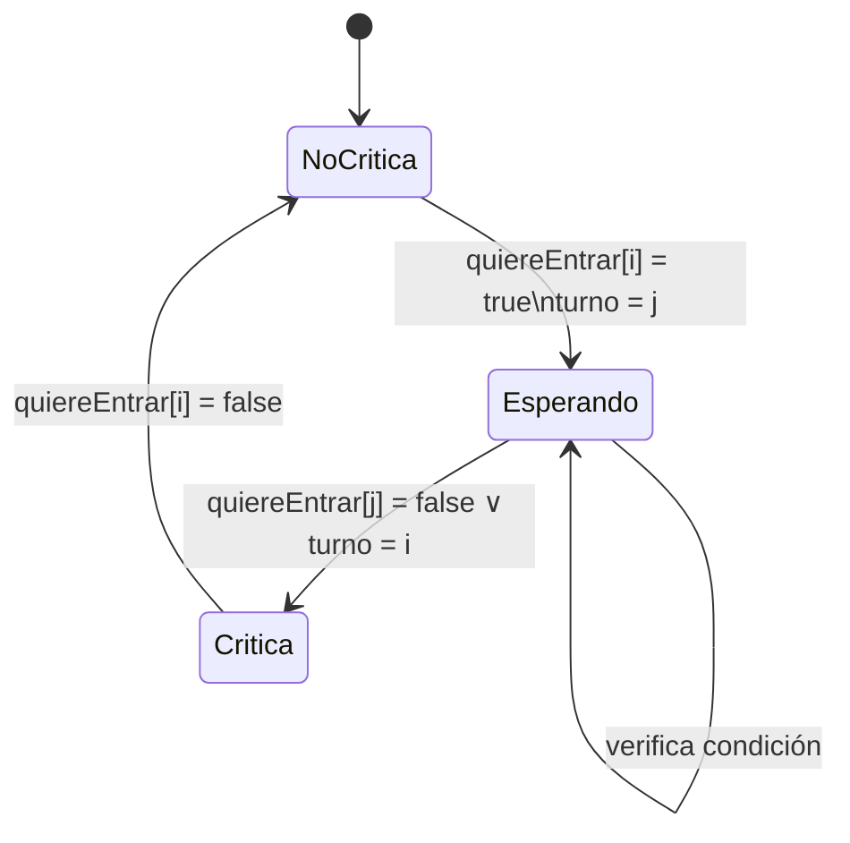

# Computación Concurrente - Exclusión mutua

## 2.1 Algoritmos para dos procesos.

---

La exclusión mutua es un mecanismo de sincronización que garantiza que solo un proceso puede acceder a una sección crítica en un momento dado. Para dos procesos, esto significa diseñar algoritmos que prevengan que ambos procesos ejecuten simultáneamente su sección crítica.

#### Propiedades Fundamentales

1. **Exclusión mutua**: Como máximo un proceso está en su sección crítica en cualquier momento
2. **Ausencia de deadlock**: Si varios procesos intentan entrar a su sección crítica, al menos uno debe tener éxito
3. **Ausencia de espera innecesaria**: Un proceso fuera de su sección crítica no debe impedir que otros entren
4. **Entrada eventual**: Un proceso que solicita entrar a su sección crítica eventualmente podrá hacerlo

### Algoritmo 1: Intento 1 - Alternancia Estricta

#### Descripción

El primer intento utiliza una variable turno que indica qué proceso puede entrar a la sección crítica.

```java
// Variables compartidas
int turno = 0; // 0 para P0, 1 para P1

// Proceso P0
while (true) {
    while (turno != 0) { /* espera */ }
    // Sección crítica
    turno = 1;
    // Sección no crítica
}

// Proceso P1
while (true) {
    while (turno != 1) { /* espera */ }
    // Sección crítica
    turno = 0;
    // Sección no crítica
}
```

#### Análisis

- (✓) **Garantiza exclusión mutua**
- (X) **No satisface entrada eventual**: Obliga a alternancia estricta
- (X) **Violación de progreso**: Un proceso puede bloquearse si el otro no quiere entrar

### Algoritmo 2: Intento 2 - Flags de Intención

#### Descripción

Cada proceso establece un flag indicando su intención de entrar a la sección crítica.

```java
// Variables compartidas
boolean[] quiereEntrar = {false, false};

// Proceso P0
while (true) {
    quiereEntrar[0] = true;
    while (quiereEntrar[1]) { /* espera */ }
    // Sección crítica
    quiereEntrar[0] = false;
    // Sección no crítica
}

// Proceso P1
while (true) {
    quiereEntrar[1] = true;
    while (quiereEntrar[0]) { /* espera */ }
    // Sección crítica
    quiereEntrar[1] = false;
    // Sección no crítica
}
```

#### Análisis

- (✓) **Satisface entrada eventual**
- (X) **Puede violar exclusión mutua**: Ambos pueden leer falso simultáneamente
- (X) **Posible deadlock**: Ambos pueden establecer sus flags antes de verificar

### Algoritmo de Peterson para Dos Procesos

#### Descripción Completa

El algoritmo de Peterson combina las ideas anteriores para lograr una solución correcta.

```java
// Variables compartidas
boolean[] quiereEntrar = {false, false};
int turno = 0;

// Proceso Pi (i = 0 o 1)
public void proceso(int i) {
    int j = 1 - i; // el otro proceso

    while (true) {
        // Protocolo de entrada
        quiereEntrar[i] = true;
        turno = j;

        // Espera activa
        while (quiereEntrar[j] && turno == j) {
            // Espera
        }

        // Sección crítica
        // Código de la sección crítica

        // Protocolo de salida
        quiereEntrar[i] = false;

        // Sección no crítica
        // Código de la sección no crítica
    }
}
```

#### Análisis Formal

**Teorema**: El algoritmo de Peterson satisface:

- Exclusión mutua
- Ausencia de deadlock
- Entrada eventual

**Demostración de exclusión mutua**:
Supongamos que ambos procesos están en su sección crítica simultáneamente. Entonces:

- Para P0: `!(quiereEntrar[1] && turno == 1)` debe ser falso
- Para P1: `!(quiereEntrar[0] && turno == 0)` debe ser falso

Esto implica que ambas condiciones `(quiereEntrar[1] && turno == 1)` y `(quiereEntrar[0] && turno == 0)` deben ser verdaderas simultáneamente, lo cual es imposible porque `turno` no puede ser 0 y 1 al mismo tiempo.

#### Diagrama de Estados del Algoritmo de Peterson



### Versión Formal en TLA+

```tla
---------------------------- MODULE Peterson2Processes ---------------------------
EXTENDS Integers

VARIABLES quiere0, quiere1, turno, pc0, pc1

vars == <<quiere0, quiere1, turno, pc0, pc1>>

ProcSet == {0,1}

NoCritica == "nc"
Esperando == "wait"
Critica == "cs"

Init == /\ quiere0 = FALSE
        /\ quiere1 = FALSE
        /\ turno \in {0,1}
        /\ pc0 = NoCritica
        /\ pc1 = NoCritica

Entrar(i) == /\ pc[i] = NoCritica
             /\ pc' = [pc EXCEPT ![i] = Esperando]
             /\ quiere' = [quiere EXCEPT ![i] = TRUE]
             /\ turno' = 1 - i

EntrarCS(i) == /\ pc[i] = Esperando
               /\ ~quiere[1-i] \/ turno = i
               /\ pc' = [pc EXCEPT ![i] = Critica]

Salir(i) == /\ pc[i] = Critica
            /\ pc' = [pc EXCEPT ![i] = NoCritica]
            /\ quiere' = [quiere EXCEPT ![i] = FALSE]

Next == \/ \E i \in ProcSet: Entrar(i) \/ EntrarCS(i) \/ Salir(i)

Spec == Init /\ [][Next]_vars

MutualExclusion == ~(pc0 = Critica /\ pc1 = Critica)

THEOREM Spec => []MutualExclusion
=============================================================================
```

### Algoritmo de Dekker

#### Descripción

El algoritmo de Dekker fue la primera solución correcta al problema de exclusión mutua.

```java
// Variables compartidas
boolean[] quiereEntrar = {false, false};
int turno = 0;

// Proceso P0
while (true) {
    quiereEntrar[0] = true;

    while (quiereEntrar[1]) {
        if (turno != 0) {
            quiereEntrar[0] = false;
            while (turno != 0) { /* espera */ }
            quiereEntrar[0] = true;
        }
    }

    // Sección crítica
    turno = 1;
    quiereEntrar[0] = false;

    // Sección no crítica
}

// Proceso P1 (simétrico)
while (true) {
    quiereEntrar[1] = true;

    while (quiereEntrar[0]) {
        if (turno != 1) {
            quiereEntrar[1] = false;
            while (turno != 1) { /* espera */ }
            quiereEntrar[1] = true;
        }
    }

    // Sección crítica
    turno = 0;
    quiereEntrar[1] = false;

    // Sección no crítica
}
```

#### Comparación Peterson vs Dekker

| Característica | Peterson        | Dekker               |
| -------------- | --------------- | -------------------- |
| Complejidad    | Más simple      | Más complejo         |
| Espera activa  | Condición única | Condiciones anidadas |
| Legibilidad    | Mejor           | Peor                 |
| Correctitud    | Probada         | Probada              |

### Modelo Formal de Corrección

#### Propiedades de Safety y Liveness

**Safety** (nada malo ocurre):

- Exclusión mutua: $¬(CS_0 ∧ CS_1)$
- Ausencia de interferencia

**Liveness** (algo bueno eventualmente ocurre):

- Ausencia de inanición: $ \Diamond(solicita_{i} → \Diamond CS_{i}) $
- Ausencia de deadlock

#### Notación Temporal

- $\Box$: Siempre (always)
- $\Diamond$: Eventualmente (eventually)
- $◯$: Siguiente estado (next)

### Ejercicios Propuestos

#### Ejercicio 1: Análisis de Corrección

Analice el siguiente algoritmo y determine si satisface exclusión mutua, ausencia de deadlock y entrada eventual:

```java
boolean f0 = false, f1 = false;

// Proceso P0
while (true) {
    f0 = true;
    while (f1) { /* espera */ }
    // Sección crítica
    f0 = false;
    // Sección no crítica
}

// Proceso P1
while (true) {
    f1 = true;
    while (f0) { /* espera */ }
    // Sección crítica
    f1 = false;
    // Sección no crítica
}
```

#### Ejercicio 2: Implementación con Semáforos

Implemente la exclusión mutua para dos procesos usando semáforos. Compare con las soluciones por software.

#### Ejercicio 3: Verificación Formal

Modele el algoritmo de Peterson en TLA+ y verifique formalmente la propiedad de exclusión mutua.

#### Ejercicio 4: Extensión a N Procesos

¿Cómo extendería el algoritmo de Peterson para N procesos? Describa los desafíos.

#### Ejercicio 5: Análisis de Rendimiento

Compare el número de operaciones atómicas requeridas en los algoritmos de Dekker y Peterson. ¿Cuál es más eficiente?

### Soluciones a Ejercicios Selectos

#### Solución Ejercicio 1

El algoritmo NO satisface exclusión mutua. Considere la siguiente secuencia:

1. P0 establece f0 = true
2. P1 establece f1 = true
3. Ambos verifican la condición del while: P0 ve f1 = true, P1 ve f0 = true
4. Ambos entran a la sección crítica simultáneamente

#### Solución Ejercicio 2

```java
Semaphore mutex = new Semaphore(1);

// Proceso P0
while (true) {
    mutex.acquire();
    // Sección crítica
    mutex.release();
    // Sección no crítica
}

// Proceso P1
while (true) {
    mutex.acquire();
    // Sección crítica
    mutex.release();
    // Sección no crítica
}
```

### Consideraciones de Implementación

#### Reordenamiento de Instrucciones

Los compiladores y procesadores pueden reordenar instrucciones, afectando la corrección:

```java
// INCORRECTO - posible reordenamiento
quiereEntrar[i] = true;
turno = j;
// Podría ejecutarse como: turno = j; quiereEntrar[i] = true;

// CORRECTO - uso de barreras de memoria
quiereEntrar[i] = true;
memoryBarrier(); // o volatile en Java
turno = j;
```

#### Volatilidad en Java

```java
public class Peterson {
    private volatile boolean[] quiereEntrar = {false, false};
    private volatile int turno = 0;

    public void lock(int i) {
        int j = 1 - i;
        quiereEntrar[i] = true;
        turno = j;
        while (quiereEntrar[j] && turno == j) {
            // Espera activa
        }
    }

    public void unlock(int i) {
        quiereEntrar[i] = false;
    }
}
```

### Referencias

#### Bibliografía Básica

1. **Taubenfeld, G. (2006)**. _Synchronization Algorithms and Concurrent Programming_ - Capítulo 2: "The Mutual Exclusion Problem"
2. **Herlihy, M. & Shavit, N. (2008)**. _The Art of Multiprocessor Programming_ - Capítulo 2: "Mutual Exclusion"

#### Bibliografía Complementaria

1. **Lamport, L. (2002)**. _Specifying Systems: The TLA+ Language and Tools_ - Capítulo 6: "Temporal Logic"

#### Lecturas Adicionales

- Peterson, G. L. (1981). "Myths About the Mutual Exclusion Problem"
- Dijkstra, E. W. (1965). "Solution of a Problem in Concurrent Programming Control"
- Lamport, L. (1974). "A New Solution of Dijkstra's Concurrent Programming Problem"

### Resumen de Conceptos Clave

- **Exclusión mutua**: Garantiza que solo un proceso accede a la sección crítica
- **Algoritmo de Peterson**: Solución elegante que combina flags de intención y turno
- **Propiedades fundamentales**: Safety (exclusión) y Liveness (progreso)
- **Verificación formal**: Herramientas como TLA+ permiten probar corrección
- **Consideraciones prácticas**: Volatilidad, reordenamiento, eficiencia
