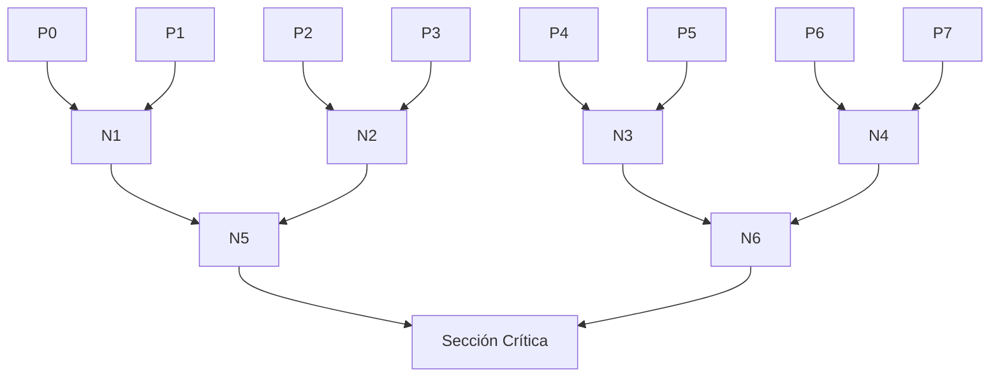
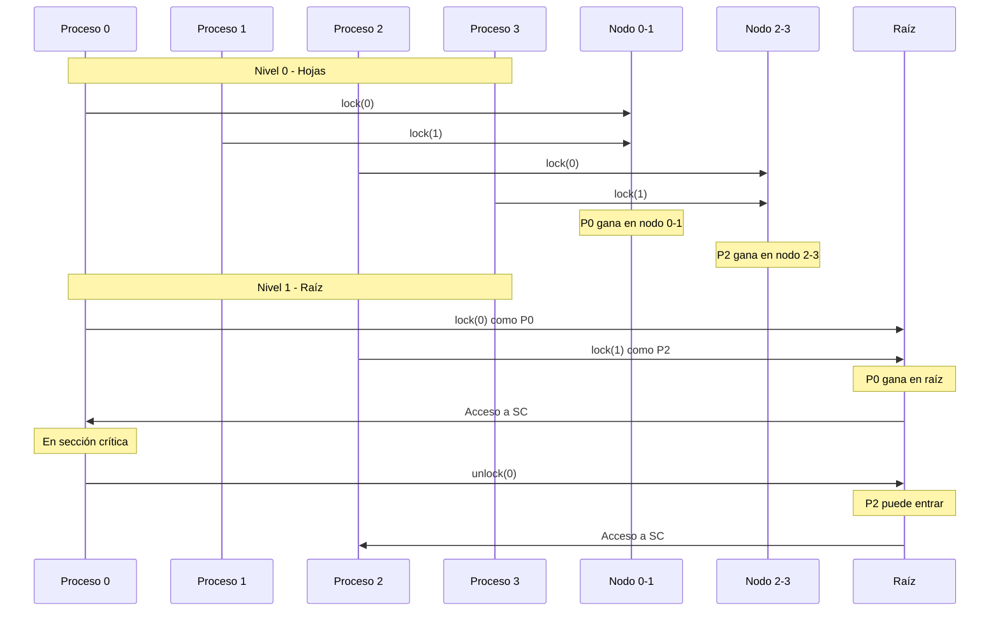

# Computación Concurrente - Exclusión mutua

## 2.2 Algoritmos de torneo.

---

Los algoritmos de torneo extienden las soluciones de exclusión mutua para dos procesos (como Peterson) a un número arbitrario de procesos $n$. La idea fundamental es organizar los procesos en un árbol binario donde cada nodo interno representa una instancia de un algoritmo para dos procesos.

#### Concepto Base

En un algoritmo de torneo, los procesos compiten en parejas en un árbol binario, donde el ganador de cada "partido" avanza al siguiente nivel hasta llegar a la raíz, que otorga acceso a la sección crítica.



### Estructura General del Algoritmo de Torneo

#### Variables Compartidas

Para $n$ procesos, necesitamos:

- $\lceil \log_2 n \rceil$ niveles en el árbol
- Un array de variables `turno` para cada nodo interno: `turno[nivel][nodo]`
- Un array de flags de intención: `quiereEntrar[nivel][proceso]`

#### Implementación Básica

```java
public class TournamentTree {
    private int niveles;
    private int n;
    private volatile boolean[][] quiereEntrar;
    private volatile int[][] turno;

    public TournamentTree(int numProcesos) {
        this.n = numProcesos;
        this.niveles = (int) Math.ceil(Math.log(n) / Math.log(2));
        this.quiereEntrar = new boolean[niveles][n];
        this.turno = new int[niveles][n / 2]; // n/2 nodos por nivel
    }

    public void lock(int procesoId) {
        int miId = procesoId;

        for (int nivel = 0; nivel < niveles; nivel++) {
            // Calcular nodo actual y oponente
            int nodo = miId / 2;
            int oponente = (miId % 2 == 0) ? miId + 1 : miId - 1;

            // Protocolo de Peterson para este nivel
            quiereEntrar[nivel][miId] = true;
            turno[nivel][nodo] = oponente;

            // Esperar mientras el oponente quiere entrar y es su turno
            while (quiereEntrar[nivel][oponente] && turno[nivel][nodo] == oponente) {
                // Espera activa
            }

            // Actualizar ID para el siguiente nivel
            miId = nodo;
        }
    }

    public void unlock(int procesoId) {
        int miId = procesoId;

        // Liberar desde la hoja hasta la raíz
        for (int nivel = 0; nivel < niveles; nivel++) {
            quiereEntrar[nivel][miId] = false;
            miId = miId / 2; // Subir al padre
        }
    }
}
```

### Algoritmo de Torneo Basado en Peterson

#### Versión Detallada

```java
public class PetersonTournament {
    private final int n;
    private final int depth;
    private final PetersonNode[][] tree;

    private static class PetersonNode {
        volatile boolean[] flag = new boolean[2];
        volatile int turn;
    }

    public PetersonTournament(int n) {
        this.n = n;
        this.depth = (int) Math.ceil(Math.log(n) / Math.log(2));
        this.tree = new PetersonNode[depth][];

        // Inicializar árbol
        for (int i = 0; i < depth; i++) {
            int nodesAtLevel = (int) Math.pow(2, depth - i - 1);
            tree[i] = new PetersonNode[nodesAtLevel];
            for (int j = 0; j < nodesAtLevel; j++) {
                tree[i][j] = new PetersonNode();
            }
        }
    }

    public void acquireLock(int threadId) {
        int currentId = threadId;

        for (int level = 0; level < depth; level++) {
            int nodeIndex = currentId / 2;
            PetersonNode node = tree[level][nodeIndex];
            int mySlot = currentId % 2;
            int otherSlot = 1 - mySlot;

            // Protocolo de Peterson para este nodo
            node.flag[mySlot] = true;
            node.turn = otherSlot;

            // Memory barrier para prevenir reordenamiento
            synchronized (this) {}

            while (node.flag[otherSlot] && node.turn == otherSlot) {
                // Espera activa
            }

            currentId = nodeIndex; // Ganador avanza al siguiente nivel
        }
    }

    public void releaseLock(int threadId) {
        int currentId = threadId;

        for (int level = 0; level < depth; level++) {
            int nodeIndex = currentId / 2;
            PetersonNode node = tree[level][nodeIndex];
            int mySlot = currentId % 2;

            node.flag[mySlot] = false;
            currentId = nodeIndex;
        }
    }
}
```

### Análisis de Complejidad

#### Complejidad Espacial

- **Número de nodos**: Para $n$ procesos, el árbol tiene $n-1$ nodos internos
- **Variables por nodo**: Cada nodo requiere 3 variables (2 flags + 1 turno)
- **Total de variables**: $3(n-1) = O(n)$

#### Complejidad Temporal

- **Adquisición del lock**: $O(\log n)$ niveles a atravesar
- **Liberación del lock**: $O(\log n)$ niveles
- **Operaciones por nivel**: 3 operaciones atómicas (2 escrituras + 1 condición)

#### Teorema de Corrección

**Teorema**: El algoritmo de torneo garantiza:

1. **Exclusión mutua**: $¬∃ i,j : (i ≠ j) ∧ (CS_i ∧ CS_j)$
2. **Ausencia de inanición**: $∀i : \Diamond(solicita_{i} → \Diamond CS_{i})$
3. **Ausencia de deadlock**: $\Diamond (∃i : CS_{i})$

**Demostración sketch**:

- Cada nivel implementa correctamente Peterson para 2 procesos
- Solo un proceso gana en cada nodo y avanza al siguiente nivel
- Por inducción en la altura del árbol, solo un proceso llega a la raíz

### Implementación con Número Arbitrario de Procesos

#### Manejo de Casos No Potencia de 2

```java
public class GeneralizedTournament {
    private final int actualN;
    private final int treeN;
    private final PetersonLock[][] tree;

    public GeneralizedTournament(int n) {
        this.actualN = n;
        this.treeN = nextPowerOfTwo(n);
        int depth = log2(treeN);
        this.tree = new PetersonLock[depth][];

        for (int i = 0; i < depth; i++) {
            int nodes = 1 << (depth - i - 1); // 2^(depth-i-1)
            tree[i] = new PetersonLock[nodes];
            for (int j = 0; j < nodes; j++) {
                tree[i][j] = new PetersonLock();
            }
        }
    }

    private int nextPowerOfTwo(int n) {
        return (int) Math.pow(2, Math.ceil(Math.log(n) / Math.log(2)));
    }

    private int log2(int n) {
        return (int) (Math.log(n) / Math.log(2));
    }

    public void lock(int pid) {
        if (pid >= actualN) return; // Proceso no existe

        int current = pid + (treeN - actualN); // Ajustar índice
        for (int level = 0; level < tree.length; level++) {
            int node = current / 2;
            int position = current % 2;
            tree[level][node].lock(position);
            current = node;
        }
    }

    public void unlock(int pid) {
        if (pid >= actualN) return;

        int current = pid + (treeN - actualN);
        for (int level = 0; level < tree.length; level++) {
            int node = current / 2;
            int position = current % 2;
            tree[level][node].unlock(position);
            current = node;
        }
    }
}
```

### Diagrama de Secuencia del Algoritmo



### Ejercicios Propuestos

#### Ejercicio 1: Implementación Completa

Implemente el algoritmo de torneo para 8 procesos y demuestre su corrección mediante testing exhaustivo.

```java
// Esqueleto para completar
public class Tournament8Processes {
    private final int LEVELS = 3;
    private volatile boolean[][] flags = new boolean[LEVELS][8];
    private volatile int[][] turns = new int[LEVELS][4];

    public void lock(int processId) {
        // TODO: Implementar
    }

    public void unlock(int processId) {
        // TODO: Implementar
    }
}
```

#### Ejercicio 2: Análisis de Fairness

Analice la fairness del algoritmo de torneo. ¿Garantiza equidad entre procesos? Demuestre su respuesta.

#### Ejercicio 3: Optimización de Espacio

Diseñe una versión optimizada que use solo $O(\log n)$ espacio adicional por proceso.

#### Ejercicio 4: Extensión a Lectores-Escritores

Modifique el algoritmo de torneo para implementar el problema de lectores-escritores con prioridad a escritores.

#### Ejercicio 5: Verificación Formal

Modele el algoritmo de torneo en TLA+ y verifique formalmente la propiedad de exclusión mutua.

### Solución al Ejercicio 1

```java
public class Tournament8Processes {
    private final int LEVELS = 3;
    private volatile boolean[][] flags = new boolean[LEVELS][8];
    private volatile int[][] turns = new int[LEVELS][4];

    public void lock(int processId) {
        int currentId = processId;

        for (int level = 0; level < LEVELS; level++) {
            int node = currentId / 2;
            int slot = currentId % 2;
            int opponent = (slot == 0) ? currentId + 1 : currentId - 1;

            flags[level][currentId] = true;
            turns[level][node] = opponent;

            // Memory barrier
            Thread.yield();

            while (flags[level][opponent] && turns[level][node] == opponent) {
                // Busy wait
            }

            currentId = node;
        }
    }

    public void unlock(int processId) {
        int currentId = processId;

        for (int level = 0; level < LEVELS; level++) {
            flags[level][currentId] = false;
            currentId = currentId / 2;
        }
    }
}
```

### Consideraciones de Implementación Real

#### Problemas de Performance

```java
// Versión optimizada con backoff
public void lockWithBackoff(int processId) {
    int currentId = processId;

    for (int level = 0; level < LEVELS; level++) {
        int node = currentId / 2;
        int slot = currentId % 2;
        int opponent = (slot == 0) ? currentId + 1 : currentId - 1;

        flags[level][currentId] = true;
        turns[level][node] = opponent;

        // Memory barrier
        synchronized (this) {}

        int backoff = 1;
        while (flags[level][opponent] && turns[level][node] == opponent) {
            // Exponential backoff
            for (int i = 0; i < backoff; i++) {
                Thread.yield();
            }
            backoff = Math.min(backoff * 2, 1024);
        }

        currentId = node;
    }
}
```

#### Consideraciones de Arquitectura

- **False sharing**: Variables en la misma línea de cache
- **Localidad espacial**: Organización de datos para optimizar acceso
- **Barreras de memoria**: Necesarias para consistencia en arquitecturas modernas

### Comparación con Otros Algoritmos

| Algoritmo    | Complejidad | Espacio | Fairness  |
| ------------ | ----------- | ------- | --------- |
| Torneo       | $O(\log n)$ | $O(n)$  | Buena     |
| Filter       | $O(n)$      | $O(n)$  | Justa     |
| Bakery       | $O(n)$      | $O(n)$  | Excelente |
| Test-And-Set | $O(1)$      | $O(1)$  | Mala      |

### Referencias Bibliográficas

#### Bibliografía Básica

1. **Taubenfeld, G. (2006)**. _Synchronization Algorithms and Concurrent Programming_
   - Capítulo 4: "Tournament Algorithms"
   - Sección 4.2: "Generalization of Two-Process Algorithms"

2. **Herlihy, M. & Shavit, N. (2008)**. _The Art of Multiprocessor Programming_
   - Capítulo 7: "Spin Locks and Contention"
   - Sección 7.5: "Queue Locks vs. Tournament Algorithms"

#### Bibliografía Complementaria

1. **Lamport, L. (2002)**. _Specifying Systems: The TLA+ Language and Tools_
   - Capítulo 14: "Advanced Examples"

#### Artículos Académicos Clave

- Peterson, G. L. (1981). "Myths About the Mutual Exclusion Problem"
- Lamport, L. (1986). "The Mutual Exclusion Problem Has Been Solved"
- Tromp, J. (1989). "How to Construct an Atomic Variable"

### Ejemplo de Uso en Aplicación Real

```java
public class ConcurrentCounter {
    private final TournamentLock lock;
    private int counter = 0;

    public ConcurrentCounter(int numThreads) {
        this.lock = new TournamentLock(numThreads);
    }

    public void increment(int threadId) {
        lock.lock(threadId);
        try {
            counter++;
        } finally {
            lock.unlock(threadId);
        }
    }

    public int getValue() {
        return counter;
    }
}

// Test de corrección
public class TournamentTest {
    public static void main(String[] args) throws InterruptedException {
        int numThreads = 8;
        ConcurrentCounter counter = new ConcurrentCounter(numThreads);

        Thread[] threads = new Thread[numThreads];
        for (int i = 0; i < numThreads; i++) {
            final int threadId = i;
            threads[i] = new Thread(() -> {
                for (int j = 0; j < 1000; j++) {
                    counter.increment(threadId);
                }
            });
        }

        for (Thread t : threads) t.start();
        for (Thread t : threads) t.join();

        System.out.println("Valor final: " + counter.getValue());
        System.out.println("Valor esperado: " + (numThreads * 1000));
    }
}
```

### Resumen y Conclusiones

Los algoritmos de torneo representan una solución elegante y eficiente para la exclusión mutua en sistemas con múltiples procesos:

- **Ventajas**:
  - Complejidad logarítmica en el peor caso
  - Uso razonable de memoria $(O(n))$
  - Fairness decente entre procesos
  - Basado en algoritmos bien entendidos para 2 procesos

- **Desventajas**:
  - Espera activa (busy waiting)
  - Sensible a problemas de cache y memoria
  - Complejidad de implementación mayor que soluciones hardware

- **Aplicaciones**:
  - Sistemas embebidos sin soporte hardware avanzado
  - Enseñanza de conceptos de concurrencia
  - Casos donde se necesita garantías de fairness
