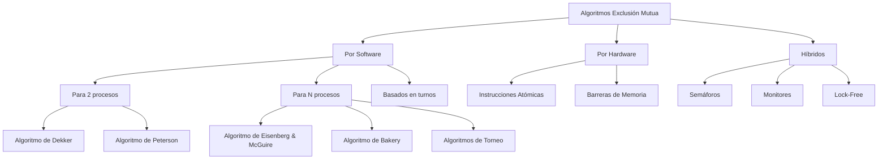

# Computación Concurrente - Exclusión mutua

## 2.3 Algoritmos de exclusión mutua.

---

### Definición Formal

La **exclusión mutua** es el problema de garantizar que cuando un proceso ejecuta su **sección crítica**, ningún otro proceso puede estar ejecutando su propia sección crítica. Formalmente:

$$
\forall i,j \quad (i \neq j) \Rightarrow \neg(CS_i \land CS_j)
$$

#### Propiedades Fundamentales

1. **Exclusión Mutua**: Como máximo un proceso está en su sección crítica en cualquier momento
2. **Progreso (Liveness)**: Si ningún proceso está en su sección crítica y algún proceso quiere entrar, entonces algún proceso eventualmente entra
3. **Espera Limitada (Bounded Waiting)**: Existe un límite en el número de veces que otros procesos pueden entrar a su sección crítica antes de que a un proceso solicitante se le conceda acceso

### Clasificación de Algoritmos de Exclusión Mutua



### Algoritmos para Dos Procesos

#### Algoritmo de Dekker

```java
public class DekkerLock {
    private boolean wantCS0 = false;
    private boolean wantCS1 = false;
    private int turn = 0;

    public void enterCS0() {
        wantCS0 = true;
        while (wantCS1) {
            if (turn != 0) {
                wantCS0 = false;
                while (turn != 0) {
                    // Espera activa
                }
                wantCS0 = true;
            }
        }
        // Sección crítica
    }

    public void exitCS0() {
        turn = 1;
        wantCS0 = false;
    }

    // Similar para proceso 1
}
```

#### Algoritmo de Peterson

```java
public class PetersonLock {
    private boolean[] flag = new boolean[2];
    private int turn;

    public void lock(int id) {
        int other = 1 - id;
        flag[id] = true;
        turn = other;
        while (flag[other] && turn == other) {
            // Espera activa
        }
    }

    public void unlock(int id) {
        flag[id] = false;
    }
}
```

### Algoritmos para N Procesos

#### Algoritmo de Eisenberg & McGuire

```java
public class EisenbergMcGuireLock {
    private int n;
    private int[] flag;
    private int turn;

    public EisenbergMcGuireLock(int numProcesses) {
        this.n = numProcesses;
        this.flag = new int[n];
        Arrays.fill(flag, 0); // 0: no quiere entrar, 1: quiere entrar, 2: en SC
        this.turn = 0;
    }

    public void lock(int i) {
        do {
            flag[i] = 1; // Quiere entrar
            while (turn != i) {
                if (flag[turn] == 0) {
                    turn = i;
                }
            }
            flag[i] = 2; // Listo para entrar

            // Verificar si algún proceso con mayor prioridad quiere entrar
            boolean found = false;
            for (int j = 0; j < n; j++) {
                if (j != i && flag[j] == 2) {
                    found = true;
                    break;
                }
            }
            if (!found) break;
        } while (true);

        // Sección crítica
    }

    public void unlock(int i) {
        // Encontrar siguiente proceso que quiere entrar
        int j = (turn + 1) % n;
        while (j != turn && flag[j] == 0) {
            j = (j + 1) % n;
        }
        if (j == turn) {
            turn = (turn + 1) % n;
        } else {
            turn = j;
        }
        flag[i] = 0;
    }
}
```

#### Algoritmo de Bakery (Lamport)

```java
public class BakeryLock {
    private int n;
    private boolean[] choosing;
    private int[] number;

    public BakeryLock(int numProcesses) {
        this.n = numProcesses;
        this.choosing = new boolean[n];
        this.number = new int[n];
    }

    public void lock(int i) {
        choosing[i] = true;

        // Obtener número de ticket
        number[i] = max(number) + 1;
        choosing[i] = false;

        for (int j = 0; j < n; j++) {
            if (j != i) {
                // Esperar si j está eligiendo número
                while (choosing[j]) {
                    Thread.yield();
                }

                // Esperar si j tiene ticket con menor número o mismo número pero menor ID
                while (number[j] != 0 &&
                      (number[j] < number[i] ||
                      (number[j] == number[i] && j < i))) {
                    Thread.yield();
                }
            }
        }
    }

    public void unlock(int i) {
        number[i] = 0;
    }

    private int max(int[] array) {
        int max = 0;
        for (int value : array) {
            if (value > max) max = value;
        }
        return max;
    }
}
```

### Algoritmos Basados en Hardware

#### Test-And-Set

```java
public class TestAndSetLock {
    private AtomicBoolean lock = new AtomicBoolean(false);

    public void lock() {
        while (lock.getAndSet(true)) {
            // Espera activa
        }
    }

    public void unlock() {
        lock.set(false);
    }
}
```

#### Compare-And-Swap (CAS)

```java
public class CASLock {
    private AtomicInteger lock = new AtomicInteger(0);

    public void lock() {
        while (!lock.compareAndSet(0, 1)) {
            // Espera activa
        }
    }

    public void unlock() {
        lock.set(0);
    }
}
```

#### Fetch-And-Add

```java
public class TicketLock {
    private AtomicInteger nextTicket = new AtomicInteger(0);
    private AtomicInteger nowServing = new AtomicInteger(0);

    public int lock() {
        int myTicket = nextTicket.getAndIncrement();
        while (nowServing.get() != myTicket) {
            // Espera activa
        }
        return myTicket;
    }

    public void unlock() {
        nowServing.incrementAndGet();
    }
}
```

### Modelo Formal de Corrección

#### Especificación TLA+

```tla
---------------------------- MODULE MutualExclusion ----------------------------
EXTENDS Integers

CONSTANT N  \* Número de procesos
VARIABLES pc, flag, turn

ProcSet == 0..N-1

NoCritica == "nc"
Esperando == "wait"
Critica == "cs"

TypeInvariant ==
    /\ pc \in [ProcSet -> {NoCritica, Esperando, Critica}]
    /\ flag \in [ProcSet -> {0,1,2}]
    /\ turn \in ProcSet

Init ==
    /\ pc = [i \in ProcSet -> NoCritica]
    /\ flag = [i \in ProcSet -> 0]
    /\ turn \in ProcSet

Entrar(i) ==
    /\ pc[i] = NoCritica
    /\ pc' = [pc EXCEPT ![i] = Esperando]
    /\ flag' = [flag EXCEPT ![i] = 1]

EntrarCS(i) ==
    /\ pc[i] = Esperando
    /\ \A j \in ProcSet \ {i}:
        flag[j] \neq 2 \/ turn \neq j
    /\ pc' = [pc EXCEPT ![i] = Critica]
    /\ flag' = [flag EXCEPT ![i] = 2]

Salir(i) ==
    /\ pc[i] = Critica
    /\ pc' = [pc EXCEPT ![i] = NoCritica]
    /\ flag' = [flag EXCEPT ![i] = 0]
    /\ turn' = (turn + 1) % N

Next ==
    \E i \in ProcSet: Entrar(i) \/ EntrarCS(i) \/ Salir(i)

MutualExclusion ==
    \A i,j \in ProcSet: i \neq j => ~(pc[i] = Critica /\ pc[j] = Critica)

Liveness ==
    \A i \in ProcSet: <> (pc[i] = Critica)

Spec == Init /\ [][Next]_<<pc, flag, turn>> /\ WF_<<pc, flag, turn>>(Next)

THEOREM Spec => []MutualExclusion
=============================================================================
```

### Análisis de Complejidad

#### Comparativa de Algoritmos

| Algoritmo    | Complejidad Espacio | Complejidad Tiempo | Espera Activa | Fairness |
| ------------ | ------------------- | ------------------ | ------------- | -------- |
| Dekker       | $O(1)$              | $O(1)$             | Sí            | Justa    |
| Peterson     | $O(1)$              | $O(1)$             | Sí            | Justa    |
| Bakery       | $O(n)$              | $O(n)$             | Sí            | Perfecta |
| Test-And-Set | $O(1)$              | $O(1)$             | Sí            | Mala     |
| Ticket Lock  | $O(1)$              | $O(1)$             | Sí            | FIFO     |

#### Teorema de Imposibilidad

**Teorema**: No existe un algoritmo de exclusión mutua que satisfaga las tres propiedades (exclusión mutua, progreso y espera limitada) usando solo registros de lectura/escritura atómicos en un modelo de memoria compartida asíncrona.

### Ejercicios Propuestos

#### Ejercicio 1: Implementación y Verificación

Implemente el algoritmo de Bakery y demuestre su corrección mediante testing concurrente.

```java
public class BakeryTest {
    private static final int NUM_THREADS = 5;
    private static final int ITERATIONS = 1000;
    private static BakeryLock lock = new BakeryLock(NUM_THREADS);
    private static int counter = 0;

    public static void main(String[] args) throws InterruptedException {
        // TODO: Implementar test de corrección
    }
}
```

#### Ejercicio 2: Análisis de Fairness

Analice la fairness del algoritmo de Ticket Lock y compárelo con el algoritmo de Bakery.

#### Ejercicio 3: Optimización de Performance

Diseñe una versión del algoritmo de Test-And-Set que reduzca el tráfico de cache usando exponential backoff.

#### Ejercicio 4: Verificación Formal

Modele el algoritmo de Eisenberg & McGuire en TLA+ y verifique formalmente la propiedad de exclusión mutua.

#### Ejercicio 5: Algoritmo Híbrido

Diseñe un algoritmo híbrido que combine las ventajas de los algoritmos por software y hardware.

### Soluciones a Ejercicios Selectos

#### Solución Ejercicio 1

```java
public class BakeryTest {
    private static final int NUM_THREADS = 5;
    private static final int ITERATIONS = 1000;
    private static BakeryLock lock = new BakeryLock(NUM_THREADS);
    private static int counter = 0;
    private static AtomicInteger maxSimultaneous = new AtomicInteger(0);
    private static AtomicInteger inCritical = new AtomicInteger(0);

    public static void main(String[] args) throws InterruptedException {
        Thread[] threads = new Thread[NUM_THREADS];

        for (int i = 0; i < NUM_THREADS; i++) {
            final int threadId = i;
            threads[i] = new Thread(() -> {
                for (int j = 0; j < ITERATIONS; j++) {
                    lock.lock(threadId);

                    // Verificar exclusión mutua
                    int current = inCritical.incrementAndGet();
                    int max = maxSimultaneous.get();
                    while (current > max &&
                           !maxSimultaneous.compareAndSet(max, current)) {
                        max = maxSimultaneous.get();
                    }

                    if (current > 1) {
                        System.out.println("VIOLACIÓN: " + current + " procesos en SC");
                    }

                    // Simular trabajo en sección crítica
                    counter++;

                    inCritical.decrementAndGet();
                    lock.unlock(threadId);
                }
            });
        }

        for (Thread t : threads) t.start();
        for (Thread t : threads) t.join();

        System.out.println("Contador final: " + counter);
        System.out.println("Valor esperado: " + (NUM_THREADS * ITERATIONS));
        System.out.println("Máximo simultáneo en SC: " + maxSimultaneous.get());
    }
}
```

#### Solución Ejercicio 3

```java
public class BackoffTASLock {
    private AtomicBoolean lock = new AtomicBoolean(false);
    private final int minDelay, maxDelay;

    public BackoffTASLock(int min, int max) {
        this.minDelay = min;
        this.maxDelay = max;
    }

    public void lock() {
        int delay = minDelay;
        while (true) {
            while (lock.get()) {
                // Espera lectura
            }
            if (!lock.getAndSet(true)) {
                return; // Adquirió lock
            }
            // Backoff exponencial
            try {
                Thread.sleep((long) (Math.random() * delay));
            } catch (InterruptedException e) {
                Thread.currentThread().interrupt();
                return;
            }
            if (delay < maxDelay) delay *= 2;
        }
    }

    public void unlock() {
        lock.set(false);
    }
}
```

### Consideraciones de Implementación en Sistemas Reales

#### Problemas de Performance

1. **Contención de Cache**: Múltiples procesos accediendo a las mismas variables
2. **False Sharing**: Variables no relacionadas en la misma línea de cache
3. **Starvation**: Algunos procesos nunca obtienen acceso

#### Técnicas de Optimización

```java
public class PaddedAtomicBoolean {
    // Padding para evitar false sharing
    private long p1, p2, p3, p4, p5, p6, p7;
    private AtomicBoolean value = new AtomicBoolean(false);
    private long p8, p9, p10, p11, p12, p13, p14;

    public boolean get() { return value.get(); }
    public boolean compareAndSet(boolean expect, boolean update) {
        return value.compareAndSet(expect, update);
    }
}
```

### Algoritmos Avanzados

#### CLH Lock

```java
public class CLHLock {
    private static class Node {
        volatile boolean locked = true;
    }

    private final ThreadLocal<Node> myNode = ThreadLocal.withInitial(Node::new);
    private final AtomicReference<Node> tail = new AtomicReference<>(new Node());

    public void lock() {
        Node node = myNode.get();
        node.locked = true;
        Node pred = tail.getAndSet(node);
        while (pred.locked) {
            // Espera activa
        }
    }

    public void unlock() {
        Node node = myNode.get();
        node.locked = false;
        // Reutilizar nodo anterior para mejorar performance
        myNode.set(new Node());
    }
}
```

#### MCS Lock

```java
public class MCSLock {
    private static class Node {
        volatile boolean locked = false;
        volatile Node next = null;
    }

    private final ThreadLocal<Node> myNode = ThreadLocal.withInitial(Node::new);
    private final AtomicReference<Node> tail = new AtomicReference<>();

    public void lock() {
        Node node = myNode.get();
        Node pred = tail.getAndSet(node);
        if (pred != null) {
            node.locked = true;
            pred.next = node;
            while (node.locked) {
                // Espera activa
            }
        }
    }

    public void unlock() {
        Node node = myNode.get();
        if (node.next == null) {
            if (tail.compareAndSet(node, null)) {
                return;
            }
            while (node.next == null) {
                // Espera
            }
        }
        node.next.locked = false;
        node.next = null;
    }
}
```

### Referencias Bibliográficas

#### Bibliografía Básica

1. **Taubenfeld, G. (2006)**. _Synchronization Algorithms and Concurrent Programming_
   - Capítulo 2: "The Mutual Exclusion Problem"
   - Capítulo 3: "Software Solutions"
   - Capítulo 4: "Hardware Solutions"

2. **Herlihy, M. & Shavit, N. (2008)**. _The Art of Multiprocessor Programming_
   - Capítulo 2: "Mutual Exclusion"
   - Capítulo 7: "Spin Locks and Contention"

#### Bibliografía Complementaria

1. **Lamport, L. (2002)**. _Specifying Systems: The TLA+ Language and Tools_
   - Capítulo 6: "Temporal Logic"

#### Artículos Seminales

- Dijkstra, E. W. (1965). "Solution of a Problem in Concurrent Programming Control"
- Lamport, L. (1974). "A New Solution of Dijkstra's Concurrent Programming Problem"
- Peterson, G. L. (1981). "Myths About the Mutual Exclusion Problem"

### Resumen y Conclusiones

Los algoritmos de exclusión mutua son fundamentales en computación concurrente:

- **Algoritmos por software**: Proveen soluciones portables pero con overhead
- **Algoritmos por hardware**: Eficientes pero dependientes de la arquitectura
- **Consideraciones prácticas**: Contención, fairness y overhead determinan la elección

La elección del algoritmo depende del contexto:

- **Sistemas embebidos**: Algoritmos por software simples
- **Sistemas de alto rendimiento**: Algoritmos hardware optimizados
- **Sistemas con fairness crítica**: Algoritmos como Bakery o Ticket Lock
