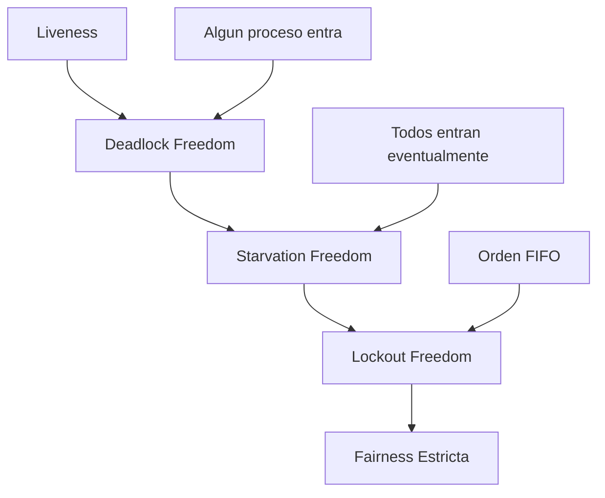

# Computación Concurrente - Exclusión mutua

## 2.4 Algoritmos libres de hambruna.

---

### Definición Formal

Un algoritmo es **libre de hambruna** (starvation-free) si todo proceso que solicita entrar a la sección crítica eventualmente obtiene acceso. Formalmente:

$$
\forall i: \square (solicita_i \rightarrow \lozenge CS_i)
$$

Donde:

- $\square$ significa "siempre"
- $\lozenge$ significa "eventualmente"
- $solicita_i$: proceso i solicita entrar a la SC
- $CS_i$: proceso i está en su sección crítica

#### Jerarquía de Propiedades de Liveness



### Propiedades de Algoritmos Libres de Hambruna

#### Definiciones Clave

1. **Deadlock Freedom**:

   $$ \lozenge(\exists i: CS_{i} ) $$

2. **Starvation Freedom**:

   $$ \forall i: \square( solicita_{i} \rightarrow \lozenge CS_{i} ) $$

3. **Bounded Waiting**:

$$ \exists k \in \Bbb{N} : \forall i,j : CS_{i} \rightarrow \square ( \# CS_{j} \leq k \text{ antes de } CS_{i} ) $$

### Algoritmo de Bakery (Lamport)

#### Descripción Completa

El algoritmo de Bakery garantiza libre hambruna mediante tickets numerados.

```java
public class BakeryLock {
    private final int n;
    private volatile boolean[] choosing;
    private volatile int[] number;

    public BakeryLock(int numProcesses) {
        this.n = numProcesses;
        this.choosing = new boolean[n];
        this.number = new int[n];
    }

    public void lock(int i) {
        // Fase 1: Obtener ticket
        choosing[i] = true;
        number[i] = max(number) + 1;
        choosing[i] = false;

        // Fase 2: Esperar turno
        for (int j = 0; j < n; j++) {
            if (j != i) {
                // Esperar si j está eligiendo número
                while (choosing[j]) {
                    Thread.yield();
                }

                // Esperar si j tiene prioridad
                while (number[j] != 0 &&
                      (number[j] < number[i] ||
                      (number[j] == number[i] && j < i))) {
                    Thread.yield();
                }
            }
        }
    }

    public void unlock(int i) {
        number[i] = 0;
    }

    private int max(int[] array) {
        int max = 0;
        for (int value : array) {
            if (value > max) max = value;
        }
        return max;
    }
}
```

#### Análisis de Corrección

**Teorema**: El algoritmo de Bakery es libre de hambruna.

**Demostración**:

1. Los números de ticket son únicos y crecientes
2. El orden de entrada está determinado por $(number[i], i)$
3. Cada proceso eventualmente obtiene el menor número disponible
4. Un proceso con ticket $(k, i)$ espera como máximo a $n-1$ procesos con tickets menores

### Algoritmo de Ticket con Espera Limitada

```java
public class FairTicketLock {
    private final AtomicInteger nextTicket = new AtomicInteger(0);
    private final AtomicInteger nowServing = new AtomicInteger(0);
    private final int n;

    public FairTicketLock(int numProcesses) {
        this.n = numProcesses;
    }

    public int lock() {
        int myTicket = nextTicket.getAndIncrement();
        while (nowServing.get() != myTicket) {
            // Espera activa con verificación de fairness
            if (myTicket - nowServing.get() > n) {
                // Detectar posible hambruna
                throw new RuntimeException("Possible starvation detected");
            }
            Thread.yield();
        }
        return myTicket;
    }

    public void unlock() {
        nowServing.incrementAndGet();
    }
}
```

### Algoritmo de Cola (Queue Locks)

#### CLH Queue Lock

```java
public class CLHLock {
    private static class QNode {
        volatile boolean locked = false;
    }

    private final ThreadLocal<QNode> myNode = ThreadLocal.withInitial(QNode::new);
    private final ThreadLocal<QNode> myPred = new ThreadLocal<>();
    private final AtomicReference<QNode> tail = new AtomicReference<>(new QNode());

    public void lock() {
        QNode node = myNode.get();
        node.locked = true;
        QNode pred = tail.getAndSet(node);
        myPred.set(pred);
        while (pred.locked) {
            // Espera en predecesor
            Thread.yield();
        }
    }

    public void unlock() {
        QNode node = myNode.get();
        node.locked = false;
        // Reutilizar el nodo del predecesor para mejorar localidad
        myNode.set(myPred.get());
    }
}
```

#### MCS Queue Lock

```java
public class MCSLock {
    private static class QNode {
        volatile boolean locked = false;
        volatile QNode next = null;
    }

    private final ThreadLocal<QNode> myNode = ThreadLocal.withInitial(QNode::new);
    private final AtomicReference<QNode> tail = new AtomicReference<>();

    public void lock() {
        QNode node = myNode.get();
        QNode pred = tail.getAndSet(node);
        if (pred != null) {
            node.locked = true;
            pred.next = node;
            while (node.locked) {
                Thread.yield();
            }
        }
    }

    public void unlock() {
        QNode node = myNode.get();
        if (node.next == null) {
            if (tail.compareAndSet(node, null)) {
                return;
            }
            while (node.next == null) {
                Thread.yield();
            }
        }
        node.next.locked = false;
        node.next = null;
    }
}
```

### Análisis de Fairness

#### Métricas de Fairness

1. **Índice de Fairness**:

   $$ F = \frac{(\sum_{i=1}^n x_i)^2}{n \cdot \sum_{i=1}^n x_i^2} $$

   Donde $x_i$ es el número de accesos del proceso i.

2. **Desviación Estándar de Esperas**:

   $$ \sigma = \sqrt{\frac{1}{n} \sum_{i=1}^n (w_i - \bar{w})^2} $$

#### Comparativa de Algoritmos

```java
public class FairnessAnalyzer {
    public static double calculateFairnessIndex(long[] accessCounts) {
        double sum = 0;
        double sumSquares = 0;

        for (long count : accessCounts) {
            sum += count;
            sumSquares += count * count;
        }

        return (sum * sum) / (accessCounts.length * sumSquares);
    }

    public static double calculateWaitStdDev(long[] waitTimes) {
        double mean = 0;
        for (long time : waitTimes) {
            mean += time;
        }
        mean /= waitTimes.length;

        double variance = 0;
        for (long time : waitTimes) {
            variance += (time - mean) * (time - mean);
        }
        variance /= waitTimes.length;

        return Math.sqrt(variance);
    }
}
```

### Algoritmo de Filtro (Filter Lock)

```java
public class FilterLock {
    private final int n;
    private volatile int[] level;
    private volatile int[] victim;

    public FilterLock(int numProcesses) {
        this.n = numProcesses;
        this.level = new int[n];
        this.victim = new int[n];
    }

    public void lock(int i) {
        for (int L = 1; L < n; L++) {
            level[i] = L;
            victim[L] = i;

            // Esperar hasta ser el único proceso en nivel L o superior
            boolean conflictExists;
            do {
                conflictExists = false;
                for (int k = 0; k < n; k++) {
                    if (k != i && level[k] >= L) {
                        conflictExists = true;
                        break;
                    }
                }
            } while (conflictExists && victim[L] == i);
        }
    }

    public void unlock(int i) {
        level[i] = 0;
    }
}
```

### Modelo Formal TLA+ para Libre Hambruna

```tla
---------------------------- MODULE StarvationFreeME ----------------------------
EXTENDS Integers, TLC

CONSTANT N  \* Number of processes
VARIABLES pc, ticket, serving

ProcSet == 0..N-1

NoCritica == "nc"
Esperando == "wait"
Critica == "cs"

TypeInvariant ==
    /\ pc \in [ProcSet -> {NoCritica, Esperando, Critica}]
    /\ ticket \in [ProcSet -> Nat]
    /\ serving \in Nat

Init ==
    /\ pc = [i \in ProcSet -> NoCritica]
    /\ ticket = [i \in ProcSet -> 0]
    /\ serving = 0

GetTicket(i) ==
    /\ pc[i] = NoCritica
    /\ pc' = [pc EXCEPT ![i] = Esperando]
    /\ ticket' = [ticket EXCEPT ![i] = Max(ticket) + 1]

EnterCS(i) ==
    /\ pc[i] = Esperando
    /\ ticket[i] # 0
    /\ \A j \in ProcSet \ {i}:
        ticket[j] = 0 \/ ticket[i] < ticket[j] \/
        (ticket[i] = ticket[j] /\ i < j)
    /\ serving = ticket[i] - 1
    /\ pc' = [pc EXCEPT ![i] = Critica]

ExitCS(i) ==
    /\ pc[i] = Critica
    /\ pc' = [pc EXCEPT ![i] = NoCritica]
    /\ ticket' = [ticket EXCEPT ![i] = 0]
    /\ serving' = serving + 1

Next ==
    \E i \in ProcSet: GetTicket(i) \/ EnterCS(i) \/ ExitCS(i)

MutualExclusion ==
    \A i,j \in ProcSet: i # j => ~(pc[i] = Critica /\ pc[j] = Critica)

StarvationFree ==
    \A i \in ProcSet:
        pc[i] = Esperando ~> pc[i] = Critica

Spec == Init /\ [][Next]_<<pc, ticket, serving>> /\ WF_<<pc, ticket, serving>>(Next)

THEOREM Spec => []MutualExclusion
THEOREM Spec => StarvationFree
=============================================================================
```

### Algoritmo de Semaforo Justo

```java
public class FairSemaphore {
    private final int permits;
    private int available;
    private final Queue<Thread> waitQueue;

    public FairSemaphore(int permits) {
        this.permits = permits;
        this.available = permits;
        this.waitQueue = new LinkedList<>();
    }

    public synchronized void acquire() throws InterruptedException {
        Thread current = Thread.currentThread();
        waitQueue.add(current);

        try {
            while (available == 0 || waitQueue.peek() != current) {
                wait();
            }
            waitQueue.remove();
            available--;
        } catch (InterruptedException e) {
            waitQueue.remove(current);
            throw e;
        }
    }

    public synchronized void release() {
        available++;
        notifyAll();
    }
}
```

### Ejercicios Propuestos

#### Ejercicio 1: Implementación y Análisis

Implemente el algoritmo de Bakery y mida su índice de fairness para diferentes cargas de trabajo.

```java
public class BakeryFairnessTest {
    private static final int NUM_THREADS = 5;
    private static final int DURATION_MS = 5000;
    private static BakeryLock lock = new BakeryLock(NUM_THREADS);
    private static long[] accessCounts = new long[NUM_THREADS];

    // TODO: Implementar test de fairness
}
```

#### Ejercicio 2: Comparativa de Algoritmos

Compare la fairness de CLH Lock, MCS Lock y Bakery Lock bajo alta contención.

#### Ejercicio 3: Detección de Hambruna

Implemente un monitor que detecte posibles casos de hambruna en tiempo de ejecución.

#### Ejercicio 4: Algoritmo Híbrido

Diseñe un algoritmo que combine la eficiencia de los locks por hardware con la fairness de los algoritmos por software.

#### Ejercicio 5: Análisis Teórico

Demuestre formalmente que el algoritmo de Bakery garantiza libre hambruna.

### Soluciones a Ejercicios Selectos

#### Solución Ejercicio 1

```java
public class BakeryFairnessTest {
    private static final int NUM_THREADS = 5;
    private static final int DURATION_MS = 5000;
    private static BakeryLock lock = new BakeryLock(NUM_THREADS);
    private static long[] accessCounts = new long[NUM_THREADS];
    private static volatile boolean running = true;

    public static void main(String[] args) throws InterruptedException {
        Thread[] threads = new Thread[NUM_THREADS];

        for (int i = 0; i < NUM_THREADS; i++) {
            final int threadId = i;
            threads[i] = new Thread(() -> {
                long count = 0;
                while (running) {
                    lock.lock(threadId);
                    try {
                        accessCounts[threadId]++;
                        count++;
                        // Simular trabajo en SC
                        Thread.yield();
                    } finally {
                        lock.unlock(threadId);
                    }
                }
                System.out.printf("Thread %d: %d accesses%n", threadId, count);
            });
        }

        for (Thread t : threads) t.start();
        Thread.sleep(DURATION_MS);
        running = false;

        for (Thread t : threads) t.join();

        double fairnessIndex = FairnessAnalyzer.calculateFairnessIndex(accessCounts);
        System.out.printf("Fairness Index: %.4f%n", fairnessIndex);

        System.out.println("Access distribution:");
        for (int i = 0; i < NUM_THREADS; i++) {
            System.out.printf("  Thread %d: %d (%.2f%%)%n",
                i, accessCounts[i],
                100.0 * accessCounts[i] / sum(accessCounts));
        }
    }

    private static long sum(long[] array) {
        long total = 0;
        for (long value : array) total += value;
        return total;
    }
}
```

#### Solución Ejercicio 3

```java
public class StarvationDetector {
    private final Map<Thread, Long> lastAccessTime = new ConcurrentHashMap<>();
    private final Map<Thread, Long> accessCounts = new ConcurrentHashMap<>();
    private final long starvationThresholdMs;
    private volatile boolean monitoring = true;

    public StarvationDetector(long thresholdMs) {
        this.starvationThresholdMs = thresholdMs;
        startMonitoring();
    }

    public void recordAccess(Thread thread) {
        long currentTime = System.currentTimeMillis();
        lastAccessTime.put(thread, currentTime);
        accessCounts.merge(thread, 1L, Long::sum);
    }

    private void startMonitoring() {
        Thread monitorThread = new Thread(() -> {
            while (monitoring) {
                try {
                    Thread.sleep(1000);
                    checkForStarvation();
                } catch (InterruptedException e) {
                    Thread.currentThread().interrupt();
                    break;
                }
            }
        });
        monitorThread.setDaemon(true);
        monitorThread.start();
    }

    private void checkForStarvation() {
        long currentTime = System.currentTimeMillis();

        for (Map.Entry<Thread, Long> entry : lastAccessTime.entrySet()) {
            Thread thread = entry.getKey();
            long lastAccess = entry.getValue();
            long waitTime = currentTime - lastAccess;

            if (waitTime > starvationThresholdMs && thread.isAlive()) {
                System.err.printf(
                    "POSSIBLE STARVATION: Thread %s waiting for %d ms%n",
                    thread.getName(), waitTime);
            }
        }
    }

    public void stop() {
        monitoring = false;
    }

    public double getFairnessIndex() {
        long[] counts = accessCounts.values().stream()
            .mapToLong(Long::longValue)
            .toArray();
        return FairnessAnalyzer.calculateFairnessIndex(counts);
    }
}
```

### Técnicas para Garantizar Libre Hambruna

#### Estrategias Comunes

1. **Turnos Rotativos**: Asignar turnos en round-robin
2. **Tickets Numerados**: Ordenar solicitudes por números crecientes
3. **Colas FIFO**: Mantener orden de llegada
4. **Envejecimiento**: Aumentar prioridad de procesos que esperan mucho tiempo

#### Algoritmo con Envejecimiento

```java
public class AgingLock {
    private final int n;
    private volatile int[] priority;
    private volatile boolean[] choosing;
    private volatile int[] number;

    public AgingLock(int numProcesses) {
        this.n = numProcesses;
        this.priority = new int[n];
        this.choosing = new boolean[n];
        this.number = new int[n];
    }

    public void lock(int i) {
        // Incrementar prioridad por envejecimiento
        priority[i]++;

        choosing[i] = true;
        number[i] = max(number) + 1;
        choosing[i] = false;

        for (int j = 0; j < n; j++) {
            if (j != i) {
                while (choosing[j]) {
                    Thread.yield();
                }

                while (number[j] != 0 &&
                      shouldWait(number[j], priority[j], j,
                                number[i], priority[i], i)) {
                    Thread.yield();
                }
            }
        }
    }

    private boolean shouldWait(int numJ, int prioJ, int j,
                             int numI, int prioI, int i) {
        // Considerar prioridad por envejecimiento
        if (prioJ > prioI) return true;
        if (prioJ < prioI) return false;

        // Si prioridades iguales, usar número de ticket
        if (numJ < numI) return true;
        if (numJ > numI) return false;

        // Si números iguales, usar ID
        return j < i;
    }

    public void unlock(int i) {
        number[i] = 0;
        // Resetear prioridad después de acceder
        priority[i] = 0;
    }
}
```

### Referencias Bibliográficas

#### Bibliografía Básica

1. **Taubenfeld, G. (2006)**. _Synchronization Algorithms and Concurrent Programming_
   - Capítulo 3: "The Mutual Exclusion Problem"
   - Sección 3.4: "Starvation-Free Algorithms"
   - Capítulo 5: "Fairness and Performance"

2. **Herlihy, M. & Shavit, N. (2008)**. _The Art of Multiprocessor Programming_
   - Capítulo 7: "Spin Locks and Contention"
   - Sección 7.5: "Queue Locks"
   - Capítulo 8: "Monitors and Blocking Synchronization"

#### Bibliografía Complementaria

1. **Lamport, L. (2002)**. _Specifying Systems: The TLA+ Language and Tools_
   - Capítulo 8: "Liveness and Fairness"

#### Artículos Fundamentales

- Lamport, L. (1974). "A New Solution of Dijkstra's Concurrent Programming Problem"
- Lamport, L. (1986). "The Mutual Exclusion Problem Has Been Solved"
- Mellor-Crummey, J. M., & Scott, M. L. (1991). "Algorithms for Scalable Synchronization on Shared-Memory Multiprocessors"

### Resumen y Conclusiones

Los algoritmos libres de hambruna son esenciales para sistemas concurrentes que requieren equidad:

- **Algoritmos por software**: Bakery, Ticket - Garantizan fairness pero con overhead
- **Algoritmos por hardware**: Queue locks (CLH, MCS) - Eficientes y fair
- **Técnicas avanzadas**: Envejecimiento, monitoreo en tiempo real

**Consideraciones de diseño**:

- Trade-off entre fairness y performance
- Overhead de mantenimiento de colas o tickets
- Escalabilidad bajo alta contención

Los algoritmos presentados proporcionan soluciones robustas para garantizar que todos los procesos eventualmente accedan a recursos compartidos, eliminando el riesgo de hambruna en sistemas concurrentes.
