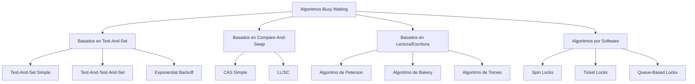
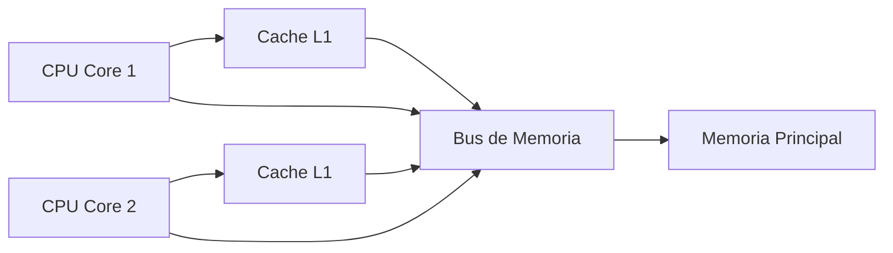

# Computación Concurrente - Exclusión mutua

## 2.5 Algoritmos con espera ocupada (busy waiting).

---

### Introducción a la Espera Ocupada

#### Definición Formal

La **espera ocupada** (busy waiting) ocurre cuando un proceso repetidamente verifica una condición en un bucle mientras espera por acceso a un recurso compartido. Formalmente:

$$ \text{BusyWait(condición)} \equiv \text{mientras } \neg \text{condición} \text{ hacer } \text{no-op} $$

#### Características de la Espera Ocupada

- **Ventajas**:
  - Baja latencia cuando la espera es corta
  - No requiere cambio de contexto
  - Simple de implementar

- **Desventajas**:
  - Desperdicio de ciclos de CPU
  - Puede causar contención de cache
  - No escalable con muchos procesos

### Clasificación de Algoritmos con Busy Waiting



### Algoritmos Basados en Instrucciones de Hardware

#### Test-And-Set

```java
public class TestAndSetLock {
    private volatile boolean lock = false;

    // Operación atómica Test-And-Set
    private boolean testAndSet() {
        boolean oldValue = lock;
        lock = true;
        return oldValue;
    }

    public void acquire() {
        while (testAndSet()) {
            // Busy waiting
        }
    }

    public void release() {
        lock = false;
    }
}
```

#### Versión con Backoff Exponencial

```java
public class BackoffTASLock {
    private final AtomicBoolean lock = new AtomicBoolean(false);
    private final int minDelay, maxDelay;

    public BackoffTASLock(int min, int max) {
        this.minDelay = min;
        this.maxDelay = max;
    }

    public void acquire() {
        int delay = minDelay;
        while (true) {
            // Fase 1: Leer sin modificar
            while (lock.get()) {
                Thread.onSpinWait();
            }

            // Fase 2: Intentar adquirir
            if (!lock.getAndSet(true)) {
                return; // Éxito
            }

            // Backoff exponencial
            try {
                Thread.sleep((long) (Math.random() * delay));
            } catch (InterruptedException e) {
                Thread.currentThread().interrupt();
                return;
            }
            if (delay < maxDelay) delay *= 2;
        }
    }

    public void release() {
        lock.set(false);
    }
}
```

#### Compare-And-Swap (CAS)

```java
public class CASLock {
    private final AtomicInteger state = new AtomicInteger(0);
    private static final int FREE = 0;
    private static final int LOCKED = 1;

    public void acquire() {
        while (!state.compareAndSet(FREE, LOCKED)) {
            // Busy waiting con optimización
            Thread.onSpinWait();
        }
    }

    public void release() {
        state.set(FREE);
    }
}
```

### Algoritmos por Software con Busy Waiting

#### Algoritmo de Peterson para 2 Procesos

```java
public class PetersonLock {
    private volatile boolean[] flag = new boolean[2];
    private volatile int turn;

    public void acquire(int id) {
        int other = 1 - id;
        flag[id] = true;          // Indicar interés
        turn = other;             // Dar prioridad al otro

        // Memory barrier implícito con volatile
        // Esperar mientras el otro quiere entrar y es su turno
        while (flag[other] && turn == other) {
            Thread.onSpinWait();
        }
    }

    public void release(int id) {
        flag[id] = false;
    }
}
```

#### Algoritmo de Bakery para N Procesos

```java
public class BakeryLock {
    private final int n;
    private volatile boolean[] choosing;
    private volatile int[] number;

    public BakeryLock(int numProcesses) {
        this.n = numProcesses;
        this.choosing = new boolean[n];
        this.number = new int[n];
    }

    public void acquire(int i) {
        // Fase 1: Obtener número de ticket
        choosing[i] = true;
        number[i] = findMaxNumber() + 1;
        choosing[i] = false;

        // Fase 2: Comparar con todos los demás procesos
        for (int j = 0; j < n; j++) {
            if (j != i) {
                // Esperar si j está eligiendo número
                while (choosing[j]) {
                    Thread.onSpinWait();
                }

                // Esperar si j tiene ticket con menor número
                while (number[j] != 0 &&
                      (number[j] < number[i] ||
                      (number[j] == number[i] && j < i))) {
                    Thread.onSpinWait();
                }
            }
        }
    }

    public void release(int i) {
        number[i] = 0;
    }

    private int findMaxNumber() {
        int max = 0;
        for (int i = 0; i < n; i++) {
            if (number[i] > max) {
                max = number[i];
            }
        }
        return max;
    }
}
```

### Análisis de Performance

#### Métricas de Evaluación

1. **Contención de Cache**:

   $$ \text{Cache Miss Rate} = \frac{\text{Número de cache misses}}{\text{Total de accesos}} $$

2. **Throughput**:

   $$ \text{Throughput} = \frac{\text{Número de operaciones completadas}}{\text{Tiempo total}} $$

3. **Latencia**:

   $$ \text{Latencia} = T_{\text{fin}} - T_{\text{inicio}} $$

#### Modelo Matemático de Busy Waiting

El tiempo esperado de espera en busy waiting puede modelarse como:

$$ E[T_{\text{wait}}] = \frac{1}{\mu} \cdot \frac{\rho}{1 - \rho} $$

Donde:

- $\mu$: Tasa de servicio
- $\rho$: Utilización del recurso $(\rho = \lambda / \mu)$
- $\lambda$: Tasa de llegada de solicitudes

### Técnicas de Optimización

#### Thread.onSpinWait()

```java
public class OptimizedSpinLock {
    private final AtomicBoolean lock = new AtomicBoolean(false);

    public void acquire() {
        // Fase 1: Espera de lectura optimizada
        while (lock.get()) {
            Thread.onSpinWait(); // Hint al CPU para optimizar
        }

        // Fase 2: Intentar adquirir
        while (!lock.compareAndSet(false, true)) {
            // Re-esperar si falla CAS
            while (lock.get()) {
                Thread.onSpinWait();
            }
        }
    }

    public void release() {
        lock.set(false);
    }
}
```

#### Test-And-Test-And-Set

```java
public class TATASLock {
    private final AtomicBoolean lock = new AtomicBoolean(false);

    public void acquire() {
        while (true) {
            // Primero test (lectura local)
            while (lock.get()) {
                Thread.onSpinWait();
            }

            // Luego test-and-set
            if (!lock.getAndSet(true)) {
                return;
            }
        }
    }

    public void release() {
        lock.set(false);
    }
}
```

### Algoritmos de Torneo con Busy Waiting

```java
public class TournamentLock {
    private final int n;
    private final int levels;
    private final PetersonLock[][] tree;

    public TournamentLock(int numProcesses) {
        this.n = numProcesses;
        this.levels = (int) Math.ceil(Math.log(n) / Math.log(2));
        this.tree = new PetersonLock[levels][];

        // Construir árbol binario
        for (int i = 0; i < levels; i++) {
            int nodes = 1 << (levels - i - 1); // 2^(levels-i-1)
            tree[i] = new PetersonLock[nodes];
            for (int j = 0; j < nodes; j++) {
                tree[i][j] = new PetersonLock();
            }
        }
    }

    public void acquire(int processId) {
        int currentId = processId;

        for (int level = 0; level < levels; level++) {
            int nodeIndex = currentId / 2;
            int position = currentId % 2;

            tree[level][nodeIndex].acquire(position);
            currentId = nodeIndex; // Avanzar al siguiente nivel
        }
    }

    public void release(int processId) {
        int currentId = processId;

        for (int level = 0; level < levels; level++) {
            int nodeIndex = currentId / 2;
            int position = currentId % 2;

            tree[level][nodeIndex].release(position);
            currentId = nodeIndex;
        }
    }
}
```

### Ejemplos de Implementación en Diferentes Lenguajes

#### C con Atomics

```c
#include <stdatomic.h>
#include <stdbool.h>

typedef struct {
    _Atomic bool lock;
} tas_lock_t;

void tas_init(tas_lock_t *lock) {
    atomic_store(&lock->lock, false);
}

void tas_acquire(tas_lock_t *lock) {
    while (atomic_exchange(&lock->lock, true)) {
        // Busy waiting
        #ifdef __x86_64__
        asm volatile("pause" ::: "memory");
        #endif
    }
}

void tas_release(tas_lock_t *lock) {
    atomic_store(&lock->lock, false);
}
```

#### Python con threading

```python
import threading
import time

class TTASLock:
    def __init__(self):
        self._lock = threading.Lock()
        self._owner = None

    def acquire(self):
        while True:
            # Test phase
            while self._lock.locked():
                time.sleep(0.001)  # Pequeño sleep para reducir CPU

            # Test-and-set phase
            if not self._lock.locked():
                acquired = self._lock.acquire(blocking=False)
                if acquired:
                    self._owner = threading.current_thread().ident
                    return

    def release(self):
        if self._owner == threading.current_thread().ident:
            self._owner = None
            self._lock.release()
```

### Ejercicios Propuestos

#### Ejercicio 1: Implementación y Medición

Implemente tres versiones de spin locks (TAS, TTAS, Backoff) y mida su performance bajo alta contención.

```java
public class SpinLockBenchmark {
    private static final int NUM_THREADS = 4;
    private static final int ITERATIONS = 1000000;

    // TODO: Implementar benchmark comparativo
}
```

#### Ejercicio 2: Análisis de Consumo de CPU

Monitoree el consumo de CPU de diferentes algoritmos de busy waiting y compare su eficiencia.

#### Ejercicio 3: Algoritmo Híbrido

Diseñe un algoritmo que combine busy waiting con blocking después de un umbral de intentos.

#### Ejercicio 4: Optimización para Arquitecturas Específicas

Investigue e implemente optimizaciones de busy waiting para arquitecturas x86, ARM y RISC-V.

#### Ejercicio 5: Simulación de Contención

Cree un modelo de simulación que prediga el comportamiento de algoritmos con busy waiting bajo diferentes niveles de contención.

### Soluciones a Ejercicios Selectos

#### Solución Ejercicio 1

```java
public class SpinLockBenchmark {
    private static final int NUM_THREADS = 4;
    private static final int ITERATIONS = 1000000;
    private static final int WARMUP_ITERATIONS = 100000;

    public static void main(String[] args) throws InterruptedException {
        // Warmup
        runBenchmark(new TASLock(), "Warmup TAS", WARMUP_ITERATIONS);
        runBenchmark(new TTASLock(), "Warmup TTAS", WARMUP_ITERATIONS);
        runBenchmark(new BackoffTASLock(1, 1000), "Warmup Backoff", WARMUP_ITERATIONS);

        // Mediciones reales
        long tasTime = runBenchmark(new TASLock(), "TAS", ITERATIONS);
        long ttasTime = runBenchmark(new TTASLock(), "TTAS", ITERATIONS);
        long backoffTime = runBenchmark(new BackoffTASLock(1, 1000), "Backoff", ITERATIONS);

        System.out.printf("TAS: %d ms%n", tasTime);
        System.out.printf("TTAS: %d ms%n", ttasTime);
        System.out.printf("Backoff: %d ms%n", backoffTime);
    }

    private static long runBenchmark(SpinLock lock, String name, int iterations)
            throws InterruptedException {
        Thread[] threads = new Thread[NUM_THREADS];
        AtomicLong counter = new AtomicLong(0);

        long startTime = System.currentTimeMillis();

        for (int i = 0; i < NUM_THREADS; i++) {
            threads[i] = new Thread(() -> {
                for (int j = 0; j < iterations / NUM_THREADS; j++) {
                    lock.acquire();
                    try {
                        counter.incrementAndGet();
                    } finally {
                        lock.release();
                    }
                }
            });
        }

        for (Thread t : threads) t.start();
        for (Thread t : threads) t.join();

        long endTime = System.currentTimeMillis();

        System.out.printf("%s: %d operations completed%n", name, counter.get());
        return endTime - startTime;
    }
}

interface SpinLock {
    void acquire();
    void release();
}
```

#### Solución Ejercicio 3

```java
public class HybridLock implements SpinLock {
    private final AtomicBoolean lock = new AtomicBoolean(false);
    private final int spinLimit;
    private final Lock blockingLock = new ReentrantLock();

    public HybridLock(int spinLimit) {
        this.spinLimit = spinLimit;
    }

    public void acquire() {
        int spinCount = 0;

        // Fase 1: Busy waiting limitado
        while (spinCount < spinLimit) {
            if (!lock.get() && lock.compareAndSet(false, true)) {
                return; // Éxito en spin phase
            }
            Thread.onSpinWait();
            spinCount++;
        }

        // Fase 2: Blocking después del límite
        blockingLock.lock();
        try {
            while (!lock.compareAndSet(false, true)) {
                Thread.onSpinWait();
            }
        } finally {
            blockingLock.unlock();
        }
    }

    public void release() {
        lock.set(false);
    }
}
```

### Análisis de Correctitud

#### Propiedades de Safety y Liveness

**Safety** (Exclusión Mutua):

$$ \forall i,j: i \neq j \Rightarrow \neg(CS_i \land CS_j) $$

**Liveness** (Libre de Hambruna con Busy Waiting):

$$ \forall i: \square(solicita_i \rightarrow \lozenge CS_i) $$

#### Verificación de Algoritmos

```java
public class LockCorrectnessTest {
    private static final int TEST_DURATION_MS = 5000;
    private static volatile boolean violationDetected = false;
    private static volatile int inCriticalSection = 0;

    public static void testLock(SpinLock lock) throws InterruptedException {
        int numThreads = 4;
        Thread[] threads = new Thread[numThreads];
        violationDetected = false;
        inCriticalSection = 0;

        for (int i = 0; i < numThreads; i++) {
            threads[i] = new Thread(() -> {
                long startTime = System.currentTimeMillis();
                while (System.currentTimeMillis() - startTime < TEST_DURATION_MS) {
                    lock.acquire();

                    // Verificar exclusión mutua
                    int current = ++inCriticalSection;
                    if (current > 1) {
                        violationDetected = true;
                        System.err.println("VIOLACIÓN: " + current + " en SC");
                    }

                    // Simular trabajo
                    try {
                        Thread.sleep(1);
                    } catch (InterruptedException e) {
                        Thread.currentThread().interrupt();
                    }

                    inCriticalSection--;
                    lock.release();
                }
            });
        }

        for (Thread t : threads) t.start();
        for (Thread t : threads) t.join();

        if (!violationDetected) {
            System.out.println("✓ Exclusión mutua verificada");
        } else {
            System.out.println("✗ Violación de exclusión mutua detectada");
        }
    }
}
```

### Consideraciones de Arquitectura

#### Impacto en el Sistema de Memoria



**Efectos de Busy Waiting**:

- Aumento de tráfico en el bus de memoria
- Invalidación de líneas de cache
- Contención en acceso a memoria

#### Optimizaciones Específicas por Arquitectura

```java
public class ArchitectureAwareSpinLock {
    private final AtomicBoolean lock = new AtomicBoolean(false);
    private final int cacheLineSize = 64; // Típico en x86

    // Padding para evitar false sharing
    private long p1, p2, p3, p4, p5, p6, p7;
    private volatile boolean locked;
    private long p8, p9, p10, p11, p12, p13, p14;

    public void acquire() {
        while (!lock.compareAndSet(false, true)) {
            architectureSpecificWait();
        }
    }

    private void architectureSpecificWait() {
        String arch = System.getProperty("os.arch", "").toLowerCase();

        if (arch.contains("x86") || arch.contains("amd64")) {
            // PAUSE instruction for x86
            asmPause();
        } else if (arch.contains("aarch64") || arch.contains("arm")) {
            // YIELD for ARM
            Thread.yield();
        } else {
            // Generic fallback
            Thread.onSpinWait();
        }
    }

    private native void asmPause(); // Implementado con JNI
}
```

### Referencias Bibliográficas

#### Bibliografía Básica

1. **Taubenfeld, G. (2006)**. _Synchronization Algorithms and Concurrent Programming_
   - Capítulo 4: "Spin Locks"
   - Sección 4.3: "Algorithms with Busy Waiting"
   - Capítulo 5: "Performance Issues"

2. **Herlihy, M. & Shavit, N. (2008)**. _The Art of Multiprocessor Programming_
   - Capítulo 7: "Spin Locks and Contention"
   - Sección 7.4: "Queue Locks"
   - Sección 7.5: "Timeout and Backoff"

#### Bibliografía Complementaria

1. **Lamport, L. (2002)**. _Specifying Systems: The TLA+ Language and Tools_
   - Capítulo 14: "Advanced Examples"

#### Artículos de Investigación

- Anderson, T. E. (1990). "The Performance of Spin Lock Alternatives for Shared-Memory Multiprocessors"
- Mellor-Crummey, J. M., & Scott, M. L. (1991). "Algorithms for Scalable Synchronization on Shared-Memory Multiprocessors"
- David, T., et al. (2013). "Everything You Always Wanted to Know about Synchronization but Were Afraid to Ask"

### Resumen y Mejores Prácticas

#### Cuándo Usar Busy Waiting

**Adecuado para**:

- Esperas muy cortas (microsegundos)
- Sistemas en tiempo real con restricciones de latencia
- Cuando el blocking es más costoso que el spinning

**Evitar cuando**:

- Las esperas son largas (milisegundos o más)
- Muchos threads compitiendo por el mismo lock
- Sistemas con restricciones de energía

#### Patrones Recomendados

1. **Usar TTAS en lugar de TAS** para reducir contención
2. **Implementar backoff exponencial** para alta contención
3. **Considerar locks híbridos** que combinen spinning y blocking
4. **Usar `Thread.onSpinWait()`** para hints de optimización

Los algoritmos con espera ocupada son herramientas fundamentales en computación concurrente, pero requieren un uso cuidadoso y comprensión de sus implicaciones en performance y consumo de recursos.
