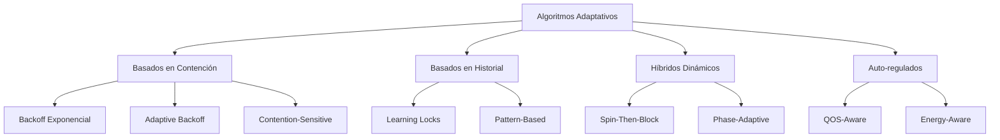

# Computación Concurrente - Exclusión mutua

## 2.6 Algoritmos adaptativos.

---

### Definición Formal

Los **algoritmos adaptativos** ajustan dinámicamente su comportamiento basándose en las condiciones del sistema, particularmente el nivel de contención. Formalmente:

$$
\text{Comportamiento} = f(\text{nivel\_contención}, \text{historial}, \text{parámetros\_sistema})
$$

#### Principios Fundamentales

1. **Monitorización Continua**: Observar métricas del sistema en tiempo real
2. **Retroalimentación**: Ajustar parámetros basándose en mediciones
3. **Balance Dinámico**: Equilibrar entre diferentes estrategias de sincronización

### Clasificación de Algoritmos Adaptativos



### Algoritmos de Backoff Adaptativo

#### Backoff Exponencial Básico

```java
public class ExponentialBackoffLock {
    private final AtomicBoolean lock = new AtomicBoolean(false);
    private final int minDelay, maxDelay;

    public ExponentialBackoffLock(int min, int max) {
        this.minDelay = min;
        this.maxDelay = max;
    }

    public void acquire() {
        int delay = minDelay;
        while (true) {
            // Intento de adquisición
            if (!lock.getAndSet(true)) {
                return; // Éxito
            }

            // Backoff adaptativo
            try {
                Thread.sleep((long) (Math.random() * delay));
            } catch (InterruptedException e) {
                Thread.currentThread().interrupt();
                return;
            }

            // Aumento exponencial con límite
            if (delay < maxDelay) {
                delay = Math.min(delay * 2, maxDelay);
            }
        }
    }

    public void release() {
        lock.set(false);
    }
}
```

#### Backoff Adaptativo con Medición de Contención

```java
public class AdaptiveBackoffLock {
    private final AtomicBoolean lock = new AtomicBoolean(false);
    private final AtomicInteger contentionLevel = new AtomicInteger(0);
    private final AtomicLong lastSuccessTime = new AtomicLong(System.nanoTime());
    private volatile int currentDelay;

    private static final int MIN_DELAY = 1;
    private static final int MAX_DELAY = 1000000; // 1ms
    private static final double ALPHA = 0.7; // Factor de suavizado

    public AdaptiveBackoffLock() {
        this.currentDelay = MIN_DELAY;
    }

    public void acquire() {
        long attemptStart = System.nanoTime();
        int localContention = 0;

        while (true) {
            // Medir contención
            long currentTime = System.nanoTime();
            if (currentTime - lastSuccessTime.get() < 1000) { // 1μs
                localContention++;
            }

            // Intentar adquirir lock
            if (!lock.getAndSet(true)) {
                // Éxito - actualizar métricas
                updateMetrics(localContention, System.nanoTime() - attemptStart);
                return;
            }

            // Aplicar backoff basado en contención medida
            applyBackoff(localContention);
            localContention++;
        }
    }

    private void updateMetrics(int measuredContention, long waitTime) {
        // Actualizar nivel de contención con suavizado exponencial
        int oldContention = contentionLevel.get();
        int newContention = (int) (ALPHA * oldContention + (1 - ALPHA) * measuredContention);
        contentionLevel.set(newContention);

        lastSuccessTime.set(System.nanoTime());

        // Ajustar delay basado en tiempo de espera
        if (waitTime > 1000000) { // > 1ms
            currentDelay = Math.min(currentDelay * 2, MAX_DELAY);
        } else if (waitTime < 1000) { // < 1μs
            currentDelay = Math.max(currentDelay / 2, MIN_DELAY);
        }
    }

    private void applyBackoff(int localContention) {
        try {
            int effectiveDelay = currentDelay * (1 + localContention);
            Thread.sleep(0, Math.min(effectiveDelay, 1000000)); // Máximo 1ms
        } catch (InterruptedException e) {
            Thread.currentThread().interrupt();
        }
    }

    public void release() {
        lock.set(false);
    }
}
```

### Algoritmos Híbridos Adaptativos

#### Spin-Then-Block Adaptativo

```java
public class AdaptiveHybridLock {
    private final AtomicBoolean lock = new AtomicBoolean(false);
    private final ReentrantLock blockingLock = new ReentrantLock();

    // Parámetros adaptativos
    private volatile int spinThreshold = 1000; // Ciclos de spin iniciales
    private volatile double contentionFactor = 1.0;
    private final AtomicInteger consecutiveSpins = new AtomicInteger(0);
    private final AtomicInteger successfulSpins = new AtomicInteger(0);

    public void acquire() {
        int spinCount = 0;
        int currentSpinThreshold = calculateSpinThreshold();

        // Fase 1: Spin adaptativo
        while (spinCount < currentSpinThreshold) {
            if (!lock.get() && lock.compareAndSet(false, true)) {
                recordSpinSuccess();
                return;
            }
            spinCount++;
            Thread.onSpinWait();
        }

        recordSpinFailure();

        // Fase 2: Blocking
        blockingLock.lock();
        try {
            // Spin final antes de bloquear
            while (!lock.compareAndSet(false, true)) {
                Thread.onSpinWait();
            }
        } finally {
            blockingLock.unlock();
        }
    }

    private int calculateSpinThreshold() {
        // Ajustar threshold basado en historial de éxito
        double successRate = getSpinSuccessRate();

        if (successRate > 0.8) {
            // Alta tasa de éxito - aumentar spinning
            return (int) (spinThreshold * 1.2);
        } else if (successRate < 0.2) {
            // Baja tasa de éxito - reducir spinning
            return (int) (spinThreshold * 0.8);
        }

        return spinThreshold;
    }

    private double getSpinSuccessRate() {
        int spins = consecutiveSpins.get();
        int successes = successfulSpins.get();
        return spins > 0 ? (double) successes / spins : 0.5;
    }

    private void recordSpinSuccess() {
        consecutiveSpins.incrementAndGet();
        successfulSpins.incrementAndGet();

        // Reducir factor de contención por éxito rápido
        contentionFactor = Math.max(0.1, contentionFactor * 0.95);
    }

    private void recordSpinFailure() {
        consecutiveSpins.incrementAndGet();

        // Aumentar factor de contención por fallo
        contentionFactor = Math.min(10.0, contentionFactor * 1.1);
    }

    public void release() {
        lock.set(false);
    }
}
```

### Modelo Matemático de Adaptación

#### Control PID para Sincronización

El ajuste de parámetros puede modelarse con control PID:

$$
u(t) = K_p e(t) + K_i \int_0^t e(\tau) d\tau + K_d \frac{de(t)}{dt}
$$

Donde:

- $e(t)$: Error (diferencia entre métrica deseada y actual)
- $K_p, K_i, K_d$: Constantes de proporcional, integral y derivativo
- $u(t)$: Ajuste del parámetro

#### Modelo de Decisión de Spin/Block

La decisión entre spinning y blocking puede optimizarse mediante:

$$
C_{\text{total}} = P_{\text{spin}} \cdot C_{\text{spin}} + (1 - P_{\text{spin}}) \cdot C_{\text{block}}
$$

Donde:

- $P_{\text{spin}}$: Probabilidad de éxito en spinning
- $C_{\text{spin}}$: Costo del spinning
- $C_{\text{block}}$: Costo del blocking

### Algoritmos de Aprendizaje Automático

#### Lock con Q-Learning

```java
public class QLearningLock {
    private final AtomicBoolean lock = new AtomicBoolean(false);
    private final Map<State, Map<Action, Double>> qTable = new ConcurrentHashMap<>();

    // Estados posibles
    enum State { LOW_CONTENTION, MEDIUM_CONTENTION, HIGH_CONTENTION }
    enum Action { SPIN_SHORT, SPIN_LONG, BLOCK }

    private final double learningRate = 0.1;
    private final double discountFactor = 0.9;
    private final double explorationRate = 0.1;

    private State currentState = State.LOW_CONTENTION;
    private final List<Long> recentWaitTimes = new ArrayList<>();

    public void acquire() {
        Action action = chooseAction(currentState);
        long startTime = System.nanoTime();

        boolean acquired = executeAction(action);
        long waitTime = System.nanoTime() - startTime;

        // Calcular recompensa (inversamente proporcional al tiempo de espera)
        double reward = calculateReward(waitTime, acquired);

        // Actualizar Q-table
        updateQValue(currentState, action, reward);

        // Actualizar estado
        updateState(waitTime);
    }

    private Action chooseAction(State state) {
        if (Math.random() < explorationRate) {
            // Exploración: acción aleatoria
            return Action.values()[(int) (Math.random() * Action.values().length)];
        } else {
            // Explotación: mejor acción conocida
            return getBestAction(state);
        }
    }

    private boolean executeAction(Action action) {
        switch (action) {
            case SPIN_SHORT:
                return spinAcquire(1000);
            case SPIN_LONG:
                return spinAcquire(10000);
            case BLOCK:
                return blockingAcquire();
            default:
                return spinAcquire(1000);
        }
    }

    private boolean spinAcquire(int maxSpins) {
        for (int i = 0; i < maxSpins; i++) {
            if (!lock.get() && lock.compareAndSet(false, true)) {
                return true;
            }
            Thread.onSpinWait();
        }
        return false;
    }

    private boolean blockingAcquire() {
        // Implementación de blocking
        while (!lock.compareAndSet(false, true)) {
            try {
                Thread.sleep(0, 1000); // Pequeño sleep
            } catch (InterruptedException e) {
                Thread.currentThread().interrupt();
                return false;
            }
        }
        return true;
    }

    private double calculateReward(long waitTime, boolean acquired) {
        if (!acquired) {
            return -100; // Penalización alta por no adquirir
        }

        // Recompensa inversamente proporcional al tiempo de espera
        return 1000.0 / (1 + waitTime / 1000.0); // Normalizar
    }

    private void updateQValue(State state, Action action, double reward) {
        Map<Action, Double> stateActions = qTable.getOrDefault(state, new HashMap<>());
        double oldQValue = stateActions.getOrDefault(action, 0.0);

        State nextState = predictNextState();
        Action bestNextAction = getBestAction(nextState);
        double bestNextQ = stateActions.getOrDefault(bestNextAction, 0.0);

        // Fórmula Q-learning
        double newQValue = oldQValue + learningRate *
                          (reward + discountFactor * bestNextQ - oldQValue);

        stateActions.put(action, newQValue);
        qTable.put(state, stateActions);
    }

    private Action getBestAction(State state) {
        Map<Action, Double> stateActions = qTable.get(state);
        if (stateActions == null || stateActions.isEmpty()) {
            return Action.SPIN_SHORT; // Acción por defecto
        }

        return stateActions.entrySet().stream()
                .max(Map.Entry.comparingByValue())
                .get()
                .getKey();
    }

    private void updateState(long waitTime) {
        // Mantener historial reciente
        recentWaitTimes.add(waitTime);
        if (recentWaitTimes.size() > 10) {
            recentWaitTimes.remove(0);
        }

        // Calcular promedio de tiempos de espera
        double avgWait = recentWaitTimes.stream()
                .mapToLong(Long::longValue)
                .average()
                .orElse(0);

        // Actualizar estado basado en promedio
        if (avgWait < 1000) { // 1μs
            currentState = State.LOW_CONTENTION;
        } else if (avgWait < 1000000) { // 1ms
            currentState = State.MEDIUM_CONTENTION;
        } else {
            currentState = State.HIGH_CONTENTION;
        }
    }

    private State predictNextState() {
        // Predicción simple basada en tendencia
        if (recentWaitTimes.size() < 2) {
            return currentState;
        }

        long last = recentWaitTimes.get(recentWaitTimes.size() - 1);
        long prev = recentWaitTimes.get(recentWaitTimes.size() - 2);

        if (last > prev * 1.5) {
            // Tendencia creciente
            return higherContentionState(currentState);
        } else if (last < prev * 0.66) {
            // Tendencia decreciente
            return lowerContentionState(currentState);
        }

        return currentState;
    }

    private State higherContentionState(State current) {
        switch (current) {
            case LOW_CONTENTION: return State.MEDIUM_CONTENTION;
            case MEDIUM_CONTENTION: return State.HIGH_CONTENTION;
            default: return State.HIGH_CONTENTION;
        }
    }

    private State lowerContentionState(State current) {
        switch (current) {
            case HIGH_CONTENTION: return State.MEDIUM_CONTENTION;
            case MEDIUM_CONTENTION: return State.LOW_CONTENTION;
            default: return State.LOW_CONTENTION;
        }
    }

    public void release() {
        lock.set(false);
    }
}
```

### Algoritmos Sensibles al Contexto

#### Energy-Aware Adaptive Lock

```java
public class EnergyAwareAdaptiveLock {
    private final AtomicBoolean lock = new AtomicBoolean(false);

    // Métricas de energía
    private final Runtime runtime = Runtime.getRuntime();
    private volatile boolean batteryPower;
    private volatile double cpuUsage;

    // Estrategias basadas en contexto
    private enum Strategy { PERFORMANCE, BALANCED, POWER_SAVE }
    private Strategy currentStrategy = Strategy.BALANCED;

    public EnergyAwareAdaptiveLock() {
        detectPowerSource();
        startMonitoring();
    }

    public void acquire() {
        adjustStrategy();

        switch (currentStrategy) {
            case PERFORMANCE:
                aggressiveSpinAcquire();
                break;
            case BALANCED:
                hybridAcquire();
                break;
            case POWER_SAVE:
                conservativeAcquire();
                break;
        }
    }

    private void aggressiveSpinAcquire() {
        // Spinning agresivo para máximo rendimiento
        while (!lock.compareAndSet(false, true)) {
            Thread.onSpinWait();
        }
    }

    private void hybridAcquire() {
        // Approach balanceado
        int spinLimit = calculateSpinLimit();
        for (int i = 0; i < spinLimit; i++) {
            if (!lock.get() && lock.compareAndSet(false, true)) {
                return;
            }
            Thread.onSpinWait();
        }

        // Fallback a blocking
        try {
            Thread.sleep(0, calculateSleepTime());
        } catch (InterruptedException e) {
            Thread.currentThread().interrupt();
        }
    }

    private void conservativeAcquire() {
        // Enfoque conservador de energía
        try {
            while (!lock.compareAndSet(false, true)) {
                Thread.sleep(calculateConservativeSleepTime());
            }
        } catch (InterruptedException e) {
            Thread.currentThread().interrupt();
        }
    }

    private void adjustStrategy() {
        if (batteryPower) {
            if (cpuUsage > 80) {
                currentStrategy = Strategy.POWER_SAVE;
            } else {
                currentStrategy = Strategy.BALANCED;
            }
        } else {
            // Conectado a energía
            if (cpuUsage < 50) {
                currentStrategy = Strategy.PERFORMANCE;
            } else {
                currentStrategy = Strategy.BALANCED;
            }
        }
    }

    private int calculateSpinLimit() {
        switch (currentStrategy) {
            case PERFORMANCE: return 10000;
            case BALANCED: return 1000;
            case POWER_SAVE: return 100;
            default: return 1000;
        }
    }

    private int calculateSleepTime() {
        switch (currentStrategy) {
            case PERFORMANCE: return 1; // 1ns
            case BALANCED: return 1000; // 1μs
            case POWER_SAVE: return 10000; // 10μs
            default: return 1000;
        }
    }

    private int calculateConservativeSleepTime() {
        return 100000; // 100μs
    }

    private void detectPowerSource() {
        // Simulación - en implementación real usaría APIs del sistema
        this.batteryPower = Math.random() > 0.5;
    }

    private void startMonitoring() {
        Thread monitorThread = new Thread(() -> {
            while (true) {
                try {
                    cpuUsage = calculateCpuUsage();
                    Thread.sleep(1000);
                } catch (InterruptedException e) {
                    Thread.currentThread().interrupt();
                    break;
                }
            }
        });
        monitorThread.setDaemon(true);
        monitorThread.start();
    }

    private double calculateCpuUsage() {
        // Simulación - en implementación real usaría MXBeans
        return Math.random() * 100;
    }

    public void release() {
        lock.set(false);
    }
}
```

### Ejercicios Propuestos

#### Ejercicio 1: Implementación de Lock Adaptativo

Implemente un lock que ajuste dinámicamente su estrategia basándose en:

- Tasa de éxito de spinning
- Tiempos promedio de espera
- Número de threads competidores

#### Ejercicio 2: Análisis de Patrones de Contención

Desarrolle un sistema que detecte patrones de acceso y ajuste la estrategia de sincronización accordingly.

#### Ejercicio 3: Algoritmo Multi-Objective

Diseñe un algoritmo que balancee performance, consumo energético y fairness.

#### Ejercicio 4: Simulación de Cargas de Trabajo

Cree un framework de simulación para evaluar algoritmos adaptativos bajo diferentes patrones de acceso.

#### Ejercicio 5: Machine Learning para Sincronización

Implemente un sistema que use reinforcement learning para optimizar parámetros de sincronización.

### Soluciones a Ejercicios Selectos

#### Solución Ejercicio 1

```java
public class ComprehensiveAdaptiveLock {
    private final AtomicBoolean lock = new AtomicBoolean(false);

    // Métricas de adaptación
    private final AdaptiveParameters params = new AdaptiveParameters();
    private final MetricCollector metrics = new MetricCollector();

    public void acquire() {
        long startTime = System.nanoTime();
        int attempt = 0;

        while (true) {
            attempt++;

            // Intentar adquisición directa
            if (!lock.get() && lock.compareAndSet(false, true)) {
                metrics.recordSuccess(attempt, System.nanoTime() - startTime);
                params.adjustForSuccess();
                return;
            }

            // Decidir estrategia basada en métricas actuales
            Strategy strategy = params.decideStrategy(attempt, metrics.getRecentSuccessRate());

            if (strategy == Strategy.BLOCK && attempt > params.getSpinThreshold()) {
                blockingAcquire();
                metrics.recordBlockingAcquisition(attempt, System.nanoTime() - startTime);
                return;
            }

            // Aplicar backoff adaptativo
            applyAdaptiveBackoff(attempt, strategy);
        }
    }

    private void blockingAcquire() {
        // Implementación de blocking con timeout adaptativo
        long timeout = params.calculateBlockingTimeout();
        long startBlock = System.nanoTime();

        while (System.nanoTime() - startBlock < timeout) {
            if (!lock.get() && lock.compareAndSet(false, true)) {
                return;
            }
            try {
                Thread.sleep(0, params.calculateSleepTime());
            } catch (InterruptedException e) {
                Thread.currentThread().interrupt();
                return;
            }
        }
    }

    private void applyAdaptiveBackoff(int attempt, Strategy strategy) {
        try {
            long backoffTime = params.calculateBackoff(attempt, strategy);
            Thread.sleep(0, (int) Math.min(backoffTime, 1000000)); // Max 1ms
        } catch (InterruptedException e) {
            Thread.currentThread().interrupt();
        }
    }

    public void release() {
        lock.set(false);
        metrics.recordRelease();
    }

    // Clases auxiliares
    enum Strategy { AGGRESSIVE_SPIN, MODERATE_SPIN, CONSERVATIVE, BLOCK }

    private static class AdaptiveParameters {
        private int spinThreshold = 1000;
        private double backoffBase = 100.0;
        private double successRateThreshold = 0.3;

        public Strategy decideStrategy(int attempt, double successRate) {
            if (attempt < 10) return Strategy.AGGRESSIVE_SPIN;
            if (successRate > successRateThreshold) return Strategy.MODERATE_SPIN;
            if (attempt > spinThreshold) return Strategy.BLOCK;
            return Strategy.CONSERVATIVE;
        }

        public long calculateBackoff(int attempt, Strategy strategy) {
            double multiplier;
            switch (strategy) {
                case AGGRESSIVE_SPIN: multiplier = 1.0; break;
                case MODERATE_SPIN: multiplier = 10.0; break;
                case CONSERVATIVE: multiplier = 100.0; break;
                default: multiplier = 1000.0;
            }
            return (long) (backoffBase * multiplier * Math.pow(1.5, attempt));
        }

        public void adjustForSuccess() {
            // Ajustar parámetros basado en éxito rápido
            spinThreshold = Math.min(spinThreshold + 100, 10000);
            backoffBase = Math.max(backoffBase * 0.9, 10.0);
        }

        public int getSpinThreshold() { return spinThreshold; }
        public long calculateBlockingTimeout() { return 100000000L; } // 100ms
        public int calculateSleepTime() { return 1000; } // 1μs
    }

    private static class MetricCollector {
        private final LinkedList<Boolean> recentAttempts = new LinkedList<>();
        private final int windowSize = 100;

        public void recordSuccess(int attempts, long duration) {
            synchronized (recentAttempts) {
                recentAttempts.add(true);
                if (recentAttempts.size() > windowSize) {
                    recentAttempts.removeFirst();
                }
            }
        }

        public void recordBlockingAcquisition(int attempts, long duration) {
            synchronized (recentAttempts) {
                recentAttempts.add(false);
                if (recentAttempts.size() > windowSize) {
                    recentAttempts.removeFirst();
                }
            }
        }

        public void recordRelease() {
            // Métricas adicionales de liberación
        }

        public double getRecentSuccessRate() {
            synchronized (recentAttempts) {
                if (recentAttempts.isEmpty()) return 1.0;
                long successes = recentAttempts.stream().filter(b -> b).count();
                return (double) successes / recentAttempts.size();
            }
        }
    }
}
```

### Referencias Bibliográficas

#### Bibliografía Básica

1. **Taubenfeld, G. (2006)**. _Synchronization Algorithms and Concurrent Programming_
   - Capítulo 6: "Adaptive Algorithms"
   - Sección 6.3: "Contention-Sensitive Synchronization"
   - Capítulo 7: "Performance and Scalability"

2. **Herlihy, M. & Shavit, N. (2008)**. _The Art of Multiprocessor Programming_
   - Capítulo 7: "Spin Locks and Contention"
   - Sección 7.6: "Hierarchical Locks"
   - Sección 7.7: "Adaptive Locks"

#### Bibliografía Complementaria

1. **Lamport, L. (2002)**. _Specifying Systems: The TLA+ Language and Tools_
   - Capítulo 15: "Advanced Algorithms"

#### Artículos de Investigación

- Dice, D., et al. (2010). "Adaptive Locking in C++"
- Calciu, I., et al. (2013). "The Adaptive Priority Lock"
- David, T., et al. (2015). "Everything You Always Wanted to Know about Synchronization but Were Afraid to Ask"

### Resumen y Conclusiones

Los algoritmos adaptativos representan la evolución de la sincronización concurrente:

#### Ventajas Clave

- **Mejor performance** bajo condiciones variables
- **Mayor eficiencia** de recursos
- **Auto-optimización** sin intervención manual
- **Robustez** ante diferentes cargas de trabajo

#### Consideraciones de Implementación

- **Overhead de monitorización** vs. beneficios
- **Estabilidad** de los algoritmos adaptativos
- **Predictibilidad** en sistemas de tiempo real
- **Complejidad** de implementación y debugging

#### Tendencias Futuras

- **Machine Learning** para optimización automática
- **Sensibilidad al contexto** (energía, thermal, etc.)
- **Algoritmos distribuidos** adaptativos
- **Hardware especializado** para sincronización adaptativa

Los algoritmos adaptativos continúan siendo un área activa de investigación, prometiendo mejoras significativas en la eficiencia de sistemas concurrentes modernos.
