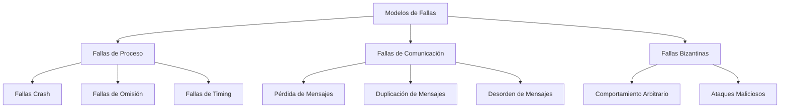

# Computación Concurrente - Exclusión mutua

## 2.7 Algoritmos tolerantes a fallas.

---

### Definición Formal

Un algoritmo de exclusión mutua es **tolerante a fallas** si mantiene sus propiedades de seguridad (safety) y vivacidad (liveness) incluso cuando algunos procesos fallan. Formalmente:

$$
\text{Tolerancia}(f) \equiv \forall F \subseteq \Pi, |F| \leq f: \text{Propiedades}(Algoritmo) \text{ se mantienen}
$$

Donde:

- $f$: número máximo de procesos que pueden fallar
- $\Pi$: conjunto de todos los procesos
- $F$: conjunto de procesos fallados

### Modelos de Fallas



#### Tipos de Fallas

1. **Fallas Crash**: Proceso deja de funcionar permanentemente
2. **Fallas de Omisión**: Proceso omite enviar/recibir mensajes
3. **Fallas Bizantinas**: Proceso se comporta arbitrariamente

### Algoritmos para Fallas Crash

#### Algoritmo de Token Ring Tolerante a Fallas

```java
public class FaultTolerantTokenRing {
    private final int numProcesses;
    private final int processId;
    private volatile boolean hasToken = false;
    private volatile boolean[] alive;
    private volatile int tokenHolder;

    public FaultTolerantTokenRing(int numProcesses, int processId) {
        this.numProcesses = numProcesses;
        this.processId = processId;
        this.alive = new boolean[numProcesses];
        Arrays.fill(alive, true);
        this.tokenHolder = 0; // Proceso 0 tiene el token inicialmente
        this.hasToken = (processId == 0);
    }

    public void acquire() {
        while (!hasToken) {
            checkTokenStatus();
            try {
                Thread.sleep(10); // Espera entre verificaciones
            } catch (InterruptedException e) {
                Thread.currentThread().interrupt();
                return;
            }
        }
        // Token adquirido - entrar a sección crítica
    }

    public void release() {
        if (hasToken) {
            passTokenToNextAlive();
        }
    }

    private void passTokenToNextAlive() {
        int next = findNextAliveProcess(processId);
        if (next != processId) {
            sendTokenTo(next);
            hasToken = false;
            tokenHolder = next;
        }
    }

    private int findNextAliveProcess(int start) {
        for (int i = 1; i < numProcesses; i++) {
            int candidate = (start + i) % numProcesses;
            if (alive[candidate]) {
                return candidate;
            }
        }
        return start; // Si todos están muertos, mantener token
    }

    private void checkTokenStatus() {
        // Si el poseedor actual está muerto, regenerar token
        if (!alive[tokenHolder] && !hasToken) {
            // Elección de nuevo poseedor del token
            int newHolder = electNewTokenHolder();
            if (newHolder == processId) {
                hasToken = true;
                tokenHolder = processId;
            }
        }
    }

    private int electNewTokenHolder() {
        // Elección simple: el proceso vivo con menor ID
        for (int i = 0; i < numProcesses; i++) {
            if (alive[i]) {
                return i;
            }
        }
        return processId;
    }

    public void markProcessDead(int process) {
        if (process >= 0 && process < numProcesses) {
            alive[process] = false;
        }
    }

    public void markProcessAlive(int process) {
        if (process >= 0 && process < numProcesses) {
            alive[process] = true;
        }
    }

    // Método para simular envío de token
    private void sendTokenTo(int target) {
        // En implementación real, enviaría mensaje de red
        System.out.printf("Process %d sending token to %d%n", processId, target);
    }
}
```

#### Algoritmo de Quórum para Exclusión Mutua

```java
public class QuorumMutex {
    private final int numProcesses;
    private final int processId;
    private final int quorumSize;
    private volatile boolean[] granted;
    private volatile boolean wantCS = false;
    private volatile long timestamp;

    public QuorumMutex(int numProcesses, int processId) {
        this.numProcesses = numProcesses;
        this.processId = processId;
        this.quorumSize = (numProcesses / 2) + 1; // Mayoría
        this.granted = new boolean[numProcesses];
    }

    public void acquire() {
        wantCS = true;
        timestamp = System.nanoTime();

        // Solicitar permisos a un quórum
        int[] quorum = selectQuorum();
        int permissionsGranted = 0;

        for (int member : quorum) {
            if (requestPermission(member)) {
                permissionsGranted++;
            }
        }

        // Esperar hasta obtener mayoría
        while (permissionsGranted < quorumSize) {
            checkForFailedProcesses(quorum);
            try {
                Thread.sleep(1);
            } catch (InterruptedException e) {
                Thread.currentThread().interrupt();
                return;
            }
        }

        // Entrar a sección crítica
    }

    public void release() {
        wantCS = false;

        // Liberar todos los permisos
        for (int i = 0; i < numProcesses; i++) {
            if (granted[i]) {
                releasePermission(i);
                granted[i] = false;
            }
        }
    }

    private int[] selectQuorum() {
        // Seleccionar quórum basado en el ID del proceso
        int[] quorum = new int[quorumSize];
        for (int i = 0; i < quorumSize; i++) {
            quorum[i] = (processId + i) % numProcesses;
        }
        return quorum;
    }

    private boolean requestPermission(int target) {
        // Simular solicitud de permiso
        // En implementación real, sería un mensaje de red
        if (isProcessAlive(target)) {
            granted[target] = true;
            return true;
        }
        return false;
    }

    private void releasePermission(int target) {
        // Simular liberación de permiso
        if (isProcessAlive(target)) {
            // Enviar mensaje de liberación
        }
    }

    private void checkForFailedProcesses(int[] quorum) {
        for (int member : quorum) {
            if (!isProcessAlive(member) && granted[member]) {
                // Re-solicitar a otro miembro del quórum
                int replacement = findReplacement(quorum);
                if (replacement != -1 && requestPermission(replacement)) {
                    granted[member] = false;
                }
            }
        }
    }

    private int findReplacement(int[] currentQuorum) {
        for (int i = 0; i < numProcesses; i++) {
            if (!contains(currentQuorum, i) && isProcessAlive(i)) {
                return i;
            }
        }
        return -1;
    }

    private boolean contains(int[] array, int value) {
        for (int element : array) {
            if (element == value) return true;
        }
        return false;
    }

    private boolean isProcessAlive(int process) {
        // En implementación real, verificaría estado del proceso
        return Math.random() > 0.05; // 5% probabilidad de falla
    }
}
```

### Algoritmos para Fallas Bizantinas

#### Algoritmo de Lamport para Generales Bizantinos

```java
public class ByzantineMutex {
    private final int numProcesses;
    private final int processId;
    private final int f; // Máximo número de procesos bizantinos

    public ByzantineMutex(int n, int id) {
        this.numProcesses = n;
        this.processId = id;
        this.f = (n - 1) / 3; // Límite para tolerancia bizantina
    }

    public void acquire() {
        // Fase 1: Acuerdo sobre quién quiere entrar
        boolean[] wantsToEnter = broadcastWantToEnter();

        // Fase 2: Ejecutar consenso bizantino
        boolean decision = byzantineAgreement(wantsToEnter);

        if (decision) {
            // Entrar a sección crítica
        } else {
            // Esperar y reintentar
            try {
                Thread.sleep(100);
            } catch (InterruptedException e) {
                Thread.currentThread().interrupt();
            }
            acquire(); // Reintentar
        }
    }

    private boolean[] broadcastWantToEnter() {
        boolean[] received = new boolean[numProcesses];
        Arrays.fill(received, false);

        // Enviar solicitud a todos
        for (int i = 0; i < numProcesses; i++) {
            if (i != processId) {
                sendWantToEnter(i);
            }
        }

        // Recibir respuestas (con tolerancia a fallas)
        int[] counts = new int[numProcesses];
        for (int round = 0; round < f + 1; round++) {
            for (int i = 0; i < numProcesses; i++) {
                if (i != processId) {
                    Boolean response = receiveResponse(i);
                    if (response != null && response) {
                        counts[i]++;
                    }
                }
            }
        }

        // Decidir basado en mayoría
        for (int i = 0; i < numProcesses; i++) {
            received[i] = counts[i] > f;
        }
        received[processId] = true; // Siempre confiamos en nosotros mismos

        return received;
    }

    private boolean byzantineAgreement(boolean[] initialValues) {
        // Algoritmo de consenso bizantino simplificado
        boolean[] values = initialValues.clone();

        for (int round = 0; round < f + 1; round++) {
            boolean[] newValues = new boolean[numProcesses];

            for (int i = 0; i < numProcesses; i++) {
                if (isProcessCorrect(i)) {
                    newValues[i] = majorityValue(values);
                } else {
                    // Para procesos bizantinos, usar valor por defecto
                    newValues[i] = false;
                }
            }
            values = newValues;
        }

        return majorityValue(values);
    }

    private boolean majorityValue(boolean[] values) {
        int trueCount = 0;
        for (boolean value : values) {
            if (value) trueCount++;
        }
        return trueCount > numProcesses / 2;
    }

    private boolean isProcessCorrect(int process) {
        // En implementación real, usaría detección de bizantinos
        return Math.random() > 0.1; // 10% probabilidad de ser bizantino
    }

    private void sendWantToEnter(int target) {
        // Simular envío de mensaje
    }

    private Boolean receiveResponse(int source) {
        // Simular recepción de mensaje
        if (!isProcessCorrect(source)) {
            // Proceso bizantino puede enviar respuesta incorrecta
            return Math.random() > 0.5;
        }
        return true; // Proceso correcto siempre responde verdad
    }

    public void release() {
        // Notificar liberación
        broadcastRelease();
    }

    private void broadcastRelease() {
        for (int i = 0; i < numProcesses; i++) {
            if (i != processId) {
                // Enviar mensaje de liberación
            }
        }
    }
}
```

### Modelo Formal de Tolerancia a Fallas

#### Especificación TLA+ para Algoritmo Tolerante

```tla
---------------------------- MODULE FaultTolerantMutex ----------------------------
EXTENDS Integers, Sequences, TLC

CONSTANTS N, F  \* N processes, at most F failures
VARIABLES pc, token, alive, requests

ProcSet == 0..N-1

TypeInvariant ==
    /\ pc \in [ProcSet -> {"idle", "waiting", "critical"}]
    /\ token \in ProcSet
    /\ alive \in SUBSET ProcSet
    /\ requests \in SUBSET ProcSet

Init ==
    /\ pc = [i \in ProcSet -> "idle"]
    /\ token = 0
    /\ alive = ProcSet
    /\ requests = {}

Request(i) ==
    /\ pc[i] = "idle"
    /\ pc' = [pc EXCEPT ![i] = "waiting"]
    /\ requests' = requests \union {i}

Enter(i) ==
    /\ pc[i] = "waiting"
    /\ token = i
    /\ pc' = [pc EXCEPT ![i] = "critical"]
    /\ requests' = requests \ {i}

Release(i) ==
    /\ pc[i] = "critical"
    /\ pc' = [pc EXCEPT ![i] = "idle"]
    /\ token' = NextAlive(token)

Fail(i) ==
    /\ i \in alive
    /\ alive' = alive \ {i}
    /\ \/ token = i /\ token' = NextAlive(i)  \* Transfer token if holder fails
       \/ token # i /\ UNCHANGED token

NextAlive(current) ==
    LET next == CHOOSE j \in ProcSet:
                  \A k \in 0..N-1:
                    (current + k) % N \in alive => j = (current + k) % N
    IN next

Next ==
    \/ \E i \in ProcSet: Request(i) \/ Enter(i) \/ Release(i)
    \/ \E i \in ProcSet: Fail(i)

MutualExclusion ==
    \A i,j \in ProcSet: i # j => ~(pc[i] = "critical" /\ pc[j] = "critical")

StarvationFree ==
    \A i \in ProcSet: i \in requests ~> pc[i] = "critical"

FaultTolerance ==
    \A i \in ProcSet:
        Cardinality(alive) >= N - F =>
            (i \in requests ~> pc[i] = "critical")

Spec == Init /\ [][Next]_<<pc, token, alive, requests>>

THEOREM Spec => []MutualExclusion
THEOREM Cardinality(alive) >= N - F => Spec => FaultTolerance
=============================================================================
```

### Algoritmos de Detección de Fallas

#### Heartbeat y Timeouts

```java
public class FailureDetector {
    private final int numProcesses;
    private final int processId;
    private final long[] lastHeartbeat;
    private final long heartbeatInterval;
    private final long failureTimeout;
    private volatile boolean[] suspected;

    public FailureDetector(int n, int id, long interval, long timeout) {
        this.numProcesses = n;
        this.processId = id;
        this.heartbeatInterval = interval;
        this.failureTimeout = timeout;
        this.lastHeartbeat = new long[n];
        this.suspected = new boolean[n];
        Arrays.fill(lastHeartbeat, System.currentTimeMillis());
    }

    public void start() {
        // Hilo para enviar heartbeats
        Thread sender = new Thread(() -> {
            while (!Thread.currentThread().isInterrupted()) {
                broadcastHeartbeat();
                try {
                    Thread.sleep(heartbeatInterval);
                } catch (InterruptedException e) {
                    Thread.currentThread().interrupt();
                }
            }
        });

        // Hilo para detectar fallas
        Thread detector = new Thread(() -> {
            while (!Thread.currentThread().isInterrupted()) {
                detectFailures();
                try {
                    Thread.sleep(heartbeatInterval / 2);
                } catch (InterruptedException e) {
                    Thread.currentThread().interrupt();
                }
            }
        });

        sender.setDaemon(true);
        detector.setDaemon(true);
        sender.start();
        detector.start();
    }

    private void broadcastHeartbeat() {
        for (int i = 0; i < numProcesses; i++) {
            if (i != processId && !suspected[i]) {
                sendHeartbeat(i);
            }
        }
    }

    private void detectFailures() {
        long currentTime = System.currentTimeMillis();
        for (int i = 0; i < numProcesses; i++) {
            if (i != processId) {
                if (currentTime - lastHeartbeat[i] > failureTimeout) {
                    suspected[i] = true;
                    System.out.printf("Process %d suspects process %d failed%n",
                                    processId, i);
                } else {
                    suspected[i] = false;
                }
            }
        }
    }

    public void receiveHeartbeat(int source) {
        lastHeartbeat[source] = System.currentTimeMillis();
        suspected[source] = false;
    }

    public boolean isSuspected(int process) {
        return suspected[process];
    }

    public boolean[] getSuspected() {
        return suspected.clone();
    }

    private void sendHeartbeat(int target) {
        // Simular envío de heartbeat
        // En implementación real, enviaría mensaje de red
    }
}
```

### Algoritmos de Elección para Recuperación

#### Algoritmo de Elección de Anillo

```java
public class RingElection {
    private final int numProcesses;
    private final int processId;
    private volatile Integer leader = null;
    private volatile boolean electionInProgress = false;

    public RingElection(int n, int id) {
        this.numProcesses = n;
        this.processId = id;
    }

    public void startElection() {
        if (electionInProgress) return;

        electionInProgress = true;
        System.out.printf("Process %d starting election%n", processId);

        // Iniciar mensaje de elección con nuestro ID
        ElectionMessage message = new ElectionMessage(processId, processId);
        sendToNext(message);
    }

    public void receiveElectionMessage(ElectionMessage message) {
        if (message.getMaxId() > processId) {
            // Continuar elección con el ID máximo
            message.setMaxId(Math.max(message.getMaxId(), processId));
            sendToNext(message);
        } else if (message.getMaxId() == processId) {
            // Somos el líder - anunciar
            announceLeader(processId);
        }

        electionInProgress = false;
    }

    public void receiveLeaderAnnouncement(int leaderId) {
        this.leader = leaderId;
        System.out.printf("Process %d acknowledges leader %d%n",
                         processId, leaderId);

        // Reenviar anuncio si no somos el último
        if (leaderId != processId) {
            sendToNext(new LeaderMessage(leaderId));
        }
    }

    private void sendToNext(ElectionMessage message) {
        int next = (processId + 1) % numProcesses;
        // En implementación real, enviaría a través de red
        System.out.printf("Process %d sending election message to %d%n",
                         processId, next);
    }

    private void sendToNext(LeaderMessage message) {
        int next = (processId + 1) % numProcesses;
        // En implementación real, enviaría a través de red
        System.out.printf("Process %d sending leader announcement to %d%n",
                         processId, next);
    }

    private void announceLeader(int leaderId) {
        this.leader = leaderId;
        System.out.printf("Process %d elected as leader%n", leaderId);
        sendToNext(new LeaderMessage(leaderId));
    }

    public Integer getLeader() {
        return leader;
    }

    // Clases de mensajes
    private static class ElectionMessage {
        private int initiator;
        private int maxId;

        public ElectionMessage(int initiator, int maxId) {
            this.initiator = initiator;
            this.maxId = maxId;
        }

        public int getMaxId() { return maxId; }
        public void setMaxId(int maxId) { this.maxId = maxId; }
    }

    private static class LeaderMessage {
        private int leaderId;

        public LeaderMessage(int leaderId) {
            this.leaderId = leaderId;
        }

        public int getLeaderId() { return leaderId; }
    }
}
```

### Ejercicios Propuestos

#### Ejercicio 1: Implementación de Token Ring Tolerante

Extienda el algoritmo de Token Ring para manejar múltiples fallas simultáneas y recuperación automática.

#### Ejercicio 2: Algoritmo de Quórum con Réplicas

Implemente un sistema de exclusión mutua que use réplicas para tolerar fallas de procesos.

#### Ejercicio 3: Detección de Fallas Bizantinas

Diseñe un mecanismo que detecte procesos bizantinos en un sistema de exclusión mutua.

#### Ejercicio 4: Simulación de Escenarios de Fallas

Cree un framework de simulación que pruebe algoritmos tolerantes a fallas bajo diferentes patrones de falla.

#### Ejercicio 5: Análisis de Límites de Tolerancia

Demuestre formalmente los límites de tolerancia a fallas para diferentes algoritmos (ej: $f < n/3$ para bizantinas).

### Soluciones a Ejercicios Selectos

#### Solución Ejercicio 1

```java
public class RobustTokenRing {
    private final int numProcesses;
    private final int processId;
    private volatile boolean hasToken = false;
    private volatile boolean[] alive;
    private volatile int tokenHolder;
    private final FailureDetector failureDetector;
    private final RingElection election;

    public RobustTokenRing(int n, int id) {
        this.numProcesses = n;
        this.processId = id;
        this.alive = new boolean[n];
        Arrays.fill(alive, true);
        this.tokenHolder = 0;
        this.hasToken = (id == 0);

        this.failureDetector = new FailureDetector(n, id, 1000, 3000);
        this.election = new RingElection(n, id);

        failureDetector.start();
    }

    public void acquire() {
        while (!hasToken) {
            checkSystemState();

            if (!alive[tokenHolder]) {
                handleTokenHolderFailure();
            }

            try {
                Thread.sleep(10);
            } catch (InterruptedException e) {
                Thread.currentThread().interrupt();
                return;
            }
        }
        // Entrar a sección crítica
    }

    public void release() {
        if (hasToken) {
            passTokenSafely();
        }
    }

    private void checkSystemState() {
        boolean[] suspected = failureDetector.getSuspected();
        for (int i = 0; i < numProcesses; i++) {
            if (suspected[i] && alive[i]) {
                markProcessDead(i);
            } else if (!suspected[i] && !alive[i]) {
                markProcessAlive(i);
            }
        }
    }

    private void handleTokenHolderFailure() {
        System.out.printf("Process %d detected failure of token holder %d%n",
                         processId, tokenHolder);

        // Iniciar elección si somos candidatos
        if (isEligibleForElection()) {
            election.startElection();
        }

        // Esperar a que se elija nuevo líder
        waitForNewLeader();

        // Si somos el nuevo líder, crear nuevo token
        if (election.getLeader() == processId && !hasToken) {
            regenerateToken();
        }
    }

    private void passTokenSafely() {
        int next = findNextAliveProcess(processId);
        if (next != processId) {
            if (sendTokenWithAck(next)) {
                hasToken = false;
                tokenHolder = next;
            } else {
                // Fallo en envío - marcar como muerto y reintentar
                markProcessDead(next);
                passTokenSafely();
            }
        }
    }

    private boolean sendTokenWithAck(int target) {
        // Simular envío con acknowledge
        System.out.printf("Process %d sending token to %d%n", processId, target);

        // En implementación real, esperaría ACK con timeout
        boolean ackReceived = simulateNetworkSend(target);

        if (!ackReceived) {
            System.out.printf("Process %d failed to send token to %d%n",
                            processId, target);
        }

        return ackReceived;
    }

    private boolean simulateNetworkSend(int target) {
        // Simular falla de red con 10% de probabilidad
        return Math.random() > 0.1 && alive[target];
    }

    private void regenerateToken() {
        hasToken = true;
        tokenHolder = processId;
        System.out.printf("Process %d regenerated token%n", processId);
    }

    private void waitForNewLeader() {
        int timeout = 5000; // 5 segundos
        long start = System.currentTimeMillis();

        while (election.getLeader() == null &&
               System.currentTimeMillis() - start < timeout) {
            try {
                Thread.sleep(100);
            } catch (InterruptedException e) {
                Thread.currentThread().interrupt();
                return;
            }
        }
    }

    private boolean isEligibleForElection() {
        // Solo procesos con ID mayor al fallado pueden iniciar elección
        return processId > tokenHolder;
    }

    private int findNextAliveProcess(int start) {
        for (int i = 1; i < numProcesses; i++) {
            int candidate = (start + i) % numProcesses;
            if (alive[candidate]) {
                return candidate;
            }
        }
        return start;
    }

    private void markProcessDead(int process) {
        if (process >= 0 && process < numProcesses) {
            alive[process] = false;
            System.out.printf("Process %d marked as dead%n", process);
        }
    }

    private void markProcessAlive(int process) {
        if (process >= 0 && process < numProcesses) {
            alive[process] = true;
            System.out.printf("Process %d marked as alive%n", process);
        }
    }
}
```

#### Solución Ejercicio 3

```java
public class ByzantineDetector {
    private final int numProcesses;
    private final int processId;
    private final double byzantineThreshold;
    private final Map<Integer, Double> suspicionLevels;
    private final Map<Integer, List<BehaviorPattern>> behaviorHistory;

    public ByzantineDetector(int n, int id, double threshold) {
        this.numProcesses = n;
        this.processId = id;
        this.byzantineThreshold = threshold;
        this.suspicionLevels = new ConcurrentHashMap<>();
        this.behaviorHistory = new ConcurrentHashMap<>();

        for (int i = 0; i < n; i++) {
            if (i != id) {
                suspicionLevels.put(i, 0.0);
                behaviorHistory.put(i, new ArrayList<>());
            }
        }
    }

    public void analyzeMessage(int source, Object message, long timestamp) {
        BehaviorPattern pattern = new BehaviorPattern(message, timestamp, source);
        behaviorHistory.get(source).add(pattern);

        // Analizar consistencia del mensaje
        double inconsistency = calculateInconsistency(source, message);

        // Analizar timing
        double timingAnomaly = analyzeTiming(source, timestamp);

        // Actualizar nivel de sospecha
        updateSuspicionLevel(source, inconsistency, timingAnomaly);
    }

    private double calculateInconsistency(int source, Object message) {
        // Verificar si el mensaje es consistente con el estado del sistema
        List<BehaviorPattern> history = behaviorHistory.get(source);
        if (history.size() < 2) return 0.0;

        BehaviorPattern last = history.get(history.size() - 2);
        BehaviorPattern current = new BehaviorPattern(message, System.currentTimeMillis(), source);

        // Detectar contradicciones
        if (isContradiction(last, current)) {
            return 1.0;
        }

        return 0.0;
    }

    private double analyzeTiming(int source, long timestamp) {
        List<BehaviorPattern> history = behaviorHistory.get(source);
        if (history.size() < 5) return 0.0;

        // Calcular desviación estándar de intervalos entre mensajes
        List<Long> intervals = new ArrayList<>();
        for (int i = 1; i < history.size(); i++) {
            intervals.add(history.get(i).timestamp - history.get(i-1).timestamp);
        }

        double mean = intervals.stream().mapToLong(Long::longValue).average().orElse(0);
        double variance = intervals.stream()
            .mapToDouble(i -> Math.pow(i - mean, 2))
            .average().orElse(0);
        double stdDev = Math.sqrt(variance);

        // Detectar anomalías de timing
        long lastInterval = intervals.get(intervals.size() - 1);
        if (Math.abs(lastInterval - mean) > 3 * stdDev) {
            return 0.5;
        }

        return 0.0;
    }

    private void updateSuspicionLevel(int source, double inconsistency, double timingAnomaly) {
        double currentLevel = suspicionLevels.get(source);
        double newLevel = currentLevel * 0.9 + inconsistency * 0.7 + timingAnomaly * 0.3;

        suspicionLevels.put(source, newLevel);

        if (newLevel > byzantineThreshold) {
            System.out.printf("Process %d detected Byzantine behavior in process %d (level: %.2f)%n",
                            processId, source, newLevel);
        }
    }

    private boolean isContradiction(BehaviorPattern a, BehaviorPattern b) {
        // Lógica para detectar contradicciones entre patrones de comportamiento
        // Esto dependerá del protocolo específico
        return false;
    }

    public boolean isByzantine(int process) {
        return suspicionLevels.getOrDefault(process, 0.0) > byzantineThreshold;
    }

    public double getSuspicionLevel(int process) {
        return suspicionLevels.getOrDefault(process, 0.0);
    }

    private static class BehaviorPattern {
        public final Object message;
        public final long timestamp;
        public final int source;

        public BehaviorPattern(Object message, long timestamp, int source) {
            this.message = message;
            this.timestamp = timestamp;
            this.source = source;
        }
    }
}
```

### Referencias Bibliográficas

#### Bibliografía Básica

1. **Taubenfeld, G. (2006)**. _Synchronization Algorithms and Concurrent Programming_
   - Capítulo 9: "Fault-Tolerant Synchronization"
   - Sección 9.2: "Wait-Free Synchronization"
   - Sección 9.3: "Self-Stabilizing Algorithms"

2. **Herlihy, M. & Shavit, N. (2008)**. _The Art of Multiprocessor Programming_
   - Capítulo 14: "Atomic Snapshots"
   - Capítulo 15: "Wait-Free Synchronization"

#### Bibliografía Complementaria

1. **Lamport, L. (2002)**. _Specifying Systems: The TLA+ Language and Tools_
   - Capítulo 16: "Fault Tolerance"

#### Artículos Fundamentales

- Lamport, L., et al. (1982). "The Byzantine Generals Problem"
- Fischer, M. J., et al. (1985). "Impossibility of Distributed Consensus with One Faulty Process"
- Chandra, T. D., & Toueg, S. (1996). "Unreliable Failure Detectors for Reliable Distributed Systems"

### Resumen y Conclusiones

Los algoritmos tolerantes a fallas son esenciales para sistemas concurrentes y distribuidos críticos:

#### Límites Fundamentales

- **Fallas Crash**: $f < n$ procesos pueden fallar
- **Fallas Bizantinas**: $f < n/3$ procesos pueden fallar
- **Consenso**: Imposible en sistemas asíncronos con al menos una falla (FLP)

#### Técnicas Clave

1. **Replicación y Quórum**: Distribuir estado entre múltiples procesos
2. **Detección de Fallas**: Monitoreo continuo con timeouts
3. **Recuperación Automática**: Re-elección y regeneración de estado
4. **Verificación Bizantina**: Detección de comportamientos maliciosos

#### Consideraciones Prácticas

- **Overhead** de comunicación y procesamiento
- **Latencia** en la detección y recuperación de fallas
- **Complejidad** de implementación y verificación
- **Trade-offs** entre tolerancia a fallas y performance

Los algoritmos presentados proporcionan las bases para construir sistemas concurrentes robustos capaces de operar correctamente incluso en presencia de fallas.
