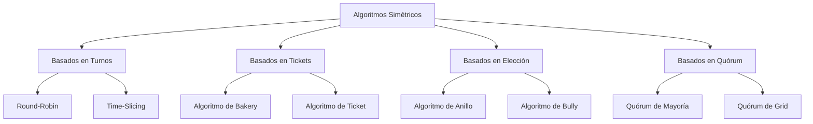

# Computación Concurrente - Exclusión mutua

## 2.8 Algoritmos simétricos.

---

### Definición Formal

Un algoritmo de exclusión mutua es **simétrico** si todos los procesos ejecutan exactamente el mismo código y tienen roles idénticos. No existen procesos especiales o coordinadores. Formalmente:

$$
\forall i,j \in \Pi: \text{Código}(i) = \text{Código}(j)
$$

Donde $\Pi$ es el conjunto de todos los procesos.

#### Características Fundamentales

1. **Simetría de Código**: Todos los procesos ejecutan el mismo algoritmo
2. **Simetría de Roles**: No hay procesos maestros o coordinadores
3. **Descentralización**: Las decisiones se toman colectivamente
4. **Equidad**: Todos los procesos tienen igual oportunidad de acceso

### Clasificación de Algoritmos Simétricos



### Algoritmo de Bakery (Lamport)

#### Descripción Completa

El algoritmo de Bakery es el ejemplo clásico de algoritmo simétrico que garantiza exclusión mutua sin hardware especial.

```java
public class BakeryLock {
    private final int n;
    private volatile boolean[] choosing;
    private volatile int[] number;

    public BakeryLock(int numProcesses) {
        this.n = numProcesses;
        this.choosing = new boolean[n];
        this.number = new int[n];
        // Inicialización implícita con false y 0
    }

    public void lock(int i) {
        // Fase 1: Obtener número de ticket
        choosing[i] = true;

        // Encontrar el máximo número actual y asignar siguiente
        int max = 0;
        for (int j = 0; j < n; j++) {
            if (number[j] > max) {
                max = number[j];
            }
        }
        number[i] = max + 1;

        choosing[i] = false;

        // Fase 2: Esperar turno
        for (int j = 0; j < n; j++) {
            if (j != i) {
                // Esperar si j está eligiendo número
                while (choosing[j]) {
                    Thread.onSpinWait();
                }

                // Esperar si j tiene prioridad
                while (number[j] != 0 &&
                      (number[j] < number[i] ||
                      (number[j] == number[i] && j < i))) {
                    Thread.onSpinWait();
                }
            }
        }
    }

    public void unlock(int i) {
        number[i] = 0;
    }
}
```

#### Análisis de Corrección

**Propiedades del Algoritmo de Bakery**:

1. **Exclusión Mutua**:

   $$ \forall i,j: i \neq j \Rightarrow \neg(CS_i \land CS_j) $$

2. **Libre de Hambruna**:

   $$ \forall i: \square(solicita_i \rightarrow \lozenge CS_i) $$

3. **Orden Justo**: Los procesos entran en orden lexicográfico de (número, id)

**Demostración Sketch**:

- Los números de ticket son únicos y crecientes
- La relación de orden `(number[j] < number[i]) ∨ (number[j] == number[i] ∧ j < i)` establece un orden total
- Cada proceso espera solo a procesos con tickets menores

### Algoritmo de Ticket Simétrico

```java
public class SymmetricTicketLock {
    private final int n;
    private volatile int nextTicket = 0;
    private volatile int nowServing = 0;
    private final boolean[] active;

    public SymmetricTicketLock(int numProcesses) {
        this.n = numProcesses;
        this.active = new boolean[n];
        Arrays.fill(active, true);
    }

    public void acquire(int i) {
        int myTicket;

        // Obtener ticket de forma atómica
        synchronized (this) {
            myTicket = nextTicket++;
        }

        // Esperar turno
        while (nowServing != myTicket) {
            // Verificar si debemos saltar procesos inactivos
            if (!active[nowServing % n]) {
                advanceServing();
            }
            Thread.onSpinWait();
        }
    }

    public void release(int i) {
        advanceServing();
    }

    private synchronized void advanceServing() {
        nowServing++;
        // Buscar siguiente proceso activo si es necesario
        while (!active[nowServing % n] && nowServing < nextTicket) {
            nowServing++;
        }
    }

    public void setActive(int i, boolean status) {
        active[i] = status;
    }
}
```

### Algoritmos Basados en Anillo

#### Token Ring Simétrico

```java
public class SymmetricTokenRing {
    private final int n;
    private final int processId;
    private volatile boolean hasToken = false;
    private volatile int tokenHolder;
    private final Object[] channels;

    public SymmetricTokenRing(int numProcesses, int id) {
        this.n = numProcesses;
        this.processId = id;
        this.tokenHolder = 0; // Inicialmente proceso 0 tiene el token
        this.hasToken = (id == 0);
        this.channels = new Object[n];

        for (int i = 0; i < n; i++) {
            channels[i] = new Object();
        }
    }

    public void acquire() {
        while (!hasToken) {
            // Esperar token
            waitForToken();
        }
        // Token adquirido - entrar a sección crítica
    }

    public void release() {
        if (hasToken) {
            passTokenToNext();
        }
    }

    private void waitForToken() {
        synchronized (channels[processId]) {
            try {
                channels[processId].wait();
            } catch (InterruptedException e) {
                Thread.currentThread().interrupt();
            }
        }
    }

    private void passTokenToNext() {
        int next = (processId + 1) % n;
        hasToken = false;

        synchronized (channels[next]) {
            channels[next].notify();
        }

        System.out.printf("Process %d passed token to %d%n", processId, next);
    }

    // Método para recibir token (llamado por el proceso anterior)
    public void receiveToken() {
        hasToken = true;
        tokenHolder = processId;
        System.out.printf("Process %d received token%n", processId);
    }
}
```

### Algoritmos de Quórum Simétricos

#### Quórum de Mayoría

```java
public class MajorityQuorumMutex {
    private final int n;
    private final int processId;
    private final int quorumSize;
    private volatile long timestamp;
    private final boolean[] permissions;
    private final Object[] locks;

    public MajorityQuorumMutex(int numProcesses, int id) {
        this.n = numProcesses;
        this.processId = id;
        this.quorumSize = (n / 2) + 1;
        this.permissions = new boolean[n];
        this.locks = new Object[n];

        for (int i = 0; i < n; i++) {
            locks[i] = new Object();
        }
    }

    public void acquire() {
        timestamp = System.nanoTime();
        int permissionsGranted = 0;

        // Solicitar permisos a un quórum
        int[] quorum = selectQuorum();

        for (int member : quorum) {
            if (requestPermission(member)) {
                permissionsGranted++;
            }
        }

        // Verificar si tenemos mayoría
        while (permissionsGranted < quorumSize) {
            // Reintentar con miembros alternativos
            int[] alternativeQuorum = selectAlternativeQuorum(quorum);
            for (int member : alternativeQuorum) {
                if (!contains(quorum, member) && requestPermission(member)) {
                    permissionsGranted++;
                    if (permissionsGranted >= quorumSize) break;
                }
            }

            try {
                Thread.sleep(1);
            } catch (InterruptedException e) {
                Thread.currentThread().interrupt();
                return;
            }
        }
    }

    public void release() {
        // Liberar todos los permisos
        for (int i = 0; i < n; i++) {
            if (permissions[i]) {
                releasePermission(i);
                permissions[i] = false;
            }
        }
    }

    private int[] selectQuorum() {
        // Selección simétrica basada en ID y timestamp
        int[] quorum = new int[quorumSize];
        long seed = timestamp ^ processId;
        Random random = new Random(seed);

        Set<Integer> selected = new HashSet<>();
        while (selected.size() < quorumSize) {
            int candidate = random.nextInt(n);
            if (candidate != processId) {
                selected.add(candidate);
            }
        }

        int index = 0;
        for (int member : selected) {
            quorum[index++] = member;
        }

        return quorum;
    }

    private int[] selectAlternativeQuorum(int[] excluded) {
        Set<Integer> excludedSet = new HashSet<>();
        for (int member : excluded) {
            excludedSet.add(member);
        }

        int[] alternative = new int[quorumSize];
        int index = 0;

        for (int i = 0; i < n && index < quorumSize; i++) {
            if (i != processId && !excludedSet.contains(i)) {
                alternative[index++] = i;
            }
        }

        return alternative;
    }

    private boolean requestPermission(int target) {
        synchronized (locks[target]) {
            // Simular solicitud de permiso
            // En sistema real, sería mensaje de red
            permissions[target] = true;
            return true;
        }
    }

    private void releasePermission(int target) {
        synchronized (locks[target]) {
            // Simular liberación de permiso
        }
    }

    private boolean contains(int[] array, int value) {
        for (int element : array) {
            if (element == value) return true;
        }
        return false;
    }
}
```

### Algoritmos Basados en Elección Simétrica

#### Algoritmo de Bully Simétrico

```java
public class SymmetricBullyElection {
    private final int n;
    private final int processId;
    private volatile Integer coordinator = null;
    private volatile boolean electionInProgress = false;
    private final List<Integer> higherProcesses;

    public SymmetricBullyElection(int numProcesses, int id) {
        this.n = numProcesses;
        this.processId = id;
        this.higherProcesses = new ArrayList<>();

        // Identificar procesos con ID mayor
        for (int i = id + 1; i < n; i++) {
            higherProcesses.add(i);
        }
    }

    public void startElection() {
        if (electionInProgress) return;

        electionInProgress = true;
        System.out.printf("Process %d starting election%n", processId);

        if (higherProcesses.isEmpty()) {
            // Somos el proceso con mayor ID - ganamos
            becomeCoordinator();
        } else {
            // Enviar mensajes de elección a procesos superiores
            boolean responseReceived = false;

            for (int higher : higherProcesses) {
                if (sendElectionMessage(higher)) {
                    responseReceived = true;
                }
            }

            // Si nadie responde, ganamos la elección
            if (!responseReceived) {
                becomeCoordinator();
            }
        }

        electionInProgress = false;
    }

    public void receiveElectionMessage(int sender) {
        System.out.printf("Process %d received election message from %d%n",
                         processId, sender);

        // Responder OK y comenzar nuestra propia elección
        sendOkMessage(sender);
        startElection();
    }

    public void receiveOkMessage(int sender) {
        System.out.printf("Process %d received OK from %d%n", processId, sender);
        // Otro proceso responderá - esperar anuncio de coordinador
    }

    public void receiveCoordinatorMessage(int coordinatorId) {
        this.coordinator = coordinatorId;
        System.out.printf("Process %d acknowledges coordinator %d%n",
                         processId, coordinatorId);

        // Reenviar anuncio si es necesario
        if (coordinatorId != processId) {
            for (int i = 0; i < processId; i++) {
                sendCoordinatorMessage(i, coordinatorId);
            }
        }
    }

    private void becomeCoordinator() {
        coordinator = processId;
        System.out.printf("Process %d elected as coordinator%n", processId);

        // Anunciar a todos los procesos inferiores
        for (int i = 0; i < processId; i++) {
            sendCoordinatorMessage(i, processId);
        }
    }

    private boolean sendElectionMessage(int target) {
        // Simular envío de mensaje con posible falla
        boolean success = Math.random() > 0.1; // 90% éxito
        if (success) {
            System.out.printf("Process %d sent election to %d%n", processId, target);
        }
        return success;
    }

    private void sendOkMessage(int target) {
        System.out.printf("Process %d sent OK to %d%n", processId, target);
    }

    private void sendCoordinatorMessage(int target, int coordinatorId) {
        System.out.printf("Process %d sent coordinator announcement to %d%n",
                         processId, target);
    }

    public Integer getCoordinator() {
        return coordinator;
    }
}
```

### Modelo Formal de Algoritmos Simétricos

#### Especificación TLA+ para Algoritmo Simétrico

```tla
---------------------------- MODULE SymmetricMutex ----------------------------
EXTENDS Integers, Sequences

CONSTANTS N  \* Number of processes
VARIABLES pc, ticket, choosing

ProcSet == 0..N-1

TypeInvariant ==
    /\ pc \in [ProcSet -> {"idle", "waiting", "critical"}]
    /\ ticket \in [ProcSet -> Nat]
    /\ choosing \in [ProcSet -> BOOLEAN]

Init ==
    /\ pc = [i \in ProcSet -> "idle"]
    /\ ticket = [i \in ProcSet -> 0]
    /\ choosing = [i \in ProcSet -> FALSE]

MaxTicket ==
    LET max == CHOOSE m \in Nat:
                 \A i \in ProcSet: ticket[i] <= m
    IN max

GetTicket(i) ==
    /\ pc[i] = "idle"
    /\ pc' = [pc EXCEPT ![i] = "waiting"]
    /\ choosing' = [choosing EXCEPT ![i] = TRUE]
    /\ ticket' = [ticket EXCEPT ![i] = MaxTicket + 1]
    /\ choosing' = [choosing EXCEPT ![i] = FALSE]

CanEnter(i) ==
    \A j \in ProcSet \ {i}:
        ~choosing[j] /\
        (ticket[j] = 0 \/
         ticket[i] < ticket[j] \/
         (ticket[i] = ticket[j] /\ i < j))

EnterCS(i) ==
    /\ pc[i] = "waiting"
    /\ CanEnter(i)
    /\ pc' = [pc EXCEPT ![i] = "critical"]

ExitCS(i) ==
    /\ pc[i] = "critical"
    /\ pc' = [pc EXCEPT ![i] = "idle"]
    /\ ticket' = [ticket EXCEPT ![i] = 0]

Next ==
    \E i \in ProcSet: GetTicket(i) \/ EnterCS(i) \/ ExitCS(i)

MutualExclusion ==
    \A i,j \in ProcSet: i # j => ~(pc[i] = "critical" /\ pc[j] = "critical")

StarvationFreedom ==
    \A i \in ProcSet: pc[i] = "waiting" ~> pc[i] = "critical"

Symmetry ==
    \A i,j \in ProcSet:
        \* Todos los procesos ejecutan el mismo código
        behavior(i) = behavior(j)

Spec == Init /\ [][Next]_<<pc, ticket, choosing>>

THEOREM Spec => []MutualExclusion
THEOREM Spec => StarvationFreedom
THEOREM Spec => Symmetry
=============================================================================
```

### Análisis de Complejidad

#### Comparativa de Algoritmos Simétricos

| Algoritmo  | Complejidad Espacio | Complejidad Tiempo | Mensajes por Acceso | Tolerancia a Fallas |
| ---------- | ------------------- | ------------------ | ------------------- | ------------------- |
| Bakery     | $O(n)$              | $O(n)$             | 0                   | Limitada            |
| Token Ring | $O(1)$              | $O(1)$             | $O(n)$              | Media               |
| Quórum     | $O(n)$              | $O(\log n)$        | $O(n)$              | Alta                |
| Ticket     | $O(1)$              | $O(1)$             | 0                   | Baja                |

#### Teorema de Imposibilidad para Simetría Perfecta

**Teorema**: No existe un algoritmo de exclusión mutua que sea completamente simétrico y espere por tiempo finito en un sistema asíncrono.

**Demostración Sketch**:

- En un sistema completamente simétrico, todos los procesos toman las mismas decisiones
- Sin diferenciadores (como IDs únicos o relojes), no se puede romper la simetría
- Por lo tanto, no se puede decidir qué proceso debe entrar primero

### Algoritmos Híbridos Simétricos

#### Algoritmo de Filtro Simétrico

```java
public class SymmetricFilterLock {
    private final int n;
    private final int levels;
    private volatile int[] level;
    private volatile int[] victim;

    public SymmetricFilterLock(int numProcesses) {
        this.n = numProcesses;
        this.levels = n - 1; // n-1 niveles para n procesos
        this.level = new int[n];
        this.victim = new int[levels];
    }

    public void lock(int i) {
        for (int L = 1; L < levels; L++) {
            level[i] = L;
            victim[L] = i;

            // Esperar hasta no haber conflicto en este nivel
            boolean conflictExists;
            do {
                conflictExists = false;
                for (int k = 0; k < n; k++) {
                    if (k != i && level[k] >= L) {
                        conflictExists = true;
                        break;
                    }
                }
            } while (conflictExists && victim[L] == i);
        }
    }

    public void unlock(int i) {
        level[i] = 0;
    }
}
```

### Ejercicios Propuestos

#### Ejercicio 1: Implementación de Bakery Mejorado

Implemente una versión optimizada del algoritmo de Bakery que reduzca el número de lecturas en la fase de espera.

#### Ejercicio 2: Algoritmo Simétrico con Tiempos

Diseñe un algoritmo simétrico que use marcas de tiempo en lugar de números de ticket.

#### Ejercicio 3: Análisis de Fairness

Compare la equidad (fairness) de diferentes algoritmos simétricos bajo alta contención.

#### Ejercicio 4: Algoritmo para Sistemas Asíncronos

Diseñe un algoritmo simétrico que funcione en sistemas completamente asíncronos.

#### Ejercicio 5: Simulación de Escalabilidad

Cree una simulación que mida el desempeño de algoritmos simétricos con diferentes números de procesos.

### Soluciones a Ejercicios Selectos

#### Solución Ejercicio 1

```java
public class OptimizedBakeryLock {
    private final int n;
    private volatile boolean[] choosing;
    private volatile int[] number;
    private final ThreadLocal<int[]> seenNumbers;

    public OptimizedBakeryLock(int numProcesses) {
        this.n = numProcesses;
        this.choosing = new boolean[n];
        this.number = new int[n];
        this.seenNumbers = ThreadLocal.withInitial(() -> new int[n]);
    }

    public void lock(int i) {
        // Fase 1: Obtener ticket
        choosing[i] = true;

        int max = 0;
        for (int j = 0; j < n; j++) {
            if (number[j] > max) {
                max = number[j];
            }
        }
        number[i] = max + 1;
        choosing[i] = false;

        // Fase 2: Espera optimizada
        int[] lastSeen = seenNumbers.get();
        Arrays.fill(lastSeen, 0);

        for (int j = 0; j < n; j++) {
            if (j == i) continue;

            while (true) {
                // Verificar si j está eligiendo
                if (choosing[j]) {
                    Thread.onSpinWait();
                    continue;
                }

                // Leer número actual de j
                int currentNumber = number[j];

                // Si el número cambió, reiniciar verificación para este j
                if (lastSeen[j] != 0 && currentNumber != lastSeen[j]) {
                    lastSeen[j] = currentNumber;
                    continue;
                }

                lastSeen[j] = currentNumber;

                // Verificar si debemos esperar
                if (currentNumber != 0 &&
                    (currentNumber < number[i] ||
                     (currentNumber == number[i] && j < i))) {
                    // Continuar esperando
                    Thread.onSpinWait();
                } else {
                    // No necesitamos esperar a este j
                    break;
                }
            }
        }
    }

    public void unlock(int i) {
        number[i] = 0;
    }
}
```

#### Solución Ejercicio 2

```java
public class TimestampSymmetricLock {
    private final int n;
    private final int processId;
    private volatile long[] timestamps;
    private volatile boolean[] interested;

    public TimestampSymmetricLock(int numProcesses, int id) {
        this.n = numProcesses;
        this.processId = id;
        this.timestamps = new long[n];
        this.interested = new boolean[n];
    }

    public void acquire() {
        interested[processId] = true;

        // Obtener timestamp actual
        long myTimestamp = System.nanoTime();
        timestamps[processId] = myTimestamp;

        // Esperar a todos los procesos con timestamps menores
        for (int j = 0; j < n; j++) {
            if (j == processId) continue;

            while (interested[j]) {
                long theirTimestamp = timestamps[j];

                if (theirTimestamp != 0 &&
                    (theirTimestamp < myTimestamp ||
                     (theirTimestamp == myTimestamp && j < processId))) {
                    Thread.onSpinWait();
                } else {
                    break;
                }
            }
        }
    }

    public void release() {
        interested[processId] = false;
        timestamps[processId] = 0;
    }

    // Método para actualizar timestamp de otro proceso
    public void updateTimestamp(int process, long timestamp) {
        if (process >= 0 && process < n && process != processId) {
            timestamps[process] = timestamp;
            interested[process] = true;
        }
    }
}
```

### Consideraciones de Implementación

#### Optimizaciones para Sistemas Reales

```java
public class CacheFriendlySymmetricLock {
    private final int n;

    // Padding para evitar false sharing
    private static class PaddedBoolean {
        boolean value;
        long p1, p2, p3, p4, p5, p6, p7; // Padding
    }

    private static class PaddedInt {
        int value;
        long p1, p2, p3, p4, p5, p6, p7; // Padding
    }

    private final PaddedBoolean[] choosing;
    private final PaddedInt[] number;

    public CacheFriendlySymmetricLock(int numProcesses) {
        this.n = numProcesses;
        this.choosing = new PaddedBoolean[n];
        this.number = new PaddedInt[n];

        for (int i = 0; i < n; i++) {
            choosing[i] = new PaddedBoolean();
            number[i] = new PaddedInt();
        }
    }

    public void lock(int i) {
        choosing[i].value = true;

        int max = 0;
        for (int j = 0; j < n; j++) {
            if (number[j].value > max) {
                max = number[j].value;
            }
        }
        number[i].value = max + 1;
        choosing[i].value = false;

        for (int j = 0; j < n; j++) {
            if (j != i) {
                while (choosing[j].value) {
                    Thread.onSpinWait();
                }

                while (number[j].value != 0 &&
                      (number[j].value < number[i].value ||
                      (number[j].value == number[i].value && j < i))) {
                    Thread.onSpinWait();
                }
            }
        }
    }

    public void unlock(int i) {
        number[i].value = 0;
    }
}
```

### Referencias Bibliográficas

#### Bibliografía Básica

1. **Taubenfeld, G. (2006)**. _Synchronization Algorithms and Concurrent Programming_
   - Capítulo 3: "The Mutual Exclusion Problem"
   - Sección 3.3: "Symmetric Algorithms"
   - Capítulo 4: "Algorithms Using Atomic Registers"

2. **Herlihy, M. & Shavit, N. (2008)**. _The Art of Multiprocessor Programming_
   - Capítulo 2: "Mutual Exclusion"
   - Sección 2.7: "The Bakery Algorithm"

#### Bibliografía Complementaria

1. **Lamport, L. (2002)**. _Specifying Systems: The TLA+ Language and Tools_
   - Capítulo 6: "Temporal Logic"

#### Artículos Fundamentales

- Lamport, L. (1974). "A New Solution of Dijkstra's Concurrent Programming Problem"
- Peterson, G. L. (1981). "Myths About the Mutual Exclusion Problem"
- Szymański, B. K. (1988). "A Simple Solution to Lamport's Concurrent Programming Problem with Linear Wait"

### Resumen y Conclusiones

Los algoritmos simétricos ofrecen soluciones elegantes y equitativas para la exclusión mutua:

#### Ventajas

- **Equidad**: Todos los procesos son tratados igualmente
- **Descentralización**: No hay punto único de falla
- **Simplicidad Conceptual**: Mismo código para todos los procesos
- **Robustez**: Funcionan sin coordinadores centrales

#### Desventajas

- **Overhead**: Comunicación o coordinación adicional
- **Escalabilidad**: Algunos algoritmos tienen complejidad $O(n)$
- **Sensibilidad a Fallas**: Pueden requerir mecanismos adicionales para tolerancia

#### Aplicaciones Prácticas

- **Sistemas Embebidos**: Donde la simplicidad es crucial
- **Sistemas Distribuidos**: Sin autoridad central
- **Enseñanza**: Para entender los fundamentos de la coordinación distribuida

Los algoritmos simétricos continúan siendo relevantes en sistemas modernos, particularmente en contextos donde la equidad y descentralización son prioritarias sobre el rendimiento absoluto.
