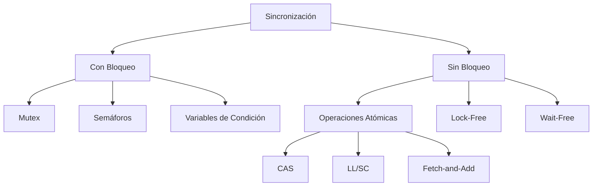

# Computación Concurrente - Sincronización con y sin bloqueo

## 3.1 Primitivas de sincronización.

---

La sincronización en sistemas concurrentes es fundamental para coordinar el acceso a recursos compartidos entre múltiples hilos o procesos. Las primitivas de sincronización pueden clasificarse en dos categorías principales: **con bloqueo** y **sin bloqueo**.

### Definiciones Fundamentales

**Sincronización con bloqueo**: Mecanismos donde un hilo puede quedar suspendido (bloqueado) esperando a que se cumpla una condición. Ejemplos: mutex, semáforos.

**Sincronización sin bloqueo**: Mecanismos donde los hilos progresan sin bloquearse, utilizando operaciones atómicas. Ejemplos: CAS (Compare-and-Swap), transacciones de memoria.

### Primitivas con Bloqueo

#### Mutex (Exclusión Mutua)

Un mutex permite que solo un hilo acceda a una sección crítica a la vez.

```c
#include <pthread.h>

pthread_mutex_t mutex = PTHREAD_MUTEX_INITIALIZER;
int contador_compartido = 0;

void* incrementar(void* arg) {
    for (int i = 0; i < 1000; i++) {
        pthread_mutex_lock(&mutex);
        contador_compartido++;
        pthread_mutex_unlock(&mutex);
    }
    return NULL;
}
```

#### Semáforos

Un semáforo mantiene un contador y permite que hasta N hilos accedan simultáneamente a un recurso.

**Operaciones básicas**:

- `wait(S)`: Si S > 0, decrementa S; sino, bloquea
- `signal(S)`: Incrementa S y despierta un hilo bloqueado

```c
#include <semaphore.h>

sem_t semaforo;
int recurso_compartido;

void usar_recurso() {
    sem_wait(&semaforo);  // Decrementa el semáforo
    // Usar recurso compartido
    sem_post(&semaforo);  // Incrementa el semáforo
}
```

#### Variables de Condición

Permiten a los hilos esperar hasta que se cumple una condición específica.

```c
pthread_mutex_t mutex = PTHREAD_MUTEX_INITIALIZER;
pthread_cond_t cond = PTHREAD_COND_INITIALIZER;
int dato_listo = 0;

void productor() {
    pthread_mutex_lock(&mutex);
    // Producir dato
    dato_listo = 1;
    pthread_cond_signal(&cond);
    pthread_mutex_unlock(&mutex);
}

void consumidor() {
    pthread_mutex_lock(&mutex);
    while (!dato_listo) {
        pthread_cond_wait(&cond, &mutex);
    }
    // Consumir dato
    pthread_mutex_unlock(&mutex);
}
```

### Primitivas sin Bloqueo

#### Operaciones Atómicas

Las operaciones atómicas se ejecutan completamente sin interrupciones.

**Compare-and-Swap (CAS)**:

$$
CAS(addr, expected, new) =
\begin{cases}
\text{true} & \text{if } *addr = expected \text{ then } *addr \leftarrow new \\
\text{false} & \text{otherwise}
\end{cases}
$$

```c
#include <stdatomic.h>

atomic_int contador = ATOMIC_VAR_INIT(0);

void incrementar_atomico() {
    int valor_actual;
    do {
        valor_actual = atomic_load(&contador);
    } while (!atomic_compare_exchange_weak(&contador, &valor_actual, valor_actual + 1));
}
```

#### Algoritmos Lock-Free

**Stack Lock-Free**:

```c
#include <stdatomic.h>

typedef struct node {
    int data;
    struct node* next;
} node_t;

atomic_ptr node_t* top = NULL;

void push(int value) {
    node_t* new_node = malloc(sizeof(node_t));
    new_node->data = value;

    do {
        new_node->next = atomic_load(&top);
    } while (!atomic_compare_exchange_weak(&top, &new_node->next, new_node));
}

int pop() {
    node_t* old_top;
    do {
        old_top = atomic_load(&top);
        if (old_top == NULL) return -1; // Stack vacío
    } while (!atomic_compare_exchange_weak(&top, &old_top, old_top->next));

    int value = old_top->data;
    free(old_top);
    return value;
}
```

### Modelos de Consistencia

#### Modelo de Memoria Sequential Consistency (SC)

En SC, todas las operaciones aparecen ejecutarse en un orden total que es consistente con el orden del programa de cada procesador.

#### Modelo de Memoria TSO (Total Store Order)

En TSO, las escrituras de un procesador son inmediatamente visibles para ese procesador, pero pueden retrasarse para otros.

### Diagramas de Sincronización



### Ejercicios Propuestos

#### Ejercicio 1: Implementación de Spinlock

Implementa un spinlock utilizando operaciones atómicas:

```c
typedef struct {
    atomic_flag flag;
} spinlock_t;

void spinlock_init(spinlock_t* lock);
void spinlock_lock(spinlock_t* lock);
void spinlock_unlock(spinlock_t* lock);
```

#### Ejercicio 2: Productor-Consumidor Lock-Free

Implementa un buffer productor-consumidor utilizando algoritmos lock-free:

```c
#define BUFFER_SIZE 10

typedef struct {
    int buffer[BUFFER_SIZE];
    atomic_int head;
    atomic_int tail;
} ring_buffer_t;

bool enqueue(ring_buffer_t* rb, int value);
bool dequeue(ring_buffer_t* rb, int* value);
```

#### Ejercicio 3: Análisis de Correctitud

Demuestra la correctitud del siguiente algoritmo:

```c
// Algoritmo de Peterson para 2 hilos
bool interested[2] = {false, false};
int turn;

void enter_critical(int thread_id) {
    int other = 1 - thread_id;
    interested[thread_id] = true;
    turn = thread_id;
    while (interested[other] && turn == thread_id) {
        // Espera activa
    }
}

void exit_critical(int thread_id) {
    interested[thread_id] = false;
}
```

**Preguntas**:

1. ¿El algoritmo garantiza exclusión mutua?
2. ¿Garantiza ausencia de inanición?
3. ¿Es justo?

### Teoremas y Propiedades Formales

#### Teorema de Imposibilidad de Consenso

En un sistema asíncrono con fallas, es imposible lograr consenso con al menos un proceso que pueda fallar.

#### Propiedades de Safety y Liveness

**Safety**: "Nada malo ocurre" - garantiza que los invariantes se mantienen.

**Liveness**: "Algo bueno eventualmente ocurre" - garantiza progreso.

#### Linearización Points

Para demostrar correctitud en algoritmos concurrentes, identificamos puntos de linearización donde las operaciones parecen tomar efecto atómicamente.

### Patrones de Diseño Avanzados

#### Read-Copy-Update (RCU)

```c
// Estructura compartida
typedef struct {
    int data;
    // otros campos
} shared_data_t;

shared_data_t* global_ptr;

void lector() {
    shared_data_t* local_ptr;
    rcu_read_lock();
    local_ptr = rcu_dereference(global_ptr);
    // Leer de local_ptr
    rcu_read_unlock();
}

void actualizador() {
    shared_data_t* new_ptr = malloc(sizeof(shared_data_t));
    // Inicializar new_ptr

    shared_data_t* old_ptr = global_ptr;
    rcu_assign_pointer(global_ptr, new_ptr);
    synchronize_rcu();  // Esperar a que todos los lectores terminen
    free(old_ptr);
}
```

### Evaluación de Rendimiento

#### Métricas Importantes

- **Throughput**: Operaciones completadas por unidad de tiempo
- **Latencia**: Tiempo para completar una operación
- **Escalabilidad**: Cómo mejora el rendimiento con más procesadores
- **Fairness**: Distribución equitativa del acceso

#### Fórmulas de Análisis

**Contención en sección crítica**:

$$
T_{total} = T_{work} + T_{sync}
$$

Donde $T_{sync}$ incluye overhead de sincronización.

### Ejercicios de Aplicación

#### Ejercicio 4: Diseño de Sistema de Reservas

Diseña un sistema de reservas de asientos para un teatro que debe soportar:

- Múltiples clientes reservando simultáneamente
- Máxima concurrencia posible
- Sin bloqueos innecesarios

**Requisitos**:

- Un asiento solo puede ser reservado por un cliente
- Las operaciones deben ser thread-safe
- Preferiblemente lock-free

#### Ejercicio 5: Análisis de Algoritmo

Analiza el siguiente algoritmo y responde:

```java
class Counter {
    private AtomicInteger value = new AtomicInteger(0);

    public void increment() {
        int oldValue;
        do {
            oldValue = value.get();
        } while (!value.compareAndSet(oldValue, oldValue + 1));
    }
}
```

**Preguntas**:

1. ¿Es este algoritmo lock-free?
2. ¿Es wait-free?
3. ¿Cuál es el peor caso de rendimiento?
4. ¿Cómo se compara con una versión con lock?

### Referencias

#### Bibliografía Básica

1. **Taubenfeld, G. (2006)**. _Synchronization Algorithms and Concurrent Programming_.
   - Capítulo 2: The Mutual Exclusion Problem
   - Capítulo 5: Synchronization Objects

2. **Herlihy, M. & Shavit, N. (2008)**. _The Art of Multiprocessor Programming_.
   - Capítulo 7: Spin Locks and Contention
   - Capítulo 11: Concurrent Stacks and Queues

#### Bibliografía Complementaria

3. **Lamport, L. (2002)**. _Specifying Systems: The TLA+ Language and Tools_.
   - Especialmente útil para especificaciones formales de algoritmos de sincronización.

#### Recursos Adicionales

- Papers clásicos: "Time, Clocks, and the Ordering of Events" (Lamport, 1978)
- Estándares: C11/C++11 memory model
- Herramientas: ThreadSanitizer, model checkers como TLC para TLA+

### Consejos para el Estudio

1. **Comienza con lo simple**: Entiende primero los mecanismos con bloqueo antes de abordar los sin bloqueo.

2. **Practica con código**: Implementa los ejemplos y modifícalos para entender su comportamiento.

3. **Analiza casos límite**: Considera siempre las condiciones de carrera y escenarios de alta contención.

4. **Usa herramientas de debugging**: Aprende a usar herramientas como helgrind, tsan, etc.

5. **Estudia las implementaciones reales**: Revisa el código fuente de primitivas en librerías estándar.
