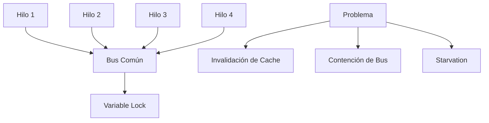
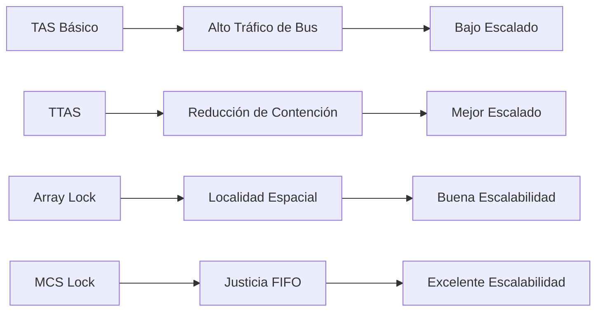

# Computación Concurrente - Sincronización con y sin bloqueo

## 3.2 Bits test-and-set y evitar colisiones.

---

El **test-and-set** es una operación atómica fundamental en computación concurrente que permite tanto probar como modificar un valor en una sola operación indivisible.

#### Definición Formal

La operación **test-and-set** se define como:

$$
\text{TAS}(addr) =
\begin{cases}
\text{true} & \text{if } *addr = 1 \\
\text{false} & \text{otherwise}
\end{cases}
\quad \text{y simultáneamente establece } *addr \leftarrow 1
$$

#### Implementación Hardware

```c
// Definición de la operación atómica
typedef struct {
    volatile int lock;
} tas_lock_t;

// Operación test-and-set atómica
int test_and_set(int *lock) {
    int old_value = *lock;
    *lock = 1;  // Establece el lock
    return old_value;
}
```

### Implementación de Spinlock con Test-and-Set

#### Versión Básica

```c
#include <stdatomic.h>

// Spinlock usando test-and-set
typedef struct {
    atomic_int lock;
} tas_spinlock_t;

void tas_lock_init(tas_spinlock_t *spinlock) {
    atomic_store(&spinlock->lock, 0);
}

void tas_lock(tas_spinlock_t *spinlock) {
    while (atomic_exchange(&spinlock->lock, 1) == 1) {
        // Espera activa (busy-waiting)
        // En la práctica, aquí se podría insertar una pausa
    }
}

void tas_unlock(tas_spinlock_t *spinlock) {
    atomic_store(&spinlock->lock, 0);
}
```

#### Versión con Backoff Exponencial

```c
void tas_lock_with_backoff(tas_spinlock_t *spinlock) {
    int backoff = 1;
    int max_backoff = 1024;

    while (atomic_exchange(&spinlock->lock, 1) == 1) {
        // Espera con backoff exponencial
        for (int i = 0; i < backoff; i++) {
            // Instrucción de pausa para ahorrar energía
            asm volatile("pause" ::: "memory");
        }
        backoff = (backoff < max_backoff) ? backoff * 2 : max_backoff;
    }
}
```

### Problema de Colisiones en Test-and-Set

#### Análisis de Contención



#### Fórmula de Contención

La probabilidad de colisión con $n$ hilos compitiendo:

$$
P_{\text{colisión}} = 1 - \left(1 - \frac{1}{m}\right)^{n-1}
$$

Donde:

- $n$: número de hilos
- $m$: número de variables de lock distintas

### Técnicas para Evitar Colisiones

#### 1. Test-and-Test-and-Set

```c
void ttas_lock(tas_spinlock_t *spinlock) {
    while (true) {
        // Primero prueba sin modificar (localmente)
        while (atomic_load(&spinlock->lock) == 1) {
            // Espera leyendo de cache local
            asm volatile("pause" ::: "memory");
        }
        // Luego intenta adquirir el lock
        if (atomic_exchange(&spinlock->lock, 1) == 0) {
            break;  // Lock adquirido
        }
    }
}
```

#### 2. Locks con Array (Anderson's Lock)

```c
#define NUM_THREADS 64

typedef struct {
    atomic_int slots[NUM_THREADS];
    atomic_int next_slot;
    atomic_int current_slot;
} array_lock_t;

void array_lock_init(array_lock_t *lock) {
    for (int i = 0; i < NUM_THREADS; i++) {
        atomic_store(&lock->slots[i], (i == 0) ? 1 : 0);
    }
    atomic_store(&lock->next_slot, 0);
    atomic_store(&lock->current_slot, 0);
}

void array_lock_acquire(array_lock_t *lock, int thread_id) {
    int my_slot = atomic_fetch_add(&lock->next_slot, 1) % NUM_THREADS;

    // Espera hasta que nuestro slot esté activo
    while (atomic_load(&lock->slots[my_slot]) == 0) {
        asm volatile("pause" ::: "memory");
    }
}

void array_lock_release(array_lock_t *lock, int thread_id) {
    int current = atomic_load(&lock->current_slot);
    int next = (current + 1) % NUM_THREADS;

    // Desactiva el slot actual y activa el siguiente
    atomic_store(&lock->slots[current], 0);
    atomic_store(&lock->slots[next], 1);
    atomic_store(&lock->current_slot, next);
}
```

#### 3. MCS Lock (FIFO basado en lista)

```c
typedef struct mcs_node {
    atomic_int locked;
    struct mcs_node *next;
} mcs_node_t;

typedef struct {
    atomic_ptr mcs_node_t *tail;
} mcs_lock_t;

void mcs_lock_init(mcs_lock_t *lock) {
    atomic_store(&lock->tail, NULL);
}

void mcs_lock_acquire(mcs_lock_t *lock, mcs_node_t *node) {
    node->locked = 1;
    node->next = NULL;

    // Enlaza este nodo al final de la cola
    mcs_node_t *prev = atomic_exchange(&lock->tail, node);

    if (prev != NULL) {
        // No éramos los primeros, enlaza con el anterior
        atomic_store(&prev->next, node);
        // Espera hasta que el nodo anterior nos desbloquee
        while (atomic_load(&node->locked) == 1) {
            asm volatile("pause" ::: "memory");
        }
    }
}

void mcs_lock_release(mcs_lock_t *lock, mcs_node_t *node) {
    // Verifica si somos el último en la cola
    if (atomic_load(&node->next) == NULL) {
        mcs_node_t *expected = node;
        if (atomic_compare_exchange_strong(&lock->tail, &expected, NULL)) {
            return;  // Éramos los únicos en la cola
        }

        // Espera a que el siguiente nodo se enlace
        while (atomic_load(&node->next) == NULL) {
            asm volatile("pause" ::: "memory");
        }
    }

    // Desbloquea al siguiente hilo
    atomic_store(&node->next->locked, 0);
}
```

### Análisis de Performance

#### Comparación de Algoritmos



#### Métricas de Evaluación

**Latencia de Adquisición**:

$$
T_{\text{acquire}} = T_{\text{cache}} + T_{\text{bus}} + T_{\text{contention}}
$$

**Throughput del Sistema**:

$$
\text{Throughput} = \frac{n \times \text{work}}{T_{\text{critical}} + T_{\text{sync}}}
$$

### Ejercicios Propuestos

#### Ejercicio 1: Implementación de Ticket Lock

Implementa un ticket lock que garantice orden FIFO:

```c
typedef struct {
    atomic_int next_ticket;
    atomic_int now_serving;
} ticket_lock_t;

void ticket_lock_init(ticket_lock_t *lock);
void ticket_lock_acquire(ticket_lock_t *lock);
void ticket_lock_release(ticket_lock_t *lock);
```

**Requisitos**:

- Garantizar fairness (FIFO)
- Minimizar tráfico de cache
- Evitar starvation

#### Ejercicio 2: Análisis de Cache Coherence

Analiza el protocolo MESI y su impacto en test-and-set:

```c
// Simula el comportamiento de cache
typedef struct {
    int state;  // M, E, S, I
    int value;
} cache_line_t;

void simulate_cache_contention() {
    // Implementar simulación de invalidaciones
}
```

**Preguntas**:

1. ¿Cuántas invalidaciones de cache ocurren con 4 hilos?
2. ¿Cómo afecta el tamaño de línea de cache?
3. ¿Qué optimizaciones reducirían el tráfico?

#### Ejercicio 3: Lock Escalable para Núcleos

Diseña un lock que escale bien en sistemas NUMA:

```c
typedef struct {
    // Diseña una estructura para múltiples sockets
} numa_lock_t;
```

**Consideraciones**:

- Localidad de memoria
- Contención inter-socket
- Fairness entre sockets

#### Ejercicio 4: Benchmark Comparativo

Implementa un benchmark para comparar diferentes locks:

```c
void benchmark_lock(void (*lock_func)(void*), void (*unlock_func)(void*)) {
    struct timespec start, end;
    volatile int counter = 0;

    clock_gettime(CLOCK_MONOTONIC, &start);

    #pragma omp parallel for
    for (int i = 0; i < 1000000; i++) {
        lock_func(&lock);
        counter++;
        unlock_func(&lock);
    }

    clock_gettime(CLOCK_MONOTONIC, &end);
    // Calcular y reportar resultados
}
```

### Optimizaciones Avanzadas

#### Adaptive Locking

```c
typedef struct {
    atomic_int lock;
    int contention_count;
    int threshold;
} adaptive_lock_t;

void adaptive_lock(adaptive_lock_t *lock) {
    if (lock->contention_count < lock->threshold) {
        // Usar spinlock
        while (atomic_exchange(&lock->lock, 1) == 1) {
            asm volatile("pause" ::: "memory");
        }
    } else {
        // Usar bloqueo cooperativo
        usleep(100);  // Pequeña espera
    }
}
```

#### Reader-Writer Locks

```c
typedef struct {
    atomic_int state;
    // bit 0: writer lock
    // bits 1-31: reader count
} rw_lock_t;

#define WRITER_BIT 0x1
#define READER_MASK 0xFFFFFFFE

void read_lock(rw_lock_t *lock) {
    int expected;
    do {
        expected = atomic_load(&lock->state) & READER_MASK;
    } while (!atomic_compare_exchange_weak(&lock->state, &expected, expected + 2));
}

void write_lock(rw_lock_t *lock) {
    int expected = 0;
    while (!atomic_compare_exchange_weak(&lock->state, &expected, WRITER_BIT)) {
        expected = 0;
        asm volatile("pause" ::: "memory");
    }
}
```

### Casos de Estudio del Mundo Real

#### Linux Kernel Spinlocks

```c
// Ejemplo simplificado basado en Linux
typedef struct {
    atomic_t raw_lock;
} spinlock_t;

static inline void spin_lock(spinlock_t *lock) {
    while (atomic_cmpxchg(&lock->raw_lock, 0, 1) != 0) {
        while (atomic_read(&lock->raw_lock) != 0)
            cpu_relax();
    }
}
```

#### Java Concurrent Package

```java
// Ejemplo de AtomicInteger en Java
public class AtomicExample {
    private AtomicInteger counter = new AtomicInteger(0);

    public void increment() {
        int oldValue;
        do {
            oldValue = counter.get();
        } while (!counter.compareAndSet(oldValue, oldValue + 1));
    }
}
```

### Referencias Académicas

#### Bibliografía Básica

1. **Taubenfeld, G. (2006)**. _Synchronization Algorithms and Concurrent Programming_.
   - Capítulo 4: Spin Locks (especialmente sección 4.2 sobre test-and-set)
   - Capítulo 7: Adaptive Algorithms

2. **Herlihy, M. & Shavit, N. (2008)**. _The Art of Multiprocessor Programming_.
   - Capítulo 7: Spin Locks and Contention
   - Capítulo 15: Implementing Concurrent Objects

#### Bibliografía Complementaria

3. **Mellor-Crummey, J. M. & Scott, M. L. (1991)**. _Algorithms for Scalable Synchronization on Shared-Memory Multiprocessors_.
   - Paper seminal sobre MCS lock y ticket lock

4. **Anderson, T. E. (1990)**. _The Performance of Spin Lock Alternatives for Shared-Memory Multiprocessors_.
   - Análisis comparativo de algoritmos de spinlock

#### Papers Recomendados

- "A Hierarchical CLH Queue Lock" de Scherer III y Scott
- "Futexes Are Tricky" de Drepper
- "The Performance of Spin Lock Alternatives" de Anderson

### Consejos Prácticos

1. **Perfila siempre**: Mide la contención antes de optimizar
2. **Considera la arquitectura**: Los locks óptimos dependen de la topología de cache
3. **Usa herramientas**: `perf`, `valgrind --tool=drd`, `tsan`
4. **Prueba con cargas reales**: Los micro-benchmarks pueden ser engañosos
5. **Documenta las suposiciones**: Especifica para qué cargas de trabajo está optimizado tu lock

Esta guía proporciona una comprensión profunda de los bits test-and-set y las técnicas para evitar colisiones, esenciales para diseñar sistemas concurrentes de alto rendimiento.
