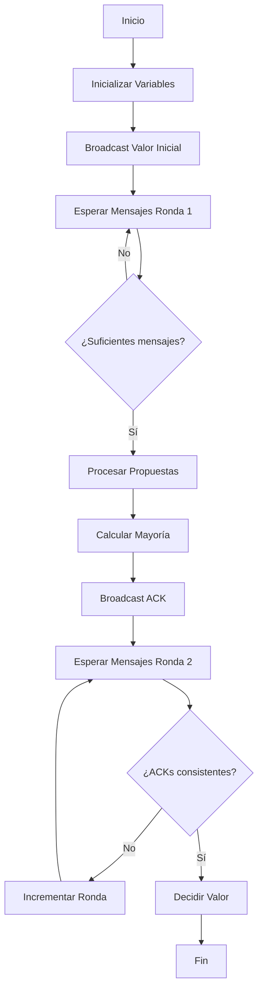

# Computación Concurrente - Sincronización con y sin bloqueo

## 3.3 El algoritmo de incidente.

---

### Introducción al Problema de Consenso

El **Algoritmo de Incidente** es un protocolo fundamental en computación distribuida que resuelve el problema de consenso bajo ciertas condiciones de falla. También se conoce como el "problema del general bizantino" en su forma más general.

#### Definición Formal

**Problema de Incidente**: Un conjunto de procesos necesita acordar un valor binario (0 o 1) donde:

- Si todos los procesos proponen el mismo valor, deben decidir ese valor
- Si hay valores mixtos, pueden decidir cualquier valor pero deben acordar

### Formulación del Algoritmo de Incidente

#### Modelo del Sistema

- **n procesos**: $P_1, P_2, ..., P_n$
- **Comunicación por mensajes**: confiable pero asíncrona
- **Fallos de crash**: procesos pueden detenerse
- **Objetivo**: Acordar un valor binario $v \in \{0, 1\}$

#### Condiciones de Correctitud

1. **Acuerdo**: Todos los procesos correctos deciden el mismo valor
2. **Validez**: Si todos los procesos proponen el mismo valor $v$, entonces todos deciden $v$
3. **Terminación**: Todos los procesos correctos eventualmente deciden

### Algoritmo de Incidente Clásico

#### Versión para Sistemas Sincrónicos

```python
class IncidentProcess:
    def __init__(self, process_id, total_processes, initial_value):
        self.id = process_id
        self.n = total_processes
        self.f = (total_processes - 1) // 3  # Máximo fallos bizantinos
        self.values = [None] * total_processes
        self.decided = False
        self.decision = None
        self.round = 0

    def incident_algorithm(self, initial_value):
        # Fase 1: Broadcast de valores iniciales
        self.broadcast(("initial", initial_value))

        for round in range(self.f + 1):
            self.round = round
            messages = self.receive_messages()

            if round == 0:
                # Procesar valores iniciales
                for msg in messages:
                    if msg[0] == "initial":
                        self.values[msg.sender] = msg[1]
            else:
                # Fases posteriores
                self.process_round(messages, round)

            # Verificar condición de decisión
            if self.check_decision_condition():
                self.decide()
                break
```

#### Implementación Detallada

```java
public class IncidentAlgorithm {
    private final int processId;
    private final int totalProcesses;
    private final int maxFailures;
    private int[] values;
    private boolean decided = false;
    private int decision = -1;

    public IncidentAlgorithm(int id, int n) {
        this.processId = id;
        this.totalProcesses = n;
        this.maxFailures = (n - 1) / 3;
        this.values = new int[n];
        Arrays.fill(values, -1); // -1 indica valor no recibido
    }

    public int run(int initialValue) {
        // Ronda 0: Enviar valor inicial
        broadcast(initialValue);

        for (int round = 0; round <= maxFailures; round++) {
            List<Message> messages = receiveMessages();
            processMessages(messages, round);

            if (canDecide()) {
                decide();
                break;
            }
        }

        return decision;
    }

    private void processMessages(List<Message> messages, int round) {
        for (Message msg : messages) {
            if (round == 0 && values[msg.sender] == -1) {
                values[msg.sender] = msg.value;
            } else if (round > 0) {
                // Procesar mensajes de rondas posteriores
                processRoundMessage(msg, round);
            }
        }
    }
}
```

### Análisis Matemático del Algoritmo

#### Límite de Procesos Fallidos

Para el algoritmo de incidente que tolera fallos bizantinos:

$$
n > 3f
$$

Donde:

- $n$: número total de procesos
- $f$: número máximo de procesos fallidos

#### Complejidad de Mensajes

El número total de mensajes enviados está acotado por:

$$
M(n) = O(n^2) \quad \text{en cada ronda}
$$

#### Rondas Requeridas

$$
R(f) = f + 1 \quad \text{rondas para consenso}
$$

### Algoritmo de Incidente para Fallos de Crash

#### Versión Simplificada

```python
class CrashTolerantIncident:
    def __init__(self, process_id, total_processes):
        self.id = process_id
        self.n = total_processes
        self.proposals = {}
        self.acknowledgements = {}
        self.decision = None
        self.round = 0

    def run_incident(self, proposal):
        # Fase 1: Broadcast de propuesta
        self.broadcast_proposal(proposal)

        while self.decision is None:
            self.round += 1
            messages = self.collect_messages()

            if self.round == 1:
                self.process_proposals(messages)
            elif self.round == 2:
                self.process_acknowledgements(messages)
            elif self.round >= 3:
                self.try_decide()

        return self.decision

    def process_proposals(self, messages):
        for msg in messages:
            if msg.type == "PROPOSAL":
                self.proposals[msg.sender] = msg.value

        # Si tenemos n - f propuestas, enviar ACK
        if len(self.proposals) >= self.n - self.estimate_failures():
            majority_value = self.compute_majority()
            self.broadcast_ack(majority_value)

    def compute_majority(self):
        # Calcular valor mayoritario entre las propuestas
        count_0 = sum(1 for v in self.proposals.values() if v == 0)
        count_1 = sum(1 for v in self.proposals.values() if v == 1)
        return 0 if count_0 > count_1 else 1
```

### Diagrama de Flujo del Algoritmo



### Casos de Ejemplo

#### Ejemplo 1: Consenso Exitoso

**Escenario**: 4 procesos, 1 fallo posible

```python
# Procesos y sus valores iniciales
processes = {
    'P1': 1,
    'P2': 1,
    'P3': 1,
    'P4': 0  # Valor diferente
}

# Ejecución del algoritmo:
# Ronda 1: Todos envían sus valores
# Ronda 2: Mayoría de 1s detectada
# Ronda 3: Consenso en valor 1
```

#### Ejemplo 2: Con Fallo de Proceso

```python
# P4 falla después de enviar su valor
processes = {
    'P1': 0,
    'P2': 0,
    'P3': 1,
    'P4': 0  # Fallo después de enviar
}

# El algoritmo debe lograr consenso a pesar del fallo
```

### Implementación Práctica en C

```c
#include <stdio.h>
#include <stdlib.h>
#include <string.h>
#include <unistd.h>

#define MAX_PROCESSES 10
#define MAX_ROUNDS 10

typedef struct {
    int sender;
    int round;
    int value;
    char type[20];
} message_t;

typedef struct {
    int id;
    int n;  // total processes
    int f;  // max failures
    int initial_value;
    int decision;
    int decided;
    int proposals[MAX_PROCESSES];
    int acks[MAX_PROCESSES];
    int round;
} incident_process_t;

void incident_init(incident_process_t *proc, int id, int n, int value) {
    proc->id = id;
    proc->n = n;
    proc->f = (n - 1) / 3;
    proc->initial_value = value;
    proc->decision = -1;
    proc->decided = 0;
    proc->round = 0;
    memset(proc->proposals, -1, sizeof(proc->proposals));
    memset(proc->acks, -1, sizeof(proc->acks));
}

int compute_majority(int *values, int n) {
    int count0 = 0, count1 = 0;
    for (int i = 0; i < n; i++) {
        if (values[i] == 0) count0++;
        else if (values[i] == 1) count1++;
    }
    return (count0 > count1) ? 0 : 1;
}

int incident_algorithm(incident_process_t *proc) {
    // Ronda 0: Broadcast initial value
    printf("Process %d: Broadcasting initial value %d\n",
           proc->id, proc->initial_value);

    for (int round = 0; round <= proc->f + 1 && !proc->decided; round++) {
        proc->round = round;

        if (round == 0) {
            // Simular recepción de mensajes de otros procesos
            // En implementación real, usaría MPI o sockets
            simulate_message_reception(proc);
        }

        // Verificar si podemos decidir
        if (check_decision_condition(proc)) {
            proc->decided = 1;
            proc->decision = compute_majority(proc->proposals, proc->n);
            printf("Process %d: Decided value %d\n", proc->id, proc->decision);
        }
    }

    return proc->decision;
}
```

### Ejercicios Propuestos

#### Ejercicio 1: Implementación de Incidente Básico

Implementa el algoritmo de incidente para 4 procesos que tolera 1 fallo:

```python
class BasicIncident:
    def __init__(self, pid, n_processes, initial_value):
        self.pid = pid
        self.n = n_processes
        self.initial_value = initial_value
        self.values = [None] * n_processes
        self.decision = None

    def run(self):
        # TODO: Implementar el algoritmo completo
        # - Fase de broadcast inicial
        # - Fases de refinamiento
        # - Condición de decisión
        pass
```

**Preguntas**:

1. ¿Cuántas rondas son necesarias mínimo?
2. ¿Qué ocurre si un proceso falla después de enviar su valor?
3. ¿Cómo garantizas la terminación?

#### Ejercicio 2: Análisis de Correctitud

Demuestra que el algoritmo satisface:

1. **Acuerdo**: $\forall p,q \text{ correctos }, decision_p = decision_q$
2. **Validez**: Si $\forall p, initial_p = v$ entonces $decision = v$
3. **Terminación**: Todos los procesos correctos eventualmente deciden

#### Ejercicio 3: Optimización para Reducción de Mensajes

Modifica el algoritmo para reducir el número de mensajes:

```python
def optimized_incident(self):
    # Implementar técnicas como:
    # - Agrupamiento de mensajes
    # - Filtrado de mensajes redundantes
    # - Comprimación de datos
    pass
```

#### Ejercicio 4: Simulación de Fallos Bizantinos

Extiende el algoritmo para manejar procesos bizantinos:

```python
class ByzantineIncident:
    def handle_byzantine_behavior(self, messages):
        # Detectar y filtrar mensajes bizantinos
        # Usar esquemas de votación
        # Implementar verificación de consistencia
        pass
```

### Variantes del Algoritmo de Incidente

#### Incidente con Quórum

```python
class QuorumIncident:
    def __init__(self, processes):
        self.quorum_size = (len(processes) // 2) + 1

    def check_quorum(self, messages):
        return len(messages) >= self.quorum_size
```

#### Incidente con Firmas Digitales

Para sistemas con procesos bizantinos:

```python
class SignedIncident:
    def verify_signature(self, message, signature):
        # Verificar autenticidad del mensaje
        # Prevenir spoofing
        pass
```

### Análisis de Performance

#### Complejidad Temporal

$$
T(n,f) = O(f \cdot \Delta)
$$

Donde $\Delta$ es el retardo máximo de mensaje.

#### Complejidad Espacial

$$
S(n) = O(n^2) \quad \text{para almacenar mensajes}
$$

#### Throughput del Sistema

$$
\text{Throughput} = \frac{1}{T(n,f)} \quad \text{decisiones por unidad de tiempo}
$$

### Aplicaciones en Sistemas Distribuidos

#### Sistemas de Bases de Datos Distribuidas

```python
class DistributedDatabase:
    def commit_transaction(self, transaction):
        # Usar incidente para acuerdo de commit
        incident = IncidentAlgorithm(self.node_id, len(self.nodes))
        return incident.run(transaction)
```

#### Sistemas de Tolerancia a Fallos

```python
class FaultTolerantSystem:
    def elect_leader(self):
        # Elección de líder usando variante de incidente
        candidates = self.detect_active_nodes()
        incident = IncidentAlgorithm(self.id, len(candidates))
        return incident.run(self.id)  # Cada nodo se propone a sí mismo
```

### Referencias Académicas

#### Bibliografía Básica

1. **Taubenfeld, G. (2006)**. _Synchronization Algorithms and Concurrent Programming_.
   - Capítulo 14: Consensus and Agreement Algorithms
   - Sección 14.3: The Incident Algorithm

2. **Herlihy, M. & Shavit, N. (2008)**. _The Art of Multiprocessor Programming_.
   - Capítulo 5: Consensus
   - Sección 5.4: Byzantine Agreement

#### Bibliografía Complementaria

3. **Lamport, L., Shostak, R., & Pease, M. (1982)**. _The Byzantine Generals Problem_.
   - Paper fundamental que formaliza el problema

4. **Fischer, M. J., Lynch, N. A., & Paterson, M. S. (1985)**. _Impossibility of Distributed Consensus with One Faulty Process_.
   - Teorema FLP y sus implicaciones

#### Papers Específicos

- "Unreliable Failure Detectors for Reliable Distributed Systems" (Chandra y Toueg)
- "The Part-Time Parliament" (Lamport) - Base de Paxos
- "Paxos Made Simple" (Lamport)

### Herramientas para Experimentación

#### Simuladores Recomendados

```python
# Ejemplo de uso de NS-3 para simulación
class IncidentSimulator:
    def setup_network(self):
        # Configurar topología de red
        # Definir modelos de fallo
        # Establecer parámetros de rendimiento
        pass

    def run_simulation(self):
        # Ejecutar múltiples instancias
        # Colectar métricas
        # Analizar resultados
        pass
```

#### Frameworks de Testing

```python
import unittest

class TestIncidentAlgorithm(unittest.TestCase):
    def test_agreement_property(self):
        # Verificar que todos deciden lo mismo
        pass

    def test_termination_property(self):
        # Verificar que todos terminan
        pass

    def test_failure_tolerance(self):
        # Probar con diferentes patrones de fallo
        pass
```

### Consejos para el Estudio

1. **Comienza con el caso sin fallos**: Entiende primero el algoritmo básico
2. **Añade fallos gradualmente**: Primero crash failures, luego bizantinos
3. **Simula manualmente**: Ejecuta el algoritmo en papel con pocos procesos
4. **Analiza casos límite**: Qué ocurre en el límite $n = 3f + 1$
5. **Compara con otros algoritmos**: Paxos, Raft, Viewstamped Replication
