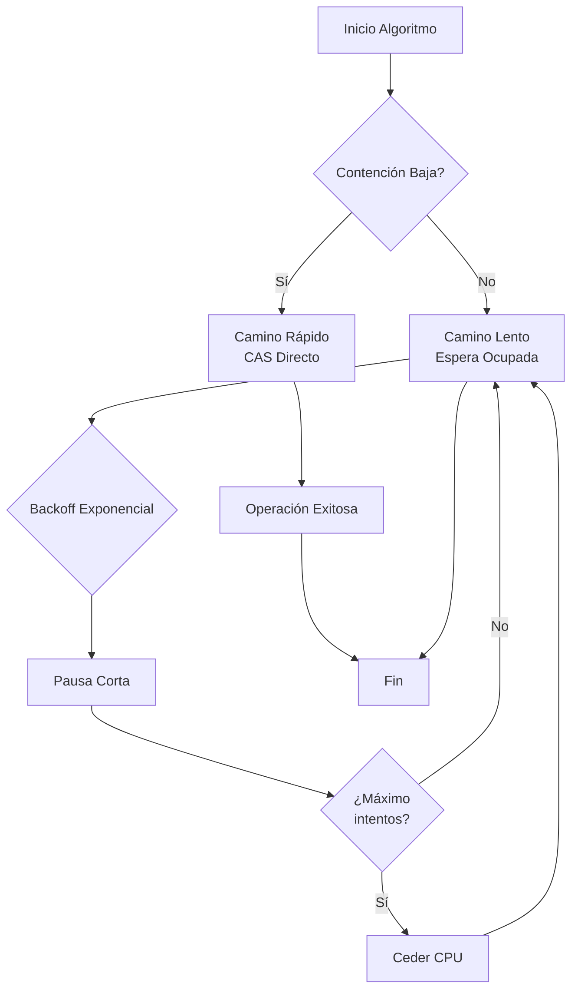

# Computación Concurrente - Sincronización con y sin bloqueo

## 3.4 Otros algoritmos con espera ocupada y primitivas fuertes.

---

La **espera ocupada** (busy-waiting) es una técnica donde un hilo verifica repetidamente una condición en lugar de bloquearse. Cuando se combina con **primitivas fuertes** de hardware, permite construir sincronizaciones eficientes.

#### Definición Formal

**Espera ocupada**: Un hilo en estado de ejecución que repetidamente prueba una condición:

$$
\text{while(condición)} \lbrace \rbrace
$$

**Primitivas fuertes**: Instrucciones atómicas proporcionadas por el hardware que permiten modificar múltiples ubicaciones de memoria de forma indivisible.

### Primitivas Fuertes del Hardware

#### Operaciones Atómicas Fundamentales

##### Compare-and-Swap (CAS)

$$ \text{CAS}(addr, expected, new) = \begin{cases}  \text{true} & \text{if } *addr = expected \text{ then } *addr \leftarrow new \\\ \text{false} & \text{otherwise} \end{cases} $$

##### Load-Linked / Store-Conditional (LL/SC)

$$ \text{LL}(addr) = \text{carga } *addr \text{ y establece monitor} $$

$$ \text{SC}(addr, value) = \begin{cases}  \text{true} & \text{si ningún otro escritor, entonces } *addr \leftarrow value \\\ \text{false} & \text{otherwise} \end{cases} $$

##### Fetch-and-Add

$$ \text{FAA}(addr, increment) = \begin{cases}  old \leftarrow *addr \\\ *addr \leftarrow *addr + increment \\\ \text{return } old \end{cases} $$

#### Implementaciones a Nivel de Hardware

```c
// Implementación x86 de CAS
static inline int cmpxchg(volatile int *addr, int expected, int new) {
    int result;
    asm volatile("lock cmpxchgl %2, %1"
                 : "=a" (result), "+m" (*addr)
                 : "r" (new), "0" (expected)
                 : "memory");
    return result;
}

// Implementación ARM de LL/SC
static inline int load_linked(volatile int *addr) {
    int value;
    asm volatile("ldaxr %w0, [%1]" : "=r" (value) : "r" (addr));
    return value;
}

static inline int store_conditional(volatile int *addr, int value) {
    int success;
    asm volatile("stlxr %w0, %w1, [%2]"
                 : "=r" (success) : "r" (value), "r" (addr) : "memory");
    return success == 0;
}
```

### Algoritmos Avanzados con Espera Ocupada

#### Ticket Lock con Espera Ocupada

```c
#include <stdatomic.h>

typedef struct {
    atomic_int next_ticket;
    atomic_int now_serving;
} ticket_lock_t;

void ticket_lock_init(ticket_lock_t *lock) {
    atomic_store(&lock->next_ticket, 0);
    atomic_store(&lock->now_serving, 0);
}

void ticket_lock_acquire(ticket_lock_t *lock) {
    int my_ticket = atomic_fetch_add(&lock->next_ticket, 1);

    // Espera ocupada hasta que sea nuestro turno
    while (atomic_load(&lock->now_serving) != my_ticket) {
        // Reduce contienda con pausa
        asm volatile("pause" ::: "memory");
    }
}

void ticket_lock_release(ticket_lock_t *lock) {
    // Avanza al siguiente ticket
    atomic_fetch_add(&lock->now_serving, 1);
}
```

#### CLH Lock (Craig, Landin, Hagersten)

```c
typedef struct clh_node {
    atomic_int locked;
    struct clh_node *prev;
} clh_node_t;

typedef struct {
    atomic_ptr clh_node_t *tail;
} clh_lock_t;

void clh_lock_init(clh_lock_t *lock) {
    // Nodo inicial desbloqueado
    clh_node_t *node = malloc(sizeof(clh_node_t));
    atomic_store(&node->locked, 0);
    node->prev = NULL;
    atomic_store(&lock->tail, node);
}

void clh_lock_acquire(clh_lock_t *lock, clh_node_t *my_node) {
    atomic_store(&my_node->locked, 1);
    my_node->prev = atomic_exchange(&lock->tail, my_node);

    // Espera ocupada en el nodo anterior
    while (atomic_load(&my_node->prev->locked) == 1) {
        asm volatile("pause" ::: "memory");
    }
}

void clh_lock_release(clh_lock_t *lock, clh_node_t *my_node) {
    // Nuestro nodo ahora está desbloqueado
    atomic_store(&my_node->locked, 0);

    // Reutilizar el nodo anterior para futuras adquisiciones
    clh_node_t *prev = my_node->prev;
    my_node->prev = prev;  // Mantener referencia para siguiente uso
}
```

#### MCS Lock (Mejorado)

```c
typedef struct mcs_node {
    atomic_int locked;
    atomic_ptr struct mcs_node *next;
} mcs_node_t;

typedef struct {
    atomic_ptr mcs_node_t *tail;
} mcs_lock_t;

void mcs_lock_acquire_optimized(mcs_lock_t *lock, mcs_node_t *node) {
    // Optimización: prueba rápida antes de operación costosa
    if (atomic_load(&lock->tail) == NULL &&
        atomic_compare_exchange_strong(&lock->tail, &(mcs_node_t*){NULL}, node)) {
        // Adquirido sin contienda
        return;
    }

    // Camino lento con espera ocupada
    atomic_store(&node->locked, 1);
    node->next = NULL;

    mcs_node_t *prev = atomic_exchange(&lock->tail, node);
    if (prev != NULL) {
        atomic_store(&prev->next, node);
        while (atomic_load(&node->locked) == 1) {
            asm volatile("pause" ::: "memory");
        }
    }
}
```

### Algoritmos para Estructuras de Datos Concurrentes

#### Stack Lock-Free con Espera Ocupada Optimizada

```c
#include <stdatomic.h>

typedef struct lf_node {
    int data;
    struct lf_node *next;
} lf_node_t;

typedef struct {
    atomic_uintptr_t top;
} lf_stack_t;

void lf_stack_init(lf_stack_t *stack) {
    atomic_store(&stack->top, (uintptr_t)NULL);
}

void lf_stack_push(lf_stack_t *stack, int value) {
    lf_node_t *new_node = malloc(sizeof(lf_node_t));
    new_node->data = value;

    uintptr_t old_top;
    int attempts = 0;
    const int max_spin = 100; // Límite de espera ocupada

    do {
        old_top = atomic_load(&stack->top);
        new_node->next = (lf_node_t*)old_top;

        // Backoff exponencial después de muchos intentos
        if (attempts++ > max_spin) {
            usleep(1); // Pequeña pausa para reducir contienda
        }
    } while (!atomic_compare_exchange_weak(&stack->top, &old_top,
                                          (uintptr_t)new_node));
}

int lf_stack_pop(lf_stack_t *stack) {
    uintptr_t old_top;
    lf_node_t *new_top;
    int attempts = 0;
    const int max_spin = 100;

    do {
        old_top = atomic_load(&stack->top);
        if (old_top == (uintptr_t)NULL) {
            return -1; // Stack vacío
        }

        new_top = ((lf_node_t*)old_top)->next;

        if (attempts++ > max_spin) {
            sched_yield(); // Ceder el CPU después de muchos intentos
        }
    } while (!atomic_compare_exchange_weak(&stack->top, &old_top,
                                          (uintptr_t)new_top));

    int value = ((lf_node_t*)old_top)->data;
    free((lf_node_t*)old_top);
    return value;
}
```

#### Queue Concurrente con Doble CAS (DCAS)

```c
typedef struct {
    int value;
    atomic_uint sequence;
} slot_t;

typedef struct {
    slot_t *buffer;
    int size;
    atomic_uint head;
    atomic_uint tail;
} dcas_queue_t;

// Operación DCAS simulada con CAS doble
int dcas_queue_enqueue(dcas_queue_t *queue, int value) {
    unsigned head, tail, new_tail;
    slot_t *slot;

    do {
        tail = atomic_load(&queue->tail);
        head = atomic_load(&queue->head);

        if ((tail + 1) % queue->size == head) {
            return -1; // Cola llena
        }

        slot = &queue->buffer[tail];
        unsigned seq = atomic_load(&slot->sequence);

        if (seq != tail) {
            continue; // Slot no está listo
        }

        new_tail = (tail + 1) % queue->size;

        // Intenta avanzar tail y escribir valor atómicamente
        if (atomic_compare_exchange_weak(&queue->tail, &tail, new_tail)) {
            slot->value = value;
            atomic_store(&slot->sequence, tail + queue->size);
            return 0; // Éxito
        }
    } while (1);
}
```

### Algoritmos de Barrera con Espera Ocupada

#### Sense-Reversing Barrier

```c
typedef struct {
    atomic_int count;
    atomic_int sense;
    int total_threads;
    atomic_int local_sense[MaxThreads];
} sense_barrier_t;

void sense_barrier_init(sense_barrier_t *barrier, int n) {
    barrier->total_threads = n;
    atomic_store(&barrier->count, n);
    atomic_store(&barrier->sense, 0);
    for (int i = 0; i < n; i++) {
        atomic_store(&barrier->local_sense[i], 1);
    }
}

void sense_barrier_wait(sense_barrier_t *barrier, int thread_id) {
    int local_sense = atomic_load(&barrier->local_sense[thread_id]);

    if (atomic_fetch_sub(&barrier->count, 1) == 1) {
        // Último hilo en llegar
        atomic_store(&barrier->count, barrier->total_threads);
        atomic_store(&barrier->sense, local_sense);
    } else {
        // Espera ocupada hasta que todos lleguen
        while (atomic_load(&barrier->sense) != local_sense) {
            asm volatile("pause" ::: "memory");
        }
    }

    // Cambia sense para la siguiente barrera
    atomic_store(&barrier->local_sense[thread_id], !local_sense);
}
```

#### Tournament Barrier

```c
typedef struct {
    atomic_int flags[MaxThreads];
    int rounds;
} tournament_barrier_t;

void tournament_barrier_wait(tournament_barrier_t *barrier, int thread_id) {
    int mask = 1;

    for (int round = 0; round < barrier->rounds; round++) {
        int partner = thread_id ^ mask;

        if (partner > thread_id) {
            // Espera a que el partner llegue
            while (atomic_load(&barrier->flags[partner]) == 0) {
                asm volatile("pause" ::: "memory");
            }
            atomic_store(&barrier->flags[partner], 0);
        } else {
            // Señala que hemos llegado
            atomic_store(&barrier->flags[thread_id], 1);
            // Espera a que el partner nos recoja
            while (atomic_load(&barrier->flags[thread_id]) == 1) {
                asm volatile("pause" ::: "memory");
            }
        }

        mask <<= 1;
    }
}
```

### Diagramas de Flujo de Algoritmos



### Técnicas de Optimización

#### Backoff Exponencial Adaptativo

```c
typedef struct {
    int min_delay;
    int max_delay;
    int current_delay;
} adaptive_backoff_t;

void adaptive_backoff_init(adaptive_backoff_t *backoff, int min, int max) {
    backoff->min_delay = min;
    backoff->max_delay = max;
    backoff->current_delay = min;
}

void adaptive_backoff_wait(adaptive_backoff_t *backoff) {
    for (int i = 0; i < backoff->current_delay; i++) {
        asm volatile("pause" ::: "memory");
    }

    // Aumenta backoff exponencialmente, pero con límite
    backoff->current_delay = (backoff->current_delay * 2) <= backoff->max_delay ?
                            backoff->current_delay * 2 : backoff->max_delay;
}

void adaptive_backoff_reset(adaptive_backoff_t *backoff) {
    backoff->current_delay = backoff->min_delay;
}
```

#### Memory Ordering y Fences

```c
// Diferentes niveles de consistencia de memoria
void atomic_operations_with_memory_orders() {
    atomic_int data;

    // Relajado - solo atomicidad, sin ordenamiento
    atomic_store_explicit(&data, 42, memory_order_relaxed);

    // Adquirir - garantiza que lecturas posteriores ven escrituras anteriores
    int value = atomic_load_explicit(&data, memory_order_acquire);

    // Liberar - garantiza que escrituras anteriores son visibles después
    atomic_store_explicit(&data, 43, memory_order_release);

    // Sequencialmente consistente - el orden más fuerte
    atomic_store_explicit(&data, 44, memory_order_seq_cst);
}

// Memory fences explícitos
void memory_fence_example() {
    atomic_int flag, data;

    // Productor
    data = 100;
    atomic_thread_fence(memory_order_release);
    atomic_store(&flag, 1);

    // Consumidor
    if (atomic_load(&flag) == 1) {
        atomic_thread_fence(memory_order_acquire);
        printf("Data: %d\n", data);
    }
}
```

### Ejercicios Propuestos

#### Ejercicio 1: Implementación de Hazard Pointers

Implementa un sistema de hazard pointers para reclamación segura de memoria:

```c
typedef struct hazard_pointer {
    atomic_uintptr_t pointer;
    int active;
} hazard_pointer_t;

#define MAX_HAZARD_POINTERS 100

hazard_pointer_t hazard_pointers[MAX_HAZARD_POINTERS];

void* hazard_protect(void *ptr, int thread_id);
void hazard_clear(int thread_id);
void hazard_retire(void *ptr, int thread_id);
```

**Requisitos**:

- Proteger pointers accedidos concurrentemente
- Reclamación segura de memoria
- Mínima sobrecarga en camino rápido

#### Ejercicio 2: Algoritmo de Consenso Wait-Free

Implementa un algoritmo de consenso wait-free para 2 hilos:

```c
typedef struct {
    atomic_int proposed[2];
    atomic_int decided;
} consensus_t;

int consensus_propose(consensus_t *consensus, int thread_id, int value);
```

**Propiedades a verificar**:

- Wait-free: cada hilo completa en pasos limitados
- Acuerdo: todos deciden el mismo valor
- Validez: el valor decidido fue propuesto por algún hilo

#### Ejercicio 3: Skip List Concurrente

Diseña una skip list concurrente con operaciones lock-free:

```c
typedef struct skip_node {
    int key;
    int value;
    int level;
    atomic_ptr struct skip_node *next[];
} skip_node_t;

typedef struct {
    skip_node_t *head;
    int max_level;
} concurrent_skip_list_t;

bool skip_list_insert(concurrent_skip_list_t *list, int key, int value);
bool skip_list_delete(concurrent_skip_list_t *list, int key);
bool skip_list_search(concurrent_skip_list_t *list, int key, int *value);
```

#### Ejercicio 4: Análisis de Performance

Analiza el rendimiento de diferentes algoritmos bajo carga:

```c
void performance_analysis() {
    // Comparar:
    // 1. Ticket lock vs CLH vs MCS
    // 2. Backoff adaptativo vs estático
    // 3. Diferentes niveles de memory ordering

    // Métricas:
    // - Throughput bajo diferentes niveles de contención
    // - Latencia de operaciones
    // - Escalabilidad con número de hilos
}
```

### Referencias Académicas

#### Bibliografía Básica

1. **Taubenfeld, G. (2006)**. _Synchronization Algorithms and Concurrent Programming_.
   - Capítulo 7: Spin Locks (secciones avanzadas)
   - Capítulo 8: Wait-Free Synchronization

2. **Herlihy, M. & Shavit, N. (2008)**. _The Art of Multiprocessor Programming_.
   - Capítulo 7: Spin Locks and Contention
   - Capítulo 9: Linked Lists - The Role of Locking
   - Capítulo 15: Atomic Snapshots

#### Bibliografía Complementaria

3. **Michael, M. M. & Scott, M. L. (1996)**. _Simple, Fast, and Practical Non-Blocking and Blocking Concurrent Queue Algorithms_.
   - Algoritmos para colas concurrentes

4. **Harris, T. L. (2001)**. _A Pragmatic Implementation of Non-Blocking Linked-Lists_.
   - Listas enlazadas lock-free

5. **Fraser, K. (2004)**. _Practical Lock-Freedom_.
   - Técnicas prácticas para programación lock-free

### Herramientas de Desarrollo y Debugging

#### Verificación Formal con TLA+

```tla
MODULE ConcurrentStack
EXTENDS Integers, Sequences, TLC

CONSTANT MaxStack, Threads

(*--algorithm ConcurrentStack
variables
    stack = <<>>;
    top = 0;

process Thread \in 1..Threads
variables
    local_val = 0;
begin
    Push:
        local_val := self;
        stack := Append(stack, local_val);
        top := top + 1;

    Pop:
        if top > 0 then
            local_val := stack[top];
            stack := SubSeq(stack, 1, top - 1);
            top := top - 1;
        end if;
end process;
end algorithm;*)
```

#### Herramientas de Análisis

```bash
# ThreadSanitizer para detectar data races
clang -fsanitize=thread -g concurrent_algorithm.c

# Helgrind para análisis de locks
valgrind --tool=helgrind ./concurrent_program

# Model checking con TLC
java -cp tla2tools.jar tlc2.TLC ConcurrentStack.tla
```

### Consejos para Implementación

1. **Comienza simple**: Implementa versiones bloqueantes primero
2. **Mide la contención**: Usa perfiles para identificar cuellos de botella
3. **Prueba con cargas reales**: Los micro-benchmarks pueden ser engañosos
4. **Usa memory ordering correcto**: No uses seq_cst por defecto
5. **Considera la arquitectura**: Los algoritmos óptimos varían entre x86, ARM, etc.
