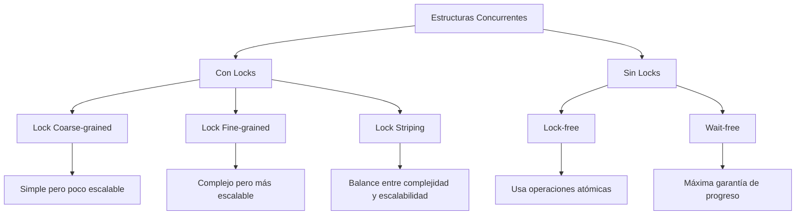

# Computación Concurrente - Sincronización con y sin bloqueo

## 3.5 Estructuras de datos concurrentes.

---

### Introducción a las Estructuras de Datos Concurrentes

Las **estructuras de datos concurrentes** son colecciones diseñadas para ser accedidas y modificadas de forma segura por múltiples hilos simultáneamente. Su diseño debe garantizar corrección, eficiencia y progreso bajo condiciones de ejecución paralela.

#### Definiciones Fundamentales

**Estructura de datos concurrente**: Colección que provee operaciones thread-safe sin requerir sincronización externa.

**Correctitud linealizable**: Cada operación parece ejecutarse instantáneamente en algún punto entre su invocación y su respuesta.

**Progress conditions**:

- **Blocking**: Un hilo puede impedir el progreso de otros
- **Non-blocking**: Ningún hilo puede impedir el progreso de otros
  - **Lock-free**: Al menos un hilo hace progreso
  - **Wait-free**: Todos los hilos hacen progreso

### Diseño de Estructuras Concurrentes

#### Patrones Fundamentales



### Listas Enlazadas Concurrentes

#### Lista con Lock Coarse-grained

```c
#include <pthread.h>

typedef struct node {
    int key;
    int value;
    struct node *next;
} node_t;

typedef struct {
    node_t *head;
    pthread_mutex_t lock;
} coarse_list_t;

void coarse_list_init(coarse_list_t *list) {
    list->head = NULL;
    pthread_mutex_init(&list->lock, NULL);
}

bool coarse_list_insert(coarse_list_t *list, int key, int value) {
    pthread_mutex_lock(&list->lock);

    node_t *curr = list->head;
    node_t *prev = NULL;

    // Buscar posición
    while (curr != NULL && curr->key < key) {
        prev = curr;
        curr = curr->next;
    }

    // Si existe, actualizar
    if (curr != NULL && curr->key == key) {
        curr->value = value;
        pthread_mutex_unlock(&list->lock);
        return true;
    }

    // Insertar nuevo nodo
    node_t *new_node = malloc(sizeof(node_t));
    new_node->key = key;
    new_node->value = value;
    new_node->next = curr;

    if (prev == NULL) {
        list->head = new_node;
    } else {
        prev->next = new_node;
    }

    pthread_mutex_unlock(&list->lock);
    return true;
}
```

#### Lista con Lock Fine-grained (Hand-over-Hand)

```c
typedef struct {
    node_t *head;
} fine_grained_list_t;

bool fine_grained_insert(fine_grained_list_t *list, int key, int value) {
    node_t *new_node = malloc(sizeof(node_t));
    new_node->key = key;
    new_node->value = value;

    pthread_mutex_lock(&list->head->lock);
    node_t *prev = list->head;
    node_t *curr = prev->next;

    if (curr != NULL) {
        pthread_mutex_lock(&curr->lock);
    }

    while (curr != NULL && curr->key < key) {
        pthread_mutex_unlock(&prev->lock);
        prev = curr;
        curr = curr->next;
        if (curr != NULL) {
            pthread_mutex_lock(&curr->lock);
        }
    }

    // Insertar
    if (curr != NULL && curr->key == key) {
        curr->value = value;
        pthread_mutex_unlock(&curr->lock);
        pthread_mutex_unlock(&prev->lock);
        free(new_node);
        return true;
    }

    new_node->next = curr;
    prev->next = new_node;

    if (curr != NULL) {
        pthread_mutex_unlock(&curr->lock);
    }
    pthread_mutex_unlock(&prev->lock);
    return true;
}
```

#### Lista Lock-Free (Harris)

```c
#include <stdatomic.h>
#include <stdbool.h>

typedef struct lf_node {
    int key;
    int value;
    atomic_uintptr_t next;  // Puntero + marca de eliminación
} lf_node_t;

typedef struct {
    atomic_uintptr_t head;
} lock_free_list_t;

#define MARKED_PTR(p) ((uintptr_t)(p) | 1)
#define UNMARKED_PTR(p) ((uintptr_t)(p) & ~1)
#define IS_MARKED(p) ((uintptr_t)(p) & 1)
#define GET_PTR(p) ((lf_node_t*)UNMARKED_PTR(p))

bool lock_free_search(lock_free_list_t *list, int key,
                     lf_node_t **left_node, lf_node_t **right_node) {
    lf_node_t *left_node_next, *right_node_next;

retry:
    while (true) {
        lf_node_t *t = GET_PTR(atomic_load(&list->head));
        lf_node_t *t_next = GET_PTR(atomic_load(&t->next));

        while (true) {
            uintptr_t t_next_val = atomic_load(&t_next->next);

            // Si el siguiente nodo está marcado, ayudar a eliminarlo
            if (IS_MARKED(t_next_val)) {
                lf_node_t *t_next_ptr = GET_PTR(t_next_val);
                if (!atomic_compare_exchange_weak(&t->next, &t_next_val,
                                                 (uintptr_t)t_next_ptr)) {
                    goto retry;
                }
                t_next = t_next_ptr;
            } else {
                if (t_next->key >= key) {
                    *left_node = t;
                    *right_node = t_next;
                    return (t_next->key == key);
                }
                t = t_next;
                t_next = GET_PTR(atomic_load(&t_next->next));
            }
        }
    }
}

bool lock_free_insert(lock_free_list_t *list, int key, int value) {
    lf_node_t *new_node = malloc(sizeof(lf_node_t));
    new_node->key = key;
    new_node->value = value;
    atomic_store(&new_node->next, (uintptr_t)NULL);

    while (true) {
        lf_node_t *right, *left;
        bool found = lock_free_search(list, key, &left, &right);

        if (found) {
            free(new_node);
            return false;  // Ya existe
        }

        // Enlazar nuevo nodo
        atomic_store(&new_node->next, (uintptr_t)right);

        if (atomic_compare_exchange_weak(&left->next,
                                        (uintptr_t*)&right,
                                        (uintptr_t)new_node)) {
            return true;
        }
    }
}
```

### Pilas Concurrentes

#### Pila Lock-Free (Treschevsky)

```c
typedef struct lf_stack_node {
    void *data;
    atomic_uintptr_t next;
} lf_stack_node_t;

typedef struct {
    atomic_uintptr_t top;
} lock_free_stack_t;

void lf_stack_init(lock_free_stack_t *stack) {
    atomic_store(&stack->top, (uintptr_t)NULL);
}

void lf_stack_push(lock_free_stack_t *stack, void *data) {
    lf_stack_node_t *new_node = malloc(sizeof(lf_stack_node_t));
    new_node->data = data;

    uintptr_t current_top;

    do {
        current_top = atomic_load(&stack->top);
        new_node->next = current_top;
    } while (!atomic_compare_exchange_weak(&stack->top,
                                          &current_top,
                                          (uintptr_t)new_node));
}

void *lf_stack_pop(lock_free_stack_t *stack) {
    uintptr_t current_top;
    lf_stack_node_t *next;

    do {
        current_top = atomic_load(&stack->top);
        if (current_top == (uintptr_t)NULL) {
            return NULL;  // Pila vacía
        }

        lf_stack_node_t *top_node = (lf_stack_node_t*)current_top;
        next = (lf_stack_node_t*)atomic_load(&top_node->next);

    } while (!atomic_compare_exchange_weak(&stack->top,
                                          &current_top,
                                          (uintptr_t)next));

    void *data = ((lf_stack_node_t*)current_top)->data;
    free((lf_stack_node_t*)current_top);
    return data;
}
```

#### Pila con Elimination Backoff

```c
typedef struct {
    lock_free_stack_t stack;
    atomic_int exchanger[EXCHANGER_SIZE];
    int timeout;
} elimination_stack_t;

void elimination_push(elimination_stack_t *estack, void *data) {
    // Primero intenta push normal
    if (lf_stack_push(&estack->stack, data)) {
        return;
    }

    // Si hay contención, intenta eliminación
    int slot = random() % EXCHANGER_SIZE;
    int timeout = estack->timeout;

    for (int i = 0; i < timeout; i++) {
        int other = atomic_exchange(&estack->exchanger[slot], (int)data);
        if (other == EMPTY) {
            continue;  // Nadie esperando
        } else if (other > 0) {  // Push esperando
            // Éxito: nuestro push se elimina con pop de otro
            return;
        }
    }

    // Fallback a push normal
    lf_stack_push(&estack->stack, data);
}
```

### Colas Concurrentes

#### Cola Lock-Free (Michael-Scott)

```c
typedef struct lf_queue_node {
    void *data;
    atomic_uintptr_t next;
} lf_queue_node_t;

typedef struct {
    atomic_uintptr_t head;
    atomic_uintptr_t tail;
} lock_free_queue_t;

void lf_queue_init(lock_free_queue_t *queue) {
    // Nodo dummy inicial
    lf_queue_node_t *dummy = malloc(sizeof(lf_queue_node_t));
    dummy->data = NULL;
    atomic_store(&dummy->next, (uintptr_t)NULL);

    atomic_store(&queue->head, (uintptr_t)dummy);
    atomic_store(&queue->tail, (uintptr_t)dummy);
}

void lf_queue_enqueue(lock_free_queue_t *queue, void *data) {
    lf_queue_node_t *new_node = malloc(sizeof(lf_queue_node_t));
    new_node->data = data;
    atomic_store(&new_node->next, (uintptr_t)NULL);

    while (true) {
        lf_queue_node_t *tail = (lf_queue_node_t*)atomic_load(&queue->tail);
        lf_queue_node_t *next = (lf_queue_node_t*)atomic_load(&tail->next);

        if (tail == (lf_queue_node_t*)atomic_load(&queue->tail)) {
            if (next == NULL) {
                // Intenta enlazar nuevo nodo
                if (atomic_compare_exchange_weak(&tail->next,
                                                (uintptr_t*)&next,
                                                (uintptr_t)new_node)) {
                    // Intenta avanzar tail
                    atomic_compare_exchange_weak(&queue->tail,
                                               (uintptr_t*)&tail,
                                               (uintptr_t)new_node);
                    return;
                }
            } else {
                // Ayuda avanzando tail
                atomic_compare_exchange_weak(&queue->tail,
                                           (uintptr_t*)&tail,
                                           (uintptr_t)next);
            }
        }
    }
}

void *lf_queue_dequeue(lock_free_queue_t *queue) {
    while (true) {
        lf_queue_node_t *head = (lf_queue_node_t*)atomic_load(&queue->head);
        lf_queue_node_t *tail = (lf_queue_node_t*)atomic_load(&queue->tail);
        lf_queue_node_t *next = (lf_queue_node_t*)atomic_load(&head->next);

        if (head == (lf_queue_node_t*)atomic_load(&queue->head)) {
            if (head == tail) {
                if (next == NULL) {
                    return NULL;  // Cola vacía
                }
                // Tail está detrás, ayudar a avanzarlo
                atomic_compare_exchange_weak(&queue->tail,
                                           (uintptr_t*)&tail,
                                           (uintptr_t)next);
            } else {
                void *result = next->data;
                if (atomic_compare_exchange_weak(&queue->head,
                                                (uintptr_t*)&head,
                                                (uintptr_t)next)) {
                    free(head);  // Liberar nodo dummy anterior
                    return result;
                }
            }
        }
    }
}
```

### Tablas Hash Concurrentes

#### Hash Table con Lock Striping

```c
#define STRIPE_COUNT 64
#define STRIPE_MASK (STRIPE_COUNT - 1)

typedef struct {
    int key;
    int value;
    struct hash_node *next;
} hash_node_t;

typedef struct {
    hash_node_t **buckets;
    int num_buckets;
    pthread_mutex_t stripes[STRIPE_COUNT];
} striped_hash_table_t;

unsigned int hash(int key) {
    return key * 2654435761;  // Knuth multiplicative hash
}

pthread_mutex_t *get_stripe(striped_hash_table_t *table, int key) {
    unsigned int h = hash(key);
    return &table->stripes[h & STRIPE_MASK];
}

void striped_hash_insert(striped_hash_table_t *table, int key, int value) {
    unsigned int bucket_idx = hash(key) % table->num_buckets;
    pthread_mutex_t *stripe = get_stripe(table, key);

    pthread_mutex_lock(stripe);

    hash_node_t *curr = table->buckets[bucket_idx];
    hash_node_t *prev = NULL;

    while (curr != NULL && curr->key != key) {
        prev = curr;
        curr = curr->next;
    }

    if (curr != NULL) {
        curr->value = value;  // Actualizar existente
    } else {
        hash_node_t *new_node = malloc(sizeof(hash_node_t));
        new_node->key = key;
        new_node->value = value;
        new_node->next = table->buckets[bucket_idx];
        table->buckets[bucket_idx] = new_node;
    }

    pthread_mutex_unlock(stripe);
}
```

#### Hash Table Lock-Free

```c
typedef struct lf_hash_node {
    int key;
    int value;
    atomic_uintptr_t next;
} lf_hash_node_t;

typedef struct {
    atomic_uintptr_t *buckets;
    int num_buckets;
} lock_free_hash_table_t;

void lf_hash_insert(lock_free_hash_table_t *table, int key, int value) {
    unsigned int bucket_idx = hash(key) % table->num_buckets;
    lf_hash_node_t *new_node = malloc(sizeof(lf_hash_node_t));
    new_node->key = key;
    new_node->value = value;

    while (true) {
        uintptr_t head = atomic_load(&table->buckets[bucket_idx]);
        atomic_store(&new_node->next, head);

        if (atomic_compare_exchange_weak(&table->buckets[bucket_idx],
                                        &head,
                                        (uintptr_t)new_node)) {
            return;
        }
    }
}
```

### Árboles Concurrentes

#### Árbol Binario de Búsqueda Concurrente

```c
typedef struct tree_node {
    int key;
    int value;
    struct tree_node *left;
    struct tree_node *right;
    pthread_mutex_t lock;
} tree_node_t;

typedef struct {
    tree_node_t *root;
    pthread_mutex_t lock;  // Para operaciones en raíz
} concurrent_bst_t;

bool bst_search(concurrent_bst_t *tree, int key, int *value) {
    pthread_mutex_lock(&tree->lock);
    tree_node_t *curr = tree->root;
    if (curr != NULL) {
        pthread_mutex_lock(&curr->lock);
    }
    pthread_mutex_unlock(&tree->lock);

    while (curr != NULL) {
        if (key == curr->key) {
            *value = curr->value;
            pthread_mutex_unlock(&curr->lock);
            return true;
        } else if (key < curr->key) {
            tree_node_t *left = curr->left;
            if (left != NULL) {
                pthread_mutex_lock(&left->lock);
            }
            pthread_mutex_unlock(&curr->lock);
            curr = left;
        } else {
            tree_node_t *right = curr->right;
            if (right != NULL) {
                pthread_mutex_lock(&right->lock);
            }
            pthread_mutex_unlock(&curr->lock);
            curr = right;
        }
    }

    return false;
}
```

### Análisis de Performance

#### Métricas de Evaluación

**Throughput**:

$$
\text{Throughput} = \frac{\text{Operaciones completadas}}{\text{Tiempo}}
$$

**Escalabilidad**:

$$
\text{Speedup} = \frac{T_1}{T_n}
$$

**Contención**:

$$
\text{Contención} = \frac{\text{Tiempo esperando locks}}{\text{Tiempo total}}
$$

#### Fórmulas de Análisis

**Amdahl's Law**:

$$
S(n) = \frac{1}{(1 - p) + \frac{p}{n}}
$$

Donde:

- $p$: fracción paralelizable
- $n$: número de procesadores

**Throughput bajo contención**:

$$
T(n) = \frac{T_{\text{seq}}}{1 + C(n-1)}
$$

Donde $C$ es el factor de contención.

### Ejercicios Propuestos

#### Ejercicio 1: Skip List Concurrente

Implementa una skip list concurrente con operaciones lock-free:

```c
typedef struct skip_node {
    int key;
    int value;
    int level;
    atomic_uintptr_t next[];
} skip_node_t;

typedef struct {
    atomic_uintptr_t head;
    int max_level;
} concurrent_skip_list_t;

bool skip_list_insert(concurrent_skip_list_t *list, int key, int value);
bool skip_list_delete(concurrent_skip_list_t *list, int key);
bool skip_list_search(concurrent_skip_list_t *list, int key, int *value);
```

**Requisitos**:

- Operaciones lock-free
- Niveles dinámicos basados en probabilidad
- Mantener ordenamiento

#### Ejercicio 2: Priority Queue Concurrente

Diseña una cola de prioridad concurrente:

```c
typedef struct {
    // Elegir entre:
    // - Heap con locks fine-grained
    // - Skip list lock-free
    // - Múltiples colas por prioridad
} concurrent_priority_queue_t;

void pq_insert(concurrent_priority_queue_t *pq, int priority, void *data);
void *pq_remove_min(concurrent_priority_queue_t *pq);
```

#### Ejercicio 3: Cache Concurrente con política LRU

Implementa un cache con reemplazo LRU thread-safe:

```c
typedef struct {
    concurrent_hash_table_t *table;
    concurrent_list_t *lru_list;
    int capacity;
    atomic_int size;
} concurrent_cache_t;

void *cache_get(concurrent_cache_t *cache, int key);
void cache_put(concurrent_cache_t *cache, int key, void *value);
```

#### Ejercicio 4: Análisis de Correctitud

Para cada estructura implementada, demuestra:

1. **Linearizabilidad**: Identifica puntos de linearización
2. **Safety**: Invariantes se mantienen
3. **Liveness**: Garantías de progreso (blocking/lock-free/wait-free)

### Patrones Avanzados

#### Software Transactional Memory (STM)

```c
typedef struct {
    atomic_int version;
    void *data;
} stm_data_t;

bool stm_transaction(void (*operation)(void*), void *context) {
    int start_version = global_clock;

    // Ejecutar operación en contexto aislado
    operation(context);

    // Validar que los datos leídos no cambiaron
    if (validate_read_set(start_version)) {
        // Commit atomico
        atomic_store(&global_clock, global_clock + 1);
        return true;
    }

    // Abortar y reintentar
    return false;
}
```

#### Hazard Pointers para Reclamación Segura

```c
#define MAX_HAZARD_POINTERS 100

__thread hazard_pointer_t local_hazard_pointers[2];

void *hazard_protect(void *ptr) {
    local_hazard_pointers[0].pointer = ptr;
    return ptr;
}

void hazard_retire(void *ptr) {
    // Agregar a lista de retirados
    // Reclamar periódicamente cuando seguro
}
```

### Referencias Académicas

#### Bibliografía Básica

1. **Herlihy, M. & Shavit, N. (2008)**. _The Art of Multiprocessor Programming_.
   - Capítulo 9: Linked Lists - The Role of Locking
   - Capítulo 10: Concurrent Queues and the ABA Problem
   - Capítulo 13: Concurrent Hashing and Natural Parallelism

2. **Taubenfeld, G. (2006)**. _Synchronization Algorithms and Concurrent Programming_.
   - Capítulo 6: Data Structures (secciones avanzadas)
   - Capítulo 8: Wait-Free Synchronization

#### Bibliografía Complementaria

3. **Michael, M. M. (2002)**. _High Performance Dynamic Lock-Free Hash Tables and List-Based Sets_.
   - Algoritmos para hash tables lock-free

4. **Harris, T. L. (2001)**. _A Pragmatic Implementation of Non-Blocking Linked-Lists_.
   - Listas enlazadas lock-free prácticas

5. **Fraser, K. & Harris, T. (2004)**. _Concurrent Programming Without Locks_.
   - Visión general de técnicas non-blocking

### Herramientas de Desarrollo

#### Testing y Verificación

```c
// Framework de testing para estructuras concurrentes
void run_concurrent_test(void (*test_func)(void*), int num_threads) {
    pthread_t threads[num_threads];

    for (int i = 0; i < num_threads; i++) {
        pthread_create(&threads[i], NULL, test_func, (void*)(intptr_t)i);
    }

    for (int i = 0; i < num_threads; i++) {
        pthread_join(threads[i], NULL);
    }
}

// Verificación de invariantes
bool verify_list_invariants(concurrent_list_t *list) {
    // Verificar que la lista está ordenada
    // Verificar que no hay duplicados
    // Verificar que todos los punteros son válidos
}
```

#### Profiling y Debugging

```bash
# ThreadSanitizer para data races
clang -fsanitize=thread -g concurrent_structure.c

# Helgrind para análisis de locks
valgrind --tool=helgrind ./concurrent_program

# Perf para análisis de performance
perf record ./concurrent_benchmark
perf report
```

### Consejos de Implementación

1. **Comienza con versiones bloqueantes**: Son más fáciles de entender y depurar
2. **Mide antes de optimizar**: Identifica los verdaderos cuellos de botella
3. **Usa abstracciones apropiadas**: No uses lock-free cuando blocking es suficiente
4. **Prueba con cargas realistas**: Los micro-benchmarks pueden ser engañosos
5. **Documenta las garantías**: Especifica claramente las propiedades de progreso
