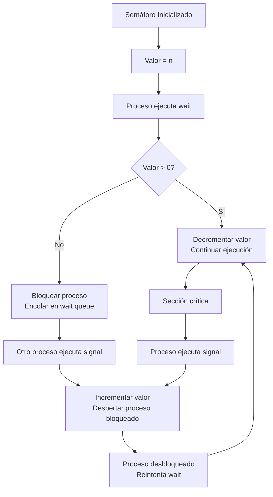

# Computación Concurrente - Sincronización con y sin bloqueo

## 3.6 Semáforos.

---

Los **semáforos** son una primitiva de sincronización fundamental propuesta por Edsger Dijkstra en 1965. Son más expresivos que los mutex y permiten controlar el acceso a un número específico de recursos.

#### Definición Formal

Un **semáforo** es una variable entera no negativa $S$ sobre la que se definen dos operaciones atómicas:

- **wait(S)**: También llamada `P` (proberen - probar en holandés)
- **signal(S)**: También llamada `V` (verhogen - incrementar en holandés)

**Definición matemática**:

$$
\text{wait}(S): \text{ while } S \leq 0 \text{ do no-op; } S \leftarrow S - 1
$$

$$
\text{signal}(S): S \leftarrow S + 1
$$

### Implementación de Semáforos

#### Semáforo con Espera Ocupada

```c
#include <stdatomic.h>

typedef struct {
    atomic_int value;
} busy_semaphore_t;

void busy_sem_init(busy_semaphore_t *sem, int initial_value) {
    atomic_store(&sem->value, initial_value);
}

void busy_sem_wait(busy_semaphore_t *sem) {
    while (1) {
        int current = atomic_load(&sem->value);
        if (current > 0) {
            if (atomic_compare_exchange_weak(&sem->value, &current, current - 1)) {
                return;
            }
        }
        // Espera ocupada - en la práctica se usaría yield o sleep
        asm volatile("pause" ::: "memory");
    }
}

void busy_sem_signal(busy_semaphore_t *sem) {
    atomic_fetch_add(&sem->value, 1);
}
```

#### Semáforo con Bloqueo (Implementación Correcta)

```c
#include <pthread.h>
#include <stdatomic.h>

typedef struct {
    atomic_int value;
    pthread_mutex_t mutex;
    pthread_cond_t condition;
} semaphore_t;

void sem_init(semaphore_t *sem, int initial_value) {
    atomic_store(&sem->value, initial_value);
    pthread_mutex_init(&sem->mutex, NULL);
    pthread_cond_init(&sem->condition, NULL);
}

void sem_wait(semaphore_t *sem) {
    pthread_mutex_lock(&sem->mutex);

    while (atomic_load(&sem->value) <= 0) {
        pthread_cond_wait(&sem->condition, &sem->mutex);
    }

    atomic_fetch_sub(&sem->value, 1);
    pthread_mutex_unlock(&sem->mutex);
}

void sem_signal(semaphore_t *sem) {
    pthread_mutex_lock(&sem->mutex);
    atomic_fetch_add(&sem->value, 1);
    pthread_cond_signal(&sem->condition);
    pthread_mutex_unlock(&sem->mutex);
}

void sem_destroy(semaphore_t *sem) {
    pthread_mutex_destroy(&sem->mutex);
    pthread_cond_destroy(&sem->condition);
}
```

### Tipos de Semáforos

#### Semáforos Binarios

```c
typedef struct {
    semaphore_t sem;
} binary_semaphore_t;

void binary_sem_init(binary_semaphore_t *bsem) {
    sem_init(&bsem->sem, 1);  // Valor inicial 1 (desbloqueado)
}

void binary_sem_wait(binary_semaphore_t *bsem) {
    sem_wait(&bsem->sem);
}

void binary_sem_signal(binary_semaphore_t *bsem) {
    sem_signal(&bsem->sem);
}
```

#### Semáforos de Conteo

```c
typedef struct {
    semaphore_t sem;
    int max_count;
} counting_semaphore_t;

void counting_sem_init(counting_semaphore_t *csem, int initial, int max) {
    sem_init(&csem->sem, initial);
    csem->max_count = max;
}

void counting_sem_wait(counting_semaphore_t *csem) {
    sem_wait(&csem->sem);
}

void counting_sem_signal(counting_semaphore_t *csem) {
    pthread_mutex_lock(&csem->sem.mutex);
    if (atomic_load(&csem->sem.value) < csem->max_count) {
        sem_signal(&csem->sem);
    }
    pthread_mutex_unlock(&csem->sem.mutex);
}
```

### Patrones Clásicos con Semáforos

#### Problema Productor-Consumidor

```c
#include <stdio.h>
#include <stdlib.h>

#define BUFFER_SIZE 10

typedef struct {
    int buffer[BUFFER_SIZE];
    int in, out;
    semaphore_t empty;  // Número de slots vacíos
    semaphore_t full;   // Número de slots llenos
    semaphore_t mutex;  // Exclusión mutua para el buffer
} pc_buffer_t;

void pc_buffer_init(pc_buffer_t *pc) {
    pc->in = 0;
    pc->out = 0;
    sem_init(&pc->empty, BUFFER_SIZE);  // Inicialmente todos vacíos
    sem_init(&pc->full, 0);             // Inicialmente ninguno lleno
    sem_init(&pc->mutex, 1);            // Mutex inicialmente desbloqueado
}

void producer(pc_buffer_t *pc, int item) {
    sem_wait(&pc->empty);    // Esperar slot vacío
    sem_wait(&pc->mutex);    // Entrar a sección crítica

    // Producir item
    pc->buffer[pc->in] = item;
    pc->in = (pc->in + 1) % BUFFER_SIZE;
    printf("Producido: %d\n", item);

    sem_signal(&pc->mutex);  // Salir de sección crítica
    sem_signal(&pc->full);   // Anunciar nuevo item disponible
}

int consumer(pc_buffer_t *pc) {
    sem_wait(&pc->full);     // Esperar item disponible
    sem_wait(&pc->mutex);    // Entrar a sección crítica

    // Consumir item
    int item = pc->buffer[pc->out];
    pc->out = (pc->out + 1) % BUFFER_SIZE;
    printf("Consumido: %d\n", item);

    sem_signal(&pc->mutex);  // Salir de sección crítica
    sem_signal(&pc->empty);  // Anunciar slot vacío
    return item;
}
```

#### Problema de los Lectores-Escritores

```c
typedef struct {
    semaphore_t mutex;       // Protege reader_count
    semaphore_t wrt;         // Controla acceso de escritores
    int reader_count;
} rw_lock_t;

void rw_lock_init(rw_lock_t *rw) {
    sem_init(&rw->mutex, 1);
    sem_init(&rw->wrt, 1);
    rw->reader_count = 0;
}

void reader_enter(rw_lock_t *rw) {
    sem_wait(&rw->mutex);
    rw->reader_count++;
    if (rw->reader_count == 1) {
        sem_wait(&rw->wrt);  // Primer lector bloquea escritores
    }
    sem_signal(&rw->mutex);
}

void reader_exit(rw_lock_t *rw) {
    sem_wait(&rw->mutex);
    rw->reader_count--;
    if (rw->reader_count == 0) {
        sem_signal(&rw->wrt);  // Último lector libera escritores
    }
    sem_signal(&rw->mutex);
}

void writer_enter(rw_lock_t *rw) {
    sem_wait(&rw->wrt);  // Escritor espera acceso exclusivo
}

void writer_exit(rw_lock_t *rw) {
    sem_signal(&rw->wrt);
}
```

#### Problema de los Filósofos

```c
#define N 5  // Número de filósofos

typedef struct {
    semaphore_t chopsticks[N];
    semaphore_t mutex;
} dining_philosophers_t;

void dp_init(dining_philosophers_t *dp) {
    for (int i = 0; i < N; i++) {
        sem_init(&dp->chopsticks[i], 1);  // Cada tenedor disponible
    }
    sem_init(&dp->mutex, 1);
}

void philosopher(dining_philosophers_t *dp, int id) {
    int left = id;
    int right = (id + 1) % N;

    while (1) {
        // Pensar
        printf("Filósofo %d pensando...\n", id);

        // Estrategia para evitar deadlock: tomar tenedores atómicamente
        sem_wait(&dp->mutex);
        sem_wait(&dp->chopsticks[left]);
        sem_wait(&dp->chopsticks[right]);
        sem_signal(&dp->mutex);

        // Comer
        printf("Filósofo %d comiendo...\n", id);

        // Liberar tenedores
        sem_signal(&dp->chopsticks[left]);
        sem_signal(&dp->chopsticks[right]);
    }
}
```

### Semáforos en Diferentes Sistemas

#### POSIX Semaphores

```c
#include <semaphore.h>
#include <fcntl.h>

// Semáforos con nombre (inter-proceso)
void named_semaphore_example() {
    sem_t *sem = sem_open("/mi_semaforo", O_CREAT, 0644, 1);

    if (sem == SEM_FAILED) {
        perror("sem_open");
        return;
    }

    // Usar semáforo
    sem_wait(sem);
    // Sección crítica
    sem_post(sem);

    sem_close(sem);
    sem_unlink("/mi_semaforo");
}

// Semáforos anónimos (intra-proceso)
void unnamed_semaphore_example() {
    sem_t sem;
    sem_init(&sem, 0, 1);  // 0 = intra-proceso, 1 = valor inicial

    sem_wait(&sem);
    // Sección crítica
    sem_post(&sem);

    sem_destroy(&sem);
}
```

#### Java Semaphores

```java
import java.util.concurrent.Semaphore;

public class SemaphoreExample {
    private final Semaphore semaphore = new Semaphore(3); // Permite 3 accesos

    public void accessResource() {
        try {
            semaphore.acquire();
            // Usar recurso
            System.out.println("Recurso en uso por " + Thread.currentThread().getName());
            Thread.sleep(1000);
        } catch (InterruptedException e) {
            Thread.currentThread().interrupt();
        } finally {
            semaphore.release();
        }
    }

    // Semáforo binario (equivalente a mutex)
    private final Semaphore binarySemaphore = new Semaphore(1);
}
```

### Propiedades y Análisis de Semáforos

#### Invariantes de Semáforos

Para un semáforo $S$ con valor inicial $S_0$:

$$ S = S_{0} + \# \text{signal}(S) - \# \text{wait}(S) $$

Donde $ \# \text{op}(S) $ denota el número de operaciones completadas.

#### Análisis de Correctitud

**Propiedad de seguridad**: Ningún proceso entra a la sección crítica sin haber adquirido el semáforo.

**Propiedad de vivacidad**: Si algún proceso está esperando en `wait(S)`, eventualmente algún proceso ejecutará `signal(S)`.

#### Teorema de Exclusión Mutua

Para un semáforo binario inicializado en 1:

- Garantiza que solo un proceso puede estar en la sección crítica a la vez
- Satisface progreso: si ningún proceso está en SC y varios quieren entrar, uno lo hará
- Satisface espera limitada: ningún proceso espera indefinidamente

### Diagramas de Estado de Semáforos



### Implementaciones Avanzadas

#### Semáforo con Timeout

```c
#include <time.h>

typedef struct {
    semaphore_t sem;
} timed_semaphore_t;

int timed_sem_wait(timed_semaphore_t *tsem, long milliseconds) {
    struct timespec ts;
    clock_gettime(CLOCK_REALTIME, &ts);

    // Calcular tiempo de expiración
    ts.tv_sec += milliseconds / 1000;
    ts.tv_nsec += (milliseconds % 1000) * 1000000;

    if (ts.tv_nsec >= 1000000000) {
        ts.tv_sec++;
        ts.tv_nsec -= 1000000000;
    }

    pthread_mutex_lock(&tsem->sem.mutex);

    while (atomic_load(&tsem->sem.value) <= 0) {
        if (pthread_cond_timedwait(&tsem->sem.condition,
                                  &tsem->sem.mutex, &ts) == ETIMEDOUT) {
            pthread_mutex_unlock(&tsem->sem.mutex);
            return -1;  // Timeout
        }
    }

    atomic_fetch_sub(&tsem->sem.value, 1);
    pthread_mutex_unlock(&tsem->sem.mutex);
    return 0;  // Éxito
}
```

#### Semáforo con Prioridad

```c
typedef struct priority_semaphore {
    atomic_int value;
    pthread_mutex_t mutex;
    pthread_cond_t condition;
    // Cola de prioridad para procesos bloqueados
    struct blocked_process *wait_queue;
} priority_semaphore_t;

void priority_sem_wait(priority_semaphore_t *psem, int priority) {
    pthread_mutex_lock(&psem->mutex);

    if (atomic_load(&psem->value) > 0) {
        atomic_fetch_sub(&psem->value, 1);
        pthread_mutex_unlock(&psem->mutex);
        return;
    }

    // Insertar en cola de prioridad
    insert_priority_queue(&psem->wait_queue, get_current_thread(), priority);

    while (atomic_load(&psem->value) <= 0 ||
           !is_highest_priority(psem->wait_queue, get_current_thread())) {
        pthread_cond_wait(&psem->condition, &psem->mutex);
    }

    // Remover de la cola y adquirir semáforo
    remove_from_queue(&psem->wait_queue, get_current_thread());
    atomic_fetch_sub(&psem->value, 1);
    pthread_mutex_unlock(&psem->mutex);
}
```

### Ejercicios Propuestos

#### Ejercicio 1: Implementación de Barrera con Semáforos

Implementa una barrera para N hilos usando semáforos:

```c
typedef struct {
    semaphore_t mutex;
    semaphore_t turnstile;
    semaphore_t turnstile2;
    int count;
    int n;  // Número total de hilos
} barrier_t;

void barrier_init(barrier_t *barrier, int n);
void barrier_wait(barrier_t *barrier);
```

**Requisitos**:

- Todos los hilos deben esperar en la barrera
- Reutilizable después de cada fase
- Eficiente y sin race conditions

#### Ejercicio 2: Semáforo de Conteo con Límite

Extiende el semáforo para tener un límite máximo:

```c
typedef struct {
    // Completar estructura
} bounded_semaphore_t;

void bounded_sem_init(bounded_semaphore_t *bsem, int initial, int max);
void bounded_sem_wait(bounded_semaphore_t *bsem);
void bounded_sem_signal(bounded_semaphore_t *bsem);
```

#### Ejercicio 3: Monitor con Semáforos

Implementa un monitor para una cuenta bancaria:

```c
typedef struct {
    // Completar con semáforos necesarios
    int balance;
} bank_account_t;

void bank_deposit(bank_account_t *account, int amount);
void bank_withdraw(bank_account_t *account, int amount);
int bank_balance(bank_account_t *account);
```

#### Ejercicio 4: Análisis de Deadlocks

Analiza el siguiente código y detecta posibles deadlocks:

```c
semaphore_t A = 1, B = 1, C = 1;

void process1() {
    sem_wait(&A);
    sem_wait(&B);
    // Trabajo
    sem_signal(&B);
    sem_signal(&A);
}

void process2() {
    sem_wait(&B);
    sem_wait(&C);
    // Trabajo
    sem_signal(&C);
    sem_signal(&B);
}

void process3() {
    sem_wait(&C);
    sem_wait(&A);
    // Trabajo
    sem_signal(&A);
    sem_signal(&C);
}
```

**Preguntas**:

1. ¿Puede ocurrir un deadlock? ¿Bajo qué condiciones?
2. ¿Cómo podrías prevenirlo?
3. Implementa una solución libre de deadlocks.

### Aplicaciones en el Mundo Real

#### Control de Acceso a Recursos Limitados

```c
// Control de conexiones a base de datos
#define MAX_CONNECTIONS 10

typedef struct {
    semaphore_t available_connections;
    int active_connections;
} connection_pool_t;

connection_t *acquire_connection(connection_pool_t *pool) {
    sem_wait(&pool->available_connections);

    // Crear o obtener conexión
    connection_t *conn = get_connection();
    pool->active_connections++;

    return conn;
}

void release_connection(connection_pool_t *pool, connection_t *conn) {
    return_connection(conn);
    pool->active_connections--;
    sem_signal(&pool->available_connections);
}
```

#### Throttling de Requests

```c
// Limitar tasa de requests por segundo
typedef struct {
    semaphore_t rate_limiter;
    struct timespec last_refill;
    int tokens;
    int max_tokens;
    int refill_rate;  // tokens por segundo
} rate_limiter_t;

void rate_limiter_init(rate_limiter_t *rl, int max_tokens, int refill_rate);
bool rate_limiter_acquire(rate_limiter_t *rl, int tokens);
```

### Referencias Académicas

#### Bibliografía Básica

1. **Taubenfeld, G. (2006)**. _Synchronization Algorithms and Concurrent Programming_.
   - Capítulo 3: Semaphores
   - Sección 3.2: The Producer-Consumer Problem
   - Sección 3.3: The Readers-Writers Problem

2. **Herlihy, M. & Shavit, N. (2008)**. _The Art of Multiprocessor Programming_.
   - Capítulo 8: Monitors and Blocking Synchronization
   - Aunque se enfoca en monitores, la teoría aplica a semáforos

#### Bibliografía Complementaria

3. **Dijkstra, E. W. (1965)**. _Cooperating Sequential Processes_.
   - Trabajo original donde se introducen los semáforos

4. **Andrews, G. R. (2000)**. _Foundations of Multithreaded, Parallel, and Distributed Programming_.
   - Capítulo 4: Semaphores and Locks

#### Recursos Adicionales

- POSIX Standard: IEEE Std 1003.1-2017 - Semáforos
- Java Documentation: java.util.concurrent.Semaphore
- Linux man pages: sem_overview(7), sem_init(3), sem_wait(3)

### Consejos para el Estudio

1. **Comprende la semántica**: `wait` decrementa, `signal` incrementa, y `wait` bloquea si el valor es 0 o menos
2. **Practica con problemas clásicos**: Productor-Consumidor, Lectores-Escritores, Filósofos
3. **Analiza invariantes**: Siempre identifica qué condición representa el valor del semáforo
4. **Evita deadlocks**: Usa orden consistente al adquirir múltiples semáforos
5. **Prueba casos límite**: Semáforos inicializados en 0, contención alta, etc.
