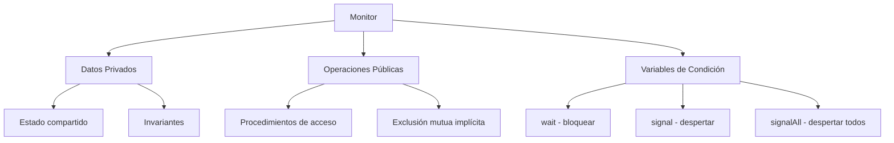
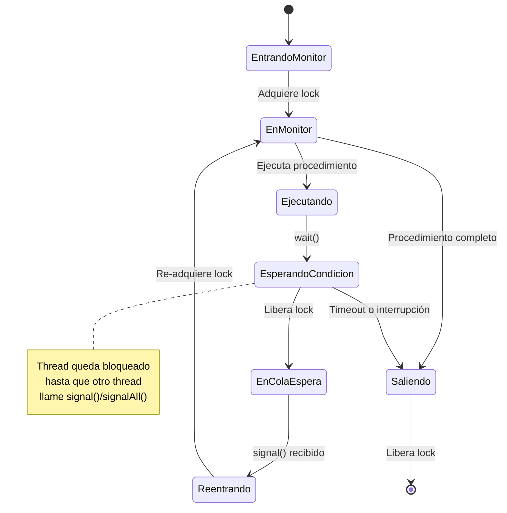

# Computación Concurrente - Sincronización con y sin bloqueo

## 3.7 Monitores.

---

Los **monitores** son una abstracción de alto nivel para la sincronización concurrente, introducidos por C. A. R. Hoare y Per Brinch Hansen en la década de 1970. Proporcionan una forma estructurada de manejar la exclusión mutua y la coordinación entre procesos.

#### Definición Formal

Un **monitor** es un módulo de software que encapsula:

- **Datos compartidos**
- **Procedimientos** que operan sobre esos datos
- **Mecanismos de sincronización** para coordinar acceso concurrente

**Invariante del monitor**: Condición que siempre es verdadera entre llamadas a procedimientos del monitor.

### Estructura Básica de un Monitor

#### Componentes Fundamentales



#### Especificación Formal

Para un monitor $M$ con variables de condición $C_1, C_2, ..., C_n$:

$$
M = (\text{datos}, \text{proc}_1, \text{proc}_2, ..., \text{proc}_m, C_1, C_2, ..., C_n)
$$

Cada variable de condición $C_i$ mantiene una cola de procesos:

$$
C_i.\text{queue} = \{P_1, P_2, ..., P_k\}
$$

### Implementación de Monitores

#### Monitor Básico en Java

```java
public class BasicMonitor {
    // Datos privados protegidos por el monitor
    private int sharedData;
    private final Object monitorLock = new Object();

    // Invariante: sharedData >= 0
    public BasicMonitor(int initialValue) {
        if (initialValue < 0) throw new IllegalArgumentException();
        this.sharedData = initialValue;
    }

    // Operaciones públicas - sincronizadas implícitamente
    public synchronized void increment() {
        sharedData++;
        // El invariante se mantiene
    }

    public synchronized void decrement() {
        while (sharedData <= 0) {
            try {
                wait();  // Espera hasta que sharedData > 0
            } catch (InterruptedException e) {
                Thread.currentThread().interrupt();
                return;
            }
        }
        sharedData--;
        // Verificar invariante
        assert sharedData >= 0 : "Invariante violado";
    }

    public synchronized int getValue() {
        return sharedData;
    }
}
```

#### Monitor con Variables de Condición Explícitas

```java
import java.util.concurrent.locks.Condition;
import java.util.concurrent.locks.ReentrantLock;

public class ConditionMonitor {
    private final ReentrantLock lock = new ReentrantLock();
    private final Condition notEmpty = lock.newCondition();
    private final Condition notFull = lock.newCondition();

    private final int[] buffer;
    private int count = 0, putIndex = 0, takeIndex = 0;

    public ConditionMonitor(int capacity) {
        buffer = new int[capacity];
    }

    public void put(int value) throws InterruptedException {
        lock.lock();
        try {
            while (count == buffer.length) {
                notFull.await();  // Espera hasta que no esté lleno
            }

            buffer[putIndex] = value;
            putIndex = (putIndex + 1) % buffer.length;
            count++;

            notEmpty.signal();  // Despierta a consumidores
        } finally {
            lock.unlock();
        }
    }

    public int take() throws InterruptedException {
        lock.lock();
        try {
            while (count == 0) {
                notEmpty.await();  // Espera hasta que no esté vacío
            }

            int value = buffer[takeIndex];
            takeIndex = (takeIndex + 1) % buffer.length;
            count--;

            notFull.signal();  // Despierta a productores
            return value;
        } finally {
            lock.unlock();
        }
    }
}
```

### Semánticas de Signal

#### Señalización y Continación (Hoare)

```java
public class HoareStyleMonitor {
    private final Object lock = new Object();
    private boolean condition = false;

    public void methodA() throws InterruptedException {
        synchronized (lock) {
            while (!condition) {
                lock.wait();
            }
            // Garantizado: condition == true aquí
            condition = false;
        }
    }

    public void methodB() {
        synchronized (lock) {
            condition = true;
            lock.notify();  // Transfiere ejecución inmediatamente al waiting thread
        }
    }
}
```

#### Señalización y Continación (Mesa)

```java
public class MesaStyleMonitor {
    private final Object lock = new Object();
    private boolean condition = false;

    public void methodA() throws InterruptedException {
        synchronized (lock) {
            while (!condition) {  // Siempre verificar condición después de wait
                lock.wait();
            }
            // condition podría ser false aquí (otro thread la cambió)
            condition = false;
        }
    }

    public void methodB() {
        synchronized (lock) {
            condition = true;
            lock.notify();  // Thread waiting compite por el lock
        }
    }
}
```

### Patrones Clásicos con Monitores

#### Problema Productor-Consumidor

```java
public class ProducerConsumerMonitor {
    private final Object monitor = new Object();
    private final int[] buffer;
    private int count = 0, in = 0, out = 0;

    public ProducerConsumerMonitor(int capacity) {
        buffer = new int[capacity];
    }

    public void produce(int item) throws InterruptedException {
        synchronized (monitor) {
            while (count == buffer.length) {
                monitor.wait();  // Espera hasta que haya espacio
            }

            buffer[in] = item;
            in = (in + 1) % buffer.length;
            count++;

            monitor.notifyAll();  // Notifica a todos los consumidores
        }
    }

    public int consume() throws InterruptedException {
        synchronized (monitor) {
            while (count == 0) {
                monitor.wait();  // Espera hasta que haya items
            }

            int item = buffer[out];
            out = (out + 1) % buffer.length;
            count--;

            monitor.notifyAll();  // Notifica a todos los productores
            return item;
        }
    }
}
```

#### Problema de los Lectores-Escritores

```java
public class ReadersWritersMonitor {
    private int readers = 0;
    private boolean writing = false;
    private int waitingWriters = 0;
    private final Object monitor = new Object();

    public void startRead() throws InterruptedException {
        synchronized (monitor) {
            while (writing || waitingWriters > 0) {
                monitor.wait();
            }
            readers++;
        }
    }

    public void endRead() {
        synchronized (monitor) {
            readers--;
            if (readers == 0) {
                monitor.notifyAll();
            }
        }
    }

    public void startWrite() throws InterruptedException {
        synchronized (monitor) {
            waitingWriters++;
            while (readers > 0 || writing) {
                monitor.wait();
            }
            waitingWriters--;
            writing = true;
        }
    }

    public void endWrite() {
        synchronized (monitor) {
            writing = false;
            monitor.notifyAll();
        }
    }
}
```

#### Problema de los Filósofos

```java
public class DiningPhilosophersMonitor {
    private enum State { THINKING, HUNGRY, EATING }
    private State[] states;
    private final Object monitor = new Object();

    public DiningPhilosophersMonitor(int numPhilosophers) {
        states = new State[numPhilosophers];
        for (int i = 0; i < numPhilosophers; i++) {
            states[i] = State.THINKING;
        }
    }

    private int left(int i) { return (i + states.length - 1) % states.length; }
    private int right(int i) { return (i + 1) % states.length; }

    private void test(int i) {
        if (states[i] == State.HUNGRY &&
            states[left(i)] != State.EATING &&
            states[right(i)] != State.EATING) {
            states[i] = State.EATING;
            monitor.notifyAll();
        }
    }

    public void pickUp(int philosopher) throws InterruptedException {
        synchronized (monitor) {
            states[philosopher] = State.HUNGRY;
            test(philosopher);
            while (states[philosopher] != State.EATING) {
                monitor.wait();
            }
        }
    }

    public void putDown(int philosopher) {
        synchronized (monitor) {
            states[philosopher] = State.THINKING;
            test(left(philosopher));
            test(right(philosopher));
        }
    }
}
```

### Implementación en Diferentes Lenguajes

#### Monitor en C++

```cpp
#include <mutex>
#include <condition_variable>
#include <queue>

template<typename T>
class ThreadSafeQueue {
private:
    std::mutex mutex;
    std::condition_variable not_empty;
    std::condition_variable not_full;
    std::queue<T> queue;
    size_t max_size;

public:
    ThreadSafeQueue(size_t max_size) : max_size(max_size) {}

    void push(T value) {
        std::unique_lock<std::mutex> lock(mutex);
        not_full.wait(lock, [this]() { return queue.size() < max_size; });

        queue.push(std::move(value));
        not_empty.notify_one();
    }

    T pop() {
        std::unique_lock<std::mutex> lock(mutex);
        not_empty.wait(lock, [this]() { return !queue.empty(); });

        T value = std::move(queue.front());
        queue.pop();
        not_full.notify_one();
        return value;
    }

    bool empty() const {
        std::lock_guard<std::mutex> lock(mutex);
        return queue.empty();
    }
};
```

#### Monitor en Python

```python
import threading
from typing import Generic, TypeVar, List

T = TypeVar('T')

class Monitor(Generic[T]):
    def __init__(self, capacity: int):
        self.capacity = capacity
        self.buffer: List[T] = []
        self.lock = threading.Lock()
        self.not_empty = threading.Condition(self.lock)
        self.not_full = threading.Condition(self.lock)

    def put(self, item: T) -> None:
        with self.lock:
            while len(self.buffer) >= self.capacity:
                self.not_full.wait()

            self.buffer.append(item)
            self.not_empty.notify()

    def take(self) -> T:
        with self.lock:
            while len(self.buffer) == 0:
                self.not_empty.wait()

            item = self.buffer.pop(0)
            self.not_full.notify()
            return item

    def __len__(self) -> int:
        with self.lock:
            return len(self.buffer)
```

### Análisis Teórico de Monitores

#### Invariantes y Verificación

Para un monitor $M$ con datos $D$ y operaciones $O_1, O_2, ..., O_n$, el **invariante** $I(D)$ debe satisfacer:

$$
\forall O_i, \text{ pre}(O_i) \land I(D) \Rightarrow \text{post}(O_i) \land I(D')
$$

Donde:

- $\text{pre}(O_i)$ es la precondición de $O_i$
- $\text{post}(O_i)$ es la postcondición de $O_i$
- $I(D')$ es el invariante después de ejecutar $O_i$

#### Teorema de Exclusión Mutua

**Teorema**: En un monitor, a lo más un proceso puede estar ejecutando un procedimiento del monitor en cualquier momento.

**Prueba**: Por la implementación del lock interno del monitor.

#### Condiciones de Vivacidad

**Freedom from deadlock**: Si algún proceso está esperando en una variable de condición, eventualmente algún proceso señalará esa condición.

**Freedom from starvation**: Cada proceso que solicita entrar al monitor eventualmente lo hará.

### Monitores Avanzados

#### Monitor con Prioridades

```java
public class PriorityMonitor {
    private final ReentrantLock lock = new ReentrantLock();
    private final Condition condition = lock.newCondition();
    private final PriorityQueue<WaitingThread> waitQueue =
        new PriorityQueue<>(Comparator.comparingInt(WaitingThread::getPriority));

    private static class WaitingThread {
        final Thread thread;
        final int priority;

        WaitingThread(Thread thread, int priority) {
            this.thread = thread;
            this.priority = priority;
        }

        int getPriority() { return priority; }
    }

    public void enterWithPriority(int priority) throws InterruptedException {
        lock.lock();
        try {
            if (!lock.isHeldByCurrentThread()) {
                WaitingThread wt = new WaitingThread(Thread.currentThread(), priority);
                waitQueue.offer(wt);

                while (lock.isLocked() || waitQueue.peek() != wt) {
                    condition.await();
                }

                waitQueue.poll();  // Remover de la cola
            }
        } finally {
            lock.unlock();
        }
    }
}
```

#### Monitor Distribuido

```java
public class DistributedMonitor {
    private final String resourceId;
    private final DistributedLock lock;
    private final Map<String, DistributedCondition> conditions;

    public DistributedMonitor(String resourceId, String zkConnection) {
        this.resourceId = resourceId;
        this.lock = new DistributedLock(zkConnection, resourceId);
        this.conditions = new ConcurrentHashMap<>();
    }

    public void executeInMonitor(Runnable criticalSection) throws Exception {
        lock.lock();
        try {
            criticalSection.run();
        } finally {
            lock.unlock();
        }
    }

    public void waitOnCondition(String conditionName) throws Exception {
        DistributedCondition condition = conditions.computeIfAbsent(
            conditionName, k -> new DistributedCondition(lock, k));
        condition.await();
    }

    public void signalCondition(String conditionName) throws Exception {
        DistributedCondition condition = conditions.get(conditionName);
        if (condition != null) {
            condition.signal();
        }
    }
}
```

### Diagramas de Estado de Monitores



### Ejercicios Propuestos

#### Ejercicio 1: Monitor de Cuenta Bancaria

Implementa un monitor para una cuenta bancaria que soporte:

```java
public class BankAccountMonitor {
    private double balance;
    // Completar implementación

    public synchronized void deposit(double amount);
    public synchronized void withdraw(double amount) throws InsufficientFundsException;
    public synchronized void transfer(BankAccountMonitor to, double amount);
    public synchronized double getBalance();
}
```

**Requisitos**:

- No sobregiros (balance nunca negativo)
- Transferencias atómicas
- Múltiples operaciones concurrentes seguras

#### Ejercicio 2: Monitor de Caché con Política LRU

Diseña un monitor para un caché con capacidad limitada:

```java
public class LRUCacheMonitor<K, V> {
    private final int capacity;
    // Completar estructura de datos

    public synchronized V get(K key);
    public synchronized void put(K key, V value);
    public synchronized boolean containsKey(K key);
    public synchronized int size();
}
```

#### Ejercicio 3: Monitor de Grupo de Recursos

Implementa un monitor para gestionar un pool de recursos:

```java
public class ResourcePoolMonitor<T> {
    private final Set<T> available;
    private final Set<T> allocated;
    private final int maxResources;

    public ResourcePoolMonitor(Collection<T> resources);
    public synchronized T acquire() throws InterruptedException;
    public synchronized T acquire(long timeout, TimeUnit unit) throws InterruptedException;
    public synchronized void release(T resource);
    public synchronized boolean addResource(T resource);
    public synchronized boolean removeResource(T resource);
}
```

#### Ejercicio 4: Análisis de Correctitud

Para el monitor de Filósofos, demuestra:

1. **Exclusión mutua**: Ningún par de filósofos adyacentes come simultáneamente
2. **Ausencia de deadlock**: No todos los filósofos pueden quedar hambrientos permanentemente
3. **Fairness**: Cada filósofo hambriento eventualmente come

**Preguntas**:

- ¿El algoritmo es libre de inanición?
- ¿Cómo afecta la política de señalización?
- ¿Se puede producir convoy effect?

### Patrones de Diseño con Monitores

#### Monitor para Object Pool

```java
public class ObjectPoolMonitor<T> {
    private final Queue<T> available;
    private final Set<T> inUse;
    private final Supplier<T> factory;
    private final int maxSize;

    public ObjectPoolMonitor(Supplier<T> factory, int maxSize) {
        this.factory = factory;
        this.maxSize = maxSize;
        this.available = new LinkedList<>();
        this.inUse = new HashSet<>();
    }

    public synchronized T acquire() throws InterruptedException {
        while (available.isEmpty() && inUse.size() >= maxSize) {
            wait();
        }

        if (!available.isEmpty()) {
            T obj = available.poll();
            inUse.add(obj);
            return obj;
        }

        T obj = factory.get();
        inUse.add(obj);
        return obj;
    }

    public synchronized void release(T obj) {
        if (inUse.remove(obj)) {
            available.offer(obj);
            notifyAll();
        }
    }
}
```

#### Monitor para Rate Limiting

```java
public class RateLimiterMonitor {
    private final int maxRequests;
    private final long timeWindowMillis;
    private final Queue<Long> requestTimes;

    public RateLimiterMonitor(int maxRequests, long timeWindowMillis) {
        this.maxRequests = maxRequests;
        this.timeWindowMillis = timeWindowMillis;
        this.requestTimes = new LinkedList<>();
    }

    public synchronized boolean allowRequest() {
        long currentTime = System.currentTimeMillis();

        // Limpiar requests antiguos
        while (!requestTimes.isEmpty() &&
               currentTime - requestTimes.peek() > timeWindowMillis) {
            requestTimes.poll();
        }

        if (requestTimes.size() < maxRequests) {
            requestTimes.offer(currentTime);
            return true;
        }

        return false;
    }

    public synchronized void awaitPermission() throws InterruptedException {
        while (!allowRequest()) {
            long oldest = requestTimes.peek();
            long waitTime = timeWindowMillis - (System.currentTimeMillis() - oldest);
            if (waitTime > 0) {
                wait(waitTime);
            }
        }
    }
}
```

### Referencias Académicas

#### Bibliografía Básica

1. **Taubenfeld, G. (2006)**. _Synchronization Algorithms and Concurrent Programming_.
   - Capítulo 4: Monitors
   - Sección 4.3: The Producer-Consumer Problem with Monitors
   - Sección 4.4: The Readers-Writers Problem with Monitors

2. **Herlihy, M. & Shavit, N. (2008)**. _The Art of Multiprocessor Programming_.
   - Capítulo 8: Monitors and Blocking Synchronization
   - Sección 8.1: Monitor Laws and Deadlock Freedom

#### Bibliografía Complementaria

3. **Hoare, C. A. R. (1974)**. _Monitors: An Operating System Structuring Concept_.
   - Paper seminal que introduce el concepto de monitores

4. **Brinch Hansen, P. (1973)**. _Operating System Principles_.
   - Primera implementación práctica de monitores

5. **Lampson, B. W. & Redell, D. D. (1980)**. _Experience with Processes and Monitors in Mesa_.
   - Discusión sobre semántica de señalización en monitores del mundo real

#### Recursos Adicionales

- Java Language Specification: Chapter 17.1 (Synchronization)
- POSIX Threads Programming: Condition Variables
- .NET Monitor Class Documentation

### Consejos para el Estudio

1. **Comprende el invariante**: Identifica siempre qué condición debe mantenerse
2. **Usa wait en loops**: Siempre verifica la condición después de wait() (semántica Mesa)
3. **Minimiza el tiempo en el monitor**: Mantén las secciones críticas lo más cortas posibles
4. **Considera notifyAll() vs notify()**: notifyAll() es más seguro pero menos eficiente
5. **Prueba casos de esquina**: Timeouts, interrupciones, condiciones de carrera
