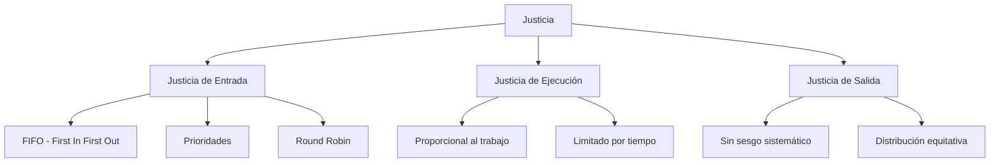
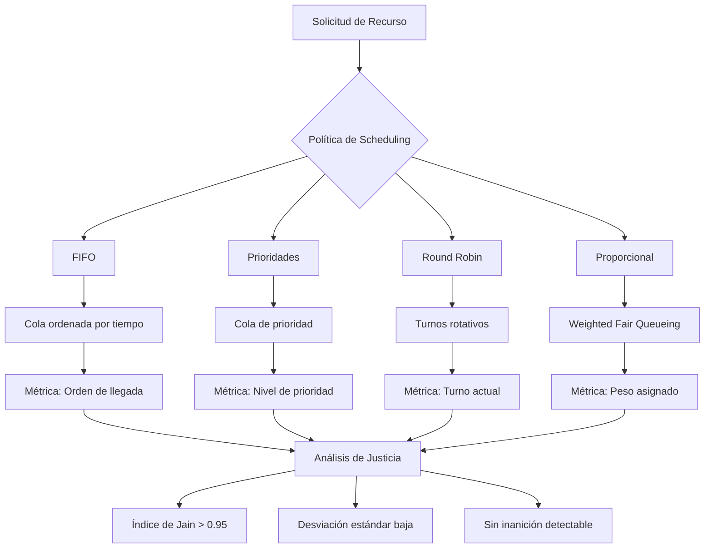

# Computación Concurrente - Sincronización con y sin bloqueo

## 3.8 Justicia y objetos compartidos.

---

La **justicia** (fairness) es una propiedad fundamental que garantiza que todos los procesos o hilos en un sistema concurrente reciben oportunidades equitativas para progresar. En el contexto de objetos compartidos, la justicia determina cómo se coordina el acceso a recursos comunes.

#### Definiciones Fundamentales

**Justicia**: Propiedad que garantiza que cada hilo que solicita acceso a un recurso eventualmente lo obtiene.

**Objeto compartido**: Estructura de datos accedida concurrentemente por múltiples hilos que requiere sincronización para mantener la consistencia.

**Starvation (Inanición)**: Situación donde un hilo es indefinidamente pospuesto y nunca obtiene acceso al recurso solicitado.

### Taxonomía de la Justicia

#### Tipos de Justicia



#### Definiciones Formales

**Justicia débil**: Si un hilo está continuamente listo para ejecutar, eventualmente será ejecutado.

**Justicia fuerte**: Cada hilo es ejecutado infinitamente menudo.

**Justicia en acceso**: Para cualquier par de hilos $T_i$ y $T_j$, si $T_i$ solicita el lock antes que $T_j$, entonces $T_i$ lo obtiene antes.

### Objetos Compartidos y sus Propiedades

#### Propiedades de Safety y Liveness

**Safety**: "Nada malo ocurre" - el sistema nunca entra en estado inválido.

- Exclusión mutua
- Ausencia de deadlocks
- Preservación de invariantes

**Liveness**: "Algo bueno eventualmente ocurre" - el sistema eventualmente progresa.

- Ausencia de inanición
- Terminación garantizada
- Progreso global

#### Garantías de Progreso

$$ \text{Progreso} = \begin{cases} \text{Wait-free} & \forall T, T \text{ completa en pasos finitos} \\\ \text{Lock-free} & \exists T \text{ que siempre progresa} \\\ \text{Obstruction-free} & T \text{ progresa si ejecuta en solitario} \\\ \text{Blocking} & T \text{ puede bloquear a otros} \end{cases} $$

### Implementación de Objetos Compartidos Justos

#### Ticket Lock - Justo FIFO

```c
#include <stdatomic.h>

typedef struct {
    atomic_int next_ticket;
    atomic_int now_serving;
} ticket_lock_t;

void ticket_lock_init(ticket_lock_t *lock) {
    atomic_store(&lock->next_ticket, 0);
    atomic_store(&lock->now_serving, 0);
}

void ticket_lock_acquire(ticket_lock_t *lock) {
    int my_ticket = atomic_fetch_add(&lock->next_ticket, 1);

    // Espera hasta que sea nuestro turno - garantía FIFO
    while (atomic_load(&lock->now_serving) != my_ticket) {
        // Reduce contienda con pausa
        asm volatile("pause" ::: "memory");
    }

    // Fence de memoria para garantizar orden
    atomic_thread_fence(memory_order_acquire);
}

void ticket_lock_release(ticket_lock_t *lock) {
    // Fence antes de liberar
    atomic_thread_fence(memory_order_release);

    // Avanza al siguiente ticket - garantizando justicia
    atomic_fetch_add(&lock->now_serving, 1);
}
```

#### MCS Lock - Justo y Escalable

```c
typedef struct mcs_node {
    atomic_int locked;
    struct mcs_node *next;
} mcs_node_t;

typedef struct {
    atomic_ptr mcs_node_t *tail;
} mcs_lock_t;

void mcs_lock_acquire(mcs_lock_t *lock, mcs_node_t *node) {
    // Inicializar nuestro nodo
    atomic_store(&node->locked, 1);
    node->next = NULL;

    // Enlazarnos al final de la cola
    mcs_node_t *prev = atomic_exchange(&lock->tail, node);

    if (prev != NULL) {
        // No éramos los primeros - esperar nuestro turno
        atomic_store(&prev->next, node);
        while (atomic_load(&node->locked) == 1) {
            asm volatile("pause" ::: "memory");
        }
    }
    // Ahora tenemos el lock - posición justa en la cola
}

void mcs_lock_release(mcs_lock_t *lock, mcs_node_t *node) {
    // Verificar si somos el último en la cola
    if (atomic_load(&node->next) == NULL) {
        mcs_node_t *expected_tail = node;
        if (atomic_compare_exchange_strong(&lock->tail, &expected_tail, NULL)) {
            return;  // Éramos los únicos
        }

        // Esperar a que el siguiente se enlace
        while (atomic_load(&node->next) == NULL) {
            asm volatile("pause" ::: "memory");
        }
    }

    // Pasar el lock al siguiente - garantizando justicia
    atomic_store(&node->next->locked, 0);
}
```

### Análisis de Justicia en Algoritmos

#### Métricas de Justicia

**Índice de Justicia (Fairness Index)** de Jain:

$$
F(x_1, x_2, ..., x_n) = \frac{\left(\sum_{i=1}^n x_i\right)^2}{n \cdot \sum_{i=1}^n x_i^2}
$$

Donde $x_i$ es el throughput del hilo $i$.

**Latencia de turnaround**:

$$
T_{\text{turnaround}} = T_{\text{completion}} - T_{\text{arrival}}
$$

**Variación de latencia**:

$$
\sigma_{\text{latency}} = \sqrt{\frac{1}{n}\sum_{i=1}^n (L_i - \bar{L})^2}
$$

#### Análisis de Inanición

**Probabilidad de inanición** en un sistema con $n$ hilos:

$$
P_{\text{starvation}} = \lim_{t \to \infty} P(\text{hilo i no es servido en } [0, t])
$$

**Tiempo esperado de servicio**:

$$
E[T_{\text{service}}] = \frac{1}{\mu} + \text{overhead de sincronización}
$$

### Objetos Compartidos con Garantías de Justicia

#### Cola Concurrente Justa

```java
import java.util.concurrent.atomic.AtomicReference;

public class FairConcurrentQueue<T> {
    private static class Node<T> {
        final T value;
        final AtomicReference<Node<T>> next;

        Node(T value) {
            this.value = value;
            this.next = new AtomicReference<>(null);
        }
    }

    private final AtomicReference<Node<T>> head;
    private final AtomicReference<Node<T>> tail;

    public FairConcurrentQueue() {
        Node<T> dummy = new Node<>(null);
        head = new AtomicReference<>(dummy);
        tail = new AtomicReference<>(dummy);
    }

    public void enqueue(T item) {
        Node<T> newNode = new Node<>(item);

        while (true) {
            Node<T> currentTail = tail.get();
            Node<T> tailNext = currentTail.next.get();

            if (currentTail == tail.get()) {
                if (tailNext != null) {
                    // Tail está detrás, ayudar a avanzar
                    tail.compareAndSet(currentTail, tailNext);
                } else {
                    // Intentar enlazar nuevo nodo
                    if (currentTail.next.compareAndSet(null, newNode)) {
                        // Avanzar tail
                        tail.compareAndSet(currentTail, newNode);
                        return;
                    }
                }
            }
        }
    }

    public T dequeue() {
        while (true) {
            Node<T> first = head.get();
            Node<T> last = tail.get();
            Node<T> firstNext = first.next.get();

            if (first == head.get()) {
                if (first == last) {
                    if (firstNext == null) {
                        return null; // Cola vacía
                    }
                    // Tail está detrás, ayudar
                    tail.compareAndSet(last, firstNext);
                } else {
                    T value = firstNext.value;
                    if (head.compareAndSet(first, firstNext)) {
                        return value; // Éxito - FIFO justo
                    }
                }
            }
        }
    }
}
```

#### Semáforo con Justicia FIFO

```java
public class FairSemaphore {
    private int permits;
    private final Object lock = new Object();
    private final Queue<Thread> waitQueue = new LinkedList<>();

    public FairSemaphore(int initialPermits) {
        if (initialPermits < 0) throw new IllegalArgumentException();
        this.permits = initialPermits;
    }

    public void acquire() throws InterruptedException {
        synchronized (lock) {
            Thread currentThread = Thread.currentThread();
            waitQueue.add(currentThread);

            try {
                while (permits <= 0 || waitQueue.peek() != currentThread) {
                    lock.wait();
                }

                // Es nuestro turno y hay permisos disponibles
                waitQueue.remove();
                permits--;

                // Notificar al siguiente en la cola si hay permisos
                if (permits > 0 && !waitQueue.isEmpty()) {
                    lock.notifyAll();
                }
            } catch (InterruptedException e) {
                waitQueue.remove(currentThread);
                throw e;
            }
        }
    }

    public void release() {
        synchronized (lock) {
            permits++;
            if (!waitQueue.isEmpty()) {
                lock.notifyAll(); // Notificar a todos los esperando
            }
        }
    }

    public boolean tryAcquire() {
        synchronized (lock) {
            if (permits > 0 && waitQueue.isEmpty()) {
                permits--;
                return true;
            }
            return false;
        }
    }
}
```

### Patrones de Diseño para Justicia

#### Resource Manager con Prioridades

```java
public class PriorityResourceManager<T> {
    private static class Request<T> implements Comparable<Request<T>> {
        final T resource;
        final int priority;
        final long timestamp;
        final Thread thread;

        Request(T resource, int priority, Thread thread) {
            this.resource = resource;
            this.priority = priority;
            this.timestamp = System.nanoTime();
            this.thread = thread;
        }

        @Override
        public int compareTo(Request<T> other) {
            // Primero por prioridad, luego por timestamp (FIFO para misma prioridad)
            if (this.priority != other.priority) {
                return Integer.compare(other.priority, this.priority); // Mayor prioridad primero
            }
            return Long.compare(this.timestamp, other.timestamp); // Más antiguo primero
        }
    }

    private final Set<T> availableResources;
    private final PriorityQueue<Request<T>> pendingRequests;
    private final Map<T, Thread> allocatedResources;

    public PriorityResourceManager(Collection<T> resources) {
        this.availableResources = new HashSet<>(resources);
        this.pendingRequests = new PriorityQueue<>();
        this.allocatedResources = new HashMap<>();
    }

    public synchronized T acquire(int priority) throws InterruptedException {
        Thread currentThread = Thread.currentThread();
        Request<T> request = new Request<>(null, priority, currentThread);
        pendingRequests.offer(request);

        try {
            while (true) {
                // Verificar si podemos asignar recurso
                if (!availableResources.isEmpty() &&
                    pendingRequests.peek() == request) {

                    T resource = availableResources.iterator().next();
                    availableResources.remove(resource);
                    allocatedResources.put(resource, currentThread);
                    pendingRequests.remove(request);
                    return resource;
                }

                wait(); // Esperar hasta que sea nuestro turno
            }
        } catch (InterruptedException e) {
            pendingRequests.remove(request);
            throw e;
        }
    }

    public synchronized void release(T resource) {
        Thread currentThread = Thread.currentThread();
        if (allocatedResources.get(resource) == currentThread) {
            allocatedResources.remove(resource);
            availableResources.add(resource);
            notifyAll(); // Notificar a todos los esperando
        }
    }
}
```

#### Work-Stealing Deque Justo

```java
public class WorkStealingDeque<T> {
    private static final int INITIAL_CAPACITY = 16;

    private final ThreadLocal<Deque<T>> localDeque;
    private final List<Deque<T>> allDeques;
    private final Random random;

    public WorkStealingDeque() {
        this.localDeque = ThreadLocal.withInitial(ArrayDeque::new);
        this.allDeques = Collections.synchronizedList(new ArrayList<>());
        this.random = new Random();
    }

    public void push(T task) {
        Deque<T> deque = localDeque.get();
        deque.push(task);

        // Registrar deque si es nuevo
        if (!allDeques.contains(deque)) {
            allDeques.add(deque);
        }
    }

    public T pop() {
        Deque<T> deque = localDeque.get();
        if (!deque.isEmpty()) {
            return deque.pop();
        }

        // Work-stealing: buscar en otros deques
        return stealWork();
    }

    private T stealWork() {
        List<Deque<T>> currentDeques = new ArrayList<>(allDeques);
        Collections.shuffle(currentDeques); // Justicia mediante aleatorización

        for (Deque<T> deque : currentDeques) {
            if (deque != localDeque.get() && !deque.isEmpty()) {
                synchronized (deque) {
                    if (!deque.isEmpty()) {
                        return deque.pollLast(); // Tomar del final (menor contención)
                    }
                }
            }
        }
        return null;
    }

    public int getQueueLength() {
        return allDeques.stream()
                       .mapToInt(Deque::size)
                       .sum();
    }
}
```

### Análisis de Performance y Justicia

#### Benchmark de Justicia

```java
public class FairnessBenchmark {
    private final Lock lock;
    private final int numThreads;
    private final int iterations;
    private final AtomicInteger[] acquisitions;

    public FairnessBenchmark(Lock lock, int numThreads, int iterations) {
        this.lock = lock;
        this.numThreads = numThreads;
        this.iterations = iterations;
        this.acquisitions = new AtomicInteger[numThreads];

        for (int i = 0; i < numThreads; i++) {
            acquisitions[i] = new AtomicInteger(0);
        }
    }

    public void runBenchmark() throws InterruptedException {
        Thread[] threads = new Thread[numThreads];
        CyclicBarrier barrier = new CyclicBarrier(numThreads);

        for (int i = 0; i < numThreads; i++) {
            final int threadId = i;
            threads[i] = new Thread(() -> {
                try {
                    barrier.await(); // Inicio sincronizado

                    for (int j = 0; j < iterations; j++) {
                        lock.lock();
                        try {
                            acquisitions[threadId].incrementAndGet();
                            Thread.yield(); // Simular trabajo
                        } finally {
                            lock.unlock();
                        }
                    }
                } catch (Exception e) {
                    Thread.currentThread().interrupt();
                }
            });
            threads[i].start();
        }

        for (Thread thread : threads) {
            thread.join();
        }

        analyzeFairness();
    }

    private void analyzeFairness() {
        int totalAcquisitions = 0;
        int sumSquares = 0;

        System.out.println("Adquisiciones por hilo:");
        for (int i = 0; i < numThreads; i++) {
            int acq = acquisitions[i].get();
            System.out.printf("Hilo %d: %d adquisiciones%n", i, acq);
            totalAcquisitions += acq;
            sumSquares += acq * acq;
        }

        // Calcular índice de justicia de Jain
        double fairnessIndex = (double) (totalAcquisitions * totalAcquisitions) /
                              (numThreads * sumSquares);

        System.out.printf("Índice de Justicia de Jain: %.4f%n", fairnessIndex);
        System.out.printf("Desviación estándar: %.2f%n",
                         calculateStandardDeviation());
    }

    private double calculateStandardDeviation() {
        double mean = Arrays.stream(acquisitions)
                           .mapToInt(AtomicInteger::get)
                           .average()
                           .orElse(0.0);

        double variance = Arrays.stream(acquisitions)
                               .mapToInt(AtomicInteger::get)
                               .mapToDouble(acq -> Math.pow(acq - mean, 2))
                               .average()
                               .orElse(0.0);

        return Math.sqrt(variance);
    }
}
```

### Ejercicios Propuestos

#### Ejercicio 1: Análisis de Justicia en Diferentes Locks

Implementa un benchmark comparativo para evaluar la justicia de:

```java
public class LockFairnessComparison {
    public static void main(String[] args) throws Exception {
        int numThreads = 4;
        int iterations = 10000;

        // Comparar diferentes implementaciones
        Lock[] locks = {
            new ReentrantLock(true),      // Fair lock
            new ReentrantLock(false),     // Non-fair lock
            new TicketLock(),             // Implementación propia FIFO
            new SimpleSpinLock()          // Sin justicia
        };

        for (Lock lock : locks) {
            System.out.println("Probando: " + lock.getClass().getSimpleName());
            FairnessBenchmark benchmark = new FairnessBenchmark(
                lock, numThreads, iterations);
            benchmark.runBenchmark();
            System.out.println();
        }
    }
}
```

**Análisis requerido**:

- Calcular índice de justicia para cada lock
- Medir throughput y latencia
- Identificar condiciones de inanición

#### Ejercicio 2: Objeto Compartido con Políticas de Justicia Configurables

Implementa un recurso compartido que soporte múltiples políticas de scheduling:

```java
public class ConfigurableSharedResource<T> {
    public enum SchedulingPolicy {
        FIFO,           // First-In-First-Out
        PRIORITY,       // Por prioridad asignada
        ROUND_ROBIN,    // Round-robin entre hilos
        RANDOM,         // Selección aleatoria
        SHORTEST_JOB    // Menor tiempo estimado primero
    }

    // Implementar adquisición y liberación con política configurable
    public T acquire(SchedulingPolicy policy, int priority);
    public void release(T resource);

    // Métricas de justicia
    public double getFairnessIndex();
    public Map<Thread, Integer> getAcquisitionCounts();
}
```

#### Ejercicio 3: Detección y Prevención de Inanición

Desarrolla un monitor que detecte y prevenga inanición:

```java
public class StarvationAwareMonitor {
    private final Map<Thread, Long> requestTimestamps;
    private final long maxWaitTime;

    public StarvationAwareMonitor(long maxWaitMillis) {
        this.requestTimestamps = new ConcurrentHashMap<>();
        this.maxWaitTime = maxWaitMillis;
    }

    public synchronized void enter() throws InterruptedException {
        Thread current = Thread.currentThread();
        requestTimestamps.put(current, System.currentTimeMillis());

        try {
            while (!canProceed(current)) {
                checkStarvation(current);
                wait(1000); // Timeout para verificar inanición
            }
            // Entrar a sección crítica
        } finally {
            requestTimestamps.remove(current);
        }
    }

    private boolean canProceed(Thread thread) {
        // Lógica de scheduling justo
        return isEligibleForService(thread);
    }

    private void checkStarvation(Thread thread) throws StarvationException {
        Long requestTime = requestTimestamps.get(thread);
        if (requestTime != null &&
            System.currentTimeMillis() - requestTime > maxWaitTime) {
            throw new StarvationException("Hilo " + thread.getName() +
                                        " experimentando inanición");
        }
    }
}
```

#### Ejercicio 4: Análisis Teórico de Garantías de Progreso

Para los siguientes algoritmos, demuestra formalmente sus garantías de progreso:

1. **Ticket Lock**: Demuestra que es libre de inanición
2. **MCS Lock**: Demuestra fairness FIFO
3. **CLH Lock**: Analiza su justicia y escalabilidad

**Preguntas**:

- ¿Cuál es el tiempo máximo de espera en cada algoritmo?
- ¿Cómo afecta la contención a la justicia?
- ¿Qué trade-offs existen entre justicia y performance?

### Diagramas de Análisis de Justicia



### Referencias Académicas

#### Bibliografía Básica

1. **Herlihy, M. & Shavit, N. (2008)**. _The Art of Multiprocessor Programming_.
   - Capítulo 7: Spin Locks and Contention (análisis de fairness)
   - Capítulo 8: Monitors and Blocking Synchronization (condiciones de vivacidad)

2. **Taubenfeld, G. (2006)**. _Synchronization Algorithms and Concurrent Programming_.
   - Capítulo 2: The Mutual Exclusion Problem (propiedades de fairness)
   - Capítulo 5: Fairness (análisis formal de justicia)

#### Bibliografía Complementaria

3. **Lamport, L. (1974)**. _A New Solution of Dijkstra's Concurrent Programming Problem_.
   - Análisis formal de algoritmos de exclusión mutua

4. **Jain, R. (1991)**. _The Art of Computer Systems Performance Analysis_.
   - Métricas de fairness y técnicas de evaluación

5. **Dijkstra, E. W. (1965)**. _Solution of a Problem in Concurrent Programming Control_.
   - Trabajo seminal sobre coordinación de procesos

#### Papers Especializados

- "Algorithms for Scalable Synchronization on Shared-Memory Multiprocessors" (Mellor-Crummey & Scott, 1991)
- "Fuss, Futexes and Furwocks: Fast Userlevel Locking in Linux" (Franke & Russell, 2002)
- "The Performance of Spin Lock Alternatives for Shared-Memory Multiprocessors" (Anderson, 1990)

### Herramientas de Evaluación

#### JMH Benchmarks para Justicia

```java
@State(Scope.Benchmark)
@OutputTimeUnit(TimeUnit.MICROSECONDS)
public class FairnessBenchmark {
    @Param({"ReentrantLock", "TicketLock", "MCSLock"})
    private String lockType;

    private Lock lock;
    private ExecutorService executor;

    @Setup
    public void setup() {
        switch (lockType) {
            case "ReentrantLock":
                lock = new ReentrantLock(true);
                break;
            case "TicketLock":
                lock = new TicketLock();
                break;
            case "MCSLock":
                lock = new MCSLock();
                break;
        }
        executor = Executors.newFixedThreadPool(4);
    }

    @Benchmark
    @Threads(4)
    public void testFairness(Blackhole bh) {
        // Implementar benchmark de contención
    }
}
```

### Consejos para el Estudio

1. **Comprende los trade-offs**: Justicia vs performance vs complejidad
2. **Mide siempre**: Usa benchmarks para evaluar garantías de justicia
3. **Considera el contexto**: La justicia necesaria depende de la aplicación
4. **Analiza casos límite**: Alta contención, diferentes cargas de trabajo
5. **Documenta las garantías**: Especifica claramente las propiedades de fairness
