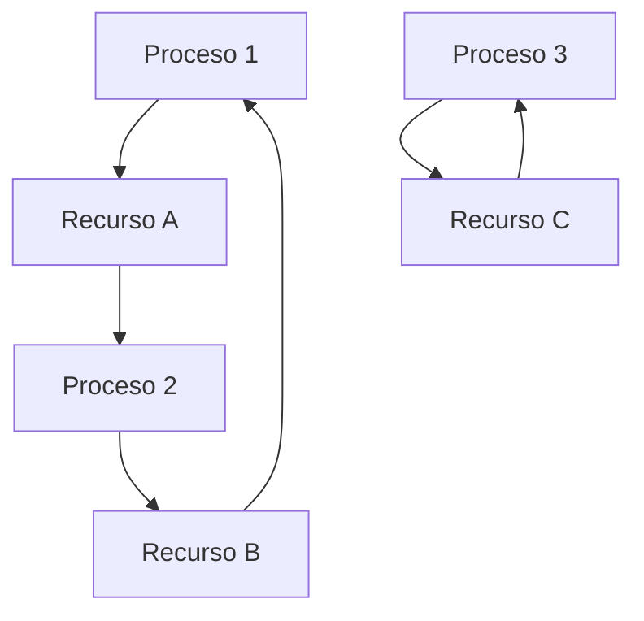
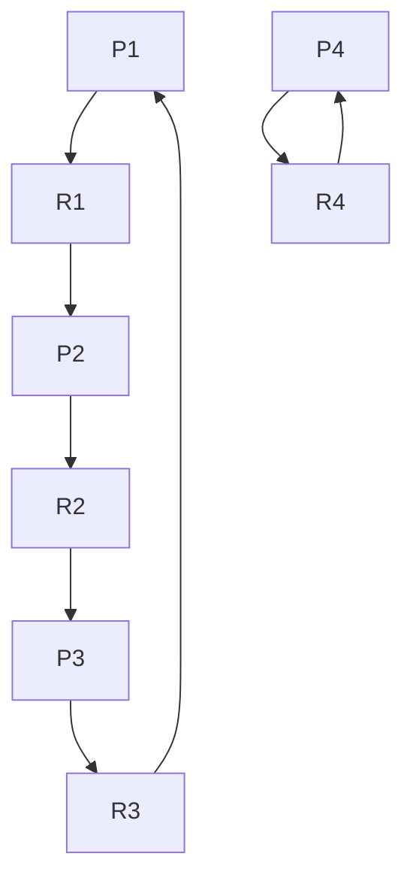

# Computación Concurrente - Recursos múltiples

## 4.1 Abrazos mortales.

---

En sistemas concurrentes, los procesos frecuentemente necesitan acceder a múltiples recursos para completar sus tareas. Cuando estos recursos son limitados y los procesos compiten por ellos bajo ciertas condiciones, puede surgir un **abrazo mortal** (deadlock).

### Definición de Abrazo Mortal

Un abrazo mortal ocurre cuando un conjunto de procesos está bloqueado permanentemente, donde cada proceso está esperando por un recurso que está siendo retenido por otro proceso del mismo conjunto.

#### Condiciones de Coffman para Abrazos Mortales

Para que ocurra un abrazo mortal, deben cumplirse simultáneamente cuatro condiciones:

1. **Exclusión mutua**: Al menos un recurso debe mantenerse en modo no compartible
2. **Retención y espera**: Un proceso retiene al menos un recurso mientras espera por recursos adicionales
3. **No apropiación**: Los recursos no pueden ser apropiados forzosamente
4. **Espera circular**: Debe existir un conjunto de procesos {P₁, P₂, ..., Pₙ} tal que P₁ espera por un recurso retenido por P₂, P₂ espera por un recurso retenido por P₃, ..., Pₙ espera por un recurso retenido por P₁

### Modelado Matemático de Abrazos Mortales

#### Grafo de asignación de recursos

Podemos modelar el sistema como un grafo dirigido $G = (V, E)$ donde:

- $V = P \cup R$ (procesos y recursos)
- $E$ contiene:
  - Aristas de solicitud: $P_i \rightarrow R_j$
  - Aristas de asignación: $R_j \rightarrow P_i$



#### Detección matemática

Un abrazo mortal existe si y solo si el grafo de asignación de recursos contiene un ciclo. La condición se puede expresar como:

$$ \exists \text{ ciclo } C \text{ en } G \text{ tal que } \forall (u,v) \in C, u,v \in P \cup R $$

### Ejemplo Práctico de Abrazo Mortal

#### Escenario clásico: Filósofos comensales

El problema de los filósofos comensales ilustra perfectamente los abrazos mortales:

```java
public class Filosofo extends Thread {
    private Object tenedorIzquierdo;
    private Object tenedorDerecho;

    public void run() {
        while (true) {
            // Pensar
            synchronized(tenedorIzquierdo) {
                synchronized(tenedorDerecho) {
                    // Comer
                }
            }
        }
    }
}
```

**Análisis del deadlock**:

- Cada filósofo adquiere su tenedor izquierdo
- Todos esperan indefinidamente por el tenedor derecho
- Se forma un ciclo de espera

### Código de Ejemplo: Simulación de Deadlock

```python
import threading
import time

class Recurso:
    def __init__(self, nombre):
        self.nombre = nombre
        self.lock = threading.Lock()

def proceso_A(recurso1, recurso2):
    print("Proceso A: Solicitando recurso 1")
    with recurso1.lock:
        print("Proceso A: Adquirió recurso 1")
        time.sleep(1)  # Simular procesamiento
        print("Proceso A: Solicitando recurso 2")
        with recurso2.lock:
            print("Proceso A: Adquirió ambos recursos")

def proceso_B(recurso1, recurso2):
    print("Proceso B: Solicitando recurso 2")
    with recurso2.lock:
        print("Proceso B: Adquirió recurso 2")
        time.sleep(1)  # Simular procesamiento
        print("Proceso B: Solicitando recurso 1")
        with recurso1.lock:
            print("Proceso B: Adquirió ambos recursos")

# Crear recursos
recurso_X = Recurso("X")
recurso_Y = Recurso("Y")

# Ejecutar procesos (esto causará deadlock)
thread_A = threading.Thread(target=proceso_A, args=(recurso_X, recurso_Y))
thread_B = threading.Thread(target=proceso_B, args=(recurso_X, recurso_Y))

thread_A.start()
thread_B.start()

thread_A.join()
thread_B.join()
```

### Algoritmos de Detección de Deadlocks

#### Algoritmo del grafo de espera

```python
class DetectorDeadlock:
    def __init__(self):
        self.grafo = {}

    def agregar_arista(self, desde, hacia):
        if desde not in self.grafo:
            self.grafo[desde] = []
        self.grafo[desde].append(hacia)

    def detectar_ciclo(self):
        visitados = set()
        stack = set()

        def dfs(nodo):
            if nodo in stack:
                return True  # Ciclo detectado
            if nodo in visitados:
                return False

            visitados.add(nodo)
            stack.add(nodo)

            if nodo in self.grafo:
                for vecino in self.grafo[nodo]:
                    if dfs(vecino):
                        return True

            stack.remove(nodo)
            return False

        for nodo in self.grafo:
            if dfs(nodo):
                return True
        return False
```

#### Algoritmo del banquero

El algoritmo del banquero de Dijkstra evita deadlocks mediante verificación de estado seguro:

Sea:

- $Available$: vector de recursos disponibles
- $Max$: matriz de máxima demanda por proceso
- $Allocation$: matriz de recursos actualmente asignados
- $Need$: matriz de recursos aún necesitados $(Need = Max - Allocation)$

Un estado es seguro si existe una secuencia segura de procesos.

### Técnicas de Prevención

#### 1. Negación de la condición de espera circular

**Ordenación de recursos**: Asignar un orden total a todos los recursos y requerir que los procesos soliciten recursos en orden creciente.

$$ \text{Si } P \text{ solicita } R_i \text{ y } R_j, \text{ entonces } i < j $$

#### 2. Negación de la condición de retención y espera

Los procesos deben solicitar todos los recursos necesarios al inicio, o liberar todos los recursos antes de solicitar nuevos.

#### 3. Negación de la condición de no apropiación

Permitir que el sistema revoque recursos de procesos.

### Ejercicios Propuestos

#### Ejercicio 1: Análisis de Grafo de Recursos

Dado el siguiente grafo de asignación de recursos:



**Preguntas**:

1. ¿Existe algún deadlock en el sistema?
2. Identifique todos los ciclos presentes
3. ¿Qué procesos están involucrados en deadlocks?

#### Ejercicio 2: Implementación de Prevención

Implemente una versión de los filósofos comensales que prevenga deadlocks usando:
a) Ordenación de tenedores
b) Semáforos adicionales

#### Ejercicio 3: Algoritmo de Detección

Extienda la clase `DetectorDeadlock` para que:

1. Mantenga un registro histórico de asignaciones
2. Pueda identificar múltiples ciclos simultáneamente
3. Sugiera procesos candidatos para terminación

#### Ejercicio 4: Análisis de Sistema Real

Analice un sistema de base de datos con transacciones que acceden a múltiples tablas. Diseñe un protocolo que:

- Minimice la probabilidad de deadlock
- Detecte deadlocks eficientemente
- Recupere el sistema con mínimo impacto

### Solución al Ejercicio 2a: Filósofos sin Deadlock

```python
import threading

class FilosofoSinDeadlock(threading.Thread):
    def __init__(self, id, tenedores):
        super().__init__()
        self.id = id
        self.tenedores = tenedores

    def run(self):
        while True:
            self.pensar()
            self.comer()

    def pensar(self):
        print(f"Filósofo {self.id} pensando")

    def comer(self):
        # Ordenar tenedores por ID para prevenir deadlock
        primero, segundo = sorted([self.id, (self.id + 1) % len(self.tenedores)])

        with self.tenedores[primero]:
            with self.tenedores[segundo]:
                print(f"Filósofo {self.id} comiendo")
```

### Referencias

#### Bibliografía Básica

1. **Taubenfeld, G. (2006)**. _Synchronization Algorithms and Concurrent Programming_.
   - Capítulo 6: "Deadlock" - Tratamiento formal de condiciones de deadlock y algoritmos de prevención.

2. **Herlihy, M. & Shavit, N. (2008)**. _The Art of Multiprocessor Programming_.
   - Capítulo 17: "Barriers and Deadlocks" - Análisis práctico de deadlocks en programación multiprocesador.

#### Bibliografía Complementaria

3. **Lamport, L. (2002)**. _Specifying Systems: The TLA+ Language and Tools_.
   - Uso de TLA+ para especificar y verificar ausencia de deadlocks en sistemas concurrentes.

### Conceptos Avanzados

#### Livelock vs Deadlock

Mientras el deadlock implica bloqueo completo, el livelock ocurre cuando los procesos cambian de estado pero no progresan:

```python
# Ejemplo de livelock
def proceso1(recursos):
    while not adquirir_recurso1(recursos):
        liberar_todo(recursos)
        time.sleep(1)

def proceso2(recursos):
    while not adquirir_recurso2(recursos):
        liberar_todo(recursos)
        time.sleep(1)
```

#### Starvation

La inanición ocurre cuando un proceso no puede acceder a recursos necesarios debido a políticas de planificación injustas.

### Herramientas de Detección en Lenguajes Modernos

#### Java Thread Dump

```bash
jstack <pid>
```

#### Python

```python
import threading
import sys
import traceback

def dump_threads():
    for thread_id, frame in sys._current_frames().items():
        print(f"Thread {thread_id}:")
        traceback.print_stack(frame)
```
