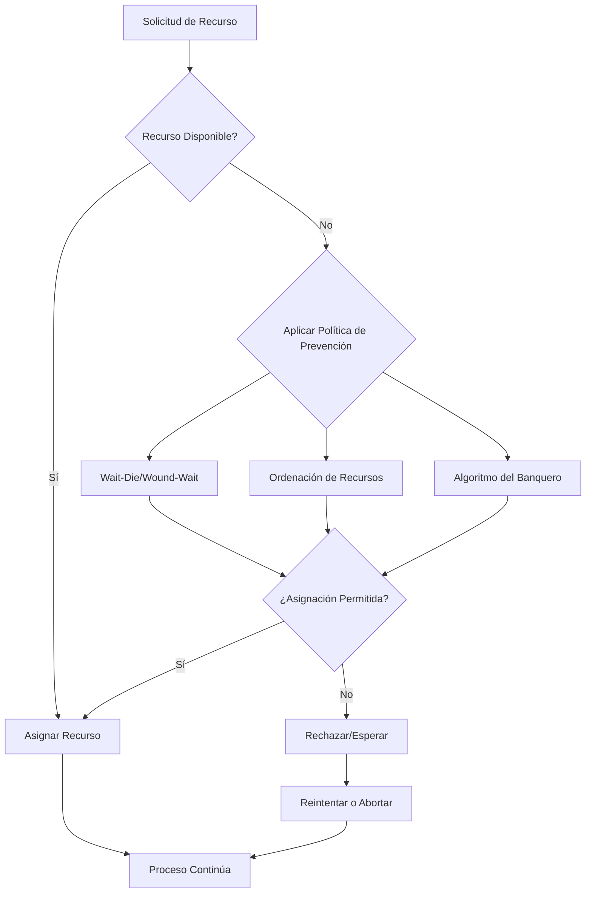

# Computación Concurrente - Recursos múltiples

## 4.2 Prevención de abrazos mortales.

---

La prevención de abrazos mortales consiste en diseñar sistemas que garanticen que **al menos una** de las cuatro condiciones necesarias para el deadlock nunca se cumpla. Según Taubenfeld (2006), este enfoque es proactivo y evita que el sistema entre en estados inseguros.

### Estrategias Fundamentales de Prevención

#### 1. Negación de la Exclusión Mutua

Si ningún recurso es de exclusión mutua, no puede ocurrir deadlock. Esto se logra mediante:

**Recursos compartibles**: Algunos recursos pueden diseñarse para acceso concurrente.

```java
public class RecursoCompartido {
    private AtomicInteger contador = new AtomicInteger(0);

    public void accesoConcurrente() {
        contador.incrementAndGet();
        // Operaciones thread-safe
    }
}
```

**Límite**: No todos los recursos pueden hacerse compartibles (impresoras, dispositivos E/S).

#### 2. Negación de la Condición "Retención y Espera"

##### Enfoque: Solicitud Total de Recursos

Cada proceso debe solicitar **todos** los recursos necesarios al inicio de su ejecución.

```python
class ProcesoSinRetencion:
    def __init__(self, recursos_necesarios):
        self.recursos_necesarios = recursos_necesarios
        self.recursos_asignados = []

    def ejecutar(self, administrador_recursos):
        # Solicitar todos los recursos al inicio
        if administrador_recursos.asignar_todos(self.recursos_necesarios):
            try:
                self.procesar()
            finally:
                administrador_recursos.liberar_todos(self.recursos_necesarios)
        else:
            self.esperar()
```

**Ventaja**: Elimina la posibilidad de ciclos de espera.
**Desventaja**: Baja utilización de recursos, posible inanición.

#### 3. Negación de la Condición "No Apropiación"

##### Protocolo de Apropiación

```python
class AdministradorRecursosApropiables:
    def __init__(self):
        self.recursos_disponibles = {}
        self.asignaciones = {}
        self.lock = threading.Lock()

    def apropiar_recurso(self, proceso_solicitante, recurso):
        with self.lock:
            if recurso in self.asignaciones:
                proceso_actual = self.asignaciones[recurso]
                # Guardar estado del proceso actual
                proceso_actual.guardar_estado()
                # Liberar recurso
                self.liberar_recurso(proceso_actual, recurso)

            self.asignar_recurso(proceso_solicitante, recurso)
```

**Aplicación**: Memoria virtual, recursos de CPU.
**Limitación**: No aplicable a todos los recursos (transacciones de base de datos).

#### 4. Negación de la Condición "Espera Circular"

##### Ordenación Lineal de Recursos

**Teorema**: Si todos los procesos solicitan recursos en orden creciente de identificación, no puede formarse un ciclo de espera.

Sea $R = \{r_1, r_2, ..., r_n\}$ un conjunto de recursos con orden total $r_1 < r_2 < ... < r_n$. Todo proceso debe cumplir:

$$ \text{Si } P \text{ solicita } r_i \text{ y luego } r_j, \text{ entonces } i < j $$

```java
public class ProcesoOrdenado {
    private List<Recurso> recursosEnOrden;

    public void accesoRecursos() {
        // Ordenar recursos por ID antes de solicitar
        Collections.sort(recursosEnOrden, Comparator.comparing(Recurso::getId));

        for (Recurso recurso : recursosEnOrden) {
            synchronized(recurso) {
                // Usar recurso
            }
        }
    }
}
```

### El Algoritmo del Banquero

Desarrollado por Dijkstra, este algoritmo evita deadlocks mediante verificación de estado seguro.

#### Modelo Matemático

Definimos:

- $Available[m]$: Vector de recursos disponibles
- $Max[n][m]$: Matriz de máxima demanda por proceso
- $Allocation[n][m]$: Matriz de recursos asignados
- $Need[n][m]$: Matriz de recursos necesitados $(Need = Max - Allocation)$

#### Algoritmo de Verificación de Seguridad

```python
class AlgoritmoBanquero:
    def __init__(self, recursos_disponibles, max_demanda):
        self.available = recursos_disponibles.copy()
        self.max = [fila[:] for fila in max_demanda]
        self.allocation = [[0] * len(recursos_disponibles)
                          for _ in range(len(max_demanda))]
        self.need = [fila[:] for fila in max_demanda]

    def es_seguro(self):
        work = self.available[:]
        finish = [False] * len(self.max)

        while True:
            encontrado = False
            for i in range(len(self.max)):
                if not finish[i] and self.need_menor_igual_work(i, work):
                    # Simular ejecución y liberación
                    for j in range(len(work)):
                        work[j] += self.allocation[i][j]
                    finish[i] = True
                    encontrado = True

            if not encontrado:
                break

        return all(finish)

    def need_menor_igual_work(self, proceso_idx, work):
        return all(self.need[proceso_idx][j] <= work[j]
                  for j in range(len(work)))

    def solicitar_recursos(self, proceso, solicitud):
        if not all(solicitud[j] <= self.need[proceso][j]
                  for j in range(len(solicitud))):
            return False  # Solicitud excede necesidad máxima

        if not all(solicitud[j] <= self.available[j]
                  for j in range(len(solicitud))):
            return False  # Recursos no disponibles

        # Simular asignación
        for j in range(len(solicitud)):
            self.available[j] -= solicitud[j]
            self.allocation[proceso][j] += solicitud[j]
            self.need[proceso][j] -= solicitud[j]

        if self.es_seguro():
            return True
        else:
            # Revertir asignación
            for j in range(len(solicitud)):
                self.available[j] += solicitud[j]
                self.allocation[proceso][j] -= solicitud[j]
                self.need[proceso][j] += solicitud[j]
            return False
```

### Protocolos de Prevención Basados en Timestamps

#### Algoritmo de Wait-Die (Espera-Muere)

```python
class AlgoritmoWaitDie:
    def __init__(self):
        self.timestamps = {}  # timestamp por proceso
        self.asignaciones = {}  # recurso -> proceso

    def solicitar_recurso(self, proceso, recurso, timestamp):
        if recurso not in self.asignaciones:
            # Recurso disponible
            self.asignaciones[recurso] = proceso
            return True

        proceso_actual = self.asignaciones[recurso]

        if timestamp < self.timestamps[proceso_actual]:
            # Proceso más viejo espera
            return False  # Esperar
        else:
            # Proceso más joven muere
            return False  # Abortar
```

#### Algoritmo de Wound-Wait (Herir-Esperar)

```python
class AlgoritmoWoundWait:
    def solicitar_recurso(self, proceso_solicitante, recurso, timestamp_solicitante):
        if recurso not in self.asignaciones:
            self.asignaciones[recurso] = proceso_solicitante
            return True

        proceso_actual = self.asignaciones[recurso]
        timestamp_actual = self.timestamps[proceso_actual]

        if timestamp_solicitante < timestamp_actual:
            # Proceso más viejo hiere al más joven
            self.herir_proceso(proceso_actual)
            self.asignaciones[recurso] = proceso_solicitante
            return True
        else:
            # Proceso más joven espera
            return False
```

### Ejemplo Práctico: Sistema de Base de Datos

#### Prevención mediante Ordenación de Bloqueos

```sql
-- Protocolo de ordenación para prevenir deadlocks
BEGIN TRANSACTION;

-- Siempre bloquear tablas en orden alfabético
LOCK TABLE accounts IN SHARE MODE;    -- Primero
LOCK TABLE transactions IN SHARE MODE; -- Después
LOCK TABLE users IN SHARE MODE;        -- Último

-- Operaciones de la transacción
UPDATE accounts SET balance = balance - 100 WHERE id = 1;
INSERT INTO transactions (amount, account_id) VALUES (100, 1);

COMMIT;
```

#### Implementación en Java con Ordenación

```java
public class GestorTransacciones {
    private final List<Object> recursos = new ArrayList<>();

    public void ejecutarTransaccion(Runnable transaccion,
                                   List<Object> recursosNecesarios) {
        // Ordenar recursos para prevenir deadlocks
        List<Object> recursosOrdenados = new ArrayList<>(recursosNecesarios);
        recursosOrdenados.sort(Comparator.comparing(System::identityHashCode));

        synchronized(recursosOrdenados.get(0)) {
            if (recursosOrdenados.size() > 1) {
                synchronized(recursosOrdenados.get(1)) {
                    transaccion.run();
                }
            } else {
                transaccion.run();
            }
        }
    }
}
```

### Diagrama de Flujo para Prevención de Deadlocks



### Ejercicios Propuestos

#### Ejercicio 1: Implementación del Algoritmo del Banquero

Implemente una clase `Banquero` que:

1. Mantenga el estado de recursos del sistema
2. Verifique seguridad antes de cada asignación
3. Permita solicitudes de múltiples procesos simultáneamente

**Datos de prueba**:

```python
recursos_disponibles = [3, 3, 2]
max_demanda = [
    [7, 5, 3],  # P0
    [3, 2, 2],  # P1
    [9, 0, 2],  # P2
    [2, 2, 2],  # P3
    [4, 3, 3]   # P4
]
```

#### Ejercicio 2: Análisis de Políticas de Prevención

Compare las políticas Wait-Die y Wound-Wait para el siguiente escenario:

- Proceso A (timestamp=1) tiene recurso X
- Proceso B (timestamp=2) tiene recurso Y
- Proceso A solicita Y
- Proceso B solicita X

**Determine**:

1. Comportamiento con Wait-Die
2. Comportamiento con Wound-Wait
3. Número de abortos en cada caso

#### Ejercicio 3: Sistema de Reservas con Prevención

Diseñe un sistema de reservas de aerolínea que prevenga deadlocks cuando:

- Múltiples usuarios reservan vuelos conexos
- Cada reserva requiere bloquear múltiples segmentos
- Las transacciones pueden revertirse

**Requisitos**:

- Usar ordenación de recursos
- Implementar timeout para solicitudes
- Garantizar consistencia

#### Ejercicio 4: Simulación de Rendimiento

Simule un sistema con 10 procesos y 5 tipos de recursos. Compare:

1. Tasa de utilización de recursos
2. Tiempo promedio de espera
3. Número de solicitudes rechazadas

Para las políticas:
a) Solicitud total de recursos
b) Algoritmo del banquero
c) Ordenación de recursos

### Técnicas Avanzadas de Prevención

#### Prevención mediante Análisis Estático

Según Herlihy & Shavit (2008), el análisis estático puede detectar potenciales deadlocks en tiempo de compilación:

```java
// Anotación para análisis estático
@Concurrent(lockOrder = {"recursoA", "recursoB"})
public void operacionConcurrente() {
    synchronized(recursoA) {
        synchronized(recursoB) {
            // Operación
        }
    }
}
```

#### Protocolos de Evitación con Múltiples Instancias

Extensión del algoritmo del banquero para recursos con múltiples instancias:

$$ \text{Estado seguro} \iff \exists \text{ secuencia } \langle P_1, P_2, ..., P_n \rangle \text{ tal que } \forall i: Need[P_i] \leq Available + \sum_{j=1}^{i-1} Allocation[P_j] $$

### Referencias Bibliográficas

#### Bibliografía Básica

1. **Taubenfeld, G. (2006).** _Synchronization Algorithms and Concurrent Programming_
   - **Capítulo 7**: "Deadlock Prevention" - Técnicas formales de prevención y análisis de complejidad
   - **Sección 7.3**: "Resource Ordering Protocols" - Protocolos basados en ordenación

2. **Herlihy, M. & Shavit, N. (2008).** _The Art of Multiprocessor Programming_
   - **Capítulo 17.4**: "Deadlock Prevention in Practice" - Casos de estudio y patrones de diseño
   - **Algoritmo 17.6**: "Banker's Algorithm Implementation"

#### Bibliografía Complementaria

3. **Lamport, L. (2002).** _Specifying Systems: The TLA+ Language and Tools_
   - **Capítulo 10**: "Specifying Concurrent Systems" - Especificación formal de sistemas libres de deadlocks
   - Uso de TLA+ para verificar protocolos de prevención

### Métricas de Evaluación de Políticas

#### Fórmulas de Rendimiento

- **Tasa de utilización de recursos**:

  $$ U = \frac{\sum_{i=1}^{n} T_{uso}(r_i)}{T_{total} \times m} \times 100\% $$

- **Tiempo promedio de espera**:

  $$ W_{avg} = \frac{\sum_{i=1}^{k} T_{espera}(p_i)}{k} $$

- **Tasa de rechazo de solicitudes**:

  $$ R = \frac{N_{rechazadas}}{N_{totales}} \times 100\% $$

### Caso de Estudio: Sistema de Archivos

Implementación de prevención en un sistema de archivos con acceso concurrente:

```python
class SistemaArchivosConcurrente:
    def __init__(self):
        self.archivos = {}
        self.orden_archivos = sorted # Orden natural por nombre

    def acceso_archivos(self, proceso, archivos_necesarios):
        archivos_ordenados = sorted(archivos_necesarios)

        locks = []
        try:
            for archivo in archivos_ordenados:
                lock = threading.Lock()
                lock.acquire()
                locks.append(lock)

            # Ejecutar operaciones
            self.ejecutar_operaciones(proceso, archivos_necesarios)
        finally:
            for lock in locks:
                lock.release()
```
