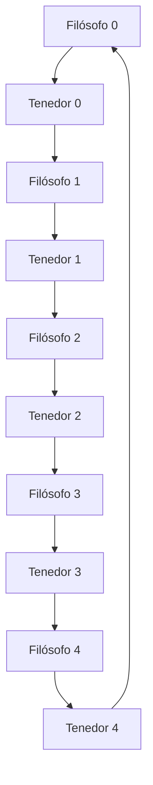
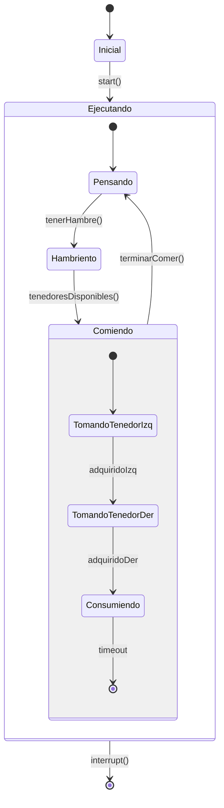

# Computación Concurrente - Recursos múltiples

## 4.3 El problema de los filósofos comensales.

---

El **problema de los filósofos comensales** es un ejemplo clásico de sincronización y competencia por recursos múltiples en sistemas concurrentes. Formulado originalmente por Edsger Dijkstra en 1965, ilustra los desafíos de evitar deadlocks y starvation en entornos con recursos compartidos.

### Definición Formal

#### Escenario Base

Tenemos $n$ filósofos sentados alrededor de una mesa circular. Cada filósofo alterna entre dos estados:

- **Pensar** (estado independiente)
- **Comer** (estado que requiere recursos)

Entre cada par de filósofos hay un **tenedor** (recurso compartido). Para comer, un filósofo necesita adquirir ambos tenedores adyacentes.



#### Modelo Matemático

Sea $P = \{p_0, p_1, ..., p_{n-1}\}$ el conjunto de filósofos y $T = \{t_0, t_1, ..., t_{n-1}\}$ el conjunto de tenedores.

Cada filósofo $p_i$ necesita los tenedores:

- Tenedor izquierdo: $t_i$
- Tenedor derecho: $t_{(i+1) \mod n}$

### Implementación Ingenua (Con Deadlock)

```java
public class FilosofoIngenuo extends Thread {
    private final int id;
    private final Object tenedorIzquierdo;
    private final Object tenedorDerecho;

    public FilosofoIngenuo(int id, Object izquierdo, Object derecho) {
        this.id = id;
        this.tenedorIzquierdo = izquierdo;
        this.tenedorDerecho = derecho;
    }

    public void run() {
        while (true) {
            pensar();
            comer();
        }
    }

    private void pensar() {
        System.out.println("Filósofo " + id + " está pensando");
        try { Thread.sleep((long)(Math.random() * 1000)); }
        catch (InterruptedException e) {}
    }

    private void comer() {
        synchronized(tenedorIzquierdo) {
            synchronized(tenedorDerecho) {
                System.out.println("Filósofo " + id + " está comiendo");
                try { Thread.sleep((long)(Math.random() * 1000)); }
                catch (InterruptedException e) {}
            }
        }
    }
}
```

**Problema**: Cuando todos los filósofos toman su tenedor izquierdo simultáneamente, ocurre un **deadlock**.

### Análisis del Deadlock

#### Verificación de las Condiciones de Coffman

1. **Exclusión mutua**: ✓ Cada tenedor solo puede ser usado por un filósofo a la vez
2. **Retención y espera**: ✓ Cada filósofo retiene un tenedor mientras espera el otro
3. **No apropiación**: ✓ Los tenedores no pueden ser quitados forzosamente
4. **Espera circular**: ✓ $p_0$ espera por $t_1$ ( retenido por $p_1$ ), $p_1$ espera por $t_2$, ..., $p_{n-1}$ espera por $t_0$

### Soluciones al Problema

#### 1. Solución con Semáforo Global (Camarero)

```java
public class FilosofoCamarero extends Thread {
    private static final Semaphore camarero = new Semaphore(4); // Solo 4 pueden comer

    // ... resto de atributos igual

    private void comer() {
        try {
            camarero.acquire(); // Pedir permiso al camarero
            synchronized(tenedorIzquierdo) {
                synchronized(tenedorDerecho) {
                    System.out.println("Filósofo " + id + " está comiendo");
                    Thread.sleep((long)(Math.random() * 1000));
                }
            }
            camarero.release();
        } catch (InterruptedException e) {}
    }
}
```

**Ventaja**: Simple, previene deadlock
**Desventaja**: Puede reducir el paralelismo

#### 2. Solución con Ordenación de Tenedores

```python
import threading

class FilosofoOrdenado(threading.Thread):
    def __init__(self, id, tenedores):
        super().__init__()
        self.id = id
        self.tenedores = tenedores
        self.n = len(tenedores)

    def run(self):
        while True:
            self.pensar()
            self.comer()

    def pensar(self):
        print(f"Filósofo {self.id} pensando")
        threading.Event().wait(1)

    def comer(self):
        # Ordenar tenedores por ID para prevenir deadlock
        primero = min(self.id, (self.id + 1) % self.n)
        segundo = max(self.id, (self.id + 1) % self.n)

        with self.tenedores[primero]:
            with self.tenedores[segundo]:
                print(f"Filósofo {self.id} comiendo")
                threading.Event().wait(1)
```

**Teorema**: Si todos los procesos adquieren recursos en orden creciente, no puede haber espera circular.

#### 3. Solución con Tiempo Límite (Timeout)

```java
public class FilosofoTimeout extends Thread {
    private final long TIMEOUT_MS = 5000;

    private void comer() {
        while (true) {
            synchronized(tenedorIzquierdo) {
                try {
                    if (((ReentrantLock)tenedorDerecho).tryLock(TIMEOUT_MS,
                                 TimeUnit.MILLISECONDS)) {
                        try {
                            System.out.println("Filósofo " + id + " comiendo");
                            Thread.sleep((long)(Math.random() * 1000));
                            return; // Éxito
                        } finally {
                            ((ReentrantLock)tenedorDerecho).unlock();
                        }
                    }
                } catch (InterruptedException e) {}
            }
            // Liberar ambos y reintentar
            pensar(); // Esperar antes de reintentar
        }
    }
}
```

#### 4. Solución con Estado Centralizado (Monitor)

```java
public class MesaFilosofos {
    private final int n;
    private final Estado[] estados;
    private final Condition[] condiciones;
    private final ReentrantLock lock;

    enum Estado { PENSANDO, HAMBRIENTO, COMIENDO }

    public MesaFilosofos(int n) {
        this.n = n;
        this.estados = new Estado[n];
        this.condiciones = new Condition[n];
        this.lock = new ReentrantLock();

        Arrays.fill(estados, Estado.PENSANDO);
        for (int i = 0; i < n; i++) {
            condiciones[i] = lock.newCondition();
        }
    }

    public void tomarTenedores(int id) throws InterruptedException {
        lock.lock();
        try {
            estados[id] = Estado.HAMBRIENTO;
            probar(id);
            while (estados[id] != Estado.COMIENDO) {
                condiciones[id].await();
            }
        } finally {
            lock.unlock();
        }
    }

    public void liberarTenedores(int id) {
        lock.lock();
        try {
            estados[id] = Estado.PENSANDO;
            probar((id + n - 1) % n); // Filósofo izquierdo
            probar((id + 1) % n);     // Filósofo derecho
        } finally {
            lock.unlock();
        }
    }

    private void probar(int id) {
        int izquierdo = (id + n - 1) % n;
        int derecho = (id + 1) % n;

        if (estados[id] == Estado.HAMBRIENTO &&
            estados[izquierdo] != Estado.COMIENDO &&
            estados[derecho] != Estado.COMIENDO) {
            estados[id] = Estado.COMIENDO;
            condiciones[id].signal();
        }
    }
}
```

### Análisis de Correctitud

#### Verificación de Ausencia de Deadlocks

**Teorema**: La solución con ordenación de recursos es libre de deadlocks.

**Demostración**:

- Asignamos un orden total a los tenedores: $t_0 < t_1 < ... < t_{n-1}$
- Cada filósofo $p_i$ adquiere primero $\min(t_i, t_{(i+1) \mod n})$ y luego $\max(t_i, t_{(i+1) \mod n})$
- No puede formarse un ciclo en el grafo de espera

#### Análisis de Inanición (Starvation)

**Problema**: En algunas soluciones, un filósofo puede esperar indefinidamente.

**Solución**: Uso de fairness en locks o timeouts:

```java
ReentrantLock lock = new ReentrantLock(true); // Fair lock
```

### Modelado con Álgebra de Procesos

Según Taubenfeld (2006), podemos modelar el comportamiento usando CSP:

$$ \begin{align*} FILOSOFO(i) &= pensar.i \rightarrow hambriento.i \rightarrow FILOSOFO'(i) \\\ FILOSOFO'(i) &= tomar.i \rightarrow tomar.(i+1) \rightarrow comer.i \\\ &\rightarrow liberar.i \rightarrow liberar.(i+1) \rightarrow FILOSOFO(i) \end{align*} $$

### Ejercicios Propuestos

#### Ejercicio 1: Implementación Completa

Implemente el problema completo con 5 filósofos usando:
a) La solución del camarero
b) La solución con ordenación de tenedores
c) La solución con monitor

**Métrica**: Compare el número de comidas por filósofo en 1 minuto.

#### Ejercicio 2: Análisis de Rendimiento

Para $n$ filósofos, derive fórmulas para:

1. **Máximo paralelismo**:

   $$ P_{max} = \lfloor \frac{n}{2} \rfloor $$

2. **Probabilidad de deadlock en implementación ingenua**:

   $$ P_{deadlock} = \left(\frac{1}{2}\right)^{n-1} $$

3. **Tiempo promedio entre comidas** para un filósofo específico.

#### Ejercicio 3: Variación - Filósofos Zurdos

Modifique el problema para que un filósofo sea zurdo (toma primero el tenedor derecho).

**Analice**:

- ¿Previene esto el deadlock?
- ¿Cómo afecta al rendimiento?
- Implemente la solución.

#### Ejercicio 4: Sistema de Prioridades

Extienda el problema con prioridades. Filósofos con mayor prioridad deben comer primero.

Implemente usando `PriorityBlockingQueue` en Java.

#### Ejercicio 5: Filósofos con Comportamiento Variable

Algunos filósofos piensan más de lo que comen, otros al revés. Modele esto y analice:

- Fairness del sistema
- Posibilidad de inanición
- Throughput general

### Simulación y Visualización

#### Diagrama de Estados del Sistema



#### Código de Métricas

```python
import time
from collections import defaultdict

class MetricasFilosofos:
    def __init__(self, n_filosofos):
        self.n = n_filosofos
        self.comidas = [0] * n_filosofos
        self.tiempo_espera = [0] * n_filosofos
        self.ultimo_cambio = [time.time()] * n_filosofos
        self.estados = ['PENSANDO'] * n_filosofos

    def cambiar_estado(self, id, nuevo_estado):
        tiempo_actual = time.time()
        tiempo_en_estado = tiempo_actual - self.ultimo_cambio[id]

        if self.estados[id] == 'ESPERANDO':
            self.tiempo_espera[id] += tiempo_en_estado
        elif self.estados[id] == 'COMIENDO':
            self.comidas[id] += 1

        self.estados[id] = nuevo_estado
        self.ultimo_cambio[id] = tiempo_actual

    def reportar_metricas(self):
        print("=== Métricas ===")
        for i in range(self.n):
            print(f"Filósofo {i}: {self.comidas[i]} comidas, "
                  f"{self.tiempo_espera[i]:.2f}s esperando")

        print(f"Fairness: {min(self.comidas)/max(self.comidas)*100:.1f}%")
```

### Extensiones del Problema

#### Versión con Tenedores Adicionales

Algunas variantes usan $n$ filósofos y $m$ tenedores, donde $m > n$.

**Problema**: Asignación óptima de tenedores para maximizar throughput.

#### Filósofos con Dependencias Temporales

```java
public class FilosofoTemporal extends Thread {
    private final long umbralHambre;
    private long ultimaComida;

    public void run() {
        while (true) {
            pensar();
            if (System.currentTimeMillis() - ultimaComida > umbralHambre) {
                comerPrioritario(); // Mayor prioridad
            } else {
                comerNormal();
            }
        }
    }
}
```

### Referencias Bibliográficas

#### Bibliografía Básica

1. **Taubenfeld, G. (2006).** _Synchronization Algorithms and Concurrent Programming_
   - **Capítulo 8.3**: "The Dining Philosophers Problem" - Análisis formal y soluciones
   - **Algoritmo 8.7**: "Resource Ordering Solution"
   - **Teorema 8.3**: "Deadlock-free condition"

2. **Herlihy, M. & Shavit, N. (2008).** _The Art of Multiprocessor Programming_
   - **Capítulo 11.5**: "The Dining Philosophers" - Implementaciones prácticas
   - **Patrón 11.6**: "Multiple Resource Acquisition"

#### Bibliografía Complementaria

3. **Lamport, L. (2002).** _Specifying Systems: The TLA+ Language and Tools_
   - **Sección 14.2**: "Specifying the Dining Philosophers" - Modelado formal en TLA+
   - Verificación de propiedades de seguridad y vivacidad

### Aplicaciones en Sistemas Reales

El problema modela situaciones reales como:

- **Sistemas de bases de datos**: Transacciones que necesitan múltiples locks
- **Sistemas operativos**: Procesos que necesitan múltiples dispositivos
- **Redes**: Nodos que necesitan múltiples canales
