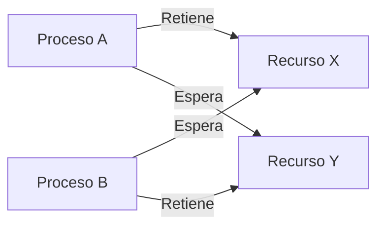
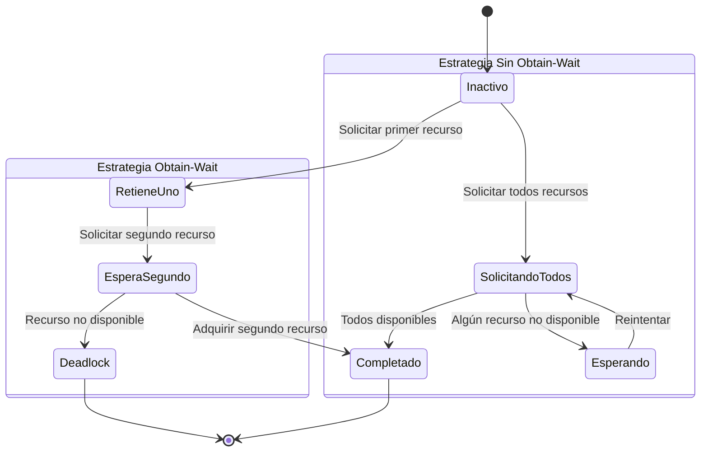

# Computación Concurrente - Recursos múltiples

## 4.4 Estrategia de obtener y esperar.

---

La **estrategia de obtener y esperar** (wait-for o hold-and-wait) es una condición fundamental en la teoría de deadlocks y se refiere a la situación donde un proceso retiene al menos un recurso mientras espera para adquirir recursos adicionales que están actualmente siendo retenidos por otros procesos.

### Definición Formal

#### Condición de Obtener y Esperar

Según Taubenfeld (2006), un sistema satisface la condición de obtener y esperar si existe al menos un proceso que:

$$ \exists P_i \text{ tal que } P_i \in \text{Wait}(R_j) \land P_i \in \text{Hold}(R_k) $$

Donde:

- $\text{Hold}(P_i)$: conjunto de recursos retenidos por $P_i$
- $\text{Wait}(P_i)$: conjunto de recursos por los que $P_i$ está esperando



### Modelado Matemático

#### Sistema de Estados de Recursos

Sea un sistema con:

- $n$ procesos: $P = \{P_1, P_2, ..., P_n\}$
- $m$ recursos: $R = \{R_1, R_2, ..., R_m\}$

Definimos las matrices:

**Matriz de Asignación**:

$$ Allocation[i,j] = \begin{cases} 1 & \text{si } P_i \text{ tiene } R_j \\\ 0 & \text{en otro caso} \end{cases} $$

**Matriz de Solicitud**:

$$ Request[i,j] = \begin{cases} 1 & \text{si } P_i \text{ solicita } R_j \\\ 0 & \text{en otro caso} \end{cases} $$

#### Detección de Obtener y Esperar

Un proceso $P_i$ está en estado de obtener y esperar si:

$$ \exists j,k \text{ tal que } Allocation[i,j] = 1 \land Request[i,k] = 1 $$

### Implementaciones con Obtener y Esperar

#### Patrón Básico Problemático

```java
public class ProcesoObtainWait {
    private final Object recursoA;
    private final Object recursoB;

    public void ejecutarTarea() {
        // OBTENER primer recurso
        synchronized(recursoA) {
            // Realizar alguna computación
            realizarComputacion();

            // ESPERAR por segundo recurso (potencial deadlock)
            synchronized(recursoB) {
                ejecutarOperacionCritica();
            }
        }
    }

    private void realizarComputacion() {
        try {
            Thread.sleep(100);
        } catch (InterruptedException e) {
            Thread.currentThread().interrupt();
        }
    }
}
```

#### Ejemplo de Deadlock por Obtener y Esperar

```python
import threading
import time

class SistemaRecursos:
    def __init__(self):
        self.recurso_x = threading.Lock()
        self.recurso_y = threading.Lock()

    def proceso_1(self):
        print("Proceso 1: Obtiene Recurso X")
        with self.recurso_x:
            time.sleep(0.1)  # Simular procesamiento
            print("Proceso 1: Espera por Recurso Y")
            with self.recurso_y:  # PUNTO DE ESPERA
                print("Proceso 1: Tiene ambos recursos")

    def proceso_2(self):
        print("Proceso 2: Obtiene Recurso Y")
        with self.recurso_y:
            time.sleep(0.1)  # Simular procesamiento
            print("Proceso 2: Espera por Recurso X")
            with self.recurso_x:  # PUNTO DE ESPERA
                print("Proceso 2: Tiene ambos recursos")

# Ejecución que causa deadlock
sistema = SistemaRecursos()
t1 = threading.Thread(target=sistema.proceso_1)
t2 = threading.Thread(target=sistema.proceso_2)

t1.start()
t2.start()
```

### Técnicas para Romper la Condición de Obtener y Esperar

#### 1. Solicitud Atómica de Todos los Recursos

```java
public class ProcesoSinObtainWait {
    private final List<Object> recursosNecesarios;

    public void ejecutarTarea() {
        // Solicitar todos los recursos atómicamente
        synchronized(obtenerLockGlobal()) {
            for (Object recurso : recursosNecesarios) {
                adquirirRecurso(recurso);
            }
        }

        try {
            ejecutarOperacionCritica();
        } finally {
            liberarTodosRecursos();
        }
    }

    private void adquirirRecurso(Object recurso) {
        // Lógica para adquirir recurso
    }
}
```

#### 2. Protocolo de Liberación y Re-solicitud

```python
class ProcesoConRetry:
    def __init__(self, recursos):
        self.recursos = recursos
        self.recursos_adquiridos = []

    def ejecutar(self):
        while True:
            if self.intentar_adquirir_todos():
                try:
                    self.procesar()
                    return
                finally:
                    self.liberar_todos()
            else:
                self.liberar_todos()
                time.sleep(0.01)  # Backoff exponencial

    def intentar_adquirir_todos(self):
        for recurso in self.recursos:
            if not recurso.lock.acquire(blocking=False):
                # No se pudo adquirir, liberar todos
                self.liberar_todos()
                return False
            self.recursos_adquiridos.append(recurso)
        return True
```

### Algoritmo del Banquero y Obtener y Esperar

#### Verificación de Estado Seguro

El algoritmo del banquero previene la condición de obtener y esperar mediante verificación previa:

```python
class AlgoritmoBanquero:
    def __init__(self, recursos_totales):
        self.disponible = recursos_totales[:]
        self.maxima = []  # Máxima demanda por proceso
        self.asignacion = []  # Recursos actualmente asignados
        self.necesidad = []  # Recursos aún necesitados

    def solicitar_recursos(self, proceso, solicitud):
        # Paso 1: Verificar si la solicitud excede la necesidad
        if not all(solicitud[i] <= self.necesidad[proceso][i]
                  for i in range(len(solicitud))):
            return False

        # Paso 2: Verificar si hay recursos disponibles
        if not all(solicitud[i] <= self.disponible[i]
                  for i in range(len(solicitud))):
            return False

        # Paso 3: Simular asignación
        self.simular_asignacion(proceso, solicitud)

        # Paso 4: Verificar estado seguro
        if self.es_estado_seguro():
            return True
        else:
            self.revertir_asignacion(proceso, solicitud)
            return False

    def es_estado_seguro(self):
        trabajo = self.disponible[:]
        terminado = [False] * len(self.maxima)

        while True:
            encontrado = False
            for i in range(len(self.maxima)):
                if not terminado[i] and self.puede_satisfacerse(i, trabajo):
                    for j in range(len(trabajo)):
                        trabajo[j] += self.asignacion[i][j]
                    terminado[i] = True
                    encontrado = True

            if not encontrado:
                break

        return all(terminado)

    def puede_satisfacerse(self, proceso, trabajo):
        return all(self.necesidad[proceso][j] <= trabajo[j]
                  for j in range(len(trabajo)))
```

### Análisis de Rendimiento

#### Overhead de las Soluciones

**Solicitud atómica**:
- Ventaja: Elimina deadlocks
- Desventaja: Baja utilización de recursos

**Tiempo de respuesta** para solicitud atómica:

$$ T_{respuesta} = T_{adquisicion} + T_{ejecucion} + T_{liberacion} $$

**Probabilidad de éxito** en protocolo de retry:

$$ P_{exito} = \prod_{i=1}^{k} P(disponible(R_i)) $$

### Ejercicios Propuestos

#### Ejercicio 1: Análisis de Sistema de Archivos

Implemente un sistema de archivos donde procesos necesitan bloquear múltiples archivos. Analice:

```java
public class ProcesoArchivos {
    public void procesarArchivos(File[] archivos) {
        for (File archivo : archivos) {
            synchronized(archivo) {
                // Procesar parcialmente
                procesarParcialmente(archivo);
            }
        }
    }
}
```

**Preguntas**:
1. ¿Existe condición de obtener y esperar?
2. ¿Puede ocurrir deadlock?
3. Proponga una solución sin obtener y esperar.

#### Ejercicio 2: Sistema de Reservas

Diseñe un sistema de reservas de hotel donde cada reserva necesita:
- Habitación específica
- Servicios adicionales (SPA, restaurante)

Implemente dos versiones:
a) Con obtener y esperar
b) Sin obtener y esperar

Compare el throughput de ambas implementaciones.

#### Ejercicio 3: Algoritmo de Detección

Implemente un detector que identifique procesos en estado de obtener y esperar:

```python
class DetectorObtainWait:
    def detectar_obtain_wait(self, grafo_asignacion):
        """
        grafo_asignacion: dict {proceso: (recursos_retenidos, recursos_esperados)}
        """
        obtain_wait = []
        for proceso, (retenidos, esperados) in grafo_asignacion.items():
            if retenidos and esperados:  # Tiene recursos Y espera por más
                obtain_wait.append(proceso)
        return obtain_wait
```

Extienda para detectar ciclos potenciales de deadlock.

#### Ejercicio 4: Simulación de Rendimiento

Simule un sistema con:
- 10 procesos
- 5 tipos de recursos
- Distribución Poisson para llegada de solicitudes

Compare:
1. Estrategia con obtener y esperar
2. Estrategia con solicitud atómica
3. Estrategia con timeouts

Métricas: utilización de recursos, tiempo de respuesta, tasa de completitud.

### Patrones de Diseño para Evitar Obtener y Esperar

#### Patrón Resource Ordering

```java
public class ProcesoOrdenado {
    private final List<Object> recursos;

    public ProcesoOrdenado(List<Object> recursosNecesarios) {
        // Ordenar recursos por identificador único
        this.recursos = new ArrayList<>(recursosNecesarios);
        this.recursos.sort(Comparator.comparing(System::identityHashCode));
    }

    public void ejecutar() {
        // Adquirir en orden predefinido
        for (Object recurso : recursos) {
            synchronized(recurso) {
                // Todos los recursos se adquieren atómicamente
                // en relación al orden global
            }
        }
    }
}
```

#### Patrón Try-Lock con Backoff

```python
class ProcesoTryLock:
    def __init__(self, recursos):
        self.recursos = sorted(recursos, key=id)
        self.max_intentos = 10
        self.base_delay = 0.001

    def ejecutar(self):
        for intento in range(self.max_intentos):
            if self.intentar_adquirir():
                try:
                    self.procesar()
                    return True
                finally:
                    self.liberar()
            else:
                self.esperar_exponencial(intento)
        return False

    def intentar_adquirir(self):
        locks_adquiridos = []
        try:
            for recurso in self.recursos:
                if not recurso.lock.acquire(blocking=False):
                    # Falló, liberar todos
                    for lock in locks_adquiridos:
                        lock.release()
                    return False
                locks_adquiridos.append(recurso.lock)
            return True
        except:
            for lock in locks_adquiridos:
                lock.release()
            return False
```

### Análisis Teórico

#### Teorema de Prevención

**Teorema** (Taubenfeld, 2006): Si ningún proceso puede retener recursos mientras espera por recursos adicionales, entonces no puede ocurrir deadlock.

**Demostración**:
- Supongamos que existe un deadlock
- Entonces existe un conjunto de procesos $\{P_1, P_2, ..., P_k\}$ tal que:
  - $P_1$ espera por recurso retenido por $P_2$
  - $P_2$ espera por recurso retenido por $P_3$
  - ...
  - $P_k$ espera por recurso retenido por $P_1$
- Pero si ningún proceso retiene recursos mientras espera, esta cadena no puede formarse
- Contradicción □

#### Complejidad Computacional

**Verificación de estado seguro**:
- Complejidad temporal: $O(n^2 \times m)$
- Donde $n$: número de procesos, $m$: número de recursos

### Caso de Estudio: Sistema de Bases de Datos

#### Transacciones con Múltiples Locks

```sql
-- ENFOQUE CON OBTENER Y ESPERA (PROBLEMÁTICO)
BEGIN TRANSACTION;

UPDATE Cuentas SET balance = balance - 100 WHERE id = 1;
-- Aquí se retiene lock en cuenta 1
UPDATE Cuentas SET balance = balance + 100 WHERE id = 2;
-- Si otra transacción tiene lock en cuenta 2, ocurre obtain-wait

COMMIT;

-- ENFOQUE SIN OBTENER Y ESPERA
BEGIN TRANSACTION;

-- Solicitar todos los locks al inicio
SELECT * FROM Cuentas WHERE id IN (1, 2) FOR UPDATE;

UPDATE Cuentas SET balance = balance - 100 WHERE id = 1;
UPDATE Cuentas SET balance = balance + 100 WHERE id = 2;

COMMIT;
```

### Diagrama de Estados para Estrategias



### Referencias Bibliográficas

#### Bibliografía Básica

1. **Taubenfeld, G. (2006).** *Synchronization Algorithms and Concurrent Programming*
   - **Capítulo 7.2**: "Hold-and-Wait Condition" - Análisis formal de la condición
   - **Algoritmo 7.3**: "Atomic Acquisition Protocol"
   - **Teorema 7.1**: "Deadlock Prevention by denying Hold-and-Wait"

2. **Herlihy, M. & Shavit, N. (2008).** *The Art of Multiprocessor Programming*
   - **Capítulo 17.3**: "Multiple Resource Acquisition" - Patrones prácticos
   - **Algoritmo 17.5**: "Try-Lock with Ordered Acquisition"

#### Bibliografía Complementaria

3. **Lamport, L. (2002).** *Specifying Systems: The TLA+ Language and Tools*
   - **Sección 10.4**: "Specifying Resource Allocation" - Modelado formal de estrategias de adquisición
   - Verificación de propiedades de ausencia de deadlock

### Métricas y Evaluación

#### Fórmulas de Evaluación

**Utilización de recursos**:

$$ U = \frac{\sum_{i=1}^{m} T_{uso}(R_i)}{T_{total} \times m} \times 100\% $$

**Tasa de aborto por contención**:

$$ A = \frac{N_{reintentos}}{N_{solicitudes}} \times 100\% $$

**Throughput del sistema**:

$$ \theta = \frac{N_{completados}}{T_{observacion}} $$
