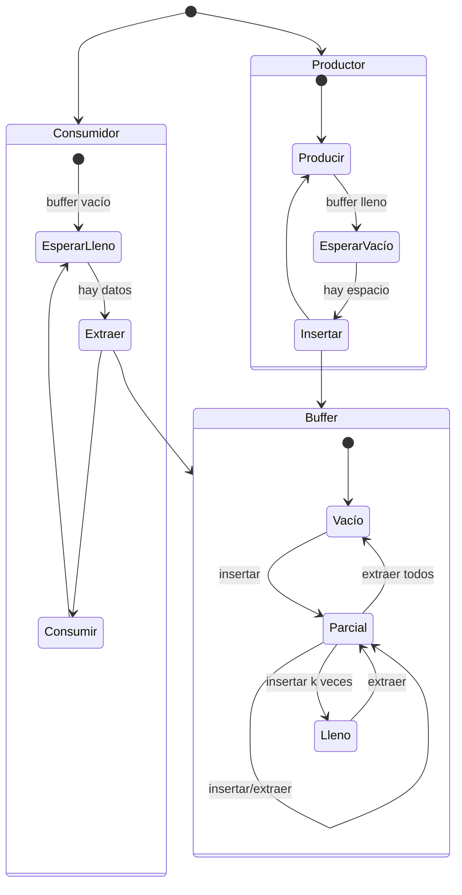
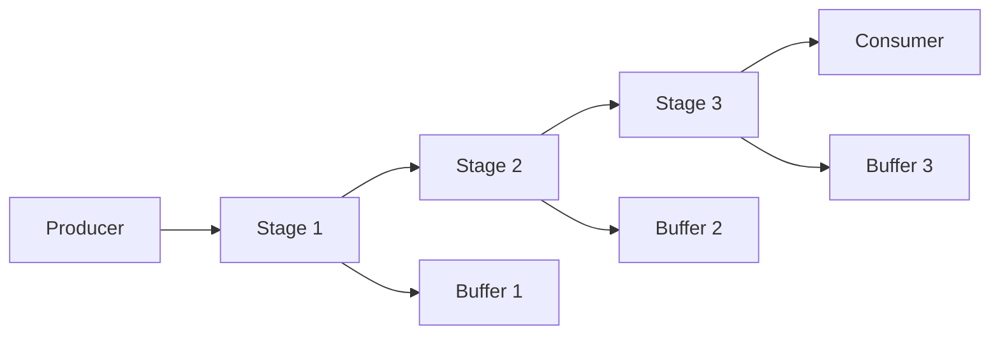
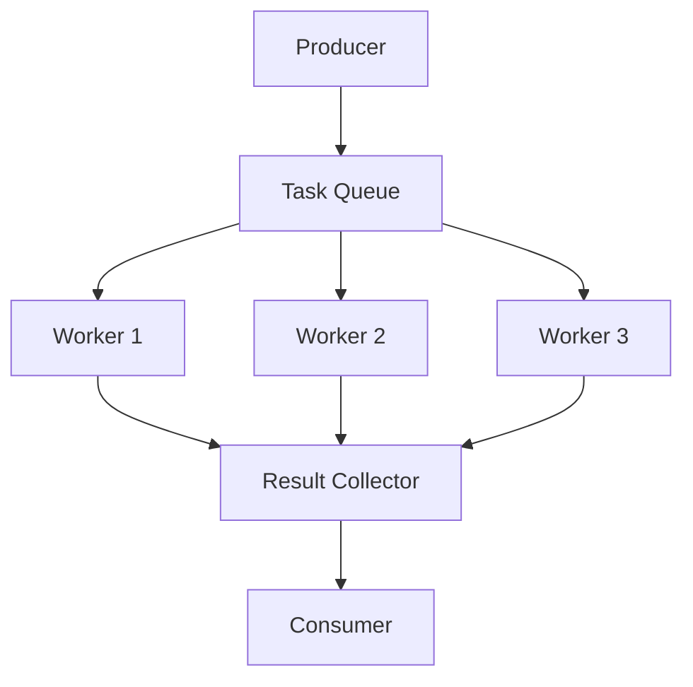

# Computación Concurrente - Problemas clásicos de sincronización

## 5.1 Productor y consumidor.

---

El problema del productor-consumidor es un paradigma clásico de sincronización donde dos tipos de procesos (productores y consumidores) comparten un buffer de tamaño limitado. Los productores generan datos y los colocan en el buffer, mientras que los consumidores retiran estos datos para procesarlos.

### Definición Formal

#### Elementos del Problema

Sean:

- $P = \\{P_1, P_2, ..., P_m\\}$ el conjunto de procesos productores
- $C = \\{C_1, C_2, ..., C_n\\}$ el conjunto de procesos consumidores
- $B$ un buffer de tamaño finito $k$
- $count$ el número actual de elementos en el buffer

#### Condiciones de Sincronización

1. **Exclusión mutua**: Solo un proceso puede acceder al buffer a la vez
2. **Sincronización por condición**:
   - Productor espera si $count = k$ (buffer lleno)
   - Consumidor espera si $count = 0$ (buffer vacío)

### Solución con Semáforos

#### Estructura de Datos

```c
#define BUFFER_SIZE 10

typedef struct {
    int data[BUFFER_SIZE];
    int in;    // Índice para insertar
    int out;   // Índice para extraer
} buffer_t;

buffer_t buffer;
sem_t empty;    // Número de slots vacíos
sem_t full;     // Número de slots llenos
sem_t mutex;    // Exclusión mutua para el buffer
```

#### Inicialización

```c
void init() {
    buffer.in = 0;
    buffer.out = 0;
    sem_init(&empty, 0, BUFFER_SIZE);  // Inicialmente todos vacíos
    sem_init(&full, 0, 0);            // Inicialmente ninguno lleno
    sem_init(&mutex, 0, 1);           // Semáforo binario
}
```

#### Proceso Productor

```c
void producer(int item) {
    while(1) {
        // Producir item
        item = produce_item();

        sem_wait(&empty);    // Esperar slot vacío
        sem_wait(&mutex);    // Entrar a región crítica

        // Insertar item en buffer
        buffer.data[buffer.in] = item;
        buffer.in = (buffer.in + 1) % BUFFER_SIZE;

        sem_post(&mutex);    // Salir de región crítica
        sem_post(&full);     // Incrementar contador de llenos
    }
}
```

#### Proceso Consumidor

```c
void consumer() {
    int item;

    while(1) {
        sem_wait(&full);     // Esperar slot lleno
        sem_wait(&mutex);    // Entrar a región crítica

        // Extraer item del buffer
        item = buffer.data[buffer.out];
        buffer.out = (buffer.out + 1) % BUFFER_SIZE;

        sem_post(&mutex);    // Salir de región crítica
        sem_post(&empty);    // Incrementar contador de vacíos

        // Consumir item
        consume_item(item);
    }
}
```

### Diagrama de Estados



### Análisis Matemático

#### Variables de Estado

Sea:

- $E$: número de slots vacíos
- $F$: número de slots llenos
- $k$: tamaño total del buffer

Se cumple que:

$$E + F = k$$

#### Invariantes

1. **Conservación de elementos**:

   $$ \text{items\_producidos} - \text{items\_consumidos} = F $$

2. **Índices del buffer**:

   $$0 \leq \text{buffer.in} < k$$

   $$0 \leq \text{buffer.out} < k$$

#### Condición de Seguridad

El sistema es seguro si:

$$\forall t, 0 \leq F(t) \leq k$$

### Solución con Monitores

#### Implementación en Java

```java
class Buffer {
    private final int[] data;
    private int count = 0;
    private int in = 0;
    private int out = 0;
    private final int size;

    public Buffer(int size) {
        this.size = size;
        this.data = new int[size];
    }

    public synchronized void produce(int item) throws InterruptedException {
        while (count == size) {
            wait();  // Buffer lleno
        }

        data[in] = item;
        in = (in + 1) % size;
        count++;

        notifyAll();  // Despertar consumidores
    }

    public synchronized int consume() throws InterruptedException {
        while (count == 0) {
            wait();  // Buffer vacío
        }

        int item = data[out];
        out = (out + 1) % size;
        count--;

        notifyAll();  // Despertar productores
        return item;
    }
}
```

### Ejemplo Práctico

#### Sistema de Logs Concurrente

```python
import threading
import time
import queue

class LogSystem:
    def __init__(self, buffer_size=5):
        self.buffer = queue.Queue(buffer_size)
        self.running = True

    def log_producer(self, producer_id):
        message_count = 0
        while self.running:
            message = f"Producer {producer_id} - Message {message_count}"
            try:
                self.buffer.put(message, timeout=1)
                print(f"Produced: {message}")
                message_count += 1
                time.sleep(0.5)
            except queue.Full:
                print(f"Producer {producer_id} waiting - buffer full")

    def log_consumer(self, consumer_id):
        while self.running:
            try:
                message = self.buffer.get(timeout=1)
                print(f"Consumer {consumer_id} processed: {message}")
                time.sleep(0.8)
            except queue.Empty:
                print(f"Consumer {consumer_id} waiting - buffer empty")

# Ejecución del ejemplo
def run_example():
    system = LogSystem()

    # Crear productores y consumidores
    producers = [threading.Thread(target=system.log_producer, args=(i,))
                 for i in range(2)]
    consumers = [threading.Thread(target=system.log_consumer, args=(i,))
                 for i in range(2)]

    # Iniciar todos los threads
    for p in producers: p.start()
    for c in consumers: c.start()

    # Ejecutar por 5 segundos
    time.sleep(5)
    system.running = False

    # Esperar a que terminen
    for p in producers: p.join()
    for c in consumers: c.join()

if __name__ == "__main__":
    run_example()
```

### Ejercicios Propuestos

#### Ejercicio 1: Análisis de Correctitud

Dado el siguiente código con error:

```c
// CÓDIGO CON ERROR - NO USAR
void producer_bad(int item) {
    sem_wait(&mutex);
    sem_wait(&empty);
    // Insertar item...
    sem_post(&full);
    sem_post(&mutex);
}

void consumer_bad() {
    sem_wait(&mutex);
    sem_wait(&full);
    // Extraer item...
    sem_post(&empty);
    sem_post(&mutex);
}
```

**Preguntas**:

1. Identifique el problema de interbloqueo (deadlock)
2. Explique bajo qué condiciones ocurre el deadlock
3. Proponga una corrección

#### Ejercicio 2: Buffer Múltiple

Extienda la solución para manejar múltiples tipos de datos en buffers separados:

```c
#define NUM_BUFFERS 3
#define BUFFER_SIZE 5

struct multi_buffer {
    int data[NUM_BUFFERS][BUFFER_SIZE];
    int in[NUM_BUFFERS];
    int out[NUM_BUFFERS];
    sem_t empty[NUM_BUFFERS];
    sem_t full[NUM_BUFFERS];
    sem_t mutex[NUM_BUFFERS];
};
```

**Requisitos**:

- Cada buffer debe manejarse independientemente
- Un productor puede elegir en qué buffer insertar
- Un consumidor puede elegir de qué buffer consumir

#### Ejercicio 3: Análisis de Rendimiento

Para un sistema con:

- $m$ productores
- $n$ consumidores
- Buffer de tamaño $k$
- Tiempo de producción: $t_p$
- Tiempo de consumo: $t_c$

Calcule:

1. El throughput máximo del sistema
2. La utilización promedio del buffer
3. El tiempo promedio de espera

### Patrones de Diseño Relacionados

#### Pipeline Pattern



#### Worker Pool Pattern



### Consideraciones de Implementación

#### En Sistemas Distribuidos

```java
// Patrón para sistemas distribuidos
public interface DistributedBuffer<T> {
    CompletableFuture<Void> produce(T item);
    CompletableFuture<T> consume();
    int availableCapacity();
    int size();
}
```

#### Optimizaciones

1. **Buffer circular con doble verificación**:

   ```c
   // Optimización: double-check para reducir contención
   if (likely(count < size)) {
       lock(mutex);
       if (count < size) {
           // Insertar
       }
       unlock(mutex);
   }
   ```

2. **Batching para mejorar throughput**:
   ```c
   // Procesamiento por lotes
   void produce_batch(int items[], int batch_size) {
       sem_wait(&empty, batch_size);  // Esperar múltiples slots
       lock(mutex);
       // Insertar lote
       unlock(mutex);
       sem_post(&full, batch_size);
   }
   ```

### Referencias

#### Bibliografía Básica

1. **Taubenfeld, G. (2006)**. _Synchronization Algorithms and Concurrent Programming_
   - Capítulo 4: "The Producer-Consumer Problem"
   - Sección 4.2: "Solutions Using Semaphores"

2. **Herlihy, M. & Shavit, N. (2008)**. _The Art of Multiprocessor Programming_
   - Capítulo 3: "Concurrent Objects"
   - Sección 3.4: "The Producer-Consumer Pattern"

#### Bibliografía Complementaria

3. **Lamport, L. (2002)**. _Specifying Systems: The TLA+ Language and Tools_
   - Capítulo 6: "Specifying Concurrent Systems"
   - Especificación formal del problema productor-consumidor

#### Recursos Adicionales

4. **Andrews, G. R. (2000)**. _Foundations of Multithreaded, Parallel, and Distributed Programming_
   - Capítulo 4: "Shared Objects and Mutual Exclusion"

5. **Java Documentation**: `java.util.concurrent.BlockingQueue`
   - Implementación real del patrón en Java

### Evaluación del Aprendizaje

#### Preguntas de Comprensión

1. ¿Por qué el orden de los semáforos en las operaciones wait() es crítico?
2. ¿Cómo se evita la condición de carrera en el acceso al buffer?
3. ¿Qué sucede si se usa notify() en lugar de notifyAll() en la solución con monitores?
4. ¿Cómo se extiende el problema para múltiples productores y consumidores?

#### Problemas para Resolver

1. Implemente una solución usando condition variables de pthreads
2. Diseñe un sistema donde los productores tengan diferentes prioridades
3. Analice el impacto del tamaño del buffer en el rendimiento del sistema
4. Proponga una solución que minimice el uso de locks
