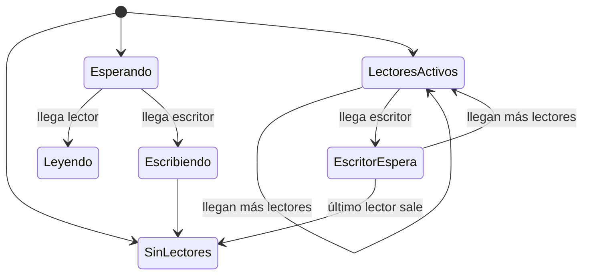
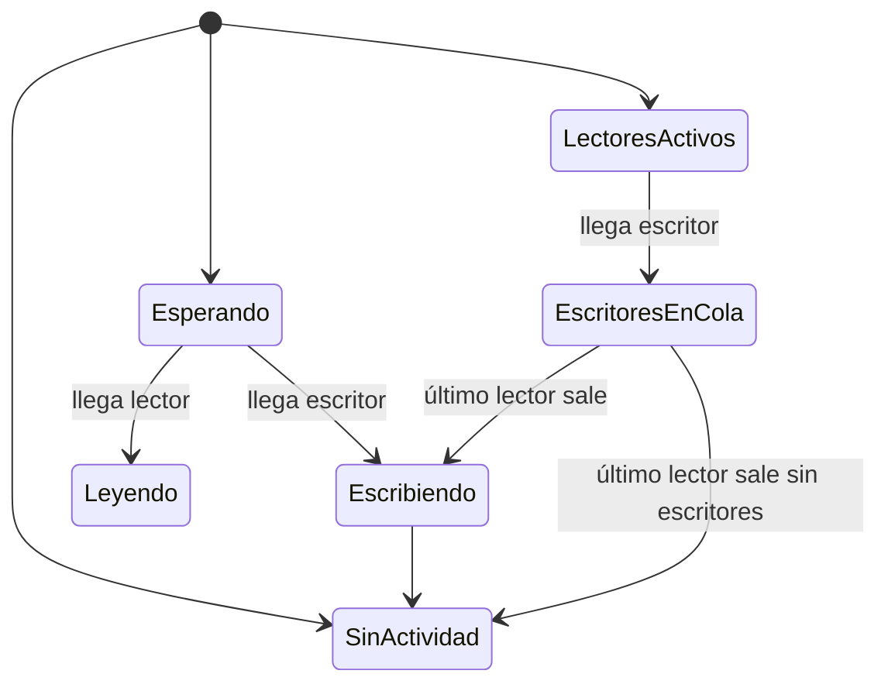

# Computación Concurrente - Problemas clásicos de sincronización

## 5.2 Lectores y escritores.

---

El problema de los lectores-escritores es un paradigma de sincronización donde múltiples procesos acceden a una estructura de datos compartida. Los lectores solo leen los datos, mientras que los escritores pueden tanto leer como modificar los datos.

### Definición Formal

#### Elementos del Problema

Sean:

- $R = \\{R_1, R_2, ..., R_m\\}$ el conjunto de procesos lectores
- $W = \\{W_1, W_2, ..., W_n\\}$ el conjunto de procesos escritores
- $D$ la estructura de datos compartida

#### Condiciones de Sincronización

1. **Múltiples lectores** pueden acceder concurrentemente a $D$
2. **Solo un escritor** puede acceder a $D$ cada vez
3. **Exclusión mutua** entre lectores y escritores
4. **Prioridades**: define el orden de acceso cuando hay conflicto

### Modelos de Prioridad

#### Primera Forma: Lectores Tienen Prioridad



#### Segunda Forma: Escritores Tienen Prioridad



### Solución con Semáforos (Primera Forma)

#### Estructura de Datos

```c
#include <semaphore.h>

sem_t mutex;        // Protege read_count
sem_t wrt;          // Controla acceso de escritores
int read_count = 0; // Número de lectores activos
```

#### Inicialización

```c
void init() {
    sem_init(&mutex, 0, 1);
    sem_init(&wrt, 0, 1);
    read_count = 0;
}
```

#### Proceso Lector

```c
void reader(int id) {
    while(1) {
        // Sección de entrada
        sem_wait(&mutex);
        read_count++;
        if (read_count == 1) {
            sem_wait(&wrt);  // Primer lector bloquea escritores
        }
        sem_post(&mutex);

        // Sección crítica - LEER DATOS
        printf("Lector %d leyendo datos\n", id);
        read_data();

        // Sección de salida
        sem_wait(&mutex);
        read_count--;
        if (read_count == 0) {
            sem_post(&wrt);  // Último lector libera escritores
        }
        sem_post(&mutex);

        // Sección restante
        process_data();
    }
}
```

#### Proceso Escritor

```c
void writer(int id) {
    while(1) {
        // Preparar datos
        prepare_data();

        // Sección de entrada
        sem_wait(&wrt);  // Exclusión mutua con otros escritores y lectores

        // Sección crítica - ESCRIBIR DATOS
        printf("Escritor %d escribiendo datos\n", id);
        write_data();

        // Sección de salida
        sem_post(&wrt);

        // Sección restante
        other_work();
    }
}
```

### Análisis Matemático

#### Variables de Estado

Sea:

- $r$: número de lectores activos
- $w$: número de escritores activos (0 o 1)
- $r_q$: lectores en espera
- $w_q$: escritores en espera

#### Invariantes

Para la primera forma:

$$(r > 0 \implies w = 0) \land (w = 1 \implies r = 0)$$

#### Throughput del Sistema

El throughput depende de las tasas:

- $\lambda_r$: tasa de llegada de lectores
- $\lambda_w$: tasa de llegada de escritores
- $\mu_r$: tasa de servicio de lectores
- $\mu_w$: tasa de servicio de escritores

### Solución con Monitores

#### Implementación en Java

```java
class Database {
    private int readerCount = 0;
    private boolean writing = false;
    private int waitingWriters = 0;
    private int waitingReaders = 0;
    private final Object condition = new Object();

    // Primera forma: lectores tienen prioridad
    public void startRead() throws InterruptedException {
        synchronized(condition) {
            while (writing || waitingWriters > 0) {
                condition.wait();
            }
            readerCount++;
        }
    }

    public void endRead() {
        synchronized(condition) {
            readerCount--;
            if (readerCount == 0) {
                condition.notifyAll();
            }
        }
    }

    public void startWrite() throws InterruptedException {
        synchronized(condition) {
            waitingWriters++;
            while (readerCount > 0 || writing) {
                condition.wait();
            }
            waitingWriters--;
            writing = true;
        }
    }

    public void endWrite() {
        synchronized(condition) {
            writing = false;
            condition.notifyAll();
        }
    }
}
```

### Segunda Forma: Escritores Tienen Prioridad

#### Implementación con Semáforos

```c
sem_t mutex;           // Protege variables compartidas
sem_t readTry;         // Controla intento de lectura
sem_t resource;        // Controla acceso al recurso
int readCount = 0;     // Lectores activos
int writeCount = 0;    // Escritores activos

void reader_priority2(int id) {
    sem_wait(&readTry);    // Indica intento de lectura
    sem_wait(&mutex);
    readCount++;
    if (readCount == 1) {
        sem_wait(&resource);
    }
    sem_post(&mutex);
    sem_post(&readTry);

    // LEER DATOS
    read_data();

    sem_wait(&mutex);
    readCount--;
    if (readCount == 0) {
        sem_post(&resource);
    }
    sem_post(&mutex);
}

void writer_priority2(int id) {
    sem_wait(&mutex);
    writeCount++;
    if (writeCount == 1) {
        sem_wait(&readTry);  // Bloquea nuevos lectores
    }
    sem_post(&mutex);

    sem_wait(&resource);
    // ESCRIBIR DATOS
    write_data();
    sem_post(&resource);

    sem_wait(&mutex);
    writeCount--;
    if (writeCount == 0) {
        sem_post(&readTry);  // Permite nuevos lectores
    }
    sem_post(&mutex);
}
```

### Ejemplo Práctico: Sistema de Base de Datos

```python
import threading
import time
import random

class DatabaseSystem:
    def __init__(self):
        self.reader_count = 0
        self.writer_active = False
        self.mutex = threading.Semaphore(1)
        self.db = threading.Semaphore(1)
        self.data = "Valor inicial"

    def reader(self, reader_id):
        for i in range(3):
            # Entrada
            self.mutex.acquire()
            self.reader_count += 1
            if self.reader_count == 1:
                self.db.acquire()  # Primer lector bloquea escritores
            self.mutex.release()

            # Sección crítica - Lectura
            print(f"Lector {reader_id} leyó: {self.data}")
            time.sleep(random.uniform(0.1, 0.3))

            # Salida
            self.mutex.acquire()
            self.reader_count -= 1
            if self.reader_count == 0:
                self.db.release()  # Último lector libera escritores
            self.mutex.release()

            time.sleep(random.uniform(0.5, 1.0))

    def writer(self, writer_id):
        for i in range(2):
            # Preparación
            new_value = f"Nuevo valor de escritor {writer_id}-{i}"

            # Entrada
            self.db.acquire()
            self.writer_active = True

            # Sección crítica - Escritura
            print(f"Escritor {writer_id} escribiendo...")
            time.sleep(random.uniform(0.2, 0.5))
            self.data = new_value
            print(f"Escritor {writer_id} escribió: {self.data}")

            # Salida
            self.writer_active = False
            self.db.release()

            time.sleep(random.uniform(0.8, 1.5))

# Ejecución del ejemplo
def run_database_example():
    db_system = DatabaseSystem()

    readers = [threading.Thread(target=db_system.reader, args=(i,))
               for i in range(4)]
    writers = [threading.Thread(target=db_system.writer, args=(i,))
               for i in range(2)]

    for thread in writers + readers:
        thread.start()

    for thread in writers + readers:
        thread.join()

if __name__ == "__main__":
    run_database_example()
```

### Problema de Inanición (Starvation)

#### Análisis del Problema

En la primera forma:

- **Escritores pueden sufrir inanición** si hay flujo continuo de lectores

En la segunda forma:

- **Lectores pueden sufrir inanición** si hay flujo continuo de escritores

#### Solución Justa

```java
class FairDatabase {
    private int readerCount = 0;
    private int writerCount = 0;
    private int waitCount = 0;
    private boolean writePending = false;

    public synchronized void startRead() throws InterruptedException {
        waitCount++;
        while (writerCount > 0 || writePending) {
            wait();
        }
        waitCount--;
        readerCount++;
    }

    public synchronized void endRead() {
        readerCount--;
        writePending = (waitCount > 0);
        notifyAll();
    }

    public synchronized void startWrite() throws InterruptedException {
        waitCount++;
        writePending = true;
        while (readerCount > 0 || writerCount > 0) {
            wait();
        }
        waitCount--;
        writePending = false;
        writerCount++;
    }

    public synchronized void endWrite() {
        writerCount--;
        notifyAll();
    }
}
```

### Ejercicios Propuestos

#### Ejercicio 1: Análisis de Correctitud

Dado el siguiente código con error:

```c
// CÓDIGO CON ERROR - NO USAR
void reader_bad(int id) {
    sem_wait(&mutex);
    read_count++;
    if (read_count == 1) {
        sem_wait(&wrt);
    }
    // LEER DATOS
    sem_wait(&mutex);
    read_count--;
    if (read_count == 0) {
        sem_post(&wrt);
    }
    sem_post(&mutex);
}
```

**Preguntas**:

1. Identifique los dos errores principales
2. Explique qué condiciones de carrera pueden ocurrir
3. Proponga la corrección completa

#### Ejercicio 2: Sistema con Límite de Lectores

Modifique la solución para limitar el número máximo de lectores concurrentes a $L_{max}$:

**Requisitos**:

- No más de $L_{max}$ lectores simultáneos
- Mantener justicia entre lectores y escritores
- Evitar inanición

```c
#define MAX_READERS 3
// Complete la implementación...
```

#### Ejercicio 3: Estadísticas de Uso

Implemente un sistema que recolecte estadísticas:

```c
struct statistics {
    long total_reads;
    long total_writes;
    long reader_wait_time;
    long writer_wait_time;
    int max_concurrent_readers;
};
```

**Métricas a calcular**:

1. Throughput de lecturas/escrituras por segundo
2. Tiempo promedio de espera
3. Utilización del recurso
4. Número máximo de lectores concurrentes

### Patrones Avanzados

#### Reader-Writer Locks

```java
public class ReadWriteLock {
    private int readers = 0;
    private int writers = 0;
    private int writeRequests = 0;

    public synchronized void lockRead() throws InterruptedException {
        while (writers > 0 || writeRequests > 0) {
            wait();
        }
        readers++;
    }

    public synchronized void unlockRead() {
        readers--;
        notifyAll();
    }

    public synchronized void lockWrite() throws InterruptedException {
        writeRequests++;
        while (readers > 0 || writers > 0) {
            wait();
        }
        writeRequests--;
        writers++;
    }

    public synchronized void unlockWrite() {
        writers--;
        notifyAll();
    }
}
```

#### Implementación con StampedLock (Java 8+)

```java
import java.util.concurrent.locks.StampedLock;

class OptimisticReadingExample {
    private final StampedLock lock = new StampedLock();
    private String data = "Datos compartidos";

    public String read() {
        // Intento de lectura optimista
        long stamp = lock.tryOptimisticRead();
        String currentData = this.data;

        if (!lock.validate(stamp)) {
            // Falló lectura optimista, adquirir lock compartido
            stamp = lock.readLock();
            try {
                currentData = this.data;
            } finally {
                lock.unlockRead(stamp);
            }
        }
        return currentData;
    }

    public void write(String newData) {
        long stamp = lock.writeLock();
        try {
            this.data = newData;
        } finally {
            lock.unlockWrite(stamp);
        }
    }
}
```

### Análisis de Rendimiento

#### Modelo Teórico

Sea:

- $T_r$: tiempo de lectura
- $T_w$: tiempo de escritura
- $\lambda_r$, $\lambda_w$: tasas de llegada
- $N_r$, $N_w$: número máximo de procesos

El throughput teórico es:

$$\text{Throughput} = \frac{\lambda_r \cdot T_r + \lambda_w \cdot T_w}{1 + \text{overhead}}$$

#### Factores que Afectan el Rendimiento

1. **Contención por locks**
2. **Tamaño de la sección crítica**
3. **Patrón de acceso** (lectura vs escritura)
4. **Número de cores/procesadores**

### Referencias

#### Bibliografía Básica

1. **Taubenfeld, G. (2006)**. _Synchronization Algorithms and Concurrent Programming_
   - Capítulo 5: "Reader-Writer Synchronization"
   - Sección 5.2: "The Readers-Writers Problem"
   - Sección 5.3: "Solutions with Different Priorities"

2. **Herlihy, M. & Shavit, N. (2008)**. _The Art of Multiprocessor Programming_
   - Capítulo 8: "Monitors and Blocking Synchronization"
   - Sección 8.3: "Reader-Writer Locks"

#### Bibliografía Complementaria

3. **Lamport, L. (2002)**. _Specifying Systems: The TLA+ Language and Tools_
   - Especificación formal del problema lectores-escritores
   - Verificación de propiedades de seguridad y vivacidad

#### Recursos Adicionales

4. **Andrews, G. R. (2000)**. _Foundations of Multithreaded, Parallel, and Distributed Programming_
   - Capítulo 3: "Synchronization for Shared Variables"

5. **Java Documentation**: `java.util.concurrent.locks.ReadWriteLock`
   - Implementación del patrón en Java estándar

### Evaluación del Aprendizaje

#### Preguntas de Comprensión

1. ¿Por qué la primera forma puede causar inanición de escritores?
2. ¿Cómo garantiza la segunda forma la prioridad de escritores?
3. ¿Qué ventajas tiene usar monitores sobre semáforos?
4. ¿Cómo se puede medir la justicia en un sistema lectores-escritores?

#### Problemas para Resolver

1. Implemente una solución que evite inanición completamente
2. Diseñe un sistema con múltiples recursos compartidos
3. Analice el impacto del tiempo de sección crítica en el rendimiento
4. Proponga una solución para sistemas de tiempo real con deadlines
