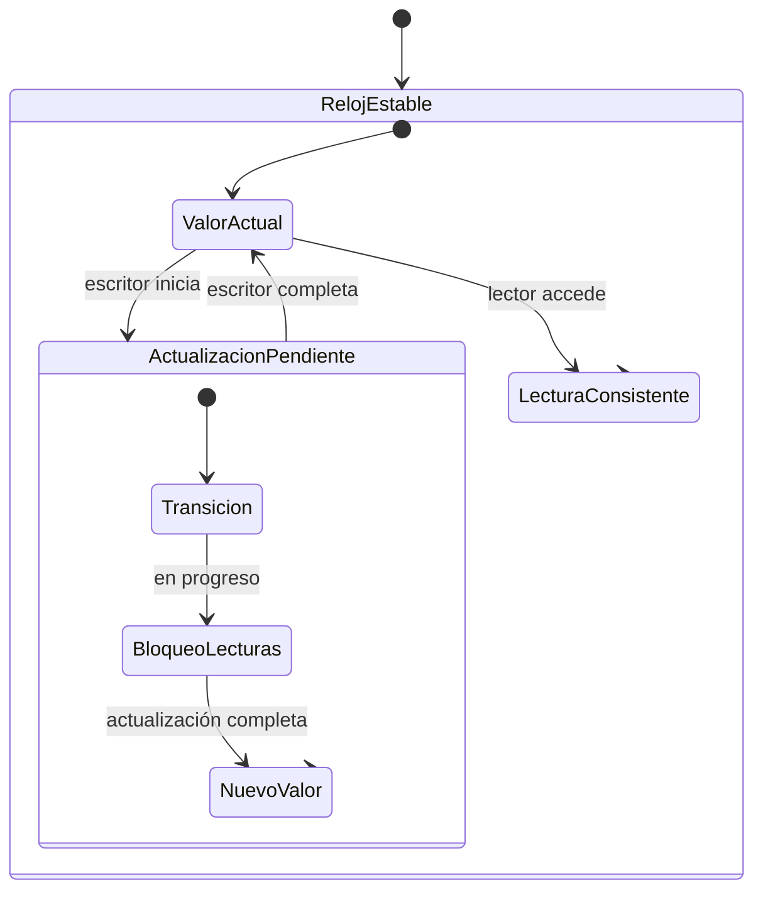
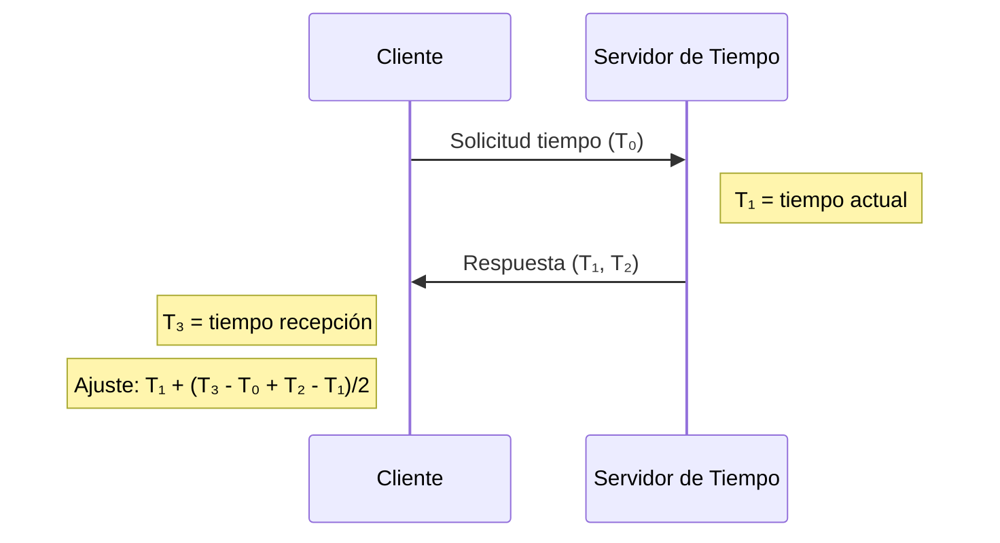

# Computación Concurrente - Problemas clásicos de sincronización

## 5.3 Escritura y lectura de relojes.

---

El problema de escritura y lectura de relojes se refiere a la sincronización de múltiples procesos que acceden concurrentemente a un reloj compartido, donde los lectores deben obtener una visión consistente del tiempo a pesar de las actualizaciones concurrentes.

### Definición Formal

#### Elementos del Problema

Sean:

- $W = \\{W_1, W_2, ..., W_m\\}$ el conjunto de procesos escritores (actualizan el reloj)
- $R = \\{R_1, R_2, ..., R_n\\}$ el conjunto de procesos lectores (consultan el reloj)
- $C$ el reloj compartido con valor $t$
- $\Delta$ la granularidad temporal mínima

#### Condiciones de Sincronización

1. **Consistencia**: Los lectores deben obtener valores de tiempo que sean lógicamente consistentes
2. **Monotonicidad**: El tiempo debe avanzar de forma monótona
3. **Precisión acotada**: La diferencia entre relojes debe estar acotada

### Modelo de Reloj Lógico de Lamport

#### Definición Matemática

El reloj lógico de Lamport define una relación de orden "ocurrió antes que" $(\rightarrow)$:

- **LC1**: Cada proceso $P_i$ incrementa $C_i$ entre eventos sucesivos
- **LC2**:
  - Si $a$ es envío de mensaje por $P_i$ y $b$ es recepción por $P_j$
  - Entonces $C_j(b) = \max(C_j(b), C_i(a)) + 1$

#### Implementación Básica

```c
#include <stdatomic.h>

typedef struct {
    atomic_long counter;
} lamport_clock_t;

void lamport_init(lamport_clock_t *clock) {
    atomic_store(&clock->counter, 0);
}

long lamport_read(lamport_clock_t *clock) {
    return atomic_load(&clock->counter);
}

void lamport_tick(lamport_clock_t *clock) {
    atomic_fetch_add(&clock->counter, 1);
}

void lamport_sync(lamport_clock_t *clock, long received_time) {
    long current;
    do {
        current = atomic_load(&clock->counter);
        if (received_time <= current) break;
    } while (!atomic_compare_exchange_weak(&clock->counter, &current,
                                           received_time + 1));
}
```

### Problema del Reloj Multilector-Multiescritor

#### Diagrama de Estados



#### Solución con Semáforos

```c
#define MAX_READERS 10

typedef struct {
    long timestamp;
    sem_t mutex;
    sem_t write_mutex;
    int reader_count;
    atomic_int writing;
} concurrent_clock_t;

void clock_init(concurrent_clock_t *clock) {
    clock->timestamp = 0;
    sem_init(&clock->mutex, 0, 1);
    sem_init(&clock->write_mutex, 0, 1);
    clock->reader_count = 0;
    atomic_store(&clock->writing, 0);
}

long clock_read(concurrent_clock_t *clock) {
    long value;

    // Protección para lectura consistente
    sem_wait(&clock->mutex);
    clock->reader_count++;
    if (clock->reader_count == 1) {
        sem_wait(&clock->write_mutex);
    }
    sem_post(&clock->mutex);

    // Sección crítica de lectura
    value = clock->timestamp;

    // Liberación
    sem_wait(&clock->mutex);
    clock->reader_count--;
    if (clock->reader_count == 0) {
        sem_post(&clock->write_mutex);
    }
    sem_post(&clock->mutex);

    return value;
}

void clock_write(concurrent_clock_t *clock, long new_value) {
    // Exclusión mutua para escritura
    sem_wait(&clock->write_mutex);
    atomic_store(&clock->writing, 1);

    // Sección crítica de escritura
    if (new_value > clock->timestamp) {
        clock->timestamp = new_value;
    }

    atomic_store(&clock->writing, 0);
    sem_post(&clock->write_mutex);
}
```

### Relojes Vectoriales

#### Definición Matemática

Para $n$ procesos, el reloj vectorial $V$ es un vector de $n$ enteros:

$$V = [v_1, v_2, ..., v_n]$$

**Reglas de actualización**:

- **VC1**: $P_i$ incrementa $v_i$ antes de cada evento
- **VC2**: Al enviar mensaje, $P_i$ envía $V$
- **VC3**: Al recibir mensaje con $V_m$, $P_j$ hace:

  $$V_j[k] = \max(V_j[k], V_m[k]) \quad \forall k$$

  $$V_j[j] = V_j[j] + 1$$

#### Implementación

```java
public class VectorClock {
    private final int[] clock;
    private final int processId;
    private final Object lock = new Object();

    public VectorClock(int numProcesses, int processId) {
        this.clock = new int[numProcesses];
        this.processId = processId;
    }

    public void tick() {
        synchronized(lock) {
            clock[processId]++;
        }
    }

    public int[] read() {
        synchronized(lock) {
            return clock.clone();
        }
    }

    public void update(int[] receivedClock) {
        synchronized(lock) {
            for (int i = 0; i < clock.length; i++) {
                clock[i] = Math.max(clock[i], receivedClock[i]);
            }
            clock[processId]++;
        }
    }

    public boolean happenedBefore(int[] otherClock) {
        synchronized(lock) {
            boolean allLessOrEqual = true;
            boolean atLeastOneLess = false;

            for (int i = 0; i < clock.length; i++) {
                if (clock[i] > otherClock[i]) {
                    allLessOrEqual = false;
                    break;
                }
                if (clock[i] < otherClock[i]) {
                    atLeastOneLess = true;
                }
            }

            return allLessOrEqual && atLeastOneLess;
        }
    }
}
```

### Algoritmo de Cristian para Sincronización

#### Fórmula de Ajuste

$$T_{cliente} = T_{servidor} + \frac{(T_1 - T_0) + (T_2 - T_1)}{2}$$

Donde:

- $T_0$: tiempo de envío de solicitud
- $T_1$: tiempo de recepción en servidor
- $T_2$: tiempo de envío de respuesta
- $T_3$: tiempo de recepción de respuesta



#### Implementación

```python
import time
import threading
import random

class TimeServer:
    def __init__(self):
        self.clock = time.time()
        self.drift_rate = 1.0001  # Simula deriva del reloj
        self.lock = threading.Lock()

    def get_time(self):
        with self.lock:
            current = self.clock
            # Simular deriva
            self.clock += 0.001 * self.drift_rate
            return current

    def process_request(self, client_time):
        with self.lock:
            t1 = self.clock
            # Procesamiento simulado
            time.sleep(random.uniform(0.001, 0.005))
            t2 = self.clock
            self.clock += 0.001 * self.drift_rate
            return (t1, t2)

class Client:
    def __init__(self, server, client_id):
        self.server = server
        self.client_id = client_id
        self.clock = time.time()
        self.adjustment = 0

    def synchronize(self):
        t0 = time.time()

        # Simular latencia de red
        network_delay = random.uniform(0.005, 0.02)
        time.sleep(network_delay)

        t1, t2 = self.server.process_request(t0)

        t3 = time.time()

        # Calcular ajuste usando algoritmo de Cristian
        round_trip_time = t3 - t0
        server_processing_time = t2 - t1
        estimated_one_way = (round_trip_time - server_processing_time) / 2

        adjusted_time = t1 + estimated_one_way
        self.adjustment = adjusted_time - self.clock

        print(f"Cliente {self.client_id}: Ajuste = {self.adjustment:.6f}s")
        return self.adjustment
```

### Relojes con Marca de Tiempo Atómica

#### Usando operaciones atómicas

```c
#include <stdatomic.h>
#include <stdint.h>

typedef struct {
    _Atomic uint64_t timestamp;
} atomic_clock_t;

void atomic_clock_init(atomic_clock_t *clock) {
    atomic_store(&clock->timestamp, 0);
}

uint64_t atomic_clock_read(atomic_clock_t *clock) {
    return atomic_load(&clock->timestamp);
}

uint64_t atomic_clock_increment(atomic_clock_t *clock) {
    return atomic_fetch_add(&clock->timestamp, 1);
}

uint64_t atomic_clock_update(atomic_clock_t *clock, uint64_t new_value) {
    uint64_t current;
    do {
        current = atomic_load(&clock->timestamp);
        if (new_value <= current) {
            return current;
        }
    } while (!atomic_compare_exchange_weak(&clock->timestamp, &current, new_value));
    return new_value;
}
```

### Ejemplo Práctico: Sistema de Subastas con Relojes

```java
public class AuctionSystem {
    private final VectorClock clock;
    private final Map<String, Bid> bids = new ConcurrentHashMap<>();
    private final int nodeId;

    public AuctionSystem(int numNodes, int nodeId) {
        this.clock = new VectorClock(numNodes, nodeId);
        this.nodeId = nodeId;
    }

    public synchronized void placeBid(String item, double amount, int[] clientClock) {
        // Actualizar reloj vectorial
        clock.update(clientClock);
        clock.tick();

        Bid newBid = new Bid(item, amount, clock.read(), nodeId);

        // Verificar concurrencia
        Bid currentBid = bids.get(item);
        if (currentBid == null ||
            compareTimestamps(newBid.getTimestamp(), currentBid.getTimestamp()) > 0 ||
            (compareTimestamps(newBid.getTimestamp(), currentBid.getTimestamp()) == 0 &&
             newBid.getAmount() > currentBid.getAmount())) {
            bids.put(item, newBid);
            System.out.println("Nueva puja aceptada: " + item + " - $" + amount);
        }
    }

    private int compareTimestamps(int[] ts1, int[] ts2) {
        // Comparar relojes vectoriales
        boolean ts1Greater = false, ts2Greater = false;

        for (int i = 0; i < ts1.length; i++) {
            if (ts1[i] > ts2[i]) ts1Greater = true;
            if (ts1[i] < ts2[i]) ts2Greater = true;
        }

        if (ts1Greater && !ts2Greater) return 1;
        if (!ts1Greater && ts2Greater) return -1;
        return 0; // Concurrentes
    }

    public static class Bid {
        private final String item;
        private final double amount;
        private final int[] timestamp;
        private final int nodeId;

        public Bid(String item, double amount, int[] timestamp, int nodeId) {
            this.item = item;
            this.amount = amount;
            this.timestamp = timestamp.clone();
            this.nodeId = nodeId;
        }

        public int[] getTimestamp() { return timestamp.clone(); }
        public double getAmount() { return amount; }
    }
}
```

### Ejercicios Propuestos

#### Ejercicio 1: Análisis de Consistencia

Dado el siguiente historial de eventos:

```
Proceso A: W(x), R(y), W(z)
Proceso B: R(x), W(y), R(z)
Proceso C: W(y), R(x), W(x)
```

**Preguntas**:

1. Construya los relojes vectoriales para cada evento
2. Identifique qué eventos son concurrentes
3. Determine si existe una relación "ocurrió antes que" entre W(x) en A y R(x) en B

#### Ejercicio 2: Implementación de Reloj Híbrido

Implemente un reloj híbrido que combine:

- Timestamp físico para orden total
- Contador lógico para orden entre eventos simultáneos

```java
public class HybridClock {
    private long physicalTime;
    private long logicalCounter;

    public synchronized HybridTimestamp now() {
        long currentPhysical = System.currentTimeMillis();
        if (currentPhysical > physicalTime) {
            physicalTime = currentPhysical;
            logicalCounter = 0;
        } else {
            logicalCounter++;
        }
        return new HybridTimestamp(physicalTime, logicalCounter);
    }

    public synchronized void update(HybridTimestamp other) {
        long currentPhysical = System.currentTimeMillis();
        // Complete la implementación...
    }
}
```

#### Ejercicio 3: Sistema de Chat Distribuido

Diseñe un sistema de chat que use relojes vectoriales para:

- Ordenar mensajes correctamente
- Detectar mensajes perdidos
- Resolver conflictos en mensajes concurrentes

**Requisitos**:

- Cada usuario tiene su propio reloj vectorial
- Los mensajes deben mostrarse en orden causal
- Indicar cuando los mensajes son concurrentes

### Algoritmo de Berkeley para Sincronización

#### Fórmula de Promedio

$$\Delta_i = T_{master} - T_i$$

$$\Delta_{avg} = \frac{\sum_{i=1}^n \Delta_i}{n}$$

$$T_{ajuste} = T_{actual} + \Delta_{avg}$$

#### Implementación

```python
class BerkeleyTimeSync:
    def __init__(self, num_nodes):
        self.num_nodes = num_nodes
        self.clocks = [time.time() for _ in range(num_nodes)]
        self.drifts = [1.0 for _ in range(num_nodes)]

    def synchronize(self, master_id=0):
        # Paso 1: Maestro consulta tiempos
        query_times = []
        for i in range(self.num_nodes):
            if i != master_id:
                # Simular consulta con latencia
                latency = random.uniform(0.001, 0.01)
                adjusted_time = self.clocks[i] + latency
                query_times.append((i, adjusted_time))

        # Paso 2: Calcular promedios y ajustes
        master_time = self.clocks[master_id]
        offsets = []

        for node_id, node_time in query_times:
            offset = master_time - node_time
            offsets.append(offset)

        # Incluir al maestro en el cálculo
        offsets.append(0)  # Offset del maestro consigo mismo

        average_offset = sum(offsets) / len(offsets)

        # Paso 3: Aplicar ajustes
        adjustments = []
        for i in range(self.num_nodes):
            if i == master_id:
                adjustment = average_offset
            else:
                # Encontrar el offset para este nodo
                node_offset = next((offset for node_id, offset in
                                  zip([id for id, _ in query_times], offsets)
                                  if node_id == i), 0)
                adjustment = average_offset - node_offset

            self.clocks[i] += adjustment
            adjustments.append(adjustment)

        return adjustments
```

### Referencias

#### Bibliografía Básica

1. **Taubenfeld, G. (2006)**. _Synchronization Algorithms and Concurrent Programming_
   - Capítulo 10: "Timestamps and Clocks"
   - Sección 10.2: "Logical Clocks"
   - Sección 10.3: "Vector Clocks"

2. **Herlihy, M. & Shavit, N. (2008)**. _The Art of Multiprocessor Programming_
   - Capítulo 3: "Concurrent Objects"
   - Sección 3.5: "Timestamps"

#### Bibliografía Complementaria

3. **Lamport, L. (2002)**. _Specifying Systems: The TLA+ Language and Tools_
   - Capítulo 6: "Specifying Concurrent Systems"
   - Especificación formal de relojes lógicos

4. **Lamport, L. (1978)**. "Time, Clocks, and the Ordering of Events in a Distributed System"
   - Paper fundamental que introduce relojes lógicos

#### Recursos Adicionales

5. **Cristian, F. (1989)**. "Probabilistic Clock Synchronization"
   - Algoritmo de sincronización de relojes

6. **Java Documentation**: `java.time` y `java.util.concurrent.atomic`
   - Implementaciones modernas de manejo de tiempo

### Evaluación del Aprendizaje

#### Preguntas de Comprensión

1. ¿Por qué los relojes vectoriales proporcionan más información que los relojes de Lamport?
2. ¿Cómo se manejan los eventos concurrentes en diferentes sistemas de relojes?
3. ¿Qué ventajas tiene el algoritmo de Cristian sobre NTP en entornos LAN?
4. ¿Cómo se previene la inversión temporal en sistemas con relojes lógicos?

#### Problemas para Resolver

1. Implemente un servicio de sincronización de tiempo tolerante a fallos
2. Diseñe un protocolo de consenso que use relojes vectoriales
3. Analice el overhead de comunicación en diferentes algoritmos de sincronización
4. Proponga un mecanismo para detectar y corregir deriva de reloj en largo plazo
