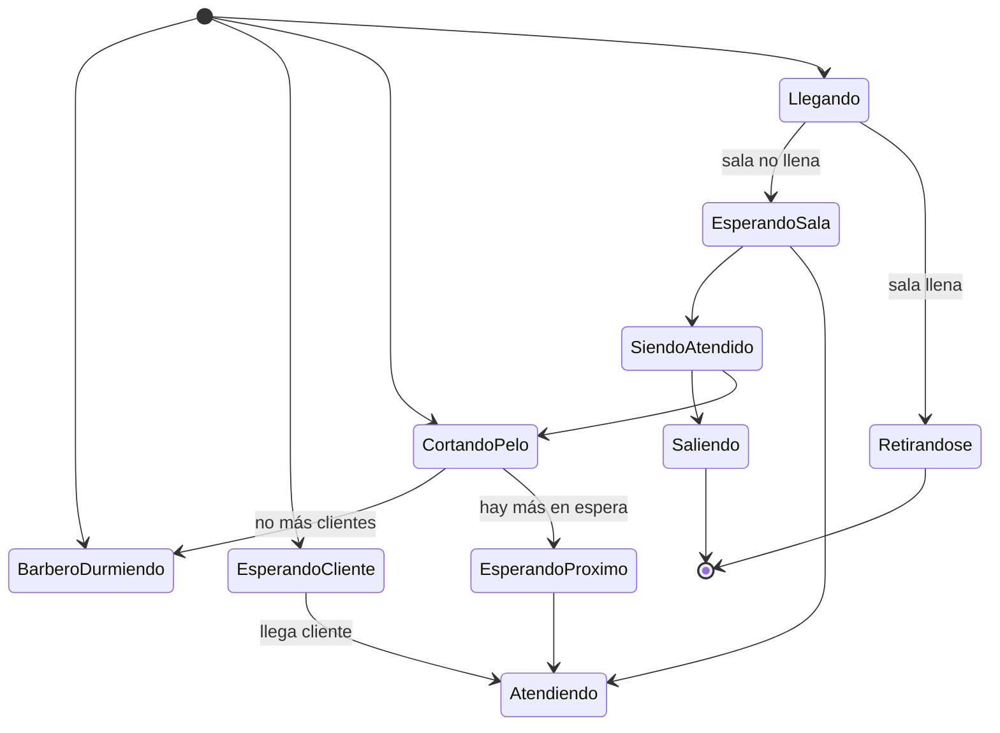

# Computación Concurrente - Problemas clásicos de sincronización

## 5.4 El barbero dormilón.

---

El problema del barbero dormilón es un problema clásico de sincronización que modela la coordinación entre un barbero y múltiples clientes. El barbero atiende a los clientes en una silla de barbería, mientras los clientes esperan en una sala de espera con capacidad limitada.

### Definición Formal

#### Elementos del Problema

Sean:

- $B$: el proceso barbero
- $C = \\{C_1, C_2, ..., C_n\\}$: el conjunto de procesos clientes
- $N$: número de sillas en la sala de espera
- $S$: silla de barbería (recurso compartido)

#### Condiciones de Sincronización

1. **Exclusión mutua**: Solo un cliente puede ser atendido a la vez
2. **Sincronización por condición**:
   - Si no hay clientes, el barbero duerme
   - Si la sala de espera está llena, los clientes se retiran
   - Los clientes despiertan al barbero si está dormido

### Modelo del Sistema

#### Diagrama de Estados



### Solución con Semáforos

#### Estructura de Datos

```c
#include <semaphore.h>
#include <pthread.h>

#define N 5  // Número de sillas en sala de espera

// Semáforos
sem_t customers;    // Número de clientes esperando (inicial 0)
sem_t barber;       // Barbero disponible (inicial 0)
sem_t mutex;        // Exclusión mutua para acceso a waiting
sem_t barber_chair; // Controla acceso a silla de barbería

// Variables compartidas
int waiting = 0;    // Número de clientes en sala de espera
int barber_sleeping = 1; // Estado del barbero
```

#### Inicialización

```c
void init_barber_shop() {
    sem_init(&customers, 0, 0);
    sem_init(&barber, 0, 0);
    sem_init(&mutex, 0, 1);
    sem_init(&barber_chair, 0, 1);
    waiting = 0;
    barber_sleeping = 1;
}
```

#### Proceso Barbero

```c
void* barber_process(void* arg) {
    printf("Barbero: Abriendo la barbería\n");

    while(1) {
        // Esperar por clientes
        printf("Barbero: Verificando si hay clientes...\n");
        sem_wait(&customers);  // Esperar que llegue un cliente

        sem_wait(&mutex);
        waiting--;  // Un cliente sale de la sala de espera
        sem_post(&mutex);

        // Atender al cliente
        sem_wait(&barber_chair);  // Ocupar silla de barbería
        barber_sleeping = 0;

        printf("Barbero: Atendiendo a un cliente\n");
        cut_hair();  // Sección crítica - cortar el pelo

        sem_post(&barber_chair);  // Liberar silla de barbería
        sem_post(&barber);        // Indicar que barbero está libre

        printf("Barbero: Cliente atendido\n");

        // Verificar si debe dormir
        sem_wait(&mutex);
        if (waiting == 0) {
            barber_sleeping = 1;
            printf("Barbero: No hay clientes, me duermo\n");
        }
        sem_post(&mutex);
    }

    return NULL;
}
```

#### Proceso Cliente

```c
void* customer_process(void* arg) {
    int customer_id = *(int*)arg;

    printf("Cliente %d: Llegando a la barbería\n", customer_id);

    sem_wait(&mutex);

    if (waiting < N) {
        // Hay espacio en la sala de espera
        waiting++;
        printf("Cliente %d: Esperando en sala (%d clientes esperando)\n",
               customer_id, waiting);

        sem_post(&mutex);
        sem_post(&customers);  // Notificar al barbero

        // Esperar turno
        sem_wait(&barber);

        // Ser atendido
        printf("Cliente %d: Siendo atendido\n", customer_id);
        get_haircut(customer_id);
        printf("Cliente %d: Corte terminado, saliendo\n", customer_id);

    } else {
        // Sala de espera llena
        sem_post(&mutex);
        printf("Cliente %d: Sala llena, me retiro\n", customer_id);
    }

    return NULL;
}
```

#### Funciones Auxiliares

```c
void cut_hair() {
    // Simular tiempo de corte de pelo
    sleep(rand() % 3 + 1);
}

void get_haircut(int customer_id) {
    // Simular tiempo de recibir corte
    sleep(rand() % 2 + 1);
}
```

### Análisis Matemático

#### Modelo de Colas

El sistema puede modelarse como una cola M/M/1/N:

- $\lambda$: tasa de llegada de clientes
- $\mu$: tasa de servicio del barbero
- $N$: capacidad total del sistema (sala de espera + silla de barbería)

#### Probabilidades de Estado

La probabilidad de tener $k$ clientes en el sistema:

$$P_k = \frac{(1-\rho)\rho^k}{1-\rho^{N+1}} \quad \text{para } \rho \neq 1$$

Donde $\rho = \frac{\lambda}{\mu}$ es la intensidad de tráfico.

#### Métricas de Rendimiento

1. **Probabilidad de pérdida**:

   $$P_{loss} = P_N = \frac{(1-\rho)\rho^N}{1-\rho^{N+1}}$$

2. **Throughput efectivo**:

   $$\lambda_{eff} = \lambda(1 - P_{loss})$$

3. **Utilización del barbero**:

   $$U = 1 - P_0$$

### Solución con Monitores

#### Implementación en Java

```java
class BarberShop {
    private final int waitingChairs;
    private int waitingCustomers = 0;
    private boolean barberSleeping = true;
    private final Object lock = new Object();

    public BarberShop(int chairs) {
        this.waitingChairs = chairs;
    }

    public void customerArrives(int customerId) throws InterruptedException {
        synchronized(lock) {
            if (waitingCustomers < waitingChairs) {
                waitingCustomers++;
                System.out.println("Cliente " + customerId +
                                 " esperando (" + waitingCustomers + " en sala)");

                if (barberSleeping) {
                    barberSleeping = false;
                    System.out.println("Cliente " + customerId +
                                     " despierta al barbero");
                    lock.notify();
                }

                // Esperar turno
                while (barberSleeping || waitingCustomers > waitingChairs) {
                    lock.wait();
                }

                // Ser atendido
                System.out.println("Cliente " + customerId + " siendo atendido");
                getHaircut(customerId);

            } else {
                System.out.println("Cliente " + customerId +
                                 " encuentra sala llena, se retira");
            }
        }
    }

    public void barberWork() throws InterruptedException {
        synchronized(lock) {
            while (true) {
                if (waitingCustomers == 0) {
                    barberSleeping = true;
                    System.out.println("Barbero: No hay clientes, durmiendo");
                    lock.wait();  // Esperar por clientes
                }

                // Atender siguiente cliente
                waitingCustomers--;
                System.out.println("Barbero: Atendiendo cliente (" +
                                 waitingCustomers + " esperando)");

                lock.notifyAll();  // Despertar al cliente que será atendido

                // Simular corte de pelo
                cutHair();

                System.out.println("Barbero: Corte terminado");
            }
        }
    }

    private void cutHair() throws InterruptedException {
        Thread.sleep(2000 + (int)(Math.random() * 2000));
    }

    private void getHaircut(int customerId) throws InterruptedException {
        Thread.sleep(1000 + (int)(Math.random() * 1000));
    }
}
```

### Ejemplo Práctico Completo

#### Sistema de Barbería con Múltiples Clientes

```python
import threading
import time
import random
import queue

class SleepingBarber:
    def __init__(self, num_waiting_chairs):
        self.num_waiting_chairs = num_waiting_chairs
        self.waiting_queue = queue.Queue(num_waiting_chairs)
        self.barber_sleeping = True
        self.customers_served = 0
        self.customers_lost = 0
        self.lock = threading.Lock()
        self.barber_available = threading.Semaphore(0)
        self.customer_arrived = threading.Semaphore(0)

    def barber(self):
        while True:
            print("Barbero: Verificando si hay clientes...")
            self.customer_arrived.acquire()  # Esperar cliente

            with self.lock:
                self.barber_sleeping = False

            # Atender cliente
            try:
                customer_id = self.waiting_queue.get_nowait()
                print(f"Barbero: Atendiendo al cliente {customer_id}")
                self.cut_hair()

                with self.lock:
                    self.customers_served += 1

                print(f"Barbero: Cliente {customer_id} atendido. "
                      f"Total atendidos: {self.customers_served}")

                self.barber_available.release()  # Barbero disponible

            except queue.Empty:
                pass

            # Verificar si debe dormir
            with self.lock:
                if self.waiting_queue.empty():
                    self.barber_sleeping = True
                    print("Barbero: No hay clientes, me duermo")

    def customer(self, customer_id):
        print(f"Cliente {customer_id}: Llegando a la barbería")

        with self.lock:
            if self.waiting_queue.qsize() < self.num_waiting_chairs:
                # Hay espacio en sala de espera
                self.waiting_queue.put(customer_id)
                print(f"Cliente {customer_id}: Esperando "
                      f"({self.waiting_queue.qsize()} en sala)")

                self.customer_arrived.release()  # Notificar al barbero

                # Esperar turno
                self.barber_available.acquire()
                print(f"Cliente {customer_id}: Saliendo satisfecho")

            else:
                # Sala llena
                self.customers_lost += 1
                print(f"Cliente {customer_id}: Sala llena, se retira. "
                      f"Total perdidos: {self.customers_lost}")

    def cut_hair(self):
        # Simular tiempo de corte
        time.sleep(random.uniform(1.0, 3.0))

    def get_stats(self):
        with self.lock:
            return {
                'served': self.customers_served,
                'lost': self.customers_lost,
                'waiting': self.waiting_queue.qsize(),
                'sleeping': self.barber_sleeping
            }

# Simulación completa
def run_simulation():
    shop = SleepingBarber(num_waiting_chairs=3)

    # Iniciar barbero
    barber_thread = threading.Thread(target=shop.barber, daemon=True)
    barber_thread.start()

    # Generar clientes
    customer_threads = []
    for i in range(10):
        time.sleep(random.uniform(0.5, 2.0))  # Llegadas aleatorias
        thread = threading.Thread(target=shop.customer, args=(i,))
        customer_threads.append(thread)
        thread.start()

    # Esperar que todos los clientes terminen
    for thread in customer_threads:
        thread.join()

    # Mostrar estadísticas finales
    stats = shop.get_stats()
    print("\n--- ESTADÍSTICAS FINALES ---")
    print(f"Clientes atendidos: {stats['served']}")
    print(f"Clientes perdidos: {stats['lost']}")
    print(f"Tasa de éxito: {stats['served']/10*100:.1f}%")

if __name__ == "__main__":
    run_simulation()
```

### Variantes del Problema

#### Múltiples Barberoes

```java
class MultipleBarbersShop {
    private final int numBarbers;
    private final int waitingChairs;
    private int availableBarbers;
    private int waitingCustomers = 0;
    private final Object lock = new Object();

    public MultipleBarbersShop(int barbers, int chairs) {
        this.numBarbers = barbers;
        this.availableBarbers = barbers;
        this.waitingChairs = chairs;
    }

    public void customerArrives(int customerId) throws InterruptedException {
        synchronized(lock) {
            if (availableBarbers > 0) {
                availableBarbers--;
                System.out.println("Cliente " + customerId +
                                 " atendido inmediatamente por barbero disponible");
                lock.notify();
            } else if (waitingCustomers < waitingChairs) {
                waitingCustomers++;
                System.out.println("Cliente " + customerId +
                                 " esperando (" + waitingCustomers + " en sala)");

                while (availableBarbers == 0) {
                    lock.wait();
                }

                availableBarbers--;
                waitingCustomers--;
            } else {
                System.out.println("Cliente " + customerId +
                                 " encuentra sala llena, se retira");
            }
        }
    }

    public void barberWork(int barberId) throws InterruptedException {
        synchronized(lock) {
            while (true) {
                if (waitingCustomers == 0) {
                    availableBarbers++;
                    System.out.println("Barbero " + barberId + " esperando clientes");
                    lock.wait();
                    availableBarbers--;
                }

                System.out.println("Barbero " + barberId + " atendiendo cliente");
                cutHair();

                availableBarbers++;
                lock.notifyAll();
            }
        }
    }

    private void cutHair() throws InterruptedException {
        Thread.sleep(2000 + (int)(Math.random() * 2000));
    }
}
```

### Ejercicios Propuestos

#### Ejercicio 1: Análisis de Rendimiento

Para una barbería con:

- Tasa de llegada: $\lambda = 4$ clientes/hora
- Tasa de servicio: $\mu = 6$ clientes/hora
- Sillas de espera: $N = 3$

**Calcule**:

1. Probabilidad de que un cliente encuentre la sala llena
2. Número promedio de clientes en el sistema
3. Tiempo promedio de espera en la sala
4. Utilización del barbero

#### Ejercicio 2: Implementación con Condition Variables

Implemente el problema usando condition variables de pthreads:

```c
pthread_cond_t customer_available;
pthread_cond_t barber_available;
pthread_mutex_t mutex;

// Complete la implementación...
```

**Requisitos**:

- Usar `pthread_cond_wait()` y `pthread_cond_signal()`
- Manejar correctamente los spurious wakeups
- Implementar timeout para clientes impacientes

#### Ejercicio 3: Barbería con Prioridades

Extienda el problema para manejar clientes con diferentes prioridades:

```c
typedef enum { NORMAL, VIP, URGENT } priority_t;

struct customer {
    int id;
    priority_t priority;
    time_t arrival_time;
};
```

**Reglas**:

- Clientes VIP tienen prioridad sobre normales
- Clientes URGENT tienen prioridad máxima
- Dentro de misma prioridad, se atiende por orden de llegada

#### Ejercicio 4: Sistema de Monitoreo

Implemente un sistema que monitoree en tiempo real:

```c
struct statistics {
    int total_customers;
    int served_customers;
    int lost_customers;
    double avg_wait_time;
    double max_wait_time;
    double barber_utilization;
};
```

**Métricas**:

- Throughput por hora
- Tasa de abandono
- Tiempos de espera promedio y máximo
- Utilización del barbero

### Análisis de Correctitud

#### Propiedades a Verificar

1. **Safety**:
   - Nunca más de un cliente en la silla de barbería
   - Nunca más de N clientes en la sala de espera
   - El barbero solo duerme cuando no hay clientes

2. **Liveness**:
   - Los clientes eventualmente son atendidos (si hay espacio)
   - El barbero eventualmente atiende a todos los clientes en espera
   - No hay inanición (starvation)

#### Invariantes

1. **Clientes en sistema**:

   $$0 \leq \text{waiting} \leq N$$

   $$\text{in\_chair} \in \lbrace 0, 1 \rbrace$$

2. **Estado del barbero**:

   $$\text{barber\_sleeping} \implies \text{waiting} = 0 \land \text{in\_chair} = 0$$

3. **Conservación de clientes**:

   $$\text{total\_arrivals} = \text{served} + \text{lost} + \text{waiting} + \text{in\_chair}$$

### Referencias

#### Bibliografía Básica

1. **Taubenfeld, G. (2006)**. _Synchronization Algorithms and Concurrent Programming_
   - Capítulo 3: "The Mutual Exclusion Problem"
   - Sección 3.4: "Classical Synchronization Problems"
   - Ejemplo del barbero dormilón en sección de problemas

2. **Herlihy, M. & Shavit, N. (2008)**. _The Art of Multiprocessor Programming_
   - Capítulo 8: "Monitors and Blocking Synchronization"
   - Patrones de diseño para problemas de productor-consumidor

#### Bibliografía Complementaria

3. **Silberschatz, A., Galvin, P. B., & Gagne, G. (2018)**. _Operating System Concepts_
   - Capítulo 5: "Process Synchronization"
   - Sección 5.7: "Classical Problems of Synchronization"

4. **Tanenbaum, A. S. & Bos, H. (2015)**. _Modern Operating Systems_
   - Capítulo 2: "Processes and Threads"
   - Problemas clásicos de sincronización

#### Recursos Adicionales

5. **Dijkstra, E. W. (1965)**. "Solution of a problem in concurrent programming control"
   - Trabajo seminal en problemas de sincronización

6. **Java Documentation**: `java.util.concurrent.locks.Condition`
   - Implementación moderna de variables de condición

### Evaluación del Aprendizaje

#### Preguntas de Comprensión

1. ¿Cómo se evita la condición de carrera en el acceso a la variable `waiting`?
2. ¿Qué sucede si un cliente llega justo cuando el barbero se va a dormir?
3. ¿Cómo se garantiza que el barbero no se quede esperando eternamente?
4. ¿Qué modificaciones se necesitan para soportar múltiples barberos?

#### Problemas para Resolver

1. Implemente una versión con timeout donde los clientes esperan máximo 5 minutos
2. Diseñe un sistema con múltiples tipos de servicio (corte, barba, ambos)
3. Analice el impacto del tamaño de la sala de espera en las métricas de rendimiento
4. Proponga una solución que minimice el tiempo de inactividad del barbero
