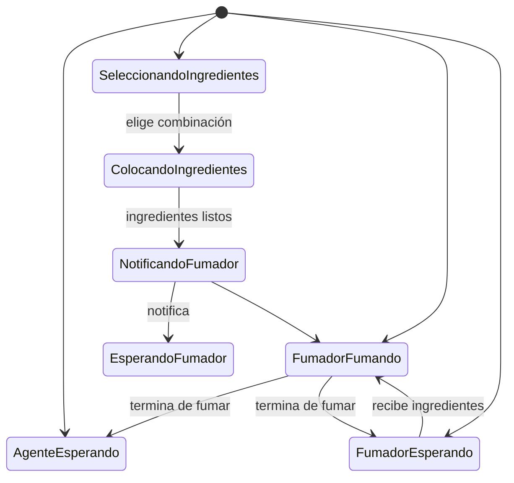

# Computación Concurrente - Problemas clásicos de sincronización

## 5.5 El fumador de cigarrillos.

---

El problema de los fumadores de cigarrillos es un problema clásico de sincronización que involucra coordinación entre múltiples procesos con dependencias de recursos. Tres fumadores, cada uno con un ingrediente diferente, necesitan dos ingredientes para fumar, los cuales son proporcionados por un agente.

### Definición Formal

#### Elementos del Problema

Sean:

- $F = \\{F_1, F_2, F_3\\}$: el conjunto de procesos fumadores
- $A$: el proceso agente
- $I = \\{tabaco, papel, cerillas\\}$: los ingredientes disponibles

Cada fumador $F_i$ tiene exactamente un ingrediente diferente y necesita los otros dos para fumar.

#### Condiciones de Sincronización

1. **Dependencia de recursos**: Cada fumador necesita exactamente 2 ingredientes que no posee
2. **Exclusión mutua**: Solo un fumador puede fumar a la vez
3. **Coordinación agente-fumadores**: El agente coloca dos ingredientes y notifica al fumador correspondiente

### Modelo del Sistema

#### Diagrama de Estados



### Representación Matemática

#### Estados del Sistema

Sea $S$ el estado del sistema definido por:

- $S_a$: estado del agente (activo, esperando)
- $S_f = [s_1, s_2, s_3]$: estados de los fumadores (esperando, fumando)
- $R = [r_t, r_p, r_c]$: disponibilidad de ingredientes (tabaco, papel, cerillas)

#### Combinaciones Posibles

El agente puede colocar exactamente dos de tres ingredientes, resultando en tres combinaciones:

1. **Tabaco y Papel** → Notifica a fumador con cerillas
2. **Tabaco y Cerillas** → Notifica a fumador con papel
3. **Papel y Cerillas** → Notifica a fumador con tabaco

#### Función de Transición

Para cada combinación $C_k$ de ingredientes:

$$A(C_k) \rightarrow F_j \text{ donde } F_j \text{ tiene el ingrediente faltante}$$

### Solución con Semáforos

#### Estructura de Datos

```c
#include <semaphore.h>
#include <pthread.h>

// Semáforos para cada fumador
sem_t smoker_tobacco;   // Fumador con tabaco
sem_t smoker_paper;     // Fumador con papel
sem_t smoker_matches;   // Fumador con cerillas
sem_t agent_sem;        // Control del agente
sem_t mutex;            // Exclusión mutua

// Variables de estado
int available_tobacco = 0;
int available_paper = 0;
int available_matches = 0;
```

#### Inicialización

```c
void init_smokers_problem() {
    sem_init(&smoker_tobacco, 0, 0);
    sem_init(&smoker_paper, 0, 0);
    sem_init(&smoker_matches, 0, 0);
    sem_init(&agent_sem, 0, 1);  // Agente puede empezar
    sem_init(&mutex, 0, 1);

    available_tobacco = 0;
    available_paper = 0;
    available_matches = 0;
}
```

#### Proceso Agente

```c
void* agent_process(void* arg) {
    int round = 0;

    while(1) {
        sem_wait(&agent_sem);  // Esperar turno

        // Seleccionar combinación aleatoria de ingredientes
        int combination = round % 3;
        round++;

        sem_wait(&mutex);

        switch(combination) {
            case 0:
                // Colocar tabaco y papel
                available_tobacco = 1;
                available_paper = 1;
                printf("Agente: Colocó tabaco y papel\n");
                sem_post(&smoker_matches);  // Notificar fumador con cerillas
                break;

            case 1:
                // Colocar tabaco y cerillas
                available_tobacco = 1;
                available_matches = 1;
                printf("Agente: Colocó tabaco y cerillas\n");
                sem_post(&smoker_paper);    // Notificar fumador con papel
                break;

            case 2:
                // Colocar papel y cerillas
                available_paper = 1;
                available_matches = 1;
                printf("Agente: Colocó papel y cerillas\n");
                sem_post(&smoker_tobacco);  // Notificar fumador con tabaco
                break;
        }

        sem_post(&mutex);
    }

    return NULL;
}
```

#### Proceso Fumador con Tabaco

```c
void* smoker_with_tobacco(void* arg) {
    int id = *(int*)arg;

    while(1) {
        sem_wait(&smoker_tobacco);  // Esperar notificación del agente

        sem_wait(&mutex);

        if (available_paper && available_matches) {
            // Tomar ingredientes
            available_paper = 0;
            available_matches = 0;

            sem_post(&mutex);

            // Fumar
            printf("Fumador %d (con tabaco): Tomó papel y cerillas, fumando...\n", id);
            smoke(id);
            printf("Fumador %d: Terminó de fumar\n", id);

            // Notificar al agente que puede colocar más ingredientes
            sem_post(&agent_sem);

        } else {
            sem_post(&mutex);
        }
    }

    return NULL;
}
```

#### Proceso Fumador con Papel

```c
void* smoker_with_paper(void* arg) {
    int id = *(int*)arg;

    while(1) {
        sem_wait(&smoker_paper);  // Esperar notificación del agente

        sem_wait(&mutex);

        if (available_tobacco && available_matches) {
            // Tomar ingredientes
            available_tobacco = 0;
            available_matches = 0;

            sem_post(&mutex);

            // Fumar
            printf("Fumador %d (con papel): Tomó tabaco y cerillas, fumando...\n", id);
            smoke(id);
            printf("Fumador %d: Terminó de fumar\n", id);

            // Notificar al agente
            sem_post(&agent_sem);

        } else {
            sem_post(&mutex);
        }
    }

    return NULL;
}
```

#### Proceso Fumador con Cerillas

```c
void* smoker_with_matches(void* arg) {
    int id = *(int*)arg;

    while(1) {
        sem_wait(&smoker_matches);  // Esperar notificación del agente

        sem_wait(&mutex);

        if (available_tobacco && available_paper) {
            // Tomar ingredientes
            available_tobacco = 0;
            available_paper = 0;

            sem_post(&mutex);

            // Fumar
            printf("Fumador %d (con cerillas): Tomó tabaco y papel, fumando...\n", id);
            smoke(id);
            printf("Fumador %d: Terminó de fumar\n", id);

            // Notificar al agente
            sem_post(&agent_sem);

        } else {
            sem_post(&mutex);
        }
    }

    return NULL;
}
```

#### Función Auxiliar

```c
void smoke(int smoker_id) {
    // Simular tiempo de fumar
    sleep(rand() % 3 + 1);
}
```

### Solución con Monitores

#### Implementación en Java

```java
class SmokingMonitor {
    private boolean tobacco = false;
    private boolean paper = false;
    private boolean matches = false;
    private final Object lock = new Object();

    public void agent_put_tobacco_paper() throws InterruptedException {
        synchronized(lock) {
            tobacco = true;
            paper = true;
            System.out.println("Agente: Colocó tabaco y papel");
            lock.notifyAll();  // Notificar a todos los fumadores

            // Esperar a que algún fumador tome los ingredientes
            while (tobacco && paper) {
                lock.wait();
            }
        }
    }

    public void agent_put_tobacco_matches() throws InterruptedException {
        synchronized(lock) {
            tobacco = true;
            matches = true;
            System.out.println("Agente: Colocó tabaco y cerillas");
            lock.notifyAll();

            while (tobacco && matches) {
                lock.wait();
            }
        }
    }

    public void agent_put_paper_matches() throws InterruptedException {
        synchronized(lock) {
            paper = true;
            matches = true;
            System.out.println("Agente: Colocó papel y cerillas");
            lock.notifyAll();

            while (paper && matches) {
                lock.wait();
            }
        }
    }

    public void smoker_with_tobacco(int id) throws InterruptedException {
        synchronized(lock) {
            while (true) {
                // Esperar hasta que haya papel y cerillas
                while (!(paper && matches)) {
                    lock.wait();
                }

                // Tomar ingredientes
                paper = false;
                matches = false;
                System.out.println("Fumador " + id + " (con tabaco): Tomó papel y cerillas");

                // Fumar
                smoke(id);

                // Notificar al agente
                lock.notifyAll();
            }
        }
    }

    public void smoker_with_paper(int id) throws InterruptedException {
        synchronized(lock) {
            while (true) {
                while (!(tobacco && matches)) {
                    lock.wait();
                }

                tobacco = false;
                matches = false;
                System.out.println("Fumador " + id + " (con papel): Tomó tabaco y cerillas");

                smoke(id);
                lock.notifyAll();
            }
        }
    }

    public void smoker_with_matches(int id) throws InterruptedException {
        synchronized(lock) {
            while (true) {
                while (!(tobacco && paper)) {
                    lock.wait();
                }

                tobacco = false;
                paper = false;
                System.out.println("Fumador " + id + " (con cerillas): Tomó tabaco y papel");

                smoke(id);
                lock.notifyAll();
            }
        }
    }

    private void smoke(int id) throws InterruptedException {
        System.out.println("Fumador " + id + ": Fumando...");
        Thread.sleep(1000 + (int)(Math.random() * 2000));
        System.out.println("Fumador " + id + ": Terminó de fumar");
    }
}
```

### Análisis Matemático

#### Espacio de Estados

El sistema puede estar en uno de varios estados:

- **Estado inicial**: $S_0 = (A_a, F_e, F_e, F_e, 0, 0, 0)$
- **Estado de colocación**: $S_1 = (A_e, F_e, F_e, F_e, i_1, i_2, 0)$ donde $i_1, i_2 \in I$
- **Estado de fumar**: $S_2 = (A_e, F_f, F_e, F_e, 0, 0, 0)$

#### Probabilidades de Transición

Para un agente que selecciona combinaciones uniformemente:

$$P(\text{tabaco-papel}) = P(\text{tabaco-cerillas}) = P(\text{papel-cerillas}) = \frac{1}{3}$$

#### Throughput del Sistema

El throughput depende de:

- $T_a$: tiempo entre colocaciones del agente
- $T_f$: tiempo de fumar
- $T_p$: tiempo de procesamiento

Throughput máximo teórico:

$$\text{Throughput}_{max} = \frac{1}{\max(T_a, T_f)}$$

### Ejemplo Práctico Completo

#### Simulación con Estadísticas

```python
import threading
import time
import random
from collections import defaultdict

class CigaretteSmokers:
    def __init__(self):
        self.ingredients = {
            'tobacco': False,
            'paper': False,
            'matches': False
        }
        self.lock = threading.Lock()
        self.agent_ready = threading.Condition(self.lock)
        self.smoker_conditions = {
            'tobacco': threading.Condition(self.lock),
            'paper': threading.Condition(self.lock),
            'matches': threading.Condition(self.lock)
        }
        self.stats = defaultdict(int)
        self.running = True

    def agent(self):
        combinations = [
            ('tobacco', 'paper'),
            ('tobacco', 'matches'),
            ('paper', 'matches')
        ]

        while self.running:
            with self.lock:
                # Esperar hasta que no haya ingredientes en la mesa
                while any(self.ingredients.values()):
                    self.agent_ready.wait()

                # Seleccionar combinación aleatoria
                combo = random.choice(combinations)
                self.ingredients[combo[0]] = True
                self.ingredients[combo[1]] = True

                print(f"Agente: Colocó {combo[0]} y {combo[1]}")
                self.stats[f'agent_{combo[0]}_{combo[1]}'] += 1

                # Notificar al fumador correspondiente
                missing_ingredient = list(set(['tobacco', 'paper', 'matches']) - set(combo))[0]
                self.smoker_conditions[missing_ingredient].notify()

    def smoker(self, name, has_ingredient):
        while self.running:
            with self.smoker_conditions[has_ingredient]:
                # Esperar notificación
                self.smoker_conditions[has_ingredient].wait()

                # Verificar que los ingredientes necesarios están disponibles
                needed = list(set(['tobacco', 'paper', 'matches']) - {has_ingredient})
                if self.ingredients[needed[0]] and self.ingredients[needed[1]]:
                    # Tomar ingredientes
                    self.ingredients[needed[0]] = False
                    self.ingredients[needed[1]] = False

                    print(f"Fumador {name} (con {has_ingredient}): Tomó {needed[0]} y {needed[1]}")

                    # Fumar
                    self.smoke(name)

                    # Notificar al agente
                    with self.lock:
                        self.agent_ready.notify()

                    self.stats[f'smoker_{name}'] += 1

    def smoke(self, name):
        print(f"Fumador {name}: Fumando...")
        time.sleep(random.uniform(1.0, 2.0))
        print(f"Fumador {name}: Terminó de fumar")

    def run_simulation(self, duration=10):
        # Crear hilos
        agent_thread = threading.Thread(target=self.agent)
        smokers = [
            threading.Thread(target=self.smoker, args=('Fumador1', 'tobacco')),
            threading.Thread(target=self.smoker, args=('Fumador2', 'paper')),
            threading.Thread(target=self.smoker, args=('Fumador3', 'matches'))
        ]

        # Iniciar hilos
        agent_thread.start()
        for smoker in smokers:
            smoker.start()

        # Ejecutar por tiempo determinado
        time.sleep(duration)
        self.running = False

        # Finalizar
        with self.lock:
            self.agent_ready.notify_all()
            for condition in self.smoker_conditions.values():
                condition.notify_all()

        agent_thread.join()
        for smoker in smokers:
            smoker.join()

        # Mostrar estadísticas
        print("\n--- ESTADÍSTICAS ---")
        for key, value in self.stats.items():
            print(f"{key}: {value}")

if __name__ == "__main__":
    simulation = CigaretteSmokers()
    simulation.run_simulation(duration=15)
```

### Variantes del Problema

#### Fumadores con Múltiples Agentes

```java
class MultipleAgentsSmokers {
    private final int numAgents;
    private boolean[] ingredients = new boolean[3];
    private int activeAgents = 0;
    private final Object lock = new Object();

    public MultipleAgentsSmokers(int agents) {
        this.numAgents = agents;
    }

    public void agent_work(int agentId) throws InterruptedException {
        while (true) {
            synchronized(lock) {
                // Esperar turno
                while (activeAgents >= 1 ||
                       (ingredients[0] || ingredients[1] || ingredients[2])) {
                    lock.wait();
                }

                activeAgents++;
            }

            // Colocar ingredientes (sección no crítica)
            place_ingredients(agentId);

            synchronized(lock) {
                activeAgents--;
                lock.notifyAll();
            }
        }
    }

    private void place_ingredients(int agentId) {
        // Lógica para colocar ingredientes
        // Similar a la versión con un agente
    }
}
```

#### Fumadores con Ingredientes Múltiples

```c
// Extensión para más de 3 ingredientes
#define NUM_INGREDIENTS 5
#define INGREDIENTS_NEEDED 3

struct smoker {
    int id;
    int has_ingredient;  // Índice del ingrediente que posee
    sem_t semaphore;
};

struct agent {
    sem_t mutex;
    int available_ingredients[NUM_INGREDIENTS];
};
```

### Ejercicios Propuestos

#### Ejercicio 1: Análisis de Rendimiento

Para un sistema con:

- Tiempo de colocación del agente: $T_a = 0.5$ segundos
- Tiempo de fumar: $T_f = 2.0$ segundos
- Probabilidad uniforme de combinaciones

**Calcule**:

1. Throughput máximo del sistema
2. Utilización de cada fumador
3. Tiempo promedio entre cigarrillos para cada fumador
4. Probabilidad de que un fumador espere más de 3 rondas

#### Ejercicio 2: Implementación con Condition Variables

Implemente el problema usando condition variables de pthreads:

```c
pthread_cond_t agent_cond;
pthread_cond_t smoker_cond[3];
pthread_mutex_t mutex;

// Complete la implementación considerando:
// - Múltiples notificaciones
// - Spurious wakeups
// - Timeouts opcionales
```

#### Ejercicio 3: Fumadores con Prioridades

Extienda el problema para manejar prioridades:

```c
typedef struct {
    int smoker_id;
    int priority;  // 1-10, mayor es más prioritario
    int wait_count; // Veces que ha esperado
} smoker_priority_t;
```

**Reglas**:

- Fumadores con mayor prioridad son notificados primero
- La prioridad aumenta con el tiempo de espera
- Implementar aging para prevenir inanición

#### Ejercicio 4: Sistema con Múltiples Mesas

Diseñe un sistema con múltiples mesas de ingredientes:

```c
#define NUM_TABLES 2
#define NUM_SMOKERS 6  // Dos fumadores por tipo de ingrediente

struct smoking_table {
    sem_t table_mutex;
    int ingredients[3];
    int smokers_waiting[3];
};
```

**Requisitos**:

- Múltiples fumadores pueden fumar simultáneamente en diferentes mesas
- Balanceo de carga entre mesas
- Evitar deadlock entre múltiples recursos

### Análisis de Correctitud

#### Propiedades a Verificar

1. **Safety**:
   - Nunca más de un fumador fumando con los mismos ingredientes
   - Los ingredientes siempre se consumen completamente
   - No hay acumulación infinita de ingredientes

2. **Liveness**:
   - Cada fumador eventualmente fuma (no inanición)
   - El agente siempre puede colocar nuevos ingredientes
   - El sistema no entra en deadlock

#### Invariantes

1. **Consistencia de ingredientes**:

   $$\sum_{i \in I} \text{available}_i \leq 2$$

2. **Estados mutuamente excluyentes**:

   $$\text{agente\_activo} \implies \sum \text{available}_i = 2$$

   $$\text{fumador\_fumando} \implies \sum \text{available}_i = 0$$

3. **Conservación**:

   $$\text{ingredientes\_colocados} = \text{ingredientes\_consumidos} + \text{ingredientes\_disponibles}$$

### Referencias

#### Bibliografía Básica

1. **Taubenfeld, G. (2006)**. _Synchronization Algorithms and Concurrent Programming_
   - Capítulo 4: "The Producer-Consumer Problem"
   - Sección 4.5: "Resource Allocation Problems"
   - Patrones de coordinación múltiple

2. **Herlihy, M. & Shavit, N. (2008)**. _The Art of Multiprocessor Programming_
   - Capítulo 8: "Monitors and Blocking Synchronization"
   - Sección 8.4: "Fairness and Starvation"

#### Bibliografía Complementaria

3. **Silberschatz, A., Galvin, P. B., & Gagne, G. (2018)**. _Operating System Concepts_
   - Capítulo 5: "Process Synchronization"
   - Problemas clásicos de sincronización

4. **Andrews, G. R. (2000)**. _Foundations of Multithreaded, Parallel, and Distributed Programming_
   - Capítulo 3: "Synchronization for Shared Variables"
   - Patrones de diseño para problemas de recursos

#### Recursos Adicionales

5. **Dijkstra, E. W. (1971)**. "Hierarchical ordering of sequential processes"
   - Trabajo seminal en coordinación de procesos

6. **Java Documentation**: `java.util.concurrent.Semaphore`
   - Implementaciones modernas de semáforos

### Evaluación del Aprendizaje

#### Preguntas de Comprensión

1. ¿Cómo se garantiza que solo un fumador tome los ingredientes colocados?
2. ¿Qué mecanismo previene que el agente coloque nuevos ingredientes antes de que los anteriores sean consumidos?
3. ¿Cómo se evita la inanición de algún fumador en la solución básica?
4. ¿Qué modificaciones se necesitan para soportar fumadores con diferentes tasas de consumo?

#### Problemas para Resolver

1. Implemente una versión donde los fumadores pueden compartir ingredientes
2. Diseñe un sistema con ingredientes parcialmente consumibles
3. Analice el impacto de diferentes distribuciones de colocación de ingredientes
4. Proponga una solución que maximice la equidad entre fumadores
