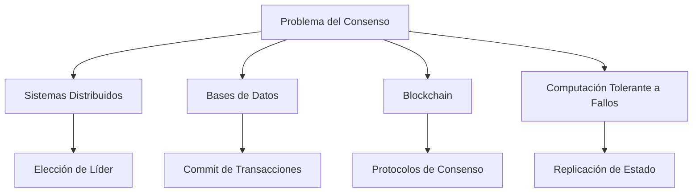
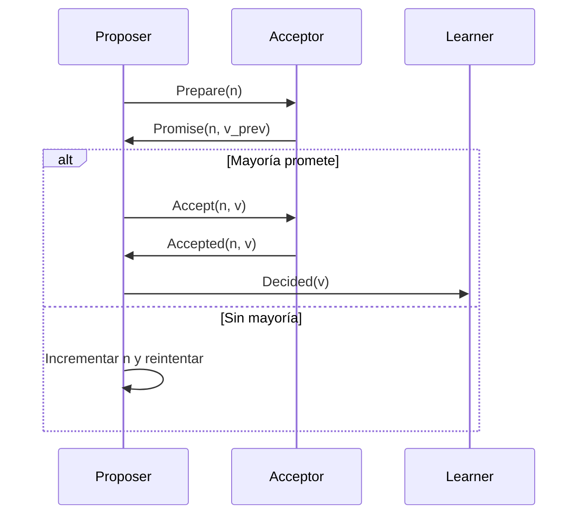
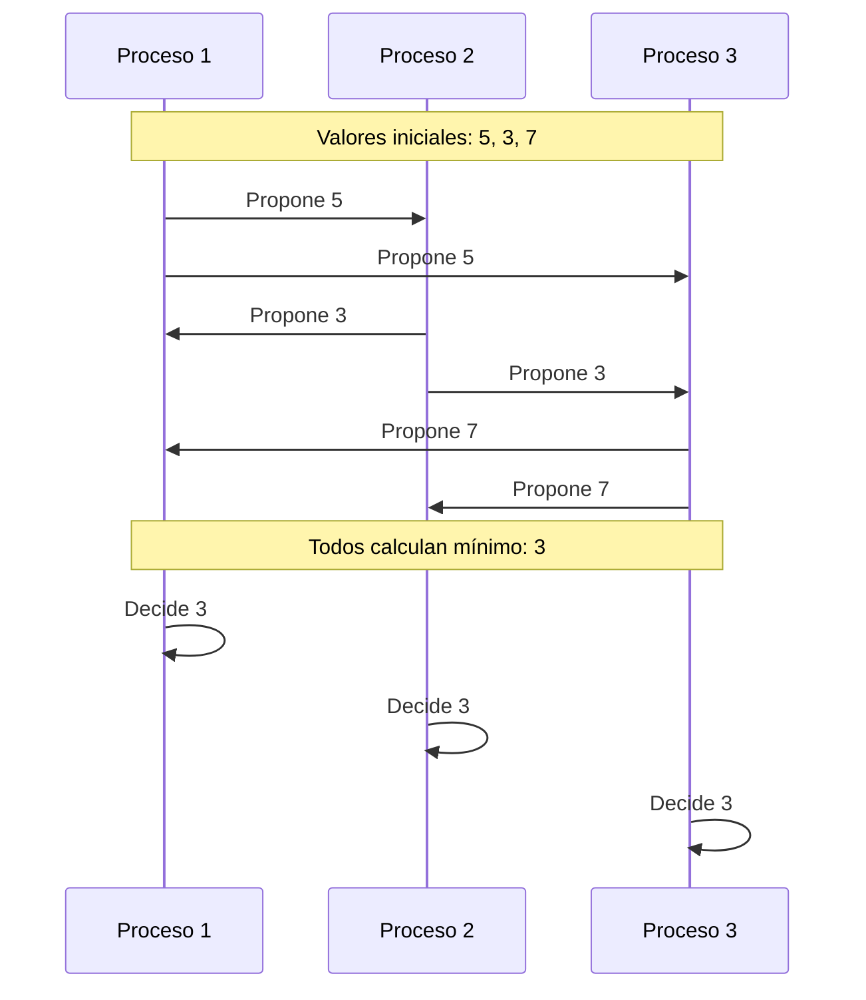
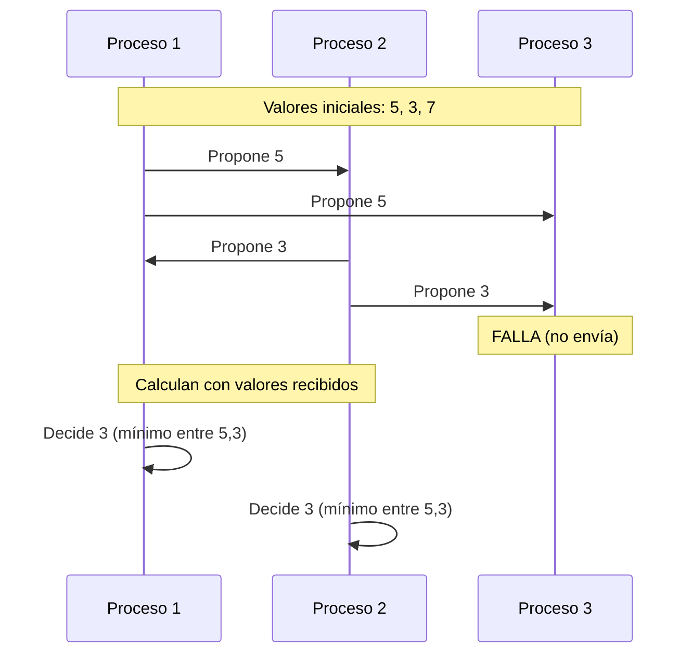

# Computación Concurrente - Consenso

## 6.1 Introducción y algoritmos básicos.

---

### Introducción al Problema del Consenso

El problema del consenso es fundamental en sistemas distribuidos y computación concurrente. Surge cuando múltiples procesos necesitan ponerse de acuerdo sobre un valor único a pesar de posibles fallos.

#### Definición Formal

El problema del consenso involucra $n$ procesos $P_1, P_2, ..., P_n$, donde cada proceso $P_i$ tiene:

- Un **valor de entrada** $v_i$
- Un **valor de decisión** $d_i$ (inicialmente indefinido)

El algoritmo debe satisfacer:

1. **Acuerdo**: Todos los procesos correctos deciden el mismo valor

   $$ \forall i,j: d_i = d_j $$

2. **Validez**: Si todos los procesos proponen el mismo valor $v$, entonces todos los procesos correctos deciden $v$

   $$ \text{Si } \forall i: v_i = v \text{ entonces } \forall j: d_j = v $$

3. **Terminación**: Todos los procesos correctos eventualmente deciden

#### Importancia del Consenso



### Modelos de Fallos

#### Fallos de Crash

Un proceso deja de funcionar pero no envía información incorrecta.

#### Fallos Bizantinos

Un proceso puede comportarse arbitrariamente, enviando información incorrecta.

### Algoritmos Básicos de Consenso

#### Consenso en Sistemas Sincrónicos

##### Algoritmo para Fallos de Crash

```java
public class CrashConsensus {
    private int[] values;
    private int round = 1;
    private final int numProcesses;

    public CrashConsensus(int numProcesses) {
        this.numProcesses = numProcesses;
        this.values = new int[numProcesses];
    }

    public int decide(int initialValue, int processId) {
        values[processId] = initialValue;

        for (int r = 1; r <= numProcesses; r++) {
            // Fase de envío
            broadcastValue(processId, values[processId], r);

            // Fase de recepción
            int[] received = receiveValues(r);

            // Actualizar valores
            for (int i = 0; i < numProcesses; i++) {
                if (received[i] != -1) { // -1 indica no recibido
                    values[i] = received[i];
                }
            }
        }

        // Decidir el mínimo valor recibido
        return findMinValue();
    }

    private int findMinValue() {
        int min = Integer.MAX_VALUE;
        for (int value : values) {
            if (value < min) {
                min = value;
            }
        }
        return min;
    }
}
```

#### Algoritmo de FloodSet

Para $n$ procesos y hasta $f$ fallos:

```python
class FloodSet:
    def __init__(self, process_id, num_processes):
        self.process_id = process_id
        self.num_processes = num_processes
        self.V = set()  # Conjunto de valores propuestos

    def run_consensus(self, initial_value, max_rounds=None):
        if max_rounds is None:
            max_rounds = self.num_processes

        self.V.add(initial_value)

        for round in range(1, max_rounds + 1):
            # Enviar conjunto V a todos los procesos
            self.broadcast(self.V)

            # Recibir conjuntos de otros procesos
            received_sets = self.receive_sets()

            # Actualizar conjunto uniendo todos los recibidos
            for v_set in received_sets:
                self.V = self.V.union(v_set)

        # Decidir el valor mínimo del conjunto
        return min(self.V)
```

### Consenso en Shared Memory

#### Protocolo de Consenso con Registros Atómicos

```java
public class AtomicRegisterConsensus {
    private final AtomicInteger[] registers;
    private final int numProcesses;

    public AtomicRegisterConsensus(int n) {
        this.numProcesses = n;
        this.registers = new AtomicInteger[n];
        for (int i = 0; i < n; i++) {
            registers[i] = new AtomicInteger(-1);
        }
    }

    public int propose(int value, int processId) {
        // Fase 1: Escribir en registro propio
        registers[processId].set(value);

        // Fase 2: Buscar el primer valor escrito
        for (int i = 0; i < numProcesses; i++) {
            int observed = registers[i].get();
            if (observed != -1) {
                return observed;
            }
        }

        return value; // Fallback
    }
}
```

#### Teorema de Imposibilidad

**Teorema**: No existe un algoritmo de consenso que tolere incluso un solo fallo de crash en un sistema asincrónico.

$$ \text{Sistema Asincrónico + Al menos 1 fallo} \Rightarrow \text{Imposible Consenso} $$

### Algoritmo de Consenso de Lamport (Paxos)

#### Fases del Protocolo Paxos



#### Implementación Básica de Paxos

```python
class PaxosAcceptor:
    def __init__(self, acceptor_id):
        self.acceptor_id = acceptor_id
        self.promised_id = -1
        self.accepted_id = -1
        self.accepted_value = None

    def prepare(self, proposal_id):
        if proposal_id > self.promised_id:
            self.promised_id = proposal_id
            return (self.accepted_id, self.accepted_value)
        return None

    def accept(self, proposal_id, value):
        if proposal_id >= self.promised_id:
            self.promised_id = proposal_id
            self.accepted_id = proposal_id
            self.accepted_value = value
            return True
        return False

class PaxosProposer:
    def __init__(self, proposer_id, acceptors):
        self.proposer_id = proposer_id
        self.acceptors = acceptors
        self.proposal_id = proposer_id

    def propose(self, value):
        while True:
            # Fase 1: Prepare
            promises = []
            for acceptor in self.acceptors:
                response = acceptor.prepare(self.proposal_id)
                if response:
                    promises.append(response)

            if len(promises) > len(self.acceptors) // 2:
                # Mayoría prometió
                break
            else:
                self.proposal_id += len(self.acceptors)

        # Elegir valor basado en respuestas
        chosen_value = value
        for (acc_id, acc_val) in promises:
            if acc_val is not None and (acc_id > highest_id):
                chosen_value = acc_val

        # Fase 2: Accept
        accepts = 0
        for acceptor in self.acceptors:
            if acceptor.accept(self.proposal_id, chosen_value):
                accepts += 1

        if accepts > len(self.acceptors) // 2:
            return chosen_value
        else:
            return self.propose(value)  # Reintentar
```

### Complejidad y Límites

#### Límite Inferior para Rondas

Para un sistema con $f$ fallos, se necesitan al menos $f+1$ rondas:

$$ R_{\text{mín}} = f + 1 $$

#### Cota de Procesos para Consenso Bizantino

El problema del consenso bizantino requiere:

$$ n > 3f $$

donde $f$ es el número máximo de procesos bizantinos tolerables.

### Ejercicios Propuestos

#### Ejercicio 1: Análisis de Algoritmo

Analice el siguiente algoritmo de consenso para 2 procesos:

```java
public class TwoProcessConsensus {
    private boolean[] flag = new boolean[2];
    private int turn;
    private int decision = -1;

    public int decide(int value, int processId) {
        int other = 1 - processId;
        flag[processId] = true;
        turn = other;

        while (flag[other] && turn == other) {
            // Espera activa
        }

        if (decision == -1) {
            decision = value;
        }

        flag[processId] = false;
        return decision;
    }
}
```

**Preguntas:**

1. ¿Satisface el algoritmo las propiedades de acuerdo, validez y terminación?
2. ¿Qué tipo de sincronización utiliza?
3. ¿Es wait-free?

#### Ejercicio 2: Diseño de Algoritmo

Diseñe un algoritmo de consenso para 3 procesos que tolere 1 fallo de crash. Especifique:

1. El número mínimo de rondas requeridas
2. El protocolo de comunicación entre procesos
3. La función de decisión

#### Ejercicio 3: Demostración

Demuestre que en un sistema asincrónico con comunicaciones por mensajes, es imposible alcanzar consenso con incluso un solo fallo de crash.

#### Ejercicio 4: Implementación

Implemente en el lenguaje de su preferencia el algoritmo de FloodSet para 4 procesos, simulando que 1 proceso puede fallar.

### Diagramas de Ejecución

#### Ejecución Correcta de Consenso



#### Ejecución con Fallo



### Referencias Bibliográficas

#### Bibliografía Básica

1. **Taubenfeld, G. (2006)**. _Synchronization Algorithms and Concurrent Programming_
   - Capítulo 5: "The Consensus Problem"
   - Sección 5.2: "Synchronous Consensus"
   - Sección 5.3: "Asynchronous Impossibility"

2. **Herlihy, M. & Shavit, N. (2008)**. _The Art of Multiprocessor Programming_
   - Capítulo 5: "Consensus"
   - Sección 5.1: "Consensus Numbers"
   - Sección 5.4: "The Paxos Algorithm"

#### Bibliografía Complementaria

3. **Lamport, L. (2002)**. _Specifying Systems: The TLA+ Language and Tools_
   - Capítulo 6: "Specifying Consensus Algorithms"
   - Especificaciones formales de protocolos de consenso

#### Conceptos Clave para Repasar

- **Propiedades de Safety y Liveness**
- **Wait-freedom vs Lock-freedom**
- **Registros atómicos vs registros seguros**
- **Modelos de temporización: sincrónico vs asincrónico**

### Resumen de Fórmulas

| Concepto         | Fórmula                                             | Descripción                                |
| ---------------- | --------------------------------------------------- | ------------------------------------------ |
| Acuerdo          | $\forall i,j: d_i = d_j$                            | Todos deciden igual                        |
| Validez          | $\forall i: v_i = v \Rightarrow \forall j: d_j = v$ | Si todos proponen igual, deciden ese valor |
| Límite bizantino | $n > 3f$                                            | Mínimo procesos para tolerar f bizantinos  |
| Rondas mínimas   | $R \geq f + 1$                                      | Rondas necesarias para f fallos            |
