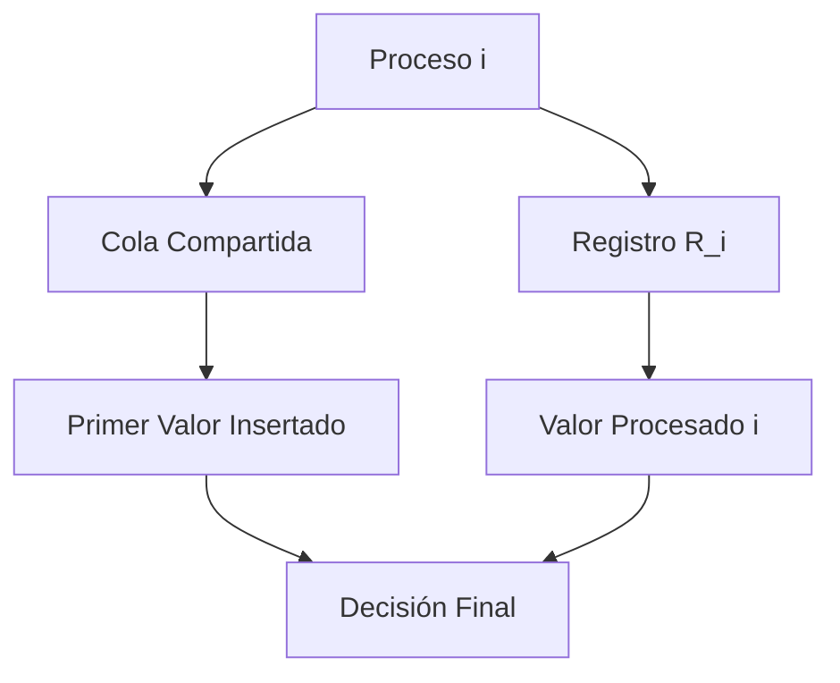
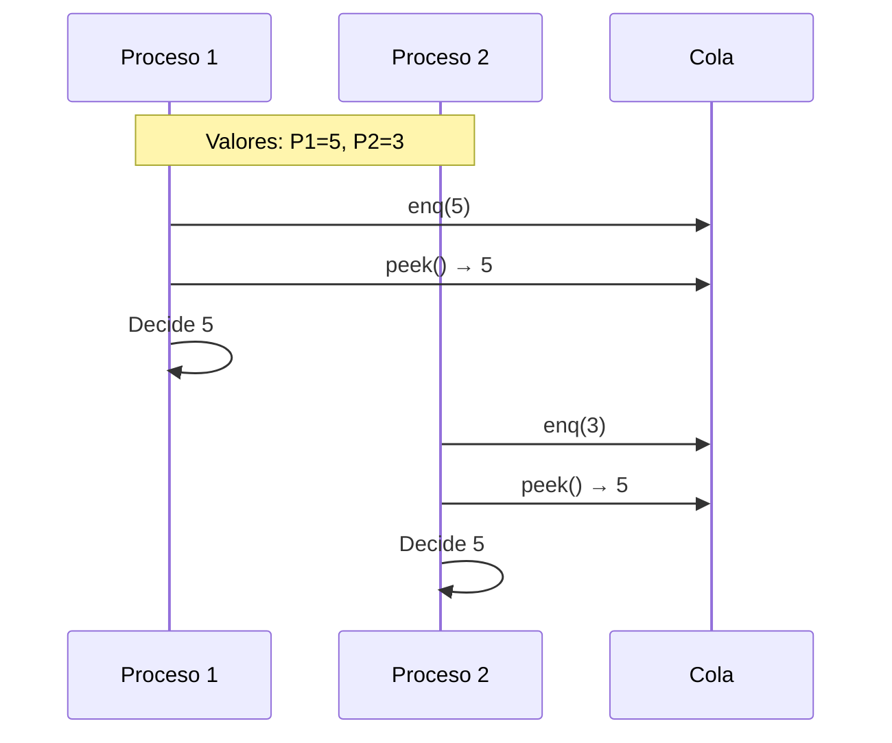
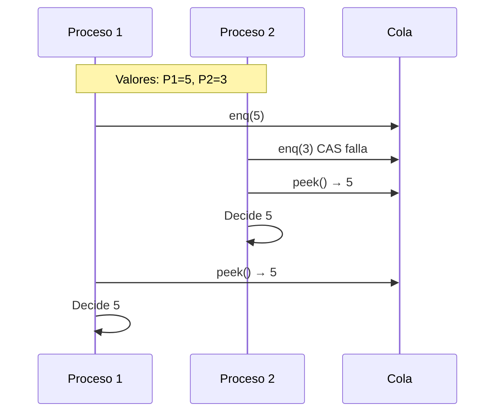

# Computación Concurrente - Consenso

## 6.2 Consenso utilizando una cola compartida.

---

### Introducción al Consenso con Colas

El uso de colas compartidas para resolver el problema del consenso representa un enfoque elegante en computación concurrente. Las colas proporcionan una abstracción de comunicación que puede aprovecharse para coordinar procesos y alcanzar acuerdos.

#### Definición Formal

Dados $n$ procesos $P_1, P_2, ..., P_n$ con valores iniciales $v_1, v_2, ..., v_n$, buscamos implementar una operación `decide()` que satisfaga:

- **Acuerdo**: $\forall i,j: \text{decide}_i() = \text{decide}_j()$
- **Validez**: $\exists v \in \{v_1, ..., v_n\} \text{ tal que } \forall i: \text{decide}_i() = v$
- **Terminación**: Todo proceso correcto eventualmente decide

### Estructuras de Datos Fundamentales

#### Cola Concurrente con Operaciones Atómicas

```java
public interface ConcurrentQueue<T> {
    void enq(T value);    // Inserción atómica
    T deq();             // Eliminación atómica
    boolean isEmpty();   // Consulta del estado
}
```

#### Propiedades de las Colas para Consenso

Una cola utilizada para consenso debe garantizar:

1. **Atomicidad linealizable** de las operaciones
2. **No bloqueo** (wait-free o lock-free)
3. **Ordenamiento consistente** entre procesos

### Algoritmo de Consenso con Cola de un Elemento

#### Implementación Básica

```java
public class QueueConsensus<T> {
    private final AtomicReference<Queue<T>> queue;
    private final int numProcesses;

    public QueueConsensus(int n) {
        this.numProcesses = n;
        this.queue = new AtomicReference<>(new LinkedList<>());
    }

    public T decide(T value, int processId) {
        // Intentar insertar el valor en la cola
        synchronized (queue) {
            if (queue.get().isEmpty()) {
                queue.get().offer(value);
            }
        }

        // El valor decidido es el primero en la cola
        while (queue.get().isEmpty()) {
            Thread.yield(); // Esperar hasta que alguien inserte
        }

        return queue.get().peek(); // Todos deciden el mismo valor
    }
}
```

#### Versión Wait-Free con Cola Atómica

```java
public class WaitFreeQueueConsensus<T> {
    private final AtomicReference<Node<T>> head;

    private static class Node<T> {
        T value;
        AtomicReference<Node<T>> next;

        Node(T value) {
            this.value = value;
            this.next = new AtomicReference<>(null);
        }
    }

    public WaitFreeQueueConsensus() {
        this.head = new AtomicReference<>(null);
    }

    public T decide(T value) {
        Node<T> newNode = new Node<>(value);

        // Intentar ser el primero en insertar
        if (head.compareAndSet(null, newNode)) {
            return value; // Soy el primero, decido mi valor
        } else {
            // Alguien ya insertó, decido su valor
            return head.get().value;
        }
    }
}
```

### Protocolo de Consenso con Múltiples Colas

#### Algoritmo para n Procesos

```java
public class MultiQueueConsensus<T> {
    private final List<ConcurrentLinkedQueue<T>> queues;
    private final int numProcesses;
    private final AtomicInteger decided = new AtomicInteger(-1);

    public MultiQueueConsensus(int n) {
        this.numProcesses = n;
        this.queues = new ArrayList<>();
        for (int i = 0; i < n; i++) {
            queues.add(new ConcurrentLinkedQueue<>());
        }
    }

    public T decide(T value, int processId) {
        // Fase 1: Cada proceso escribe en todas las colas
        for (int i = 0; i < numProcesses; i++) {
            queues.get(i).offer(value);
        }

        // Fase 2: Buscar el primer valor en orden determinístico
        for (int i = 0; i < numProcesses; i++) {
            T candidate = queues.get(i).poll();
            if (candidate != null) {
                // Intentar establecer como decisión
                if (decided.compareAndSet(-1, i)) {
                    return candidate;
                } else {
                    // Ya se decidió, retornar el valor decidido
                    return queues.get(decided.get()).peek();
                }
            }
        }

        return value; // Fallback (no debería ocurrir)
    }
}
```

### Consenso con Cola y Registros de Escritura Única

#### Algoritmo Híbrido



```java
public class HybridQueueConsensus<T> {
    private final ConcurrentLinkedQueue<T> queue;
    private final AtomicReference<T>[] registers;
    private final AtomicBoolean[] written;

    @SuppressWarnings("unchecked")
    public HybridQueueConsensus(int n) {
        this.queue = new ConcurrentLinkedQueue<>();
        this.registers = new AtomicReference[n];
        this.written = new AtomicBoolean[n];

        for (int i = 0; i < n; i++) {
            registers[i] = new AtomicReference<>(null);
            written[i] = new AtomicBoolean(false);
        }
    }

    public T decide(T value, int processId) {
        // Paso 1: Escribir en registro propio
        registers[processId].set(value);
        written[processId].set(true);

        // Paso 2: Intentar insertar en cola
        queue.offer(value);

        // Paso 3: Buscar decisión
        T queueHead = queue.peek();
        if (queueHead != null) {
            return queueHead;
        }

        // Paso 4: Si cola vacía, buscar primer registro escrito
        for (int i = 0; i < registers.length; i++) {
            if (written[i].get() && registers[i].get() != null) {
                return registers[i].get();
            }
        }

        return value;
    }
}
```

### Análisis de Correctitud

#### Demostración de Acuerdo

**Teorema**: El algoritmo de cola única garantiza acuerdo.

**Prueba**:

1. Sea $v$ el primer valor insertado en la cola
2. Todos los procesos leen de la misma cola
3. La operación `peek()` retorna siempre el mismo elemento $v$
4. Por lo tanto, $\forall i,j: \text{decide}_i() = \text{decide}_j() = v$

#### Demostración de Validez

**Prueba**:

1. El valor decidido $v$ proviene de algún proceso $P_i$
2. $v$ fue el valor inicial de $P_i$
3. Por lo tanto, $v \in \{v_1, v_2, ..., v_n\}$

### Complejidad y Análisis de Rendimiento

#### Costo de Operaciones

| Operación | Complejidad | Tipo      |
| --------- | ----------- | --------- |
| `enq()`   | $O(1)$      | Atómica   |
| `deq()`   | $O(1)$      | Atómica   |
| `peek()`  | $O(1)$      | Lectura   |
| Decisión  | $O(1)$      | Wait-free |

#### Número de Consenso

El **número de consenso** de una cola es $\infty$, lo que significa que puede resolver consenso para cualquier número de procesos.

$$ \text{ConsensusNumber}(queue) = \infty $$

### Implementación Avanzada con Backoff

```java
public class BackoffQueueConsensus<T> {
    private final AtomicReference<T> decision = new AtomicReference<>(null);
    private final ConcurrentLinkedQueue<T> proposalQueue;
    private final Backoff backoff;

    public BackoffQueueConsensus() {
        this.proposalQueue = new ConcurrentLinkedQueue<>();
        this.backoff = new Backoff(1, 1000); // min, max delay
    }

    public T decide(T value) throws InterruptedException {
        // Insertar propuesta
        proposalQueue.offer(value);

        while (decision.get() == null) {
            T candidate = proposalQueue.peek();
            if (candidate != null) {
                if (decision.compareAndSet(null, candidate)) {
                    return candidate;
                }
            }
            backoff.backoff(); // Espera exponencial
        }

        return decision.get();
    }

    private static class Backoff {
        private final int minDelay, maxDelay;
        private int limit;

        Backoff(int min, int max) {
            this.minDelay = min;
            this.maxDelay = max;
            this.limit = min;
        }

        public void backoff() throws InterruptedException {
            int delay = ThreadLocalRandom.current().nextInt(limit);
            Thread.sleep(delay);
            limit = Math.min(maxDelay, limit * 2);
        }
    }
}
```

### Ejercicios Propuestos

#### Ejercicio 1: Análisis de Correctitud

Analice el siguiente algoritmo y determine si satisface las propiedades de consenso:

```java
public class QuestionableQueueConsensus<T> {
    private final Queue<T> queue = new LinkedList<>();

    public T decide(T value, int processId) {
        synchronized (queue) {
            if (queue.isEmpty()) {
                queue.add(value);
            }
            return queue.peek();
        }
    }
}
```

**Preguntas:**

1. ¿Garantiza acuerdo? Demuestre por qué sí o por qué no.
2. ¿Es wait-free? Justifique su respuesta.
3. ¿Qué ocurre si un proceso falla durante la ejecución?

#### Ejercicio 2: Diseño de Algoritmo

Diseñe un algoritmo de consenso usando dos colas compartidas que tolere fallos de crash. Especifique:

1. El protocolo completo
2. La estrategia para garantizar terminación
3. Análisis del número máximo de fallos tolerables

#### Ejercicio 3: Implementación

Implemente en Java una cola concurrente que garantice wait-freedom para todas las operaciones y úsela para resolver consenso.

#### Ejercicio 4: Análisis de Performance

Compare la eficiencia del algoritmo de cola simple vs el algoritmo con backoff en términos de:

- Tiempo de decisión en caso de contención
- Uso de recursos del sistema
- Escalabilidad con número de procesos

### Diagramas de Ejecución

#### Escenario Sin Contención



#### Escenario con Contención



### Casos de Prueba y Verificación

#### Test de Corrección

```java
public class QueueConsensusTest {
    @Test
    public void testAgreement() throws InterruptedException {
        final int NUM_PROCESSES = 10;
        final int NUM_TESTS = 100;

        for (int test = 0; test < NUM_TESTS; test++) {
            QueueConsensus<Integer> consensus = new QueueConsensus<>(NUM_PROCESSES);
            Set<Integer> decisions = Collections.synchronizedSet(new HashSet<>());

            List<Thread> threads = new ArrayList<>();
            for (int i = 0; i < NUM_PROCESSES; i++) {
                final int value = i;
                Thread thread = new Thread(() -> {
                    int decision = consensus.decide(value, value);
                    decisions.add(decision);
                });
                threads.add(thread);
            }

            for (Thread thread : threads) thread.start();
            for (Thread thread : threads) thread.join();

            assertEquals(1, decisions.size()); // Todos deben decidir igual
        }
    }
}
```

### Referencias Bibliográficas

#### Bibliografía Básica

1. **Taubenfeld, G. (2006)**. _Synchronization Algorithms and Concurrent Programming_
   - Capítulo 5: "The Consensus Problem"
   - Sección 5.4: "Wait-Free Implementations Using Queues"
   - Teoremas de imposibilidad y límites

2. **Herlihy, M. & Shavit, N. (2008)**. _The Art of Multiprocessor Programming_
   - Capítulo 5: "Consensus"
   - Sección 5.5: "The Wait-Free Hierarchy"
   - Análisis de estructuras de datos para consenso

#### Bibliografía Complementaria

3. **Lamport, L. (2002)**. _Specifying Systems: The TLA+ Language and Tools_
   - Especificación formal de algoritmos de cola
   - Verificación de propiedades de seguridad

#### Conceptos Clave para Repasar

- **Linearizability** vs **Sequential Consistency**
- **Wait-freedom** vs **Lock-freedom**
- **Atomic snapshots** de estructuras de datos
- **Problema del productor-consumidor** en contextos concurrentes

### Resumen de Ventajas y Desventajas

| Ventajas                          | Desventajas                               |
| --------------------------------- | ----------------------------------------- |
| Implementación simple             | Contención en acceso a cola               |
| Wait-free en algunos casos        | Overhead de sincronización                |
| Fácil de entender y verificar     | Puede requerir backoff en alta contención |
| Escalable con técnicas apropiadas | Consumo de memoria para colas             |
