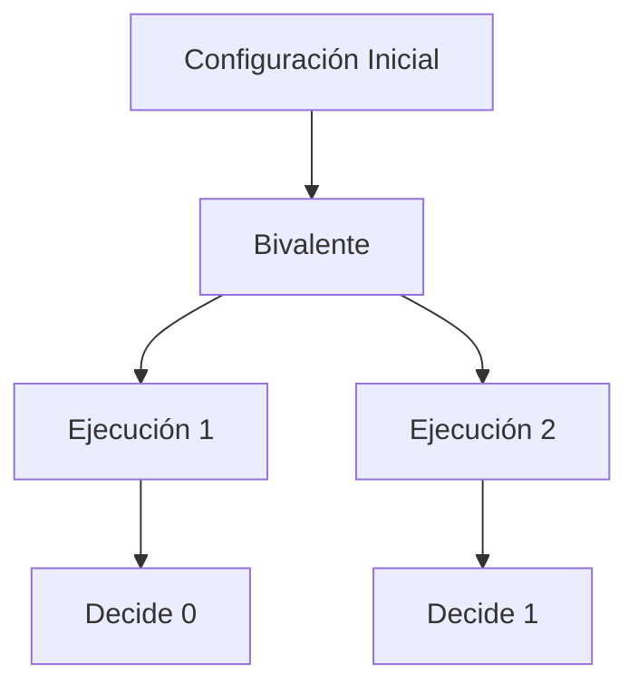
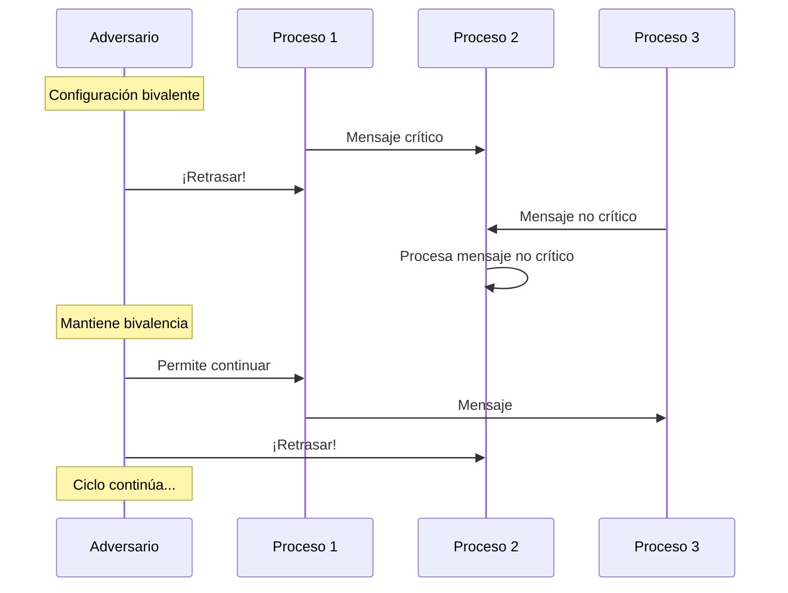
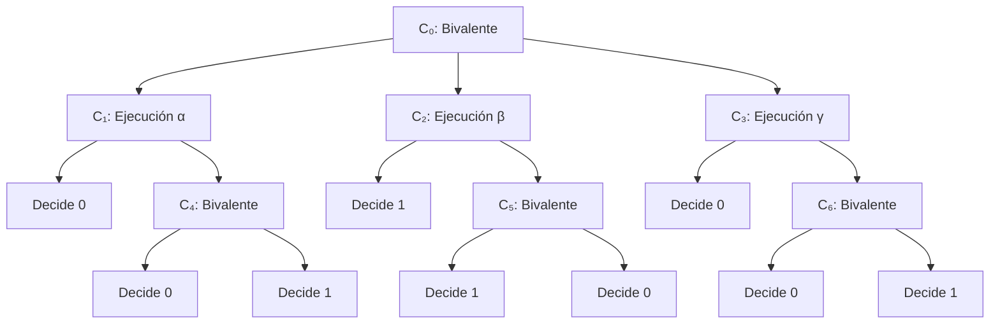
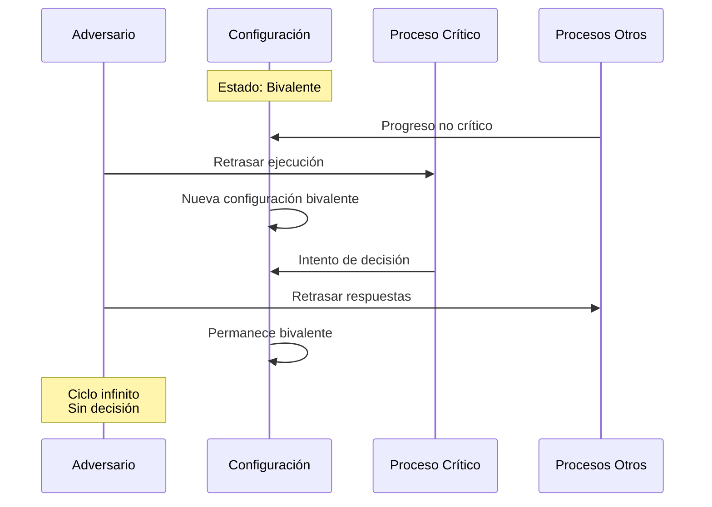

# Computación Concurrente - Consenso

## 6.3 Imposibilidad de consenso con un proceso falible.

---

### Introducción al Teorema de Imposibilidad

El resultado más fundamental en computación distribuida es la demostración de que es imposible lograr consenso en sistemas asincrónicos con al menos un proceso falible. Este resultado, conocido como el **Teorema de FLP** (por Fischer, Lynch y Paterson), establece límites fundamentales sobre lo que puede lograrse en sistemas distribuidos.

#### Contexto Histórico

**Fischer, Lynch y Paterson (1985)** demostraron que:

> "No existe un algoritmo determinista que resuelva el problema del consenso en un sistema asincrónico de paso de mensajes sujeto a un solo fallo de crash."

### Modelo del Sistema

#### Supuestos del Modelo

1. **Sistema Asincrónico**:
   - No hay relojes globales
   - No hay límites en el tiempo de entrega de mensajes
   - No hay sincronización temporal

2. **Comunicación por Mensajes**:
   - Canales confiables (no pierden mensajes)
   - Mensajes pueden entregarse en cualquier orden
   - Comunicación punto a punto

3. **Modelo de Fallos**:
   - Fallos de crash (procesos se detienen)
   - Al menos un proceso puede fallar

#### Definición Formal del Problema

Dado un conjunto de procesos $P = \{p_1, p_2, ..., p_n\}$:

- Cada proceso $p_i$ tiene valor inicial $v_i \in V$
- Debe decidir un valor $d_i \in V$ satisfaciendo:

1. **Acuerdo**: $\forall i,j: d_i = d_j$
2. **Validez**: $\exists v \in \{v_1, ..., v_n\} \text{ tal que } \forall i: d_i = v$
3. **Terminación**: Todo proceso correcto eventualmente decide

### Demostración del Teorema FLP

#### Estrategia de la Demostración

La demostración utiliza un argumento de **valencia** y **configuraciones bivalentes**.

##### Definiciones Clave

**Configuración**: Estado global del sistema en un instante dado, incluyendo:

- Estados locales de todos los procesos
- Mensajes en tránsito

**Configuración Univalente**: Configuración donde todos los ejecuciones llevan a la misma decisión.

**Configuración Bivalente**: Configuración donde algunas ejecuciones llevan a decisión 0 y otras a decisión 1.



#### Lema 1: Existencia de Configuración Inicial Bivalente

**Demostración**: Supongamos todas las configuraciones iniciales son univalentes.

- Sea $C_0$ configuración con todos valores 0 → debe decidir 0 (validez)
- Sea $C_n$ configuración con todos valores 1 → debe decidir 1 (validez)
- Existe una secuencia $C_0, C_1, ..., C_n$ donde cambia un valor a la vez
- Por lo tanto, existen $C_i$ y $C_{i+1}$ que difieren solo en el valor de un proceso $p$
- Si $p$ falla inmediatamente, ambas configuraciones deben decidir igual
- ¡Contradicción! ∴ existe configuración inicial bivalente

#### Lema 2: Mantenimiento de Bivalencia

**Demostración**: Desde cualquier configuración bivalente, existe una ejecución que evita la decisión.

```java
public class FLPImpossibility {
    // Estructura para representar configuraciones
    static class Configuration {
        int[] processStates;
        Queue<Message>[] messageQueues;
        boolean decided = false;
        Integer decision = null;

        public Configuration(int n) {
            processStates = new int[n];
            messageQueues = new LinkedList[n];
            for (int i = 0; i < n; i++) {
                messageQueues[i] = new LinkedList<>();
            }
        }

        public Configuration fork() {
            Configuration copy = new Configuration(processStates.length);
            // Implementar copia profunda
            return copy;
        }
    }

    public static void demonstrateIndecision(Configuration bivalentConfig) {
        // Desde cualquier configuración bivalente,
        // podemos mantener la bivalencia indefinidamente
        Configuration current = bivalentConfig;

        while (!current.decided) {
            // El adversario siempre puede retrasar el proceso
            // que llevaría a la decisión
            current = adversaryDelaysCriticalProcess(current);
        }
    }
}
```

#### Argumento del Adversario

El **adversario schedulers** controla:

- Orden de entrega de mensajes
- Velocidad de los procesos
- Momento de los fallos



### Ejemplo Concreto con Dos Procesos

#### Sistema de 2 Procesos

Consideremos dos procesos $p$ y $q$ con valores binarios.

```java
public class TwoProcessSystem {
    enum State { INIT, SENT, RECEIVED, DECIDED }
    enum Value { ZERO, ONE }

    static class Process {
        State state = State.INIT;
        Value initialValue;
        Value decision = null;
        boolean failed = false;

        public Process(Value v) { this.initialValue = v; }
    }

    public static void demonstrateImpossibility() {
        // Configuración inicial bivalente
        Process p = new Process(Value.ZERO);
        Process q = new Process(Value.ONE);

        // El adversario puede siempre evitar la decisión
        while (p.decision == null && q.decision == null) {
            // Siempre retrasar el mensaje crítico
            if (isAboutToDecide(p, q)) {
                delay(p); // Retrasar proceso que llevaría a decisión
            } else if (isAboutToDecide(q, p)) {
                delay(q);
            } else {
                // Permitir progreso no crítico
                allowProgress(p, q);
            }
        }
    }
}
```

### Implicaciones del Teorema FLP

#### Corolarios Importantes

1. **No existe algoritmo determinista** para consenso asincrónico con fallos
2. **Cualquier algoritmo** puede ser demorado indefinidamente
3. **Los sistemas prácticos** deben relajar alguno de los supuestos

#### Relajaciones Prácticas

| Relajación            | Ejemplo                    | Compromiso                 |
| --------------------- | -------------------------- | -------------------------- |
| **Sincronía parcial** | Timeouts                   | Asume límites temporales   |
| **Randomización**     | Algoritmos probabilísticos | Terminación probabilística |
| **Fallos limitados**  | Quórum systems             | Disponibilidad reducida    |
| **Consenso débil**    | Consenso k-set             | Acuerdo parcial            |

### Ejercicios Propuestos

#### Ejercicio 1: Análisis de Configuraciones

Para un sistema de 3 procesos con valores binarios:

1. Identifique todas las configuraciones iniciales posibles
2. Clasifíquelas en 0-valentes, 1-valentes y bivalentes
3. Demuestre que existe al menos una configuración bivalente

#### Ejercicio 2: Argumento del Adversario

Diseñe un adversario scheduler para el siguiente algoritmo:

```java
public class NaiveConsensus {
    private boolean[] received = new boolean[3];
    private int[] values = new int[3];

    public Integer decide(int value, int processId) {
        // Enviar valor a todos
        broadcast(value);

        // Esperar recibir 2 valores (incluyendo propio)
        while (countReceived() < 2) {
            // Esperar mensajes
        }

        // Decidir el mínimo valor recibido
        return minReceivedValue();
    }
}
```

#### Ejercicio 3: Generalización

Demuestre que si el consenso es imposible para 2 procesos, también lo es para n procesos.

**Hint**: Use el argumento de partición.

#### Ejercicio 4: Sistemas Sincrónicos

Compare por qué el consenso SÍ es posible en sistemas sincrónicos pero NO en asincrónicos. Identifique las diferencias clave.

### Diagramas de Configuraciones

#### Árbol de Ejecuciones Posibles



#### Estrategia del Adversario



### Formalización Matemática

#### Notación y Definiciones

Sea $C$ una configuración, $e$ un evento (entrega de mensaje o paso de proceso):

- $C \xrightarrow{e} C'$: Configuración $C'$ resulta de aplicar $e$ a $C$
- $C \rightsquigarrow C'$: $C'$ es alcanzable desde $C$
- $val(C)$: Valencia de $C$ (0, 1, o bivalente)

#### Lema de Commutación

Si los eventos $e_1$ y $e_2$ afectan a procesos diferentes, entonces:

$$ C \xrightarrow{e_1} C_1 \xrightarrow{e_2} C' \equiv C \xrightarrow{e_2} C_2 \xrightarrow{e_1} C' $$

#### Teorema Principal

**Teorema FLP**: No existe algoritmo que resuelva consenso en modelo asincrónico con al menos un fallo de crash.

**Demostración**:

1. ∃ configuración inicial bivalente (Lema 1)
2. Desde cualquier bivalente, podemos mantener bivalencia (Lema 2)
3. El adversario puede evitar decisión indefinidamente
4. ∴ No hay algoritmo que siempre termine

### Extensiones y Variantes

#### Consenso Randomizado

Aunque el consenso determinista es imposible, se puede lograr con **probabilidad 1** usando randomización:

$$ P(\text{terminación}) = 1 - \lim_{t \to \infty} (1 - p)^t = 1 $$

#### FLP en Memoria Compartida

El resultado también aplica a modelos de memoria compartida: no existe consenso wait-free usando solo registros.

$$ \text{ConsensusNumber(registros read/write)} = 1 $$

### Ejercicios de Demostración

#### Ejercicio 5: Construcción de Ejecución Indecisa

Construya una ejecución infinita para 3 procesos donde:

- Al menos un proceso es correcto
- Ningún proceso correcto decide nunca
- Todos los procesos hacen progreso infinito

#### Ejercicio 6: Análisis de Algoritmos Existente

Tome cualquier algoritmo de consenso propuesto en la literatura y:

1. Identifique dónde asume sincronía
2. Diseñe un adversario que lo prevenga de terminar
3. Especifique la secuencia de retrasos necesaria

#### Ejercicio 7: Modelos con Fallos Bizantinos

Investigue si el teorema FLP aplica para fallos bizantinos. ¿Qué cambia en la demostración?

### Referencias Bibliográficas

#### Bibliografía Básica

1. **Taubenfeld, G. (2006)**. _Synchronization Algorithms and Concurrent Programming_
   - Capítulo 5: "The Consensus Problem"
   - Sección 5.6: "Impossibility in Asynchronous Systems"
   - Análisis detallado de configuraciones bivalentes

2. **Herlihy, M. & Shavit, N. (2008)**. _The Art of Multiprocessor Programming_
   - Capítulo 5: "Consensus"
   - Sección 5.8: "The Wait-Free Hierarchy"
   - Teorema de imposibilidad para memoria compartida

#### Publicación Original

3. **Fischer, M. J., Lynch, N. A., & Paterson, M. S. (1985)**.
   "Impossibility of Distributed Consensus with One Faulty Process"
   - Demostración original del teorema
   - Argumento formal de valencia
   - Estrategia del adversario

#### Bibliografía Complementaria

4. **Lynch, N. A. (1996)**. _Distributed Algorithms_
   - Capítulo 12: "Consensus"
   - Sección 12.5: "Impossibility in Asynchronous Systems"
   - Tratamiento educativo extenso

### Resumen de Conceptos Clave

| Concepto                    | Definición                                                  | Importancia              |
| --------------------------- | ----------------------------------------------------------- | ------------------------ |
| **Configuración Bivalente** | Estado del sistema que puede llevar a decisiones diferentes | Base de la demostración  |
| **Adversario Scheduler**    | Entidad que controla el orden de eventos                    | Muestra la imposibilidad |
| **Valencia**                | Valor de decisión forzado desde una configuración           | Herramienta de análisis  |
| **Commutatividad**          | Independencia de eventos en procesos diferentes             | Permite reordenamientos  |

El teorema FLP establece un límite fundamental en la computación distribuida: en sistemas completamente asincrónicos, es imposible garantizar que los procesos alcancen consenso si incluso un solo proceso puede fallar. Este resultado ha guiado el diseño de sistemas prácticos durante décadas y continúa siendo relevante en sistemas modernos como blockchain y computación en la nube.
