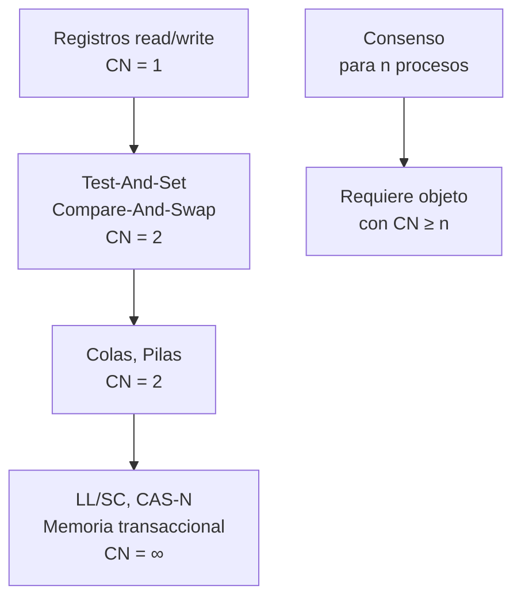
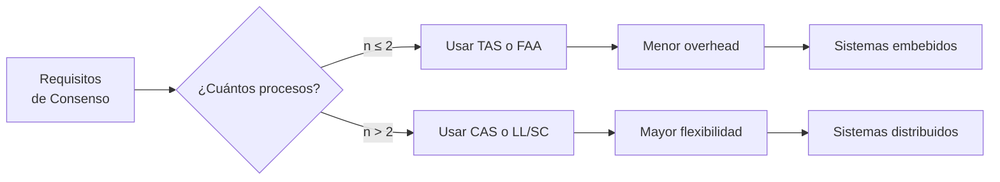

# Computación Concurrente - Consenso

## 6.4 El poder relativo de las primitivas de sincronización.

---

### Introducción al Poder de Sincronización

En computación concurrente, diferentes primitivas de sincronización tienen distinto "poder" para resolver problemas de coordinación. La teoría del **número de consenso** (consensus number) proporciona una forma sistemática de clasificar este poder.

#### Definición Fundamental

El **número de consenso** de un objeto concurrente es el máximo número de procesos para los cuales el objeto puede resolver el problema del consenso en un sistema wait-free.

$$ \text{ConsensusNumber}(X) = \max\{n \mid X \text{ resuelve consenso wait-free para } n \text{ procesos}\} $$

### Jerarquía de Números de Consenso

#### Teorema de la Jerarquía de Consenso



### Primitivas Básicas y su Poder

#### Registros Read/Write (CN = 1)

```java
public class ReadWriteRegister<T> {
    private T value;

    public synchronized T read() {
        return value;
    }

    public synchronized void write(T newValue) {
        this.value = newValue;
    }
}
```

**Teorema**: Los registros read/write no pueden resolver consenso para 2 procesos.

**Demostración**:

- Cualquier protocolo usando solo registros read/write tiene una ejecución bivalente
- El adversario puede mantener la bivalencia indefinidamente

#### Test-And-Set (CN = 2)

```java
public class TestAndSet {
    private boolean locked = false;

    public synchronized boolean testAndSet() {
        boolean oldValue = locked;
        locked = true;
        return oldValue;
    }

    public synchronized void reset() {
        locked = false;
    }
}
```

**Algoritmo de consenso para 2 procesos usando TAS**:

```java
public class TASConsensus {
    private TestAndSet tas = new TestAndSet();
    private int[] proposed = new int[2];

    public int decide(int value, int processId) {
        proposed[processId] = value;

        if (tas.testAndSet() == false) {
            // Soy el primero - decido mi valor
            return value;
        } else {
            // Alguien llegó primero - decido su valor
            return proposed[1 - processId];
        }
    }
}
```

#### Compare-And-Swap (CN = ∞)

```java
public class CASRegister<T> {
    private T value;

    public synchronized boolean compareAndSet(T expected, T newValue) {
        if (this.value == expected) {
            this.value = newValue;
            return true;
        }
        return false;
    }

    public synchronized T get() {
        return value;
    }
}
```

**Algoritmo de consenso wait-free para n procesos usando CAS**:

```java
public class CASConsensus<T> {
    private AtomicReference<T> decision = new AtomicReference<>(null);

    public T propose(T value) {
        if (decision.compareAndSet(null, value)) {
            return value; // Soy el primero
        } else {
            return decision.get(); // Alguien ya decidió
        }
    }
}
```

### Demostraciones de Imposibilidad

#### Teorema: Registros Read/Write tienen CN = 1

**Demostración por indistinguibilidad**:

```java
public class ReadWriteImpossibility {
    // Lemma: Desde cualquier configuración bivalente,
    // existe un paso que mantiene la bivalencia

    public static void demonstrateIndistinguishability() {
        // Para dos procesos p y q
        // Cualquier escritura por p hace la configuración indistinguible
        // para q de una configuración donde p no escribió
    }
}
```

**Argumento formal**:

1. Sea $C$ una configuración bivalente
2. Sea $e_p$ un evento de $p$ y $e_q$ un evento de $q$
3. Si $e_p$ y $e_q$ son lecturas, no cambian el estado global
4. Si $e_p$ es escritura, $q$ no puede distinguir inmediatamente
5. ∴ Se puede mantener bivalencia

### Construcción de Objetos de Alto Número de Consenso

#### De Test-And-Set a Consenso para 2 Procesos

```java
public class TwoProcessConsensusFromTAS {
    private TestAndSet tas = new TestAndSet();
    private Register[] registers = new Register[2];

    class Register {
        int value;
        boolean written = false;
    }

    public int decide(int value, int processId) {
        registers[processId].value = value;
        registers[processId].written = true;

        if (tas.testAndSet() == false) {
            // Ganador - decide su valor
            return value;
        } else {
            // Perdedor - decide el valor del otro
            int other = 1 - processId;
            while (!registers[other].written) {
                // Esperar a que el otro escriba
            }
            return registers[other].value;
        }
    }
}
```

#### Algoritmo de Consenso para Múltiples Procesos

```java
public class TournamentConsensus {
    private CASConsensus[] tournamentTree;
    private int treeSize;

    public TournamentConsensus(int numProcesses) {
        this.treeSize = numProcesses - 1;
        this.tournamentTree = new CASConsensus[treeSize];
        for (int i = 0; i < treeSize; i++) {
            tournamentTree[i] = new CASConsensus<>();
        }
    }

    public Object propose(Object value, int processId) {
        int node = processId + treeSize;

        while (node > 0) {
            int parent = (node - 1) / 2;
            Object opponentsValue = tournamentTree[parent].propose(value);
            if (opponentsValue != null) {
                value = opponentsValue; // Perdedor adopta valor del ganador
            }
            node = parent;
        }
        return value;
    }
}
```

### La Jerarquía Completa

#### Tabla de Números de Consenso

| Primitiva de Sincronización   | Número de Consenso | Ejemplo de Implementación         |
| ----------------------------- | ------------------ | --------------------------------- |
| Registros read/write          | 1                  | `synchronized` en Java            |
| Test-And-Set                  | 2                  | `AtomicBoolean`                   |
| Fetch-And-Add                 | 2                  | `AtomicInteger`                   |
| Swap                          | 2                  | `AtomicReference`                 |
| Colas/Pilas                   | 2                  | `ConcurrentLinkedQueue`           |
| Compare-And-Swap              | ∞                  | `AtomicReference.compareAndSet()` |
| Load-Linked/Store-Conditional | ∞                  | Implementaciones hardware         |
| Memoria transaccional         | ∞                  | `synchronized` bloques            |

#### Teorema de Complejidad

Para resolver consenso wait-free para $n$ procesos, se necesita al menos una primitiva con:

$$ \text{ConsensusNumber} \geq n $$

**Corolario**: No se puede construir una primitiva con número de consenso $m$ usando solo primitivas con número de consenso $< m$.

### Ejercicios Propuestos

#### Ejercicio 1: Demostración para Fetch-And-Add

Demuestre que Fetch-And-Add tiene número de consenso exactamente 2.

1. Implemente consenso para 2 procesos usando Fetch-And-Add
2. Demuestre que no puede resolver consenso para 3 procesos

```java
public class FetchAndAdd {
    private int value = 0;

    public synchronized int fetchAndAdd(int delta) {
        int oldValue = value;
        value += delta;
        return oldValue;
    }
}
```

#### Ejercicio 2: Análisis de Algoritmos Existentes

Analice las siguientes estructuras de datos y determine su número de consenso:

```java
public class MysteryObject {
    private int[] array;
    private AtomicInteger index = new AtomicInteger(0);

    public void add(int value) {
        int i = index.getAndIncrement();
        array[i] = value;
    }

    public int getFirst() {
        return array[0];
    }
}
```

#### Ejercicio 3: Construcción de Objetos

Diseñe un objeto con número de consenso 3 usando solo objetos con número de consenso 2.

**Pista**: Use un torneo de 3 procesos.

#### Ejercicio 4: Algoritmo Universal

Implemente un algoritmo universal wait-free para cualquier objeto secuencial usando Compare-And-Swap.

### Aplicaciones Prácticas

#### Selección de Primitivas en Diseño de Sistemas



#### Ejemplo: Pool de Threads con Consenso

```java
public class ConsensusThreadPool {
    private final CASConsensus<Runnable>[] consensusObjects;
    private final WorkerThread[] workers;

    public ConsensusThreadPool(int numThreads) {
        this.consensusObjects = new CASConsensus[numThreads];
        this.workers = new WorkerThread[numThreads];

        for (int i = 0; i < numThreads; i++) {
            consensusObjects[i] = new CASConsensus<>();
            workers[i] = new WorkerThread(consensusObjects[i]);
            workers[i].start();
        }
    }

    public void execute(Runnable task) {
        // Cada tarea compite en todos los objetos de consenso
        for (CASConsensus<Runnable> consensus : consensusObjects) {
            Runnable decidedTask = consensus.propose(task);
            if (decidedTask == task) {
                return; // Mi tarea fue aceptada
            }
        }
        // Si ninguna aceptó, re-intentar o rechazar
    }
}
```

### Demostraciones Formales

#### Teorema de Incomparabilidad

No todos los objetos con el mismo número de consenso son equivalentes.

**Ejemplo**: Test-And-Set y Colas ambos tienen CN = 2, pero:

- Se puede implementar una cola usando Test-And-Set
- No se puede implementar Test-And-Set usando solo colas

#### Jerarquía Estricta

Para cualquier $n$, existen objetos con número de consenso exactamente $n$.

**Construcción**:

```java
public class nConsensusObject {
    // Objeto que resuelve consenso para exactamente n procesos
    // pero no para n+1 procesos
}
```

### Ejercicios Avanzados

#### Ejercicio 5: Análisis de Performance

Compare el rendimiento de diferentes primitivas para resolver consenso en sistemas con contención:

1. Mida el throughput usando registros vs TAS vs CAS
2. Analice el comportamiento bajo alta contención
3. Proponga criterios de selección basados en patrones de acceso

#### Ejercicio 6: Consenso en Sistemas Heterogéneos

Diseñe un algoritmo que use múltiples primitivas diferentes optimizadas para diferentes escenarios:

- Usar TAS cuando hay poca contención
- Cambiar a CAS bajo alta contención
- Fallback a registros read/write para operaciones de solo lectura

#### Ejercicio 7: Verificación Formal

Modele en TLA+ o similar la jerarquía de números de consenso y demuestre:

1. Que los registros read/write no pueden resolver consenso para 2 procesos
2. Que CAS puede resolver consenso para cualquier número de procesos

### Implementaciones de Referencia

#### Consenso Wait-Free con LL/SC

```java
public class LLSCConsensus<T> {
    private static class Node<T> {
        T value;
        boolean decided = false;
    }

    private Node<T>[] nodes;
    private AtomicReference<Node<T>> leader = new AtomicReference<>(null);

    @SuppressWarnings("unchecked")
    public LLSCConsensus(int numProcesses) {
        nodes = new Node[numProcesses];
        for (int i = 0; i < numProcesses; i++) {
            nodes[i] = new Node<>();
        }
    }

    public T propose(T value, int processId) {
        nodes[processId].value = value;

        Node<T> currentLeader = leader.get();
        if (currentLeader == null) {
            if (leader.compareAndSet(null, nodes[processId])) {
                // Soy el líder
                nodes[processId].decided = true;
                return value;
            } else {
                currentLeader = leader.get();
            }
        }

        // Esperar a que el líder decida
        while (!currentLeader.decided) {
            Thread.yield();
        }
        return currentLeader.value;
    }
}
```

### Referencias Bibliográficas

#### Bibliografía Básica

1. **Herlihy, M. & Shavit, N. (2008)**. _The Art of Multiprocessor Programming_
   - Capítulo 5: "Consensus"
   - Sección 5.5: "The Wait-Free Hierarchy"
   - Teorema fundamental de la jerarquía

2. **Taubenfeld, G. (2006)**. _Synchronization Algorithms and Concurrent Programming_
   - Capítulo 7: "The Relative Power of Primitive"
   - Análisis comparativo de primitivas
   - Demostraciones de imposibilidad

#### Publicaciones Seminales

3. **Herlihy, M. (1991)**. "Wait-Free Synchronization"
   - Introducción del concepto de número de consenso
   - Jerarquía de poder de sincronización
   - Construcciones universales

4. **Loui, M. & Abu-Amara, H. (1987)**. "Memory Requirements for Agreement Among Unreliable Asynchronous Processes"

#### Bibliografía Complementaria

5. **Attiya, H. & Welch, J. (2004)**. _Distributed Computing: Fundamentals, Simulations, and Advanced Topics_
   - Capítulo 5: "Fault-Tolerant Consensus"
   - Análisis de poder de objetos compartidos

### Resumen de la Jerarquía

| Nivel      | Primitivas                        | Características                             |
| ---------- | --------------------------------- | ------------------------------------------- |
| **CN = 1** | Registros read/write              | No resuelven consenso para ≥ 2 procesos     |
| **CN = 2** | TAS, FAA, Swap, Colas             | Resuelven para 2 procesos pero no para 3    |
| **CN = ∞** | CAS, LL/SC, Memoria transaccional | Resuelven para cualquier número de procesos |

#### Fórmulas Clave

- **Número de consenso**: $CN(X) = \max\{n \mid X \text{ resuelve consenso wait-free para n procesos}\}$
- **Composición**: $CN(X \otimes Y) = \max(CN(X), CN(Y))$
- **Imposibilidad**: Si $CN(X) < n$, entonces no se puede construir consenso para $n$ procesos usando solo $X$
