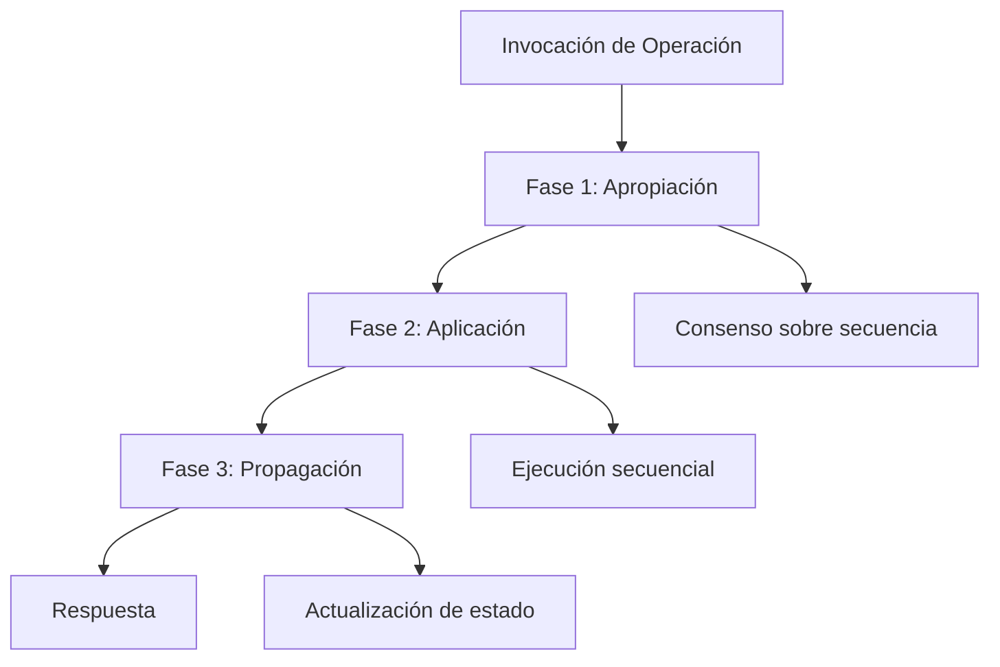
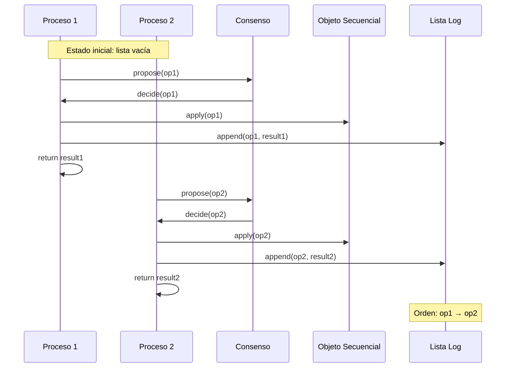
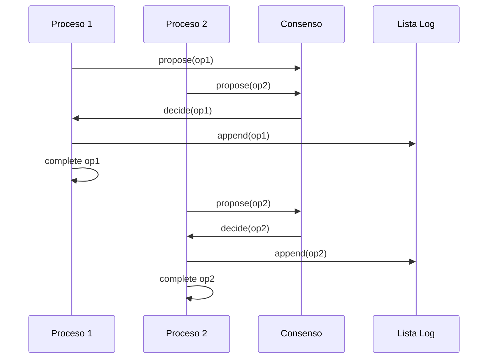

# Computación Concurrente - Consenso

## 6.5 Universalidad del consenso.

---

El concepto de **universalidad** establece que cualquier objeto concurrente puede ser implementado de manera wait-free si disponemos de una primitiva con número de consenso suficiente. Este resultado fundamental conecta el problema del consenso con la construcción de estructuras de datos concurrentes.

#### Teorema de Universalidad de Herlihy

**Teorema**: Si un objeto tiene número de consenso $n$, entonces puede utilizarse para construir una implementación wait-free de cualquier objeto secuencial para $n$ procesos.

$$ \text{ConsensusNumber}(X) \geq n \Rightarrow X \text{ es universal para } n \text{ procesos} $$

### Fundamentos Teóricos

#### Objetos Secuenciales y Concurrentes

**Definición**: Un objeto secuencial es una tupla $(Q, q_0, O, R, \delta)$ donde:

- $Q$: conjunto de estados
- $q_0 \in Q$: estado inicial
- $O$: conjunto de operaciones
- $R$: conjunto de respuestas
- $\delta: Q \times O \rightarrow Q \times R$: función de transición

**Objeto concurrente**: Extensión que permite invocaciones concurrentes manteniendo consistencia linealizable.

#### Linearizability

Una historia concurrente $H$ es linearizable si existe una historia secuencial $S$ equivalente a alguna permutación de $H$ que preserva el orden parcial de $H$ y respeta la especificación secuencial del objeto.

$$ H \text{ es linearizable} \iff \exists S: H \equiv S \land S \models \text{Spec} $$

### Construcción Universal Básica

#### Esquema General



#### Implementación con Lista Enlazada

```java
public class UniversalConsensusObject<T> {
    private static class Node {
        Object operation;
        Object response;
        Node next;
        Consensus<Node> decideNext;

        Node(Object op) {
            this.operation = op;
            this.decideNext = new Consensus<>();
        }
    }

    private Node tail;
    private final Object sequentialObject;

    public UniversalConsensusObject(Object seqObject) {
        this.sequentialObject = seqObject;
        this.tail = new Node(null); // nodo inicial
    }

    public Object apply(Object operation) {
        Node myNode = new Node(operation);
        Node current = tail;

        while (true) {
            Node next = current.decideNext.propose(myNode);
            current = next;

            if (next == myNode) {
                // Mi nodo fue aceptado, ejecutar operación
                myNode.response = executeSequentially(operation);
                tail = myNode;
                return myNode.response;
            }
        }
    }

    private Object executeSequentially(Object operation) {
        // Ejecutar operación en el objeto secuencial
        // usando reflexión o interfaz conocida
        return sequentialObject.execute(operation);
    }
}
```

### Construcción Detallada Paso a Paso

#### Estructura de Datos Universal

```java
public class UniversalConstruction<T> {
    private final Consensus<OperationNode> consensus;
    private OperationNode head;
    private final SequentialObject sequentialObject;

    private static class OperationNode {
        final Object operation;
        Object response;
        OperationNode next;
        volatile boolean applied = false;

        OperationNode(Object op) {
            this.operation = op;
        }
    }

    public interface SequentialObject {
        Object apply(Object operation);
    }

    public UniversalConstruction(SequentialObject seqObj,
                               Consensus<OperationNode> consensus) {
        this.sequentialObject = seqObj;
        this.consensus = consensus;
        this.head = new OperationNode(null); // nodo cabeza
    }

    public Object invoke(Object operation) {
        OperationNode myNode = new OperationNode(operation);
        OperationNode current = head;

        while (true) {
            // Intentar añadir nuestro nodo a la lista
            OperationNode next = current.next;
            if (next == null) {
                OperationNode decided = consensus.propose(myNode);
                if (decided == myNode) {
                    // Nuestro nodo fue elegido
                    myNode.response = sequentialObject.apply(operation);
                    myNode.applied = true;
                    current.next = myNode;
                    return myNode.response;
                } else {
                    // Otro nodo fue elegido, continuar
                    current = decided;
                }
            } else {
                // Ya hay siguiente nodo, avanzar
                current = next;

                // Si este nodo no ha sido aplicado, aplicarlo
                if (!current.applied) {
                    current.response = sequentialObject.apply(current.operation);
                    current.applied = true;
                }

                // Si es nuestro nodo, retornar respuesta
                if (current == myNode) {
                    return current.response;
                }
            }
        }
    }
}
```

### Ejemplo: Pila Universal

#### Implementación usando Consenso

```java
public class UniversalStack<T> {
    private final UniversalConstruction<Stack<T>> universal;
    private final Stack<T> sequentialStack;

    public UniversalStack(Consensus<OperationNode> consensus) {
        this.sequentialStack = new Stack<>();
        this.universal = new UniversalConstruction<>(
            new UniversalConstruction.SequentialObject() {
                @Override
                public Object apply(Object operation) {
                    StackOperation op = (StackOperation) operation;
                    switch (op.type) {
                        case PUSH:
                            sequentialStack.push((T) op.element);
                            return null;
                        case POP:
                            return sequentialStack.isEmpty() ? null : sequentialStack.pop();
                        case PEEK:
                            return sequentialStack.isEmpty() ? null : sequentialStack.peek();
                        default:
                            throw new IllegalArgumentException("Operación desconocida");
                    }
                }
            }, consensus);
    }

    public void push(T element) {
        universal.invoke(new StackOperation(OperationType.PUSH, element));
    }

    public T pop() {
        return (T) universal.invoke(new StackOperation(OperationType.POP, null));
    }

    public T peek() {
        return (T) universal.invoke(new StackOperation(OperationType.PEEK, null));
    }

    enum OperationType { PUSH, POP, PEEK }

    static class StackOperation {
        final OperationType type;
        final Object element;

        StackOperation(OperationType type, Object element) {
            this.type = type;
            this.element = element;
        }
    }
}
```

### Análisis de Correctitud

#### Teorema de Linearizability

**Teorema**: La construcción universal produce historias linearizables.

**Demostración**:

1. El orden de consenso establece un orden total de las operaciones
2. Cada operación se ejecuta exactamente una vez en el objeto secuencial
3. Las respuestas corresponden a la ejecución en el orden establecido

#### Teorema de Wait-Freedom

**Teorema**: La construcción universal es wait-free.

**Demostración**:

- Cada proceso eventualmente gana el consenso en algún nodo
- El número de nodos entre la cabeza y el nodo de un proceso es finito
- Cada paso acerca al proceso a su objetivo

$$ \forall P_i, \exists k: P_i \text{ decide en a lo más } k \text{ pasos} $$

### Optimizaciones y Variantes

#### Construcción con Arreglo de Anuncios

```java
public class OptimizedUniversalConstruction<T> {
    private final Consensus<Integer> consensus;
    private final OperationNode[] announced;
    private OperationNode[] head;
    private final SequentialObject sequentialObject;
    private final int numProcesses;

    public OptimizedUniversalConstruction(SequentialObject seqObj,
                                        Consensus<Integer> consensus,
                                        int n) {
        this.sequentialObject = seqObj;
        this.consensus = consensus;
        this.numProcesses = n;
        this.announced = new OperationNode[n];
        this.head = new OperationNode[n];

        // Inicializar todos los head al mismo nodo inicial
        OperationNode initial = new OperationNode(null);
        for (int i = 0; i < n; i++) {
            head[i] = initial;
        }
    }

    public Object invoke(Object operation, int processId) {
        announced[processId] = new OperationNode(operation);
        head[processId] = findMaxHead();

        while (announced[processId] != null) {
            OperationNode current = head[processId];
            OperationNode next = current.next;

            if (next == null) {
                // Elegir próximo nodo por consenso
                int winner = consensus.propose(processId);
                OperationNode nextNode = announced[winner];

                if (nextNode != null) {
                    current.next = nextNode;
                    nextNode.response = sequentialObject.apply(nextNode.operation);
                    nextNode.applied = true;
                    announced[winner] = null;
                }
            } else {
                // Aplicar operación si no se ha aplicado
                if (!next.applied) {
                    next.response = sequentialObject.apply(next.operation);
                    next.applied = true;
                }
                head[processId] = next;

                if (next == announced[processId]) {
                    announced[processId] = null;
                    return next.response;
                }
            }
        }

        return null; // No debería llegar aquí
    }

    private OperationNode findMaxHead() {
        OperationNode max = head[0];
        for (int i = 1; i < numProcesses; i++) {
            // Encontrar el head más avanzado
            // Esto requiere un orden total en los nodos
        }
        return max;
    }
}
```

### Aplicaciones de la Universalidad

#### Sistema de Transacciones

```java
public class TransactionalMemory {
    private final UniversalConstruction<Map<Object, Object>> universal;
    private final Map<Object, Object> sequentialMap;

    public TransactionalMemory(Consensus<OperationNode> consensus) {
        this.sequentialMap = new HashMap<>();
        this.universal = new UniversalConstruction<>(
            new UniversalConstruction.SequentialObject() {
                @Override
                public Object apply(Object operation) {
                    Transaction tx = (Transaction) operation;
                    return executeTransaction(tx);
                }
            }, consensus);
    }

    public Object execute(Transaction transaction) {
        return universal.invoke(transaction);
    }

    private Object executeTransaction(Transaction tx) {
        // Ejecutar transacción atómicamente en el mapa secuencial
        Map<Object, Object> snapshot = new HashMap<>(sequentialMap);

        for (Operation op : tx.operations) {
            if (op instanceof ReadOp) {
                ReadOp read = (ReadOp) op;
                read.result = snapshot.get(read.key);
            } else if (op instanceof WriteOp) {
                WriteOp write = (WriteOp) op;
                snapshot.put(write.key, write.value);
            }
        }

        // Commit si no hay conflictos
        sequentialMap.putAll(snapshot);
        return tx.result;
    }
}
```

### Ejercicios Propuestos

#### Ejercicio 1: Implementación de Cola Universal

Implemente una cola concurrente wait-free usando la construcción universal.

```java
public class UniversalQueue<T> {
    // TODO: Implementar usando UniversalConstruction
    // Operaciones: enqueue(T element), T dequeue()
}
```

**Requisitos**:

1. Demuestre que es linearizable
2. Pruebe que es wait-free
3. Analice el costo en términos de consensos por operación

#### Ejercicio 2: Análisis de Performance

Analice el rendimiento de la construcción universal:

1. ¿Cuántos consensos se necesitan por operación en el peor caso?
2. ¿Cómo afecta el número de procesos al rendimiento?
3. Proponga una optimización para operaciones de solo lectura

#### Ejercicio 3: Construcción con Múltiples Objetos

Extienda la construcción universal para trabajar con múltiples objetos secuenciales:

```java
public class MultiUniversalConstruction {
    public Object invoke(Object target, Object operation, int processId) {
        // TODO: Extender para múltiples objetos
    }
}
```

#### Ejercicio 4: Recuperación de Fallos

Modifique la construcción universal para tolerar fallos de crash y recuperación:

```java
public class RecoverableUniversalConstruction {
    public void recover(int processId) {
        // TODO: Permitir que procesos se recuperen después de fallos
    }
}
```

### Diagramas de Ejecución

#### Flujo de la Construcción Universal



#### Ejecución con Contención



### Demostraciones Formales

#### Teorema de Completitud

**Teorema**: Si un tipo de objeto tiene una implementación wait-free para $n$ procesos, entonces tiene número de consenso al menos $n$.

**Demostración**:

- Podemos usar el objeto para resolver consenso
- Construcción por reducción al absurdo

#### Corolario de la Jerarquía

El número de consenso clasifica completamente el poder de los objetos para construir implementaciones wait-free:

$$ CN(X) = \max\{n \mid X \text{ puede implementar cualquier objeto para } n \text{ procesos}\} $$

### Implementaciones Avanzadas

#### Construcción con Snapshots Atómicos

```java
public class SnapshotUniversalConstruction<T> {
    private final AtomicSnapshot<OperationNode> snapshot;
    private final SequentialObject sequentialObject;

    public SnapshotUniversalConstruction(SequentialObject seqObj, int n) {
        this.sequentialObject = seqObj;
        this.snapshot = new AtomicSnapshot<>(n);
    }

    public Object invoke(Object operation, int processId) {
        OperationNode myNode = new OperationNode(operation);
        OperationNode[] currentView = snapshot.scan();

        // Encontrar el último nodo en la vista actual
        OperationNode lastNode = findLastNode(currentView);

        // Intentar añadir nuestro nodo
        while (true) {
            snapshot.update(processId, myNode);
            OperationNode[] newView = snapshot.scan();

            OperationNode newLastNode = findLastNode(newView);
            if (newLastNode == myNode) {
                // Nuestro nodo es el último, ejecutar
                myNode.response = executeFrom(lastNode, myNode);
                return myNode.response;
            } else if (newLastNode != lastNode) {
                // Alguien más avanzó, actualizar lastNode
                lastNode = newLastNode;
            }
        }
    }

    private Object executeFrom(OperationNode start, OperationNode end) {
        // Ejecutar todas las operaciones desde start hasta end
        OperationNode current = start;
        Object result = null;

        while (current != end) {
            result = sequentialObject.apply(current.operation);
            current = current.next;
        }

        return sequentialObject.apply(end.operation);
    }
}
```

### Ejercicios de Implementación

#### Ejercicio 5: Árbol Binario de Búsqueda Universal

Implemente un árbol binario de búsqueda concurrente usando la construcción universal.

**Características**:

- Operaciones: insert, delete, search
- Mantener propiedades de BST
- Wait-free para todas las operaciones

#### Ejercicio 6: Sistema de Archivos Concurrente

Diseñe un sistema de archivos concurrente usando universalidad:

```java
public class ConcurrentFileSystem {
    public File readFile(String path) { ... }
    public void writeFile(String path, File content) { ... }
    public void deleteFile(String path) { ... }
}
```

#### Ejercicio 7: Análisis de Complejidad

Analice las complejidades temporal y espacial de la construcción universal:

1. **Tiempo**: Número de consensos por operación
2. **Espacio**: Tamaño de la lista de operaciones
3. **Comunicación**: Mensajes intercambiados

### Referencias Bibliográficas

#### Bibliografía Básica

1. **Herlihy, M. & Shavit, N. (2008)**. _The Art of Multiprocessor Programming_
   - Capítulo 6: "Universality of Consensus"
   - Sección 6.3: "A Universal Construction"
   - Teorema fundamental y demostraciones

2. **Taubenfeld, G. (2006)**. _Synchronization Algorithms and Concurrent Programming_
   - Capítulo 16: "Universal Constructions"
   - Construcciones prácticas y optimizaciones

#### Publicación Seminal

3. **Herlihy, M. (1991)**. "Wait-Free Synchronization"
   - Introducción del concepto de universalidad
   - Jerarquía de números de consenso
   - Construcción universal original

#### Bibliografía Complementaria

4. **Shavit, N. (2011)**. "Data Structures in the Multicore Age"
   - Aplicaciones prácticas de la universalidad
   - Estructuras de datos concurrentes modernas

5. **Guerraoui, R. & Kapalka, M. (2008)**. "Principles of Transactional Memory"
   - Aplicación de universalidad en memoria transaccional

### Resumen de Conceptos Clave

| Concepto                   | Definición                                                  | Importancia                                      |
| -------------------------- | ----------------------------------------------------------- | ------------------------------------------------ |
| **Universalidad**          | Capacidad de implementar cualquier objeto usando consenso   | Conecta consenso con estructuras de datos        |
| **Linearizability**        | Propiedad de consistencia que preserva el orden real-time   | Garantiza corrección en ejecuciones concurrentes |
| **Wait-freedom**           | Garantía de progreso independiente de otros procesos        | Previene inanición y garantiza responsividad     |
| **Construcción Universal** | Algoritmo que usa consenso para construir objetos wait-free | Implementación práctica del teorema              |

#### Fórmulas y Teoremas Clave

- **Teorema de Universalidad**: $CN(X) \geq n \Rightarrow X$ es universal para $n$ procesos
- **Linearizability**: $H \equiv S \land S \models \text{Spec}$
- **Completitud**: Si $X$ es universal para $n$ procesos, entonces $CN(X) \geq n$

La universalidad del consenso establece que el consenso es el problema fundamental de la computación concurrente: cualquier objeto concurrente puede construirse a partir de primitivas de consenso, y el poder de estas primitivas determina exactamente para cuántos procesos podemos construir implementaciones wait-free.
