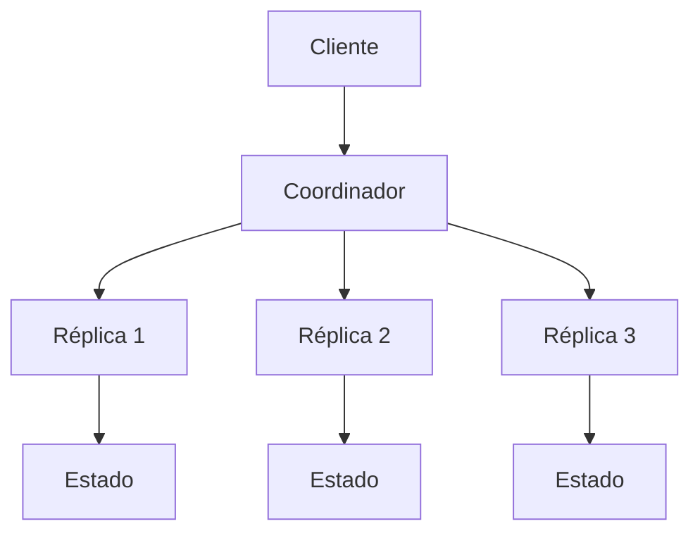
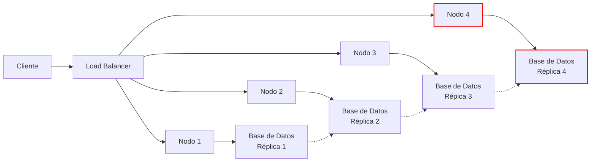
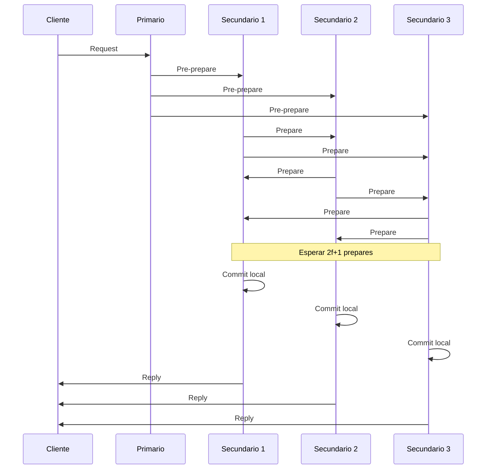

# Computación Concurrente - Temas selectos

## 7.1 Tolerancia a fallas benignas y bizantinas.

---

En sistemas distribuidos y concurrentes, la tolerancia a fallas es la capacidad de un sistema para continuar operando correctamente incluso cuando algunos de sus componentes fallan. Las fallas se clasifican principalmente en dos categorías: benignas y bizantinas.

### Definiciones Fundamentales

#### Fallas Benignas

Las fallas benignas son aquellas donde el componente fallido deja de funcionar pero no produce comportamientos maliciosos o incorrectos. Incluyen:

- **Fallos por parada (Crash faults)**: Un proceso simplemente deja de funcionar
- **Fallos de omisión**: Un proceso no responde a mensajes o no completa operaciones
- **Fallos temporales**: El proceso se recupera después de un período de inactividad

#### Fallas Bizantinas

Las fallas bizantinas son aquellas donde un componente fallido puede comportarse de manera arbitraria e impredecible, potencialmente de forma maliciosa. El nombre proviene del "Problema de los Generales Bizantinos".

**Definición formal**: Un sistema sufre una falla bizantina cuando uno o más procesos exhiben un comportamiento que diverge del protocolo especificado, pudiendo enviar mensajes contradictorios o información incorrecta a diferentes partes del sistema.

### Modelos de Sistema

#### Modelo de Fallas Benignas

En un sistema con $n$ procesos y hasta $f$ fallas benignas, para lograr consenso se requiere:

$$
n > f
$$

#### Modelo de Fallas Bizantinas

Para tolerar $f$ fallas bizantinas, el sistema debe cumplir:

$$
n > 3f
$$

Esta condición asegura que los procesos correctos puedan alcanzar consenso a pesar de los procesos faultys.

### Algoritmos para Fallas Benignas

#### Consenso en Sincronía

```python
class BenignConsensus:
    def __init__(self, process_id, total_processes):
        self.id = process_id
        self.n = total_processes
        self.values = []
        self.decision = None

    def propose(self, value, round_num):
        # Fase 1: Enviar valor a todos
        broadcast(value)

        # Fase 2: Recibir valores
        received_values = receive_all()
        self.values = received_values

        # Decidir por mayoría o valor predeterminado
        if len(received_values) > self.n // 2:
            self.decision = majority(received_values)
        else:
            self.decision = default_value

        return self.decision
```

### Algoritmos para Fallas Bizantinas

#### Algoritmo de Consenso Bizantino

El algoritmo requiere $n > 3f$ y opera en $f + 1$ rondas:

```python
class ByzantineConsensus:
    def __init__(self, process_id, total_processes, faulty_count):
        self.id = process_id
        self.n = total_processes
        self.f = faulty_count
        self.values = {}
        self.decision = None

    def byzantine_agreement(self, initial_value):
        values = [initial_value]

        for round in range(self.f + 1):
            # Fase de comunicación
            if self.id == commander:
                broadcast(values)
            else:
                received = receive_from_commander()
                if is_valid(received):
                    values = merge(values, received)

            # Rotar comandante
            commander = (commander + 1) % self.n

        # Decisión final
        if len(values) == 1:
            self.decision = values[0]
        else:
            self.decision = default_value

        return self.decision
```

### Protocolos de Tolerancia a Fallas

#### Replicación de Máquina de Estados



#### Algoritmo PBFT (Practical Byzantine Fault Tolerance)

PBFT opera en 3 fases principales:

1. **Pre-prepare**: El nodo primario propone una operación
2. **Prepare**: Los nodos secundarios validan y preparan
3. **Commit**: Los nodos confirman la operación

La condición de seguridad requiere:

$$
2f + 1 \leq n
$$

### Fórmulas y Teoremas Importantes

#### Límite de Procesos Faulty

Para fallas bizantinas, el número mínimo de procesos es:

$$
n_{min} = 3f + 1
$$

#### Complejidad de Mensajes

En el peor caso, el número de mensajes para consenso bizantino es:

$$
M = O(n^2) \quad \text{por ronda}
$$

#### Tiempo de Ejecución

El tiempo para alcanzar consenso con fallas bizantinas:

$$
T = (f + 1) \cdot \Delta
$$

Donde $\Delta$ es el retardo máximo de mensaje.

### Ejemplos Prácticos

#### Ejemplo 1: Sistema Bancario Distribuido

```python
class ByzantineBank:
    def __init__(self, nodes):
        self.nodes = nodes
        self.accounts = {}
        self.consensus = ByzantineConsensus(len(nodes), len(nodes)//3)

    def transfer(self, from_acc, to_acc, amount):
        # Validar transacción
        if not self.validate_transfer(from_acc, to_acc, amount):
            return False

        # Alcanzar consenso bizantino
        transaction = (from_acc, to_acc, amount)
        decision = self.consensus.byzantine_agreement(transaction)

        if decision == transaction:
            self.execute_transfer(from_acc, to_acc, amount)
            return True
        return False

    def validate_transfer(self, from_acc, to_acc, amount):
        return (from_acc in self.accounts and
                self.accounts[from_acc] >= amount and
                to_acc in self.accounts)
```

#### Ejemplo 2: Detección de Fallas Bizantinas

```python
def detect_byzantine_behavior(messages, threshold=0.6):
    """
    Detecta comportamiento bizantino basado en inconsistencia de mensajes
    """
    inconsistency_scores = {}

    for process, received_msgs in messages.items():
        score = calculate_inconsistency(received_msgs)
        inconsistency_scores[process] = score

    # Identificar procesos sospechosos
    suspicious = [p for p, score in inconsistency_scores.items()
                 if score > threshold]

    return suspicious

def calculate_inconsistency(messages):
    """
    Calcula el nivel de inconsistencia en los mensajes de un proceso
    """
    if not messages:
        return 0.0

    conflicts = 0
    total_comparisons = 0

    for i, msg1 in enumerate(messages):
        for j, msg2 in enumerate(messages):
            if i != j and are_conflicting(msg1, msg2):
                conflicts += 1
            total_comparisons += 1

    return conflicts / total_comparisons if total_comparisons > 0 else 0.0
```

### Ejercicios Propuestos

#### Ejercicio 1: Análisis de Consenso

Dado un sistema distribuido con 7 procesos:

- ¿Cuántas fallas bizantinas puede tolerar?
- ¿Cuál es el número mínimo de procesos correctos necesarios?
- Diseñe el árbol de comunicación para 3 rondas

**Solución esperada:**

- Fallas bizantinas tolerables: $f = \lfloor \frac{n-1}{3} \rfloor = 2$
- Procesos correctos mínimos: $n - f = 5$
- Árbol de comunicación con depth = $f + 1 = 3$

#### Ejercicio 2: Implementación de PBFT

Implemente la fase de pre-prepare del algoritmo PBFT:

```python
def pbft_pre_prepare(self, operation, sequence_number):
    # Completar implementación
    pre_prepare_msg = {
        'type': 'PRE-PREPARE',
        'view': self.current_view,
        'sequence': sequence_number,
        'operation': operation,
        'digest': hash(operation)
    }

    # Verificar que soy el primario
    if self.is_primary():
        # Firmar y enviar a todos los secundarios
        signed_msg = self.sign_message(pre_prepare_msg)
        self.broadcast_to_backups(signed_msg)

    return pre_prepare_msg
```

#### Ejercicio 3: Simulación de Fallas

Simule un sistema con 4 procesos donde 1 es bizantino:

```python
class ByzantineSimulator:
    def simulate_byzantine_attack(self):
        processes = ['P0', 'P1', 'P2', 'P3']  # P0 es bizantino
        messages = {
            'P0': ['A', 'B', 'A'],  # Mensajes inconsistentes
            'P1': ['A', 'A', 'A'],
            'P2': ['A', 'A', 'A'],
            'P3': ['A', 'A', 'A']
        }

        suspicious = detect_byzantine_behavior(messages)
        print(f"Procesos sospechosos: {suspicious}")
```

### Diagramas de Tolerancia a Fallas

#### Arquitectura de Sistema Tolerante a Fallas



#### Flujo de Consenso Bizantino



### Evaluación de Desempeño

#### Métricas de Tolerancia a Fallas

- **Disponibilidad**: $A = \frac{MTTF}{MTTF + MTTR}$
- **Fiabilidad**: $R(t) = e^{-\lambda t}$
- **Latencia de consenso**: $L = f \cdot \delta + \tau$

Donde:

- MTTF: Mean Time To Failure
- MTTR: Mean Time To Repair
- $\lambda$: Tasa de fallas
- $\delta$: Retardo de mensaje
- $\tau$: Tiempo de procesamiento

### Casos de Estudio

#### Sistema de Votación Distribuido

Implemente un sistema de votación resistente a fallas bizantinas:

```python
class ByzantineVoting:
    def __init__(self, voters, candidates):
        self.voters = voters
        self.candidates = candidates
        self.votes = {}
        self.consensus_algorithm = ByzantineConsensus(len(voters))

    def cast_vote(self, voter_id, candidate):
        if voter_id not in self.voters:
            raise ValueError("Votador no autorizado")

        # Crear voto verificado
        vote = {
            'voter': voter_id,
            'candidate': candidate,
            'timestamp': time.time(),
            'signature': self.sign_vote(voter_id, candidate)
        }

        # Alcanzar consenso sobre el voto
        agreed_vote = self.consensus_algorithm.byzantine_agreement(vote)

        if agreed_vote == vote:
            self.record_vote(vote)
            return True
        return False

    def tally_votes(self):
        # Verificar integridad de todos los votos
        valid_votes = [v for v in self.votes.values()
                      if self.verify_vote_integrity(v)]

        # Contar votos por candidato
        results = {}
        for vote in valid_votes:
            candidate = vote['candidate']
            results[candidate] = results.get(candidate, 0) + 1

        return results
```

### Referencias

#### Bibliografía Básica

1. **Taubenfeld, G. (2006)**. _Synchronization Algorithms and Concurrent Programming_. Pearson/Prentice Hall.
   - Capítulo 9: "Fault-Tolerant Consensus"
   - Capítulo 10: "Byzantine Agreement"

2. **Herlihy, M. & Shavit, N. (2008)**. _The Art of Multiprocessor Programming_. Morgan Kaufmann.
   - Capítulo 5: "Consensus"
   - Capítulo 15: "Atomic Snapshots"

#### Bibliografía Complementaria

3. **Lamport, L. (2002)**. _Specifying Systems: The TLA+ Language and Tools for Hardware and Software Engineers_. Pearson Education.
   - Especificación formal de sistemas tolerantes a fallas
   - Verificación de protocolos de consenso

#### Referencias Adicionales

4. **Castro, M. & Liskov, B. (1999)**. "Practical Byzantine Fault Tolerance"
5. **Fischer, M., Lynch, N., & Paterson, M. (1985)**. "Impossibility of Distributed Consensus with One Faulty Process"

### Glosario de Términos

- **Consenso**: Acuerdo entre procesos sobre un valor
- **Quórum**: Mínimo número de procesos necesarios para tomar una decisión
- **Sincronía**: Suposición de límites conocidos en retardo de mensajes
- **Asincronía**: No hay garantías sobre tiempos de entrega
- **Validez**: Propiedad que asegura que el valor decidido fue propuesto por algún proceso
- **Acuerdo**: Todos los procesos correctos deciden el mismo valor
