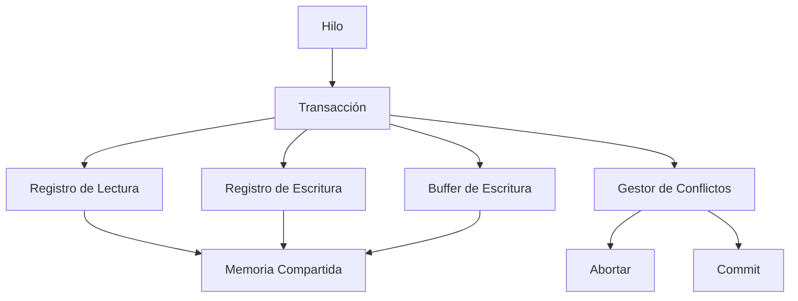
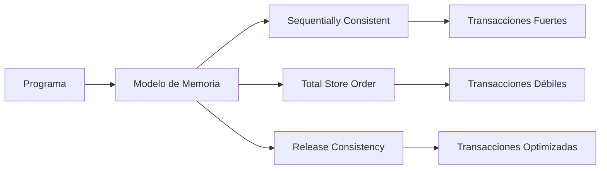

# Computación Concurrente - Temas selectos

## 7.2 Transacciones en memoria compartida

---

Las transacciones en memoria compartida son un mecanismo de programación concurrente que permite agrupar múltiples operaciones de lectura y escritura en una unidad atómica. Proporcionan una alternativa a los mecanismos tradicionales de sincronización como cerrojos y semáforos.

### Definiciones Fundamentales

#### Transacción de Memoria

Una transacción de memoria es una secuencia de operaciones de lectura y escritura sobre memoria compartida que se ejecuta atómicamente. Debe cumplir con las propiedades ACID:

- **Atomicidad**: Todas las operaciones se ejecutan o ninguna
- **Consistencia**: La transacción lleva al sistema de un estado consistente a otro
- **Aislamiento**: Las operaciones no son visibles hasta que la transacción commit
- **Durabilidad**: Una vez commit, los cambios son permanentes

#### Modelo de Memoria Transaccional

En un sistema con memoria transaccional, las operaciones se agrupan en:

```java
atomic {
    // secuencia de operaciones
    // lectura y escritura de variables compartidas
}
```

### Arquitectura de Memoria Transaccional

#### Componentes Principales



### Implementaciones de Memoria Transaccional

#### Memoria Transaccional Hardware (HTM)

Implementada directamente en hardware, ofrece alto rendimiento pero capacidad limitada.

#### Memoria Transaccional Software (STM)

Implementada en software, mayor flexibilidad pero overhead adicional.

### Algoritmos Básicos de STM

#### Algoritmo de Control de Concurrencia Optimista

```python
class SoftwareTransactionalMemory:
    def __init__(self):
        self.global_version = 0
        self.locks = {}
        self.values = {}
        self.version_table = {}

    def read(self, key, transaction):
        if key in transaction.write_set:
            return transaction.write_set[key]

        # Verificar consistencia de versión
        current_version = self.version_table.get(key, 0)
        if key in transaction.read_set:
            if transaction.read_set[key] != current_version:
                raise ConflictError("Read version mismatch")
        else:
            transaction.read_set[key] = current_version

        return self.values.get(key)

    def write(self, key, value, transaction):
        transaction.write_set[key] = value

    def commit(self, transaction):
        # Fase 1: Adquirir cerrojos en orden
        keys_sorted = sorted(transaction.write_set.keys())
        for key in keys_sorted:
            if not self.acquire_lock(key):
                self.release_locks(transaction)
                raise ConflictError("Cannot acquire lock")

        # Fase 2: Validar lectura
        for key, read_version in transaction.read_set.items():
            if self.version_table.get(key, 0) != read_version:
                self.release_locks(transaction)
                raise ConflictError("Validation failed")

        # Fase 3: Aplicar escrituras
        for key, value in transaction.write_set.items():
            self.values[key] = value
            self.version_table[key] = self.global_version + 1

        self.global_version += 1
        self.release_locks(transaction)
        return True
```

### Modelos de Consistencia

#### Serialización

Un historial de transacciones es serializable si es equivalente a alguna ejecución secuencial de las mismas transacciones.

#### Consistencia de Snapshot

Cada transacción ve una instantánea consistente de la memoria.

### Patrones de Programación Transaccional

#### Transacciones Anidadas

```java
public class NestedTransactions {
    private TransactionalMap<String, Integer> account;

    public boolean transfer(String from, String to, int amount) {
        return atomic(() -> {
            int balanceFrom = account.get(from);
            if (balanceFrom < amount) {
                return false;
            }

            // Transacción anidada para actualización
            atomic(() -> {
                account.put(from, balanceFrom - amount);
                account.put(to, account.get(to) + amount);
            });

            return true;
        });
    }
}
```

### Manejo de Conflictos

#### Estrategias de Resolución

1. **Abortar y Reintentar**
2. **Esperar y Continuar**
3. **Negociación de Prioridades**

#### Detección de Conflictos

Dos transacciones $T_i$ y $T_j$ conflictúan si:

$$
\text{Conflict}(T_i, T_j) = (W_i \cap R_j) \cup (R_i \cap W_j) \cup (W_i \cap W_j) \neq \emptyset
$$

Donde:

- $R_i$: Conjunto de lecturas de $T_i$
- $W_i$: Conjunto de escrituras de $T_i$

### Ejemplos Prácticos

#### Ejemplo 1: Contador Transaccional

```python
class TransactionalCounter:
    def __init__(self, stm):
        self.stm = stm
        self.key = "counter_value"

    def increment(self):
        while True:
            try:
                @atomic(stm)
                def _increment():
                    value = stm.read(self.key)
                    stm.write(self.key, value + 1)
                return _increment()
            except ConflictError:
                continue  # Reintentar

    def get_value(self):
        @atomic(stm)
        def _read():
            return stm.read(self.key)
        return _read()
```

#### Ejemplo 2: Lista Enlazada Transaccional

```java
public class TransactionalLinkedList<T> {
    private static class Node<T> {
        T value;
        Node<T> next;
    }

    private Node<T> head;

    public boolean add(T element) {
        return atomic(() -> {
            Node<T> newNode = new Node<>();
            newNode.value = element;

            if (head == null) {
                head = newNode;
            } else {
                Node<T> current = head;
                while (current.next != null) {
                    current = current.next;
                }
                current.next = newNode;
            }
            return true;
        });
    }

    public boolean contains(T element) {
        return atomic(() -> {
            Node<T> current = head;
            while (current != null) {
                if (current.value.equals(element)) {
                    return true;
                }
                current = current.next;
            }
            return false;
        });
    }
}
```

### Algoritmos Avanzados

#### TL2 (Transactional Locking 2)

```python
class TL2STM:
    def __init__(self):
        self.global_clock = 0
        self.lock_table = {}
        self.data_table = {}
        self.version_table = {}

    def validate_read_set(self, transaction):
        for key, read_time in transaction.read_set.items():
            current_version = self.version_table.get(key, 0)
            if current_version > read_time or self.is_locked(key):
                return False
        return True

    def commit(self, transaction):
        # Fase 1: Bloquear escrituras
        write_keys = list(transaction.write_set.keys())
        write_keys.sort()  # Ordenar para prevenir deadlock

        for key in write_keys:
            if not self.acquire_lock(key):
                self.release_locks(write_keys)
                return False

        # Fase 2: Incrementar reloj global
        commit_time = self.increment_global_clock()

        # Fase 3: Validar lecturas
        if not self.validate_read_set(transaction):
            self.release_locks(write_keys)
            return False

        # Fase 4: Aplicar escrituras
        for key, value in transaction.write_set.items():
            self.data_table[key] = value
            self.version_table[key] = commit_time

        # Fase 5: Liberar cerrojos
        self.release_locks(write_keys)
        return True
```

### Ejercicios Propuestos

#### Ejercicio 1: Implementación de STM Básica

Implemente un sistema básico de memoria transaccional que soporte operaciones atómicas:

```python
class SimpleSTM:
    def __init__(self):
        self.memory = {}
        self.locks = {}

    @contextmanager
    def atomic(self):
        transaction = Transaction()
        try:
            yield transaction
            self.commit(transaction)
        except ConflictError:
            self.rollback(transaction)
            raise

    def commit(self, transaction):
        # TODO: Implementar protocolo de commit
        # 1. Adquirir cerrojos en las claves de escritura
        # 2. Validar las lecturas
        # 3. Aplicar escrituras
        # 4. Liberar cerrojos
        pass
```

**Solución esperada:**

- Uso de cerrojos para escrituras
- Validación de versiones para lecturas
- Manejo de conflictos mediante abort y retry

#### Ejercicio 2: Árbol Binario Transaccional

Implemente un árbol binario de búsqueda con operaciones transaccionales:

```java
public class TransactionalBST<K extends Comparable<K>, V> {
    private Node root;

    private class Node {
        K key;
        V value;
        Node left, right;
    }

    public V get(K key) {
        return atomic(() -> {
            Node current = root;
            while (current != null) {
                int cmp = key.compareTo(current.key);
                if (cmp == 0) return current.value;
                current = cmp < 0 ? current.left : current.right;
            }
            return null;
        });
    }

    public void put(K key, V value) {
        atomic(() -> {
            // TODO: Implementar inserción transaccional
        });
    }
}
```

#### Ejercicio 3: Análisis de Conflictos

Analice el siguiente historial de transacciones y determine si es conflict-serializable:

```
T1: R(A), W(A), R(B), W(B)
T2: R(A), W(A), R(C), W(C)
T3: R(B), W(B), R(C), W(C)
```

**Solución:**

- Grafique el grafo de seriabilidad
- Identifique ciclos
- Determine si el historial es serializable

### Modelos de Memoria Transaccional

#### Semántica de Memoria



### Optimizaciones y Técnicas Avanzadas

#### Lecturas Inmutables

```python
class OptimizedSTM:
    def read_only_transaction(self, func):
        """Optimización para transacciones de solo lectura"""
        snapshot = self.create_snapshot()
        try:
            return func(snapshot)
        except ReadConflictError:
            # Reintentar con nueva snapshot
            return self.read_only_transaction(func)
```

#### Escrituras Privadas

```java
public class PrivatizationOptimization {
    private TransactionalReference<Set<String>> sharedSet;

    public void processBatch(List<String> items) {
        // Fase 1: Leer datos compartidos
        Set<String> snapshot = atomic(() -> {
            return new HashSet<>(sharedSet.get());
        });

        // Fase 2: Procesamiento local (sin transacciones)
        Set<String> results = new HashSet<>();
        for (String item : items) {
            if (snapshot.contains(item)) {
                results.add(processItem(item));
            }
        }

        // Fase 3: Escribir resultados
        atomic(() -> {
            sharedSet.get().addAll(results);
        });
    }
}
```

### Patrones de Diseño

#### Patrón Actor-Transaccional

```python
class ActorTransactionalPattern:
    def __init__(self, stm):
        self.stm = stm
        self.mailbox = Queue()
        self.state = {}

    def process_message(self, message):
        @atomic(self.stm)
        def handle():
            current_state = self.stm.read("actor_state")
            new_state = self.process_logic(current_state, message)
            self.stm.write("actor_state", new_state)
            return new_state

        return handle()
```

### Ejemplos de Aplicación

#### Sistema de Reservas

```java
public class BookingSystem {
    private TransactionalMap<String, Integer> availableSeats;
    private TransactionalMap<String, List<String>> userBookings;

    public boolean bookSeat(String userId, String eventId, int seats) {
        return atomic(() -> {
            Integer available = availableSeats.get(eventId);
            if (available == null || available < seats) {
                return false;
            }

            // Reservar asientos
            availableSeats.put(eventId, available - seats);

            // Actualizar reservas del usuario
            List<String> bookings = userBookings.getOrDefault(userId, new ArrayList<>());
            bookings.add(eventId + ":" + seats);
            userBookings.put(userId, bookings);

            return true;
        });
    }
}
```

### Evaluación de Rendimiento

#### Métricas de Desempeño

- **Throughput**: Número de transacciones por segundo

  $$
  \text{Throughput} = \frac{N_{\text{commit}}}{T_{\text{total}}}
  $$

- **Tasa de Abortos**:

  $$
  \text{Abort Rate} = \frac{N_{\text{abort}}}{N_{\text{abort}} + N_{\text{commit}}}
  $$

- **Latencia Promedio**:
  $$
  \text{Latency} = \frac{\sum T_{\text{commit}} + \sum T_{\text{abort}}}{N_{\text{total}}}
  $$

### Ejercicios Avanzados

#### Ejercicio 4: STM con Especificación TLA+

Modele un sistema de memoria transaccional usando TLA+:

```tla
---------------------------- MODULE SimpleSTM ----------------------------
EXTENDS Integers, Sequences, TLC

CONSTANT Keys, Values, Processes

(* Variables del sistema *)
VARIABLE
    memory,      \* Estado de la memoria
    transactions \* Transacciones activas

TypeInvariant ==
    /\ memory \in [Keys -> Values]
    /\ transactions \in SUBSET(Processes)

Commit(proc) ==
    /\ proc \in transactions
    /\ \E new_memory \in [Keys -> Values]:
        /\ memory' = new_memory
        /\ transactions' = transactions \ {proc}

Abort(proc) ==
    /\ proc \in transactions
    /\ UNCHANGED memory
    /\ transactions' = transactions \ {proc}

Next ==
    \E proc \in Processes:
        Commit(proc) \/ Abort(proc)

=============================================================================
```

#### Ejercicio 5: Análisis de Escalabilidad

Analice la escalabilidad de un sistema STM bajo diferentes cargas de trabajo:

- Carga de solo lectura vs. lectura-escritura
- Efecto del tamaño de las transacciones
- Impacto del número de hilos concurrentes

### Referencias

#### Bibliografía Básica

1. **Taubenfeld, G. (2006)**. _Synchronization Algorithms and Concurrent Programming_. Pearson/Prentice Hall.
   - Capítulo 7: "Transactional Memory"
   - Sección 7.4: "Obstruction-Free Synchronization"

2. **Herlihy, M. & Shavit, N. (2008)**. _The Art of Multiprocessor Programming_. Morgan Kaufmann.
   - Capítulo 18: "Transactional Memory"
   - Capítulo 19: "Software Transactional Memory"

#### Bibliografía Complementaria

3. **Lamport, L. (2002)**. _Specifying Systems: The TLA+ Language and Tools for Hardware and Software Engineers_. Pearson Education.
   - Especificación formal de sistemas transaccionales
   - Verificación de propiedades de seguridad y vivacidad

#### Referencias Técnicas

4. **Shavit, N. & Touitou, D. (1995)**. "Software Transactional Memory"
5. **Harris, T., et al. (2010)**. "Composable Memory Transactions"
6. **Dice, D., et al. (2006)**. "Transactional Locking II"

### Casos de Estudio Reales

#### Intel TSX (Transactional Synchronization Extensions)

Extensiones de hardware para memoria transaccional en procesadores Intel.

#### GCC STM

Implementación de memoria transaccional en software en el compilador GCC.

#### Clojure STM

Sistema de memoria transaccional en el lenguaje de programación Clojure.
