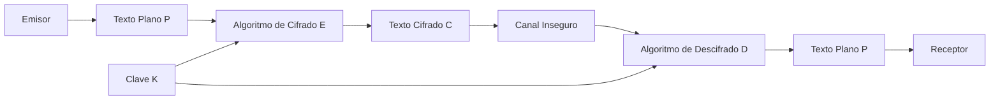
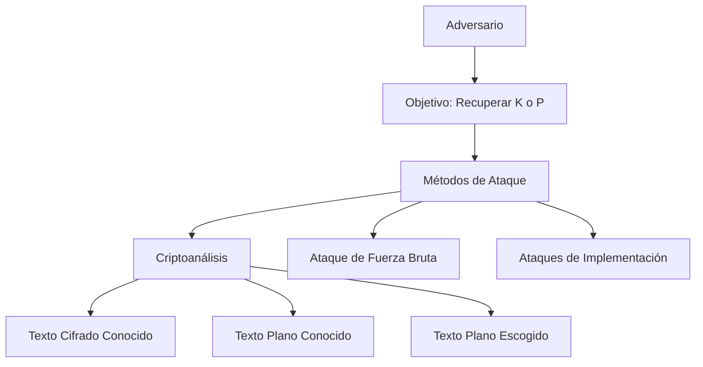

# Criptografía y Seguridad - Conceptos de seguridad y criptografía

## 1.1 Esquema general de la comunicación criptográfica.

---

La criptografía proporciona los fundamentos matemáticos y técnicos para proteger la información durante la transmisión y el almacenamiento. El esquema general de comunicación criptográfica establece los componentes básicos y el flujo de información en un sistema seguro.

### Conceptos Fundamentales de Seguridad

#### Objetivos de Seguridad

1. **Confidencialidad**: Garantizar que la información sea accesible solo a entidades autorizadas
2. **Integridad**: Asegurar que la información no sea alterada de manera no autorizada
3. **Autenticación**: Verificar la identidad de las entidades comunicantes
4. **No repudio**: Imposibilidad de negar la participación en una comunicación

### Componentes del Esquema Criptográfico

#### Elementos Básicos

- **Texto plano $(P)$**: Mensaje original en forma legible
- **Texto cifrado $(C)$**: Mensaje transformado mediante cifrado
- **Clave $(K)$**: Información secreta que controla la transformación
- **Algoritmo de cifrado $(E)$**: Función que transforma $P$ en $C$ usando $K$
- **Algoritmo de descifrado $(D)$**: Función que recupera $P$ desde $C$ usando $K$

#### Relaciones Matemáticas

El proceso de cifrado se representa como:

$$C = E(K, P)$$

El proceso de descifrado se representa como:

$$P = D(K, C)$$

Para que el sistema sea correcto, debe cumplirse:

$$D(K, E(K, P)) = P$$

### Diagrama del Esquema General



### Tipos de Criptografía

#### Criptografía Simétrica

Ambas partes comparten la misma clave secreta:

$$C = E(K, P)$$

$$P = D(K, C)$$

**Ventajas**:

- Alta velocidad de procesamiento
- Implementación eficiente

**Desventajas**:

- Problema de distribución de claves
- Escalabilidad limitada

#### Criptografía Asimétrica

Utiliza pares de claves pública-privada:

$$C = E(K_{pub}, P)$$

$$P = D(K_{priv}, C)$$

**Ventajas**:

- Soluciona el problema de distribución de claves
- Facilita la autenticación y no repudio

**Desventajas**:

- Mayor costo computacional
- Velocidad más lenta

### Modelo de Comunicación Segura

#### Componentes del Modelo

1. **Entidades**:
   - Emisor (Alice)
   - Receptor (Bob)
   - Adversario (Eve)

2. **Canales**:
   - Canal principal (inseguro)
   - Canal seguro para distribución de claves

3. **Procesos**:
   - Cifrado en origen
   - Transmisión segura
   - Descifrado en destino

### Ejemplo Práctico: Cifrado César

#### Implementación en Python

```python
def cifrado_cesar(texto, desplazamiento):
    """
    Implementa el cifrado César con desplazamiento fijo
    """
    resultado = ""
    for caracter in texto:
        if caracter.isalpha():
            ascii_base = ord('A') if caracter.isupper() else ord('a')
            nuevo_caracter = chr((ord(caracter) - ascii_base + desplazamiento) % 26 + ascii_base)
            resultado += nuevo_caracter
        else:
            resultado += caracter
    return resultado

def descifrado_cesar(texto_cifrado, desplazamiento):
    """
    Implementa el descifrado César
    """
    return cifrado_cesar(texto_cifrado, -desplazamiento)

# Ejemplo de uso
texto_original = "HOLA MUNDO"
clave = 3
texto_cifrado = cifrado_cesar(texto_original, clave)
texto_descifrado = descifrado_cesar(texto_cifrado, clave)

print(f"Texto original: {texto_original}")
print(f"Texto cifrado: {texto_cifrado}")
print(f"Texto descifrado: {texto_descifrado}")
```

#### Análisis Matemático

Para un alfabeto de 26 letras, el cifrado César se define como:

$$C = (P + K) \mod 26$$

$$P = (C - K) \mod 26$$

Donde:

- $P$: posición de la letra en texto plano (0-25)
- $C$: posición de la letra en texto cifrado (0-25)
- $K$: clave de desplazamiento

### Ataques Criptográficos

#### Clasificación de Ataques

1. **Ataque de texto cifrado solamente**
2. **Ataque de texto plano conocido**
3. **Ataque de texto plano escogido**
4. **Ataque de texto cifrado escogido**
5. **Ataque de fuerza bruta**

#### Modelo de Ataque



### Ejercicios Propuestos

#### Ejercicio 1: Análisis de Cifrado Simétrico

Dado el siguiente sistema de cifrado:

$$C = (P \times K) \mod 26$$

$$P = (C \times K^{-1}) \mod 26$$

Donde $K$ y $26$ deben ser coprimos.

**Preguntas**:

1. ¿Para qué valores de $K$ entre 1 y 25 existe inverso modular?
2. Cifre el mensaje "CRIPTO" con $K = 3$
3. Descifre "JXUQYO" con $K = 3$

#### Ejercicio 2: Diseño de Protocolo

Diseñe un esquema de comunicación que cumpla con:

- Confidencialidad
- Integridad
- Autenticación del emisor

**Requisitos**:

1. Especifique los algoritmos a usar
2. Describa el flujo de mensajes
3. Identifique las claves necesarias

#### Ejercicio 3: Análisis de Seguridad

Para un sistema que usa cifrado César $(K = 7)$:

1. Calcule el espacio de claves
2. Determine la complejidad del ataque por fuerza bruta
3. Proponga una mejora para aumentar la seguridad

### Conceptos Avanzados

#### Principio de Kerckhoffs

"La seguridad de un sistema criptográfico debe residir en la clave, no en el secreto del algoritmo."

#### Entropía y Espacio de Claves

La seguridad de un sistema depende del tamaño del espacio de claves:

$$S = |K|$$

Donde $S$ representa el número de claves posibles.

#### Teoría de la Información de Shannon

- **Entropía**: Medida de incertidumbre
- **Redundancia**: Características predecibles del lenguaje
- **Distancia de unicidad**: Cantidad de texto cifrado necesario para romper el sistema

### Implementación de Verificación

#### Código de Verificación de Integridad

```python
import hashlib

def calcular_hash(mensaje):
    """
    Calcula el hash SHA-256 de un mensaje
    """
    return hashlib.sha256(mensaje.encode()).hexdigest()

def verificar_integridad(mensaje, hash_original):
    """
    Verifica la integridad de un mensaje
    """
    hash_calculado = calcular_hash(mensaje)
    return hash_calculado == hash_original

# Ejemplo de uso
mensaje = "Mensaje importante"
hash_original = calcular_hash(mensaje)
print(f"Hash del mensaje: {hash_original}")

# Verificación
mensaje_alterado = "Mensaje alterado"
print(f"Integridad verificada: {verificar_integridad(mensaje_alterado, hash_original)}")
```

### Referencias

#### Bibliografía Básica

1. **Stallings, William** (2010). _Cryptography and Network Security: Principles and Practice_, 5a Ed., Prentice Hall.
   - Capítulo 1: Introducción a la seguridad
   - Capítulo 2: Conceptos criptográficos fundamentales

2. **Forouzan, Behrouz A.** (2008). _Cryptography and Network Security_, McGraw Hill.
   - Capítulo 1: Conceptos básicos de seguridad
   - Capítulo 2: Modelos de seguridad criptográfica

3. **Pfleeger, Charles P. y Shari L. Pfleeger** (2006). _Security in Computing_, 4a Ed., Prentice Hall.
   - Capítulo 2: Elementos de seguridad

#### Bibliografía Complementaria

1. **Stallings, William** (2010). _Network Security Essentials: Applications and Standards_, 4a Ed., Prentice Hall.

2. **Ferguson, Niels, Bruce Schneier y Tadayoshi Kohno** (2010). _Cryptography Engineering: Design Principles and Practical Applications_, Wiley.

3. **Menezes, Alfred, Paul van Oorschot y Scott Vanstone** (1996). _Handbook of Applied Cryptography_, CRC Press.

4. **Schneier, Bruce** (1996). _Applied Cryptography: Protocols, Algorithms, and Source Code in C_, 2a Ed., Wiley.

### Resumen de Conceptos Clave

- El esquema general define los componentes y flujos en comunicación segura
- La criptografía simétrica es eficiente pero tiene problemas de distribución de claves
- La criptografía asimétrica resuelve la distribución pero es computacionalmente costosa
- La seguridad debe basarse en principios establecidos como el de Kerckhoffs
- Los objetivos fundamentales son confidencialidad, integridad, autenticación y no repudio

### Próximos Temas

1. Algoritmos de cifrado simétrico (DES, AES)
2. Criptografía de clave pública (RSA, Diffie-Hellman)
3. Funciones hash y códigos de autenticación
4. Protocolos de autenticación y distribución de claves
