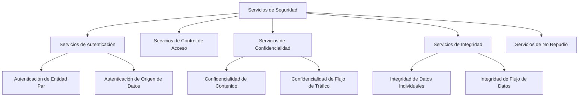
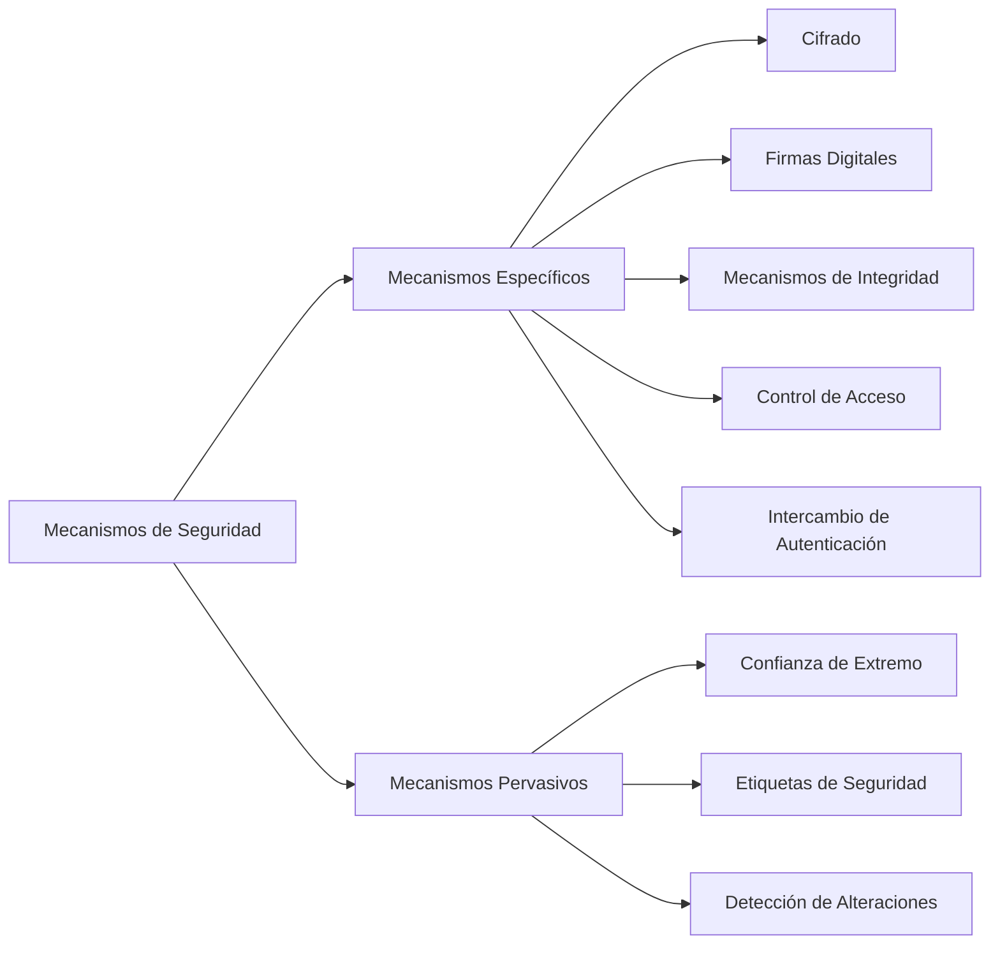
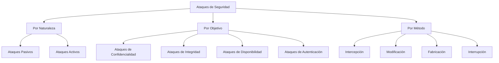
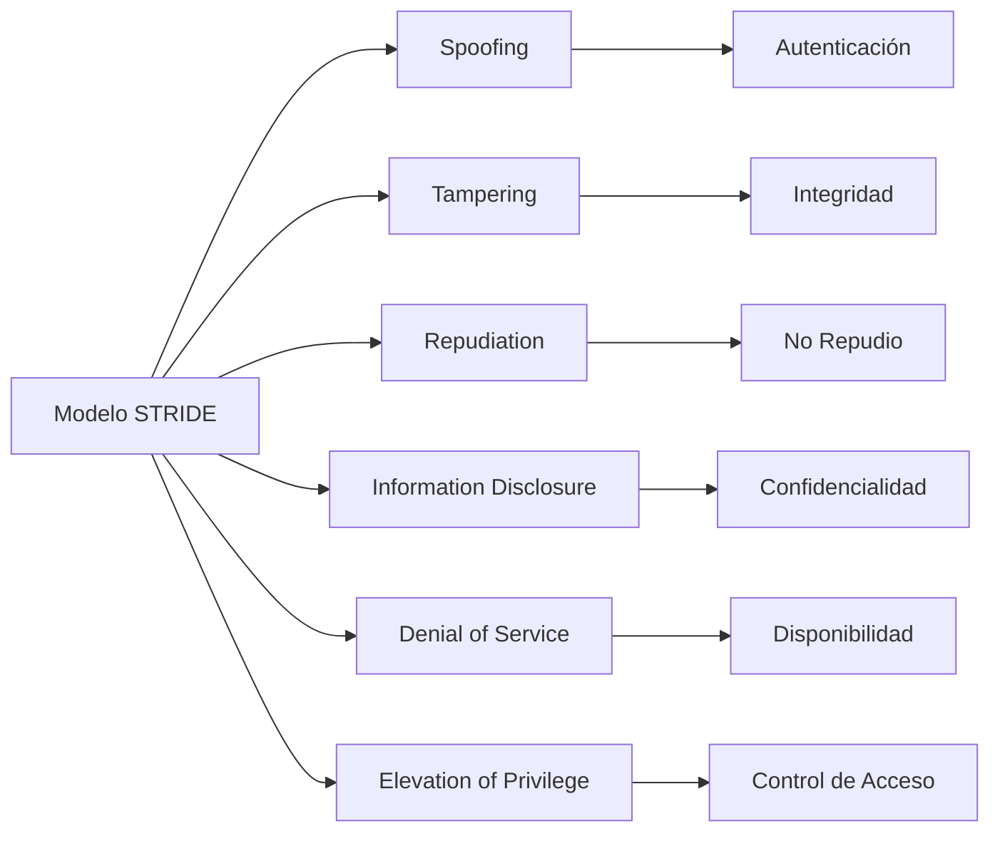

# Criptografía y Seguridad - Conceptos de seguridad y criptografía

## 1.2 Servicios y mecanismos de seguridad, ataques.

---

Los servicios y mecanismos de seguridad constituyen los pilares fundamentales para proteger la información en sistemas de comunicación. Esta guía explora los diferentes servicios de seguridad, los mecanismos que los implementan y los ataques que intentan vulnerarlos.

### Servicios de Seguridad

#### Definición Formal

Un servicio de seguridad es **una prestación que mejora la seguridad de los sistemas de procesamiento de datos y las transferencias de información** (ISO 7498-2).

#### Clasificación de Servicios de Seguridad



### Servicios de Autenticación

#### Autenticación de Entidad Par

**Definición**: Verificación de la identidad de las entidades comunicantes durante el establecimiento de la conexión.

**Ejemplo práctico**:

```python
import hashlib
import os
import hmac

class Autenticador:
    def __init__(self, clave_secreta):
        self.clave_secreta = clave_secreta

    def generar_desafio(self):
        """Genera un desafío aleatorio para autenticación"""
        return os.urandom(16)

    def calcular_respuesta(self, desafio):
        """Calcula la respuesta al desafío usando HMAC"""
        return hmac.new(
            self.clave_secreta.encode(),
            desafio,
            hashlib.sha256
        ).digest()

    def verificar_autenticidad(self, desafio, respuesta_recibida):
        """Verifica la respuesta al desafío"""
        respuesta_correcta = self.calcular_respuesta(desafio)
        return hmac.compare_digest(respuesta_correcta, respuesta_recibida)

# Ejemplo de uso
clave_compartida = "clave_secreta_123"
alice = Autenticador(clave_compartida)
bob = Autenticador(clave_compartida)

# Protocolo de autenticación
desafio = alice.generar_desafio()
respuesta = bob.calcular_respuesta(desafio)
autenticado = alice.verificar_autenticidad(desafio, respuesta)

print(f"Autenticación exitosa: {autenticado}")
```

#### Autenticación de Origen de Datos

**Definición**: Verificación de que los datos recibidos provienen de la fuente declarada.

**Fórmula usando HMAC**:

$$MAC = H(K \oplus opad \parallel H(K \oplus ipad \parallel mensaje))$$

Donde:

- $H$: Función hash criptográfica
- $K$: Clave secreta
- $opad$, $ipad$: Constantes de relleno

### Servicios de Control de Acceso

#### Modelo de Control de Acceso

```python
class SistemaControlAcceso:
    def __init__(self):
        self.politicas = {}
        self.roles = {}

    def definir_politica(self, recurso, rol, permiso):
        """Define políticas de acceso"""
        if recurso not in self.politicas:
            self.politicas[recurso] = {}
        self.politicas[recurso][rol] = permiso

    def asignar_rol(self, usuario, rol):
        """Asigna rol a usuario"""
        self.roles[usuario] = rol

    def verificar_acceso(self, usuario, recurso, accion):
        """Verifica si un usuario tiene acceso a un recurso"""
        if usuario not in self.roles:
            return False

        rol = self.roles[usuario]
        if (recurso in self.politicas and
            rol in self.politicas[recurso]):

            permisos = self.politicas[recurso][rol]
            return accion in permisos

        return False

# Ejemplo de implementación
sistema = SistemaControlAcceso()

# Definir políticas
sistema.definir_politica("base_datos", "admin", ["lectura", "escritura", "eliminacion"])
sistema.definir_politica("base_datos", "usuario", ["lectura"])

# Asignar roles
sistema.asignar_rol("alice", "admin")
sistema.asignar_rol("bob", "usuario")

# Verificar acceso
print(f"Alice puede escribir en BD: {sistema.verificar_acceso('alice', 'base_datos', 'escritura')}")
print(f"Bob puede eliminar en BD: {sistema.verificar_acceso('bob', 'base_datos', 'eliminacion')}")
```

### Servicios de Confidencialidad

#### Tipos de Confidencialidad

1. **Confidencialidad de Contenido**: Protección del contenido del mensaje
2. **Confidencialidad de Flujo**: Protección de la información sobre patrones de comunicación

**Fórmula de confidencialidad perfecta (Shannon)**:
Un sistema de cifrado tiene **confidencialidad perfecta** si:

$$P(P = p | C = c) = P(P = p) \quad \forall p, c$$

Donde:

- $P$: Texto plano
- $C$: Texto cifrado

#### Ejemplo de Cifrado para Confidencialidad

```python
from cryptography.fernet import Fernet
import base64

class SistemaConfidencialidad:
    def __init__(self):
        self.clave = Fernet.generate_key()
        self.cifrador = Fernet(self.clave)

    def cifrar_mensaje(self, mensaje):
        """Cifra un mensaje para confidencialidad"""
        return self.cifrador.encrypt(mensaje.encode())

    def descifrar_mensaje(self, mensaje_cifrado):
        """Descifra un mensaje"""
        return self.cifrador.decrypt(mensaje_cifrado).decode()

# Uso del sistema
sistema = SistemaConfidencialidad()
mensaje_secreto = "Información clasificada"

# Cifrado
mensaje_cifrado = sistema.cifrar_mensaje(mensaje_secreto)
print(f"Mensaje cifrado: {base64.b64encode(mensaje_cifrado).decode()}")

# Descifrado
mensaje_original = sistema.descifrar_mensaje(mensaje_cifrado)
print(f"Mensaje original: {mensaje_original}")
```

### Servicios de Integridad

#### Mecanismos de Integridad

**Función hash criptográfica**:

$$h = H(m)$$

Donde:

- $H$: Función hash (SHA-256, SHA-3, etc.)
- $m$: Mensaje
- $h$: Digest del mensaje

**Propiedades requeridas**:

1. **Resistencia a preimagen**: Dado $h$, es computacionalmente inviable encontrar $m$ tal que $H(m) = h$
2. **Resistencia a segunda preimagen**: Dado $m_1$, es inviable encontrar $m_2 \neq m_1$ con $H(m_1) = H(m_2)$
3. **Resistencia a colisiones**: Es inviable encontrar $m_1 \neq m_2$ con $H(m_1) = H(m_2)$

#### Implementación de Verificación de Integridad

```python
import hashlib
import hmac

class SistemaIntegridad:
    def __init__(self, clave_secreta):
        self.clave_secreta = clave_secreta

    def calcular_hmac(self, mensaje):
        """Calcula HMAC para verificación de integridad"""
        return hmac.new(
            self.clave_secreta.encode(),
            mensaje.encode(),
            hashlib.sha256
        ).hexdigest()

    def verificar_integridad(self, mensaje, hmac_recibido):
        """Verifica la integridad del mensaje"""
        hmac_calculado = self.calcular_hmac(mensaje)
        return hmac.compare_digest(hmac_calculado, hmac_recibido)

# Ejemplo de uso
sistema = SistemaIntegridad("clave_integridad")
mensaje_original = "Transacción por $1000"

# Calcular HMAC en el origen
hmac_original = sistema.calcular_hmac(mensaje_original)
print(f"HMAC calculado: {hmac_original}")

# Verificación en el destino
mensaje_alterado = "Transacción por $9000"
verificacion = sistema.verificar_integridad(mensaje_alterado, hmac_original)
print(f"Integridad verificada: {verificacion}")
```

### Servicio de No Repudio

#### Tipos de No Repudio

1. **No repudio de origen**: El emisor no puede negar el envío
2. **No repudio de recepción**: El receptor no puede negar la recepción

**Fórmula de firma digital**:

$$s = Sig_{K_{priv}}(H(m))$$

Verificación:

$$ Ver_{K_{pub}}(m, s) = \text{verdadero si s es válida} $$

#### Implementación de No Repudio

```python
from cryptography.hazmat.primitives import hashes
from cryptography.hazmat.primitives.asymmetric import rsa, padding
from cryptography.hazmat.primitives import serialization

class SistemaNoRepudio:
    def __init__(self):
        # Generar par de claves
        self.clave_privada = rsa.generate_private_key(
            public_exponent=65537,
            key_size=2048
        )
        self.clave_publica = self.clave_privada.public_key()

    def firmar_mensaje(self, mensaje):
        """Firma un mensaje digitalmente"""
        firma = self.clave_privada.sign(
            mensaje.encode(),
            padding.PSS(
                mgf=padding.MGF1(hashes.SHA256()),
                salt_length=padding.PSS.MAX_LENGTH
            ),
            hashes.SHA256()
        )
        return firma

    def verificar_firma(self, mensaje, firma, clave_publica):
        """Verifica una firma digital"""
        try:
            clave_publica.verify(
                firma,
                mensaje.encode(),
                padding.PSS(
                    mgf=padding.MGF1(hashes.SHA256()),
                    salt_length=padding.PSS.MAX_LENGTH
                ),
                hashes.SHA256()
            )
            return True
        except:
            return False

# Ejemplo de uso
sistema_alice = SistemaNoRepudio()
mensaje_contrato = "Acepto pagar $5000 el 30 de noviembre"

# Alice firma el contrato
firma = sistema_alice.firmar_mensaje(mensaje_contrato)
print(f"Firma generada: {firma.hex()[:50]}...")

# Bob verifica la firma
es_valida = sistema_alice.verificar_firma(
    mensaje_contrato,
    firma,
    sistema_alice.clave_publica
)
print(f"Firma válida: {es_valida}")
```

### Mecanismos de Seguridad

#### Clasificación de Mecanismos



#### Mecanismos Específicos

1. **Cifrado**: Algoritmos simétricos y asimétricos
2. **Firmas digitales**: RSA, DSA, ECDSA
3. **Funciones hash**: SHA-256, SHA-3
4. **MAC**: HMAC, CMAC
5. **Certificados digitales**: X.509

### Ataques de Seguridad

#### Taxonomía de Ataques



#### Ataques Pasivos vs Activos

| Característica | Ataques Pasivos                    | Ataques Activos                          |
| -------------- | ---------------------------------- | ---------------------------------------- |
| **Objetivo**   | Obtener información                | Alterar el sistema                       |
| **Detección**  | Difícil                            | Más fácil                                |
| **Prevención** | Cifrado                            | Mecanismos de autenticación e integridad |
| **Ejemplos**   | Eavesdropping, análisis de tráfico | Suplantación, modificación, DoS          |

#### Ejemplos de Ataques Específicos

```python
class SimuladorAtaques:
    """Simula diferentes tipos de ataques de seguridad"""

    def ataque_fuerza_bruta(self, texto_cifrado, algoritmo):
        """Simula ataque por fuerza bruta"""
        espacio_claves = 2**128  # Para AES-128
        intentos = 0
        # En la práctica, esto se optimizaría
        for intento in range(min(1000, espacio_claves)):
            intentos += 1
            # Simulación simplificada
            if intento == 999:  # "Encuentra" la clave
                return True, intentos
        return False, intentos

    def ataque_mitm(self, mensaje):
        """Simula ataque Man-in-the-Middle"""
        mensaje_interceptado = mensaje.replace("Alice", "Eve")
        mensaje_interceptado = mensaje_interceptado.replace("Bob", "Eve")
        return mensaje_interceptado

    def ataque_replay(self, mensaje_autenticado):
        """Simula ataque de repetición"""
        # Reenvía el mensaje autenticado
        return mensaje_autenticado

# Simulación de ataques
simulador = SimuladorAtaques()

# Ataque de fuerza bruta
exitoso, intentos = simulador.ataque_fuerza_bruta("texto_cifrado", "AES-128")
print(f"Ataque fuerza bruta: {exitoso} después de {intentos} intentos")

# Ataque MITM
mensaje_original = "Alice envía $100 a Bob"
mensaje_alterado = simulador.ataque_mitm(mensaje_original)
print(f"Ataque MITM: {mensaje_original} -> {mensaje_alterado}")
```

### Ejercicios Propuestos

#### Ejercicio 1: Análisis de Servicios de Seguridad

**Escenario**: Un sistema de banca en línea requiere:

- Login de usuarios
- Transferencias electrónicas
- Consulta de saldos

**Preguntas**:

1. Identifique qué servicios de seguridad son necesarios para cada operación
2. Proponga mecanismos específicos para implementar cada servicio
3. Diseñe un diagrama de secuencia que muestre la aplicación de estos servicios

#### Ejercicio 2: Diseño de Mecanismos de Defensa

**Requisitos**:

- Proteger confidencialidad de mensajes
- Garantizar integridad
- Proveer autenticación mutua
- Implementar no repudio

**Tareas**:

1. Especifique los algoritmos criptográficos a usar
2. Diseñe el formato de los mensajes protegidos
3. Implemente en Python un prototipo del sistema

#### Ejercicio 3: Análisis de Ataques

**Caso de estudio**: Un atacante intercepta comunicaciones en una red WiFi pública

**Análisis requerido**:

1. Clasifique los posibles ataques por tipo y método
2. Evalúe el impacto en los servicios de seguridad
3. Proponga contramedidas específicas
4. Calcule la complejidad computacional de los ataques posibles

#### Ejercicio 4: Implementación de HMAC

Implemente una función HMAC-SHA256 desde cero:

```python
def hmac_sha256(key, message):
    """
    Implementa HMAC-SHA256
    """
    # Bloques de 64 bytes para SHA-256
    block_size = 64

    # Ajustar la clave
    if len(key) > block_size:
        key = hashlib.sha256(key).digest()
    if len(key) < block_size:
        key += b'\x00' * (block_size - len(key))

    # Constantes
    opad = bytes([0x5c] * block_size)
    ipad = bytes([0x36] * block_size)

    # Calcular inner y outer
    inner_key = bytes([k ^ i for k, i in zip(key, ipad)])
    outer_key = bytes([k ^ o for k, o in zip(key, opad)])

    # HMAC calculation
    inner_hash = hashlib.sha256(inner_key + message).digest()
    outer_hash = hashlib.sha256(outer_key + inner_hash).digest()

    return outer_hash
```

### Modelo de Amenazas STRIDE



### Referencias

#### Bibliografía Básica

1. **Stallings, William** (2010). _Cryptography and Network Security: Principles and Practice_, 5a Ed., Prentice Hall.
   - Capítulo 1: Introducción - Servicios y mecanismos de seguridad
   - Capítulo 3: Autenticación y control de acceso

2. **Forouzan, Behrouz A.** (2008). _Cryptography and Network Security_, McGraw Hill.
   - Capítulo 1: Aspectos de seguridad - Servicios y ataques
   - Capítulo 11: Integridad de mensajes y autenticación

3. **Pfleeger, Charles P. y Shari L. Pfleeger** (2006). _Security in Computing_, 4a Ed., Prentice Hall.
   - Capítulo 1: ¿Es seguro? - Conceptos fundamentales
   - Capítulo 2: Herramientas criptográficas

#### Bibliografía Complementaria

1. **Stallings, William** (2010). _Network Security Essentials: Applications and Standards_, 4a Ed., Prentice Hall.

2. **Ferguson, Niels, Bruce Schneier y Tadayoshi Kohno** (2010). _Cryptography Engineering: Design Principles and Practical Applications_, Wiley.

3. **Menezes, Alfred, Paul van Oorschot y Scott Vanstone** (1996). _Handbook of Applied Cryptography_, CRC Press.

4. **Schneier, Bruce** (1996). _Applied Cryptography: Protocols, Algorithms, and Source Code in C_, 2a Ed., Wiley.

### Resumen de Conceptos Clave

- **Servicios de seguridad**: Conjunto de capacidades que mejoran la protección
- **Mecanismos de seguridad**: Implementaciones técnicas específicas
- **Ataques pasivos**: Interceptan información sin alterar el sistema
- **Ataques activos**: Modifican o interrumpen el funcionamiento normal
- **Defensa en profundidad**: Múltiples capas de seguridad
- **Principio de mínimo privilegio**: Solo los permisos necesarios

### Evaluación del Conocimiento

#### Preguntas de Revisión

1. ¿Cuál es la diferencia entre autenticación de entidad y autenticación de origen de datos?
2. ¿Cómo previene el no repudio que un usuario niegue una transacción?
3. ¿Qué mecanismo proporciona tanto integridad como autenticación?
4. ¿Por qué los ataques pasivos son más difíciles de detectar?
5. ¿Cómo se relacionan los servicios de seguridad con los mecanismos?

#### Caso Práctico Final

Diseñe un sistema seguro para:

- Autenticación de usuarios remotos
- Transferencia confidencial de documentos
- Registro auditor de todas las operaciones

Especifique: servicios necesarios, mecanismos a implementar y protecciones contra ataques conocidos.
