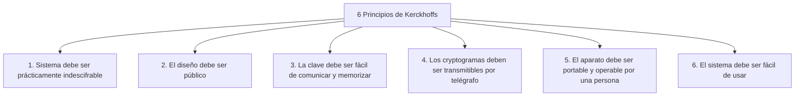
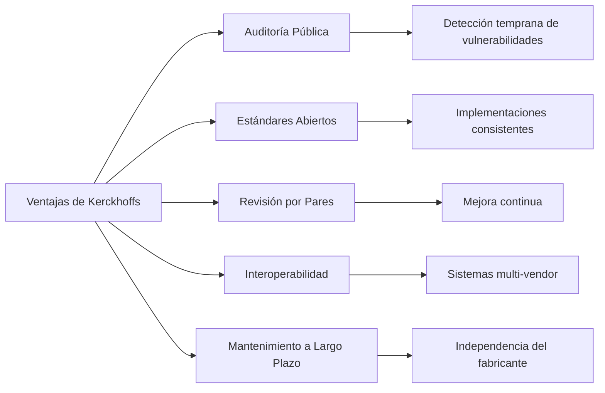
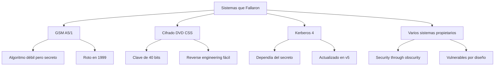
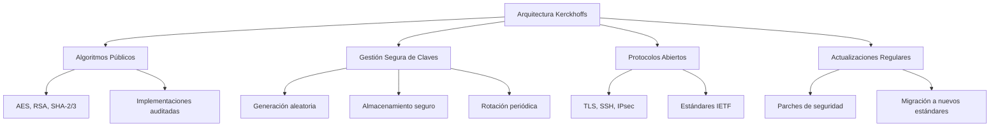

# Criptografía y Seguridad - Conceptos de seguridad y criptografía

## 1.3 Principios de Kerckhoffs.

---

El Principio de Kerckhoffs es uno de los fundamentos más importantes en el diseño de sistemas criptográficos modernos. Establecido por el lingüista y criptógrafo holandés Auguste Kerckhoffs en el siglo XIX, este principio ha guiado el desarrollo de sistemas seguros durante más de un siglo.

### Contexto Histórico

#### Auguste Kerckhoffs (1835-1903)

**Contribución fundamental**: En 1883, Kerckhoffs publicó "La Cryptographie Militaire" donde estableció seis principios para el diseño de sistemas criptográficos seguros. El segundo principio es el más conocido y perdurable.

#### Los Seis Principios Originales



### Formulación del Principio

#### Enunciado Original

> "El sistema no debe requerir secreto y debe poder caer en manos del enemigo sin inconvenientes"

#### Enunciado Moderno

> **"La seguridad de un sistema criptográfico debe residir en la clave secreta, no en el secreto del algoritmo"**

#### Representación Matemática

Para un sistema criptográfico con:

- Algoritmo público $A$
- Clave secreta $K$
- Texto plano $P$
- Texto cifrado $C$

El cifrado: $C = A(K, P)$  
El descifrado: $P = A^{-1}(K, C)$

**La seguridad debe cumplir**:

$$Seguridad(Sistema) = f(K) \neq f(secreto(A))$$

### Fundamentos Teóricos

#### Teoría de la Información de Shannon

Claude Shannon reformuló el principio como:  
**"El enemigo conoce el sistema"**

**Entropía de la clave**:

$$H(K) = - \sum_{i=1}^{n} p(k_i) \log_2 p(k_i)$$

Donde la seguridad del sistema depende de:

- El tamaño del espacio de claves: $|K|$
- La entropía de la clave: $H(K)$
- La aleatoriedad en la generación de claves

#### Ventajas del Principio



### Implementaciones Prácticas

#### Ejemplo: Sistema que Viola Kerckhoffs

```python
class SistemaSecretoInseguro:
    """
    Ejemplo de sistema que viola el principio de Kerckhoffs
    Confía en el secreto del algoritmo
    """

    def __init__(self):
        # "Algoritmo secreto" - MALA PRÁCTICA
        self.desplazamiento_secreto = 13
        self.permutacion_secreta = [3, 1, 4, 2, 0]

    def cifrar(self, texto_plano):
        """Cifrado que depende del secreto del algoritmo"""
        # Primero: cifrado César con desplazamiento secreto
        texto_temp = ""
        for char in texto_plano:
            if char.isalpha():
                ascii_base = ord('A') if char.isupper() else ord('a')
                nuevo_char = chr((ord(char) - ascii_base + self.desplazamiento_secreto) % 26 + ascii_base)
                texto_temp += nuevo_char
            else:
                texto_temp += char

        # Segundo: permutación secreta
        texto_cifrado = ""
        bloques = [texto_temp[i:i+5] for i in range(0, len(texto_temp), 5)]
        for bloque in bloques:
            if len(bloque) == 5:
                bloque_permutado = ''.join(bloque[i] for i in self.permutacion_secreta)
                texto_cifrado += bloque_permutado
            else:
                texto_cifrado += bloque

        return texto_cifrado

# Uso del sistema inseguro
sistema_inseguro = SistemaSecretoInseguro()
mensaje = "ATAQUE AL AMANECER"
cifrado = sistema_inseguro.cifrar(mensaje)
print(f"Sistema inseguro - Texto cifrado: {cifrado}")
```

#### Ejemplo: Sistema que Cumple Kerckhoffs

```python
import os
from cryptography.hazmat.primitives.ciphers import Cipher, algorithms, modes
from cryptography.hazmat.primitives import padding
import hashlib

class SistemaKerckhoffs:
    """
    Sistema que cumple el principio de Kerckhoffs
    Algoritmo público (AES), seguridad en la clave
    """

    def __init__(self, clave: bytes):
        self.clave = self._derivar_clave(clave)

    def _derivar_clave(self, clave: bytes) -> bytes:
        """Deriva una clave adecuada para AES-256"""
        return hashlib.sha256(clave).digest()

    def cifrar(self, texto_plano: str) -> tuple:
        """Cifrado usando AES (algoritmo público)"""
        # IV aleatorio
        iv = os.urandom(16)

        # Configurar cifrador AES
        cipher = Cipher(algorithms.AES(self.clave), modes.CBC(iv))
        encryptor = cipher.encryptor()

        # Aplicar padding y cifrar
        padder = padding.PKCS7(128).padder()
        texto_padded = padder.update(texto_plano.encode()) + padder.finalize()
        texto_cifrado = encryptor.update(texto_padded) + encryptor.finalize()

        return iv, texto_cifrado

    def descifrar(self, iv: bytes, texto_cifrado: bytes) -> str:
        """Descifrado usando AES"""
        cipher = Cipher(algorithms.AES(self.clave), modes.CBC(iv))
        decryptor = cipher.decryptor()

        texto_padded = decryptor.update(texto_cifrado) + decryptor.finalize()

        # Remover padding
        unpadder = padding.PKCS7(128).unpadder()
        texto_plano = unpadder.update(texto_padded) + unpadder.finalize()

        return texto_plano.decode()

# Uso del sistema seguro
clave_secreta = b"mi_clave_secreta_12345"
sistema_seguro = SistemaKerckhoffs(clave_secreta)

mensaje = "ATAQUE AL AMANECER"
iv, texto_cifrado = sistema_seguro.cifrar(mensaje)
texto_descifrado = sistema_seguro.descifrar(iv, texto_cifrado)

print(f"Sistema Kerckhoffs - Texto original: {mensaje}")
print(f"Sistema Kerckhoffs - Texto cifrado (hex): {texto_cifrado.hex()}")
print(f"Sistema Kerckhoffs - Texto descifrado: {texto_descifrado}")
```

### Comparación: Seguridad por Oscuridad vs Kerckhoffs

#### Análisis de Vulnerabilidades

```python
class AnalizadorSeguridad:
    """Analiza la seguridad de diferentes enfoques"""

    def analizar_sistema_oscuro(self, algoritmo_conocido=False):
        """
        Analiza sistema que depende del secreto del algoritmo
        """
        if algoritmo_conocido:
            # Una vez descubierto el algoritmo, el sistema es inseguro
            espacio_claves = 26  # Solo 26 posibles desplazamientos
            complejidad = f"O({espacio_claves}) - INSECURO"
            seguridad = "MUY BAJA"
        else:
            complejidad = "Desconocida (depende del secreto)"
            seguridad = "FRÁGIL"

        return {
            "enfoque": "Seguridad por oscuridad",
            "complejidad_ataque": complejidad,
            "nivel_seguridad": seguridad,
            "vulnerabilidades": [
                "Reverse engineering",
                "Análisis de tráfico",
                "Ingeniería social",
                "Una vez roto, todo el sistema cae"
            ]
        }

    def analizar_sistema_kerckhoffs(self, longitud_clave_bits=256):
        """
        Analiza sistema que cumple Kerckhoffs
        """
        espacio_claves = 2 ** longitud_clave_bits
        complejidad = f"O(2^{longitud_clave_bits}) - SEGURO"

        return {
            "enfoque": "Principio de Kerckhoffs",
            "complejidad_ataque": complejidad,
            "nivel_seguridad": "ALTA",
            "ventajas": [
                "Algoritmo públicamente auditado",
                "Seguridad cuantificable",
                "Claves fácilmente reemplazables",
                "Interoperabilidad"
            ]
        }

# Comparación
analizador = AnalizadorSeguridad()
resultado_oscuro = analizador.analizar_sistema_oscuro(algoritmo_conocido=True)
resultado_kerckhoffs = analizador.analizar_sistema_kerckhoffs()

print("=== COMPARACIÓN DE ENFOQUES ===")
print(f"Seguridad por oscuridad: {resultado_oscuro}")
print(f"Principio de Kerckhoffs: {resultado_kerckhoffs}")
```

### Casos de Estudio Históricos

#### Sistemas que Violaron Kerckhoffs



#### Ejemplo: Análisis del Cifrado A5/1 (GSM)

```python
class AnalizadorA5:
    """Análisis del cifrado A5/1 de GSM"""

    def __init__(self):
        self.problemas_conocidos = [
            "Algoritmo mantenido en secreto inicialmente",
            "Diseñado para exportación (debilitado)",
            "Registros LFSR demasiado cortos",
            "Sesgos estadísticos en el output"
        ]

    def analizar_vulnerabilidades(self):
        """Analiza las vulnerabilidades del A5/1"""
        espacio_claves_efectivo = 2**54  # Mucho menor que el teórico
        tiempo_ataque_optimizado = "~6 horas con hardware especializado"

        return {
            "espacio_claves_teorico": "2^64",
            "espacio_claves_efectivo": f"2^54",
            "tiempo_ataque": tiempo_ataque_optimizado,
            "leccion": "El secreto del algoritmo no compensó el diseño débil"
        }

# Análisis del caso GSM
analizador_a5 = AnalizadorA5()
resultado = analizador_a5.analizar_vulnerabilidades()
print("Análisis A5/1 GSM:", resultado)
```

### Aplicaciones Modernas

#### Estándares que Cumplen Kerckhoffs

```python
class EstándaresModernos:
    """Ejemplos de estándares que siguen el principio de Kerckhoffs"""

    def listar_estandares(self):
        estandares = {
            "AES": {
                "tipo": "Cifrado simétrico",
                "longitud_clave": "128, 192, 256 bits",
                "proceso": "Competencia pública NIST",
                "estado": "Aprobado para información clasificada"
            },
            "RSA": {
                "tipo": "Cifrado asimétrico",
                "longitud_clave": "≥2048 bits recomendado",
                "proceso": "Algoritmo público desde 1977",
                "estado": "Ampliamente utilizado"
            },
            "SHA-256": {
                "tipo": "Función hash",
                "caracteristicas": "Resistente a colisiones",
                "proceso": "Estándar NIST público",
                "estado": "Base de Bitcoin y muchos sistemas"
            },
            "TLS 1.3": {
                "tipo": "Protocolo de comunicación",
                "algoritmos": "AES, ChaCha20, RSA, ECDSA",
                "proceso": "Estándar IETF abierto",
                "estado": "Protección web moderna"
            }
        }
        return estandares

# Mostrar estándares
estandares = EstándaresModernos()
print("Estándares modernos que cumplen Kerckhoffs:")
for nombre, info in estandares.listar_estandares().items():
    print(f"\n{nombre}:")
    for key, value in info.items():
        print(f"  {key}: {value}")
```

### Implicaciones en el Diseño de Sistemas

#### Arquitectura Segura por Diseño



#### Ejemplo: Sistema con Gestión Segura de Claves

```python
import secrets
from cryptography.hazmat.primitives import hashes
from cryptography.hazmat.primitives.kdf.pbkdf2 import PBKDF2
import base64

class SistemaGestionClaves:
    """
    Sistema que implementa gestión segura de claves
    siguiendo el principio de Kerckhoffs
    """

    def __init__(self):
        self.claves_almacenadas = {}

    def generar_clave_aleatoria(self, bits=256):
        """Genera una clave criptográficamente segura"""
        if bits % 8 != 0:
            raise ValueError("Los bits deben ser múltiplo de 8")

        bytes_longitud = bits // 8
        clave = secrets.token_bytes(bytes_longitud)
        return clave

    def derivar_clave_de_password(self, password: str, salt: bytes = None):
        """Deriva una clave segura de un password usando KDF"""
        if salt is None:
            salt = secrets.token_bytes(16)

        kdf = PBKDF2(
            algorithm=hashes.SHA256(),
            length=32,
            salt=salt,
            iterations=100000,
        )

        clave = kdf.derive(password.encode())
        return clave, salt

    def rotar_clave(self, identificador: str, nueva_longitud=256):
        """Rota una clave existente"""
        nueva_clave = self.generar_clave_aleatoria(nueva_longitud)
        self.claves_almacenadas[identificador] = nueva_clave
        return nueva_clave

    def evaluar_entropia_clave(self, clave: bytes):
        """Evalúa la entropía de una clave"""
        longitud_bits = len(clave) * 8
        # En una clave aleatoria ideal, la entropía es igual a la longitud en bits
        entropia_estimada = longitud_bits

        return {
            "longitud_bytes": len(clave),
            "longitud_bits": longitud_bits,
            "entropia_estimada": entropia_estimada,
            "espacio_claves": f"2^{longitud_bits}",
            "evaluacion": "ALTA" if longitud_bits >= 128 else "BAJA"
        }

# Uso del sistema de gestión de claves
sistema_claves = SistemaGestionClaves()

# Generar claves seguras
clave_aleatoria = sistema_claves.generar_clave_aleatoria(256)
clave_de_password, salt = sistema_claves.derivar_clave_de_password("mi_password_secreto")

# Evaluar entropía
eval_aleatoria = sistema_claves.evaluar_entropia_clave(clave_aleatoria)
eval_password = sistema_claves.evaluar_entropia_clave(clave_de_password)

print("Evaluación de claves:")
print(f"Clave aleatoria: {eval_aleatoria}")
print(f"Clave de password: {eval_password}")
```

### Ejercicios Propuestos

#### Ejercicio 1: Análisis Crítico

**Caso**: Una empresa desarrolla un "algoritmo de cifrado propietario super seguro" que mantiene en secreto.

**Preguntas**:

1. ¿Por qué esta aproximación viola el principio de Kerckhoffs?
2. Enumere al menos 3 riesgos específicos de este enfoque
3. ¿Cómo convencería a la empresa para usar estándares públicos?
4. Calcule la seguridad real vs percibida

#### Ejercicio 2: Diseño de Sistema Kerckhoffs

Diseñe un sistema de comunicación seguro que cumpla estrictamente con Kerckhoffs:

**Requisitos**:

- Cifrado de mensajes
- Autenticación de usuarios
- Integridad de datos
- No repudio

**Entregables**:

1. Especificación de algoritmos públicos a usar
2. Diagrama de arquitectura del sistema
3. Protocolo de gestión de claves
4. Código de implementación de referencia

#### Ejercicio 3: Análisis de Ataques

Para un sistema que usa AES-256 (algoritmo público):

1. Calcule el costo computacional de un ataque por fuerza bruta
2. Compare con un sistema que usa un algoritmo secreto pero con clave de 56 bits
3. Analice el trade-off entre complejidad del algoritmo vs longitud de clave

**Fórmulas útiles**:

- Tiempo de ataque fuerza bruta: $T = \frac{2^n}{OPS} \times T_{op}$
- Donde $n$ es la longitud de la clave en bits

#### Ejercicio 4: Implementación Práctica

Implemente un sistema de cifrado de archivos que cumpla con Kerckhoffs:

```python
class CifradorArchivosKerckhoffs:
    """
    Ejercicio: Implementar un cifrador de archivos
    que siga el principio de Kerckhoffs
    """

    def cifrar_archivo(self, ruta_archivo: str, clave: bytes) -> dict:
        """
        Debe cifrar un archivo usando algoritmos públicos
        y retornar metadatos necesarios para el descifrado
        """
        # TODO: Implementar usando AES u otro algoritmo público
        pass

    def descifrar_archivo(self, ruta_cifrado: str, clave: bytes, metadatos: dict) -> bool:
        """
        Debe descifrar un archivo previamente cifrado
        """
        # TODO: Implementar descifrado
        pass
```

### Evaluación de la Seguridad

#### Métricas Cuantitativas

**Longitud efectiva de clave**:

$$K_{eff} = \log_2(N)$$

Donde $N$ es el número de claves posibles efectivas.

**Tiempo estimado de ruptura**:

$$T_{ruptura} = \frac{2^{K_{eff}}}{V_{ops} \times P_{paralelo}}$$

#### Checklist de Cumplimiento Kerckhoffs

- [ ] ¿El algoritmo es público y estándar?
- [ ] ¿La seguridad depende únicamente de la clave?
- [ ] ¿Existe revisión pública del diseño?
- [ ] ¿La longitud de clave es adecuada?
- [ ] ¿La generación de claves es criptográficamente segura?

### Referencias

#### Bibliografía Básica

1. **Stallings, William** (2010). _Cryptography and Network Security: Principles and Practice_, 5a Ed., Prentice Hall.
   - Capítulo 1: Introducción - Principios de diseño de sistemas seguros
   - Capítulo 2: Conceptos criptográficos - Teoría de la información

2. **Forouzan, Behrouz A.** (2008). _Cryptography and Network Security_, McGraw Hill.
   - Capítulo 1: Aspectos de seguridad - Principios de diseño

3. **Pfleeger, Charles P. y Shari L. Pfleeger** (2006). _Security in Computing_, 4a Ed., Prentice Hall.
   - Capítulo 2: Herramientas criptográficas - Principios fundamentales

#### Bibliografía Complementaria

1. **Stallings, William** (2010). _Network Security Essentials: Applications and Standards_, 4a Ed., Prentice Hall.

2. **Ferguson, Niels, Bruce Schneier y Tadayoshi Kohno** (2010). _Cryptography Engineering: Design Principles and Practical Applications_, Wiley.
   - Capítulo 1: Contexto de la criptografía - Principios de diseño

3. **Menezes, Alfred, Paul van Oorschot y Scott Vanstone** (1996). _Handbook of Applied Cryptography_, CRC Press.
   - Capítulo 1: Conceptos básicos - Modelos de seguridad

4. **Schneier, Bruce** (1996). _Applied Cryptography: Protocols, Algorithms, and Source Code in C_, 2a Ed., Wiley.
   - Capítulo 1: Fundamentos - Principios de diseño

#### Lectura Original

- **Kerckhoffs, Auguste** (1883). "La Cryptographie Militaire" - Journal des sciences militaires

### Conclusiones

El Principio de Kerckhoffs sigue siendo tan relevante hoy como lo era en el siglo XIX. La seguridad por oscuridad es una falacia peligrosa, mientras que los sistemas construidos sobre algoritmos públicos con claves secretas fuertes han demostrado su robustez a lo largo del tiempo.

**Lección fundamental**: La verdadera seguridad proviene de diseños transparentes, claves fuertes y una gestión adecuada, no del secreto de los algoritmos.
