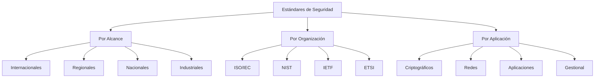
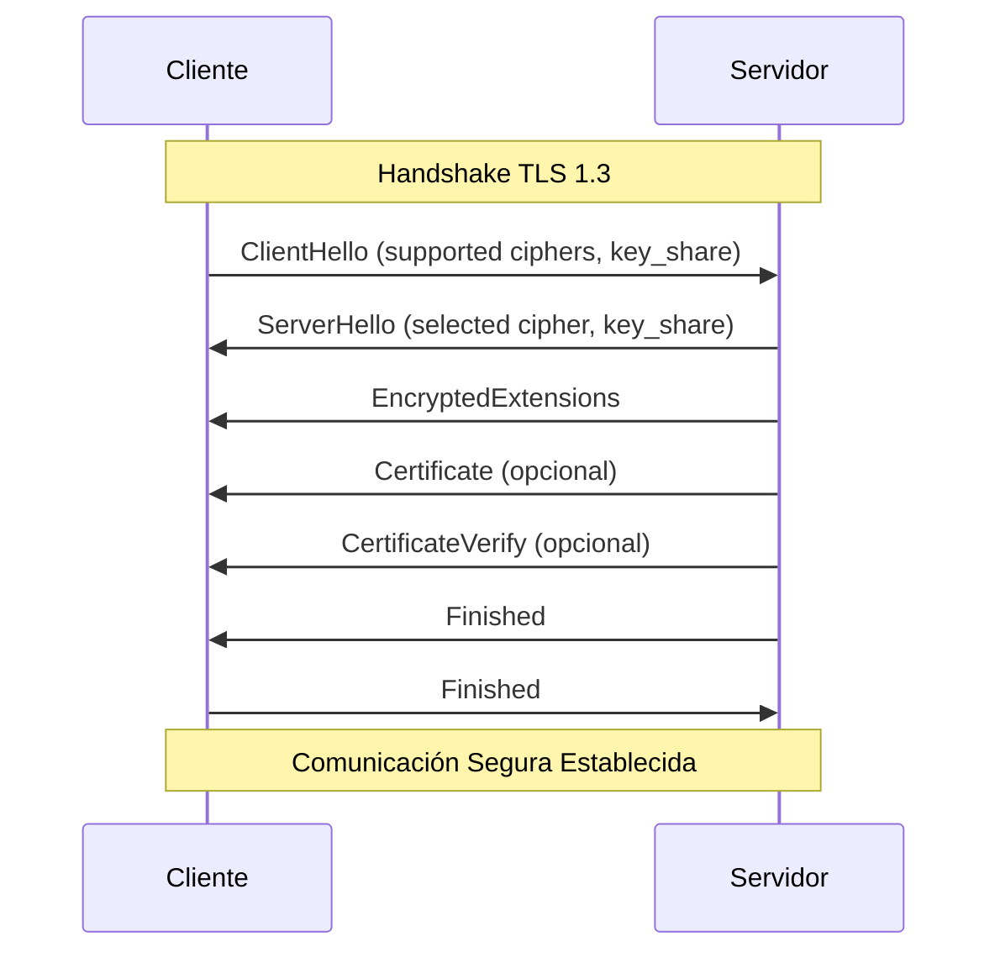
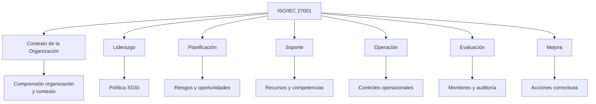
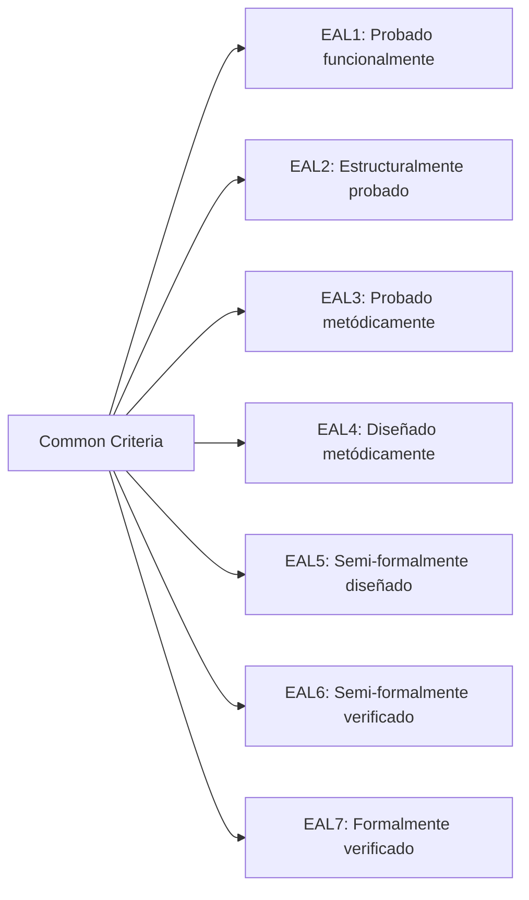
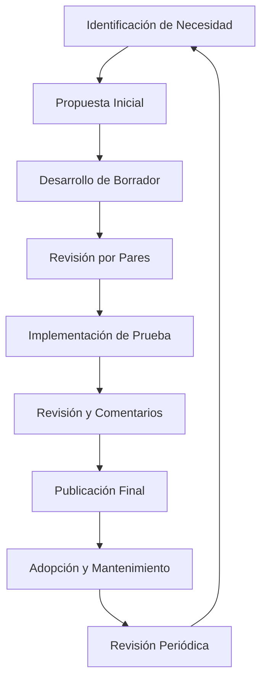

# Criptografía y Seguridad - Conceptos de seguridad y criptografía

## 1.4 Estándares de seguridad.

---

Los estándares de seguridad son especificaciones técnicas, protocolos y mejores prácticas establecidas para garantizar la interoperabilidad, confiabilidad y seguridad de los sistemas criptográficos y de información. Constituyen la base sobre la cual se construyen sistemas seguros en el mundo digital.

### Fundamentos de los Estándares de Seguridad

#### Definición y Propósito

**Estándar de seguridad**: Especificación técnica formal que establece requisitos, lineamientos y mejores prácticas para implementar medidas de seguridad consistentes y efectivas.

**Objetivos principales**:

- **Interoperabilidad**: Sistemas diferentes pueden trabajar juntos
- **Confianza**: Base común para evaluar la seguridad
- **Economía de escala**: Reducción de costos mediante implementaciones estandarizadas
- **Auditoría**: Criterios uniformes para evaluación

#### Clasificación de Estándares



### Organismos de Estandarización

#### Principales Organizaciones

```python
class OrganismosEstandarizacion:
    """Representa los principales organismos de estandarización"""

    def __init__(self):
        self.organismos = {
            "ISO": {
                "nombre_completo": "International Organization for Standardization",
                "alcance": "Internacional",
                "estandares_importantes": ["ISO/IEC 27001", "ISO/IEC 15408"]
            },
            "IEC": {
                "nombre_completo": "International Electrotechnical Commission",
                "alcance": "Internacional",
                "estandares_importantes": ["IEC 62443"]
            },
            "NIST": {
                "nombre_completo": "National Institute of Standards and Technology",
                "alcance": "Estados Unidos",
                "estandares_importantes": ["FIPS 140-3", "SP 800-53", "AES"]
            },
            "IETF": {
                "nombre_completo": "Internet Engineering Task Force",
                "alcance": "Internet",
                "estandares_importantes": ["TLS 1.3", "IPsec", "SHA-3"]
            },
            "ETSI": {
                "nombre_completo": "European Telecommunications Standards Institute",
                "alcance": "Europeo",
                "estandares_importantes": ["GSM", "3GPP", "ETSI TS 103 743"]
            }
        }

    def obtener_informacion(self, organismo):
        return self.organismos.get(organismo, {})

# Ejemplo de uso
org = OrganismosEstandarizacion()
print("=== ORGANISMOS DE ESTANDARIZACIÓN ===")
for nombre, info in org.organismos.items():
    print(f"\n{nombre}: {info['nombre_completo']}")
    print(f"Alcance: {info['alcance']}")
    print(f"Estándares importantes: {', '.join(info['estandares_importantes'])}")
```

### Estándares Criptográficos Fundamentales

#### Estándares de Cifrado Simétrico

##### AES (Advanced Encryption Standard)

**FIPS 197** - Estándar adoptado en 2001 después de competencia pública

**Características técnicas**:

- Tamaño de bloque: 128 bits
- Tamaños de clave: 128, 192, 256 bits
- Número de rondas: 10, 12, 14 (dependiendo del tamaño de clave)

**Transformaciones principales**:

- SubBytes: $S_{ij} = Sbox(A_{ij})$
- ShiftRows: Rotación de filas
- MixColumns: $C_j = M \times C_j$ donde $M$ es matriz de MixColumns
- AddRoundKey: $Estado \oplus K_r$

```python
from cryptography.hazmat.primitives.ciphers import Cipher, algorithms, modes
from cryptography.hazmat.primitives import padding
import os

class ImplementacionAES:
    """Implementación de referencia del estándar AES"""

    def __init__(self, clave: bytes):
        if len(clave) not in [16, 24, 32]:
            raise ValueError("La clave debe ser de 16, 24 o 32 bytes")
        self.clave = clave
        self.tamano_clave = len(clave)

    def cifrar(self, texto_plano: bytes, modo='CBC') -> tuple:
        """Cifrado según estándar AES"""
        if modo == 'CBC':
            iv = os.urandom(16)
            cipher = Cipher(algorithms.AES(self.clave), modes.CBC(iv))
        elif modo == 'GCM':
            iv = os.urandom(12)
            cipher = Cipher(algorithms.AES(self.clave), modes.GCM(iv))
        else:
            raise ValueError("Modo no soportado")

        # Aplicar padding PKCS7 para CBC
        if modo == 'CBC':
            padder = padding.PKCS7(128).padder()
            texto_plano = padder.update(texto_plano) + padder.finalize()

        encryptor = cipher.encryptor()
        texto_cifrado = encryptor.update(texto_plano) + encryptor.finalize()

        if modo == 'GCM':
            return iv, texto_cifrado, encryptor.tag
        else:
            return iv, texto_cifrado

    def descifrar(self, iv: bytes, texto_cifrado: bytes, tag=None, modo='CBC') -> bytes:
        """Descifrado según estándar AES"""
        if modo == 'CBC':
            cipher = Cipher(algorithms.AES(self.clave), modes.CBC(iv))
        elif modo == 'GCM':
            if tag is None:
                raise ValueError("Se requiere tag para GCM")
            cipher = Cipher(algorithms.AES(self.clave), modes.GCM(iv, tag))
        else:
            raise ValueError("Modo no soportado")

        decryptor = cipher.decryptor()
        texto_plano = decryptor.update(texto_cifrado) + decryptor.finalize()

        # Remover padding para CBC
        if modo == 'CBC':
            unpadder = padding.PKCS7(128).unpadder()
            texto_plano = unpadder.update(texto_plano) + unpadder.finalize()

        return texto_plano

# Ejemplo de uso
clave = os.urandom(32)  # AES-256
aes = ImplementacionAES(clave)

texto_original = b"Mensaje secreto para cifrar"
iv, texto_cifrado = aes.cifrar(texto_original)
texto_recuperado = aes.descifrar(iv, texto_cifrado)

print(f"Texto original: {texto_original}")
print(f"Texto cifrado (hex): {texto_cifrado.hex()}")
print(f"Texto recuperado: {texto_recuperado}")
print(f"Coinciden: {texto_original == texto_recuperado}")
```

#### Estándares de Cifrado Asimétrico

##### RSA (Rivest-Shamir-Adleman)

**PKCS #1** - Estándar para cifrado y firmas RSA

**Generación de claves**:

1. Elegir primos $p$ y $q$
2. Calcular $n = p \times q$
3. Calcular $\phi(n) = (p-1)(q-1)$
4. Elegir $e$ tal que $1 < e < \phi(n)$ y $gcd(e, \phi(n)) = 1$
5. Calcular $d = e^{-1} \mod \phi(n)$

**Cifrado**: $C = M^e \mod n$  
**Descifrado**: $M = C^d \mod n$

```python
from cryptography.hazmat.primitives.asymmetric import rsa, padding
from cryptography.hazmat.primitives import hashes
import math

class ImplementacionRSA:
    """Implementación de referencia del estándar RSA"""

    def __init__(self, tamano_clave=2048):
        self.tamano_clave = tamano_clave
        self.clave_privada = rsa.generate_private_key(
            public_exponent=65537,
            key_size=tamano_clave
        )
        self.clave_publica = self.clave_privada.public_key()

    def cifrar(self, mensaje: bytes) -> bytes:
        """Cifrado RSA según PKCS#1"""
        texto_cifrado = self.clave_publica.encrypt(
            mensaje,
            padding.OAEP(
                mgf=padding.MGF1(algorithm=hashes.SHA256()),
                algorithm=hashes.SHA256(),
                label=None
            )
        )
        return texto_cifrado

    def descifrar(self, texto_cifrado: bytes) -> bytes:
        """Descifrado RSA según PKCS#1"""
        texto_plano = self.clave_privada.decrypt(
            texto_cifrado,
            padding.OAEP(
                mgf=padding.MGF1(algorithm=hashes.SHA256()),
                algorithm=hashes.SHA256(),
                label=None
            )
        )
        return texto_plano

    def firmar(self, mensaje: bytes) -> bytes:
        """Firma digital RSA según PKCS#1"""
        firma = self.clave_privada.sign(
            mensaje,
            padding.PSS(
                mgf=padding.MGF1(hashes.SHA256()),
                salt_length=padding.PSS.MAX_LENGTH
            ),
            hashes.SHA256()
        )
        return firma

    def verificar_firma(self, mensaje: bytes, firma: bytes) -> bool:
        """Verificación de firma RSA"""
        try:
            self.clave_publica.verify(
                firma,
                mensaje,
                padding.PSS(
                    mgf=padding.MGF1(hashes.SHA256()),
                    salt_length=padding.PSS.MAX_LENGTH
                ),
                hashes.SHA256()
            )
            return True
        except:
            return False

# Ejemplo de uso
rsa_impl = ImplementacionRSA(2048)
mensaje = b"Mensaje importante para firmar y cifrar"

# Cifrado asimétrico
texto_cifrado = rsa_impl.cifrar(mensaje)
texto_descifrado = rsa_impl.descifrar(texto_cifrado)

# Firma digital
firma = rsa_impl.firmar(mensaje)
verificacion = rsa_impl.verificar_firma(mensaje, firma)

print(f"RSA - Mensaje original: {mensaje}")
print(f"RSA - Cifrado/Descifrado exitoso: {mensaje == texto_descifrado}")
print(f"RSA - Firma verificada: {verificacion}")
```

#### Estándares de Funciones Hash

##### Familia SHA (Secure Hash Algorithm)

**SHA-2** (FIPS 180-4) y **SHA-3** (FIPS 202)

**Propiedades de funciones hash seguras**:

- Resistencia a preimagen: Dado $h$, encontrar $m$ tal que $H(m) = h$ es computacionalmente inviable
- Resistencia a segunda preimagen: Dado $m_1$, encontrar $m_2 \neq m_1$ con $H(m_1) = H(m_2)$ es inviable
- Resistencia a colisiones: Encontrar $m_1 \neq m_2$ con $H(m_1) = H(m_2)$ es inviable

```python
import hashlib
import hmac

class ImplementacionHash:
    """Implementación de estándares de hash"""

    def sha256(self, mensaje: bytes) -> str:
        """SHA-256 según FIPS 180-4"""
        return hashlib.sha256(mensaje).hexdigest()

    def sha3_256(self, mensaje: bytes) -> str:
        """SHA3-256 según FIPS 202"""
        return hashlib.sha3_256(mensaje).hexdigest()

    def hmac_sha256(self, clave: bytes, mensaje: bytes) -> str:
        """HMAC-SHA256 según RFC 2104"""
        return hmac.new(clave, mensaje, hashlib.sha256).hexdigest()

    def comparar_hashes(self, mensaje: str) -> dict:
        """Compara diferentes algoritmos hash"""
        mensaje_bytes = mensaje.encode()

        return {
            "MD5 (INSECURO)": hashlib.md5(mensaje_bytes).hexdigest(),
            "SHA-1 (DEBIL)": hashlib.sha1(mensaje_bytes).hexdigest(),
            "SHA-256": self.sha256(mensaje_bytes),
            "SHA3-256": self.sha3_256(mensaje_bytes),
            "BLAKE2b": hashlib.blake2b(mensaje_bytes).hexdigest()
        }

# Ejemplo de uso
hash_impl = ImplementacionHash()
mensaje = "Mensaje de prueba para funciones hash"

print("=== COMPARACIÓN DE ALGORITMOS HASH ===")
resultados = hash_impl.comparar_hashes(mensaje)
for algoritmo, hash_valor in resultados.items():
    print(f"{algoritmo}: {hash_valor}")

# Ejemplo HMAC
clave_secreta = b"clave_secreta_hmac"
hmac_resultado = hash_impl.hmac_sha256(clave_secreta, mensaje.encode())
print(f"\nHMAC-SHA256: {hmac_resultado}")
```

### Estándares de Protocolos de Seguridad

#### TLS (Transport Layer Security)

**RFC 5246** (TLS 1.2) y **RFC 8446** (TLS 1.3)



```python
import ssl
import socket
from cryptography import x509
from cryptography.hazmat.backends import default_backend

class AnalizadorTLS:
    """Analiza configuraciones y certificados TLS"""

    def obtener_info_certificado(self, hostname, port=443):
        """Obtiene información del certificado TLS"""
        try:
            context = ssl.create_default_context()
            with socket.create_connection((hostname, port)) as sock:
                with context.wrap_socket(sock, server_hostname=hostname) as ssock:
                    cert_bin = ssock.getpeercert(binary_form=True)
                    cert = x509.load_der_x509_certificate(cert_bin, default_backend())

                    return {
                        "sujeto": cert.subject.rfc4514_string(),
                        "emisor": cert.issuer.rfc4514_string(),
                        "validez_desde": cert.not_valid_before,
                        "validez_hasta": cert.not_valid_after,
                        "algoritmo_firma": cert.signature_hash_algorithm.name if cert.signature_hash_algorithm else "N/A",
                        "version_tls": ssock.version()
                    }
        except Exception as e:
            return {"error": str(e)}

    def evaluar_cifrados(self, hostname, port=443):
        """Evalúa los cifrados soportados"""
        cifrados_recomendados = [
            "TLS_AES_256_GCM_SHA384",
            "TLS_CHACHA20_POLY1305_SHA256",
            "TLS_AES_128_GCM_SHA256"
        ]

        cifrados_debiles = [
            "TLS_RSA_",
            "TLS_DHE_",
            "_DES_",
            "_RC4_"
        ]

        return {
            "recomendados": cifrados_recomendados,
            "debiles": cifrados_debiles,
            "evaluacion": "Verificar configuración del servidor"
        }

# Ejemplo de uso
analizador = AnalizadorTLS()
info_google = analizador.obtener_info_certificado("google.com")
cifrados_info = analizador.evaluar_cifrados("google.com")

print("=== ANÁLISIS TLS ===")
print(f"Información certificado: {info_google}")
print(f"Evaluación cifrados: {cifrados_info}")
```

### Estándares de Gestión de Seguridad

#### ISO/IEC 27001

**Sistema de Gestión de Seguridad de la Información (SGSI)**



#### NIST Cybersecurity Framework

**Cinco funciones principales**:

1. **Identify** (Identificar)
2. **Protect** (Proteger)
3. **Detect** (Detectar)
4. **Respond** (Responder)
5. **Recover** (Recuperar)

```python
class MarcoNIST:
    """Implementación del marco de ciberseguridad NIST"""

    def __init__(self):
        self.categorias = {
            "IDENTIFY": {
                "Gestión de activos": "ID.AM",
                "Entorno de negocio": "ID.BE",
                "Gobernanza": "ID.GV",
                "Evaluación de riesgos": "ID.RA",
                "Estrategia de gestión de riesgos": "ID.RM"
            },
            "PROTECT": {
                "Control de acceso": "PR.AC",
                "Concienciación y entrenamiento": "PR.AT",
                "Protección de datos": "PR.DS",
                "Procesos y procedimientos": "PR.IP",
                "Protección mantenimiento": "PR.MA",
                "Tecnología de protección": "PR.PT"
            },
            "DETECT": {
                "Anomalías y eventos": "DE.AE",
                "Monitoreo continuo": "DE.CM",
                "Procesos de detección": "DE.DP"
            },
            "RESPOND": {
                "Planificación de respuesta": "RS.RP",
                "Comunicaciones": "RS.CO",
                "Análisis": "RS.AN",
                "Mitigación": "RS.MI",
                "Mejoras": "RS.IM"
            },
            "RECOVER": {
                "Planificación de recuperación": "RC.RP",
                "Mejoras": "RC.IM",
                "Comunicaciones": "RC.CO"
            }
        }

    def evaluar_implementacion(self, organizacion):
        """Evalúa la implementación del marco NIST"""
        puntuacion = {}

        for funcion, categorias in self.categorias.items():
            puntuacion[funcion] = {
                "nivel_implementacion": "Parcial",  # En práctica, se evaluaría realmente
                "categorias_implementadas": len(categorias),
                "recomendaciones": self._generar_recomendaciones(funcion)
            }

        return puntuacion

    def _generar_recomendaciones(self, funcion):
        recomendaciones = {
            "IDENTIFY": ["Inventario completo de activos", "Evaluación formal de riesgos"],
            "PROTECT": ["Controles de acceso basados en roles", "Cifrado de datos sensibles"],
            "DETECT": ["Sistema SIEM", "Monitoreo continuo de red"],
            "RESPOND": ["Plan de respuesta a incidentes", "Equipo CSIRT"],
            "RECOVER": ["Plan de recuperación de desastres", "Copias de seguridad regulares"]
        }
        return recomendaciones.get(funcion, [])

# Ejemplo de uso
marco = MarcoNIST()
evaluacion = marco.evaluar_implementacion("Empresa Ejemplo")

print("=== EVALUACIÓN MARCO NIST ===")
for funcion, info in evaluacion.items():
    print(f"\n{funcion}:")
    print(f"  Nivel: {info['nivel_implementacion']}")
    print(f"  Categorías: {info['categorias_implementadas']}")
    print(f"  Recomendaciones: {', '.join(info['recomendaciones'])}")
```

### Estándares de Evaluación de Seguridad

#### Common Criteria (ISO/IEC 15408)

**Estructura de evaluación**:

- **EAL** (Evaluation Assurance Levels): 1-7
- **Protection Profiles**: Requisitos específicos para tipos de productos
- **Security Targets**: Especificación de seguridad para producto específico



#### FIPS 140-3

**Estándar para módulos criptográficos**

**Niveles de seguridad**:

- **Nivel 1**: Requisitos básicos
- **Nivel 2**: Mecanismos de alteración, roles de operador
- **Nivel 3**: Enclaves físicos, autenticación de identidad
- **Nivel 4**: Protección ambiental avanzada

### Ejercicios Propuestos

#### Ejercicio 1: Análisis de Estándares Criptográficos

**Escenario**: Una empresa necesita seleccionar algoritmos criptográficos para su nueva plataforma.

**Requisitos**:

- Cifrado de datos en reposo
- Comunicaciones seguras entre servicios
- Almacenamiento seguro de contraseñas
- Firmas digitales para documentos

**Tareas**:

1. Seleccione los estándares apropiados para cada caso
2. Justifique su selección basándose en:
   - Fortaleza criptográfica
   - Adopción en la industria
   - Eficiencia computacional
   - Compatibilidad

#### Ejercicio 2: Implementación de Protocolo Seguro

Implemente un protocolo de comunicación seguro que combine múltiples estándares:

```python
class ProtocoloSeguro:
    """
    Ejercicio: Implementar protocolo seguro usando estándares
    """

    def establecer_conexion_segura(self, servidor, puerto):
        """
        Debe implementar handshake seguro usando:
        - TLS para transporte
        - Autenticación mutua con certificados
        - Perfect Forward Secrecy
        """
        # TODO: Implementar usando estándares TLS
        pass

    def intercambiar_mensajes_seguros(self, mensaje):
        """
        Debe garantizar:
        - Confidencialidad (AES)
        - Integridad (HMAC)
        - Autenticación (certificados)
        """
        # TODO: Implementar cifrado y firma
        pass
```

#### Ejercicio 3: Auditoría de Cumplimiento

Realice una auditoría de cumplimiento para una organización ficticia:

**Checklist de evaluación**:

- [ ] Políticas de gestión de claves
- [ ] Uso de algoritmos aprobados
- [ ] Configuraciones TLS seguras
- [ ] Procedimientos de respuesta a incidentes
- [ ] Cumplimiento de regulaciones aplicables

**Entregables**:

1. Reporte de cumplimiento
2. Recomendaciones de mejora
3. Plan de remediación

#### Ejercicio 4: Análisis de Vulnerabilidades en Estándares

Investigue y analice vulnerabilidades históricas en estándares:

**Casos de estudio**:

- WEP (802.11)
- SSL 2.0/3.0
- MD5 y SHA-1
- ROCA (CVE-2017-15361)

**Análisis requerido**:

1. Causa raíz de la vulnerabilidad
2. Impacto en la seguridad
3. Estándares de reemplazo
4. Lecciones aprendidas

### Herramientas de Verificación de Estándares

```python
class VerificadorEstándares:
    """Herramienta para verificar cumplimiento de estándares"""

    def verificar_configuracion_tls(self, hostname):
        """Verifica configuración TLS según mejores prácticas"""
        try:
            import subprocess
            result = subprocess.run(
                ["openssl", "s_client", "-connect", f"{hostname}:443", "-tlsextdebug", "-status"],
                capture_output=True, text=True, timeout=10
            )

            checks = {
                "TLS 1.2/1.3 soportado": "TLSv1.2" in result.stdout or "TLSv1.3" in result.stdout,
                "OCSP stapling": "OCSP Response Status: successful" in result.stdout,
                "Perfect Forward Secrecy": "TLS_ECDHE_" in result.stdout
            }

            return checks
        except Exception as e:
            return {"error": str(e)}

    def analizar_certificado(self, certificado_path):
        """Analiza certificado según estándares X.509"""
        from cryptography import x509
        from cryptography.hazmat.backends import default_backend

        with open(certificado_path, 'rb') as f:
            cert = x509.load_pem_x509_certificate(f.read(), default_backend())

        analisis = {
            "validez": cert.not_valid_after > datetime.now(),
            "algoritmo_firma": cert.signature_hash_algorithm.name,
            "tamano_clave_publica": cert.public_key().key_size if hasattr(cert.public_key(), 'key_size') else "N/A",
            "extensiones_criticas": [ext.oid.dotted_string for ext in cert.extensions if ext.critical]
        }

        return analisis

# Ejemplo de uso
verificador = VerificadorEstándares()
checks_tls = verificador.verificar_configuracion_tls("google.com")
print("Verificación TLS:", checks_tls)
```

### Tendencias y Evolución de Estándares

#### Estándares Emergentes

- **Post-quantum cryptography**: NIST PQC competition
- **Zero Trust Architecture**: NIST SP 800-207
- **Confidential Computing**: Certificaciones SGX, SEV
- **Blockchain security**: Estándares ISO/TC 307

#### Proceso de Desarrollo de Estándares



### Referencias

#### Bibliografía Básica

1. **Stallings, William** (2010). _Cryptography and Network Security: Principles and Practice_, 5a Ed., Prentice Hall.
   - Capítulo 2: Introducción a estándares criptográficos
   - Capítulo 6: Estándares de cifrado avanzado

2. **Forouzan, Behrouz A.** (2008). _Cryptography and Network Security_, McGraw Hill.
   - Capítulo 15: Estándares de seguridad en Internet
   - Apéndice: Estándares y organizaciones

3. **Pfleeger, Charles P. y Shari L. Pfleeger** (2006). _Security in Computing_, 4a Ed., Prentice Hall.
   - Capítulo 7: Estándares de seguridad y evaluación

#### Bibliografía Complementaria

1. **Stallings, William** (2010). _Network Security Essentials: Applications and Standards_, 4a Ed., Prentice Hall.

2. **Ferguson, Niels, Bruce Schneier y Tadayoshi Kohno** (2010). _Cryptography Engineering: Design Principles and Practical Applications_, Wiley.

3. **Menezes, Alfred, Paul van Oorschot y Scott Vanstone** (1996). _Handbook of Applied Cryptography_, CRC Press.

4. **Schneier, Bruce** (1996). _Applied Cryptography: Protocols, Algorithms, and Source Code in C_, 2a Ed., Wiley.

#### Referencias de Estándares

- **NIST FIPS Publications**: https://csrc.nist.gov/publications/fips
- **IETF RFCs**: https://www.ietf.org/standards/rfcs/
- **ISO/IEC Standards**: https://www.iso.org/standards.html
- **Common Criteria**: https://www.commoncriteriaportal.org/

### Conclusión

Los estándares de seguridad proporcionan el fundamento para construir sistemas confiables, interoperables y seguros. La comprensión y aplicación correcta de estos estándares es esencial para cualquier profesional de ciberseguridad. La evolución continua de los estándares refleja la naturaleza dinámica del campo de la seguridad y la necesidad de adaptarse constantemente a nuevas amenazas y tecnologías.
