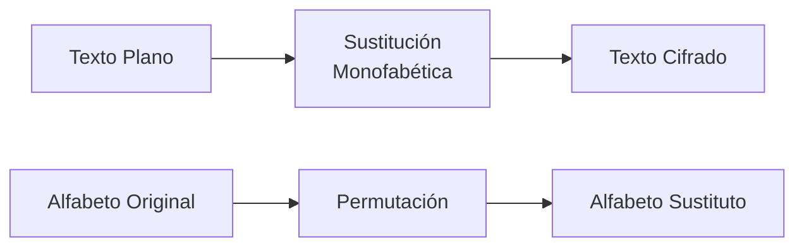
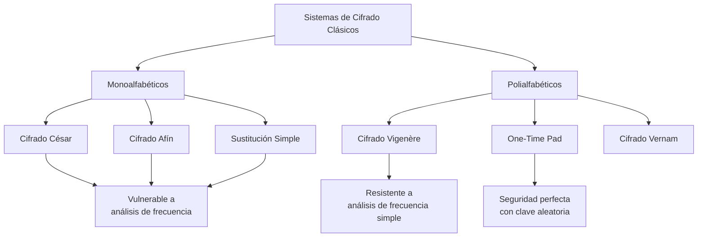

# Criptografía y Seguridad - Sistemas de cifrado clásicos, seguridad perfecta

## 2.1 Sistemas monoalfabéticos y polialfabéticos.

---

Los sistemas de cifrado clásicos representan los fundamentos históricos de la criptografía moderna. En esta guía nos enfocaremos en dos categorías principales: los sistemas monoalfabéticos y polialfabéticos, analizando sus principios matemáticos, implementaciones y propiedades de seguridad.

### Sistemas Monoalfabéticos

#### Definición

Un sistema monoalfabético es un cifrado donde cada carácter del texto plano se sustituye por un único carácter del texto cifrado, manteniendo una correspondencia fija durante todo el proceso de cifrado.

#### Cifrado por Desplazamiento (Cifrado César)

El cifrado César es uno de los sistemas monoalfabéticos más antiguos, donde cada letra se desplaza un número fijo de posiciones en el alfabeto.

**Función de cifrado:**
$$E_k(x) = (x + k) \mod 26$$

**Función de descifrado:**
$$D_k(y) = (y - k) \mod 26$$

Donde:

- $x$ es la posición de la letra en texto plano (A=0, B=1, ..., Z=25)
- $y$ es la posición de la letra en texto cifrado
- $k$ es la clave de desplazamiento
- $\mod 26$ indica operación módulo 26

**Implementación en Python:**

```python
def cifrado_cesar(texto, desplazamiento):
    resultado = ""
    for caracter in texto.upper():
        if caracter.isalpha():
            # Convertir a número (A=0, B=1, ..., Z=25)
            num = ord(caracter) - ord('A')
            # Aplicar desplazamiento
            num = (num + desplazamiento) % 26
            # Convertir de vuelta a letra
            resultado += chr(num + ord('A'))
        else:
            resultado += caracter
    return resultado

def descifrado_cesar(texto, desplazamiento):
    return cifrado_cesar(texto, -desplazamiento)

# Ejemplo de uso
texto_plano = "CRIPTOGRAFIA"
clave = 3
texto_cifrado = cifrado_cesar(texto_plano, clave)
print(f"Texto plano: {texto_plano}")
print(f"Texto cifrado: {texto_cifrado}")
print(f"Texto descifrado: {descifrado_cesar(texto_cifrado, clave)}")
```

**Ejemplo:**

- Texto plano: "CRIPTOGRAFIA" con clave k=3
- Texto cifrado: "FULSWRJUDSLD"

#### Cifrado Afín

El cifrado afín generaliza el cifrado César utilizando una transformación lineal.

**Función de cifrado:**
$$E_{a,b}(x) = (a \cdot x + b) \mod m$$

**Función de descifrado:**
$$D_{a,b}(y) = a^{-1} \cdot (y - b) \mod m$$

Donde:

- $a$ y $b$ son las claves
- $m$ es el tamaño del alfabeto (normalmente 26)
- $a^{-1}$ es el inverso multiplicativo de $a$ módulo $m$
- Se requiere que $mcd(a, m) = 1$ para que exista $a^{-1}$

**Implementación en Python:**

```python
def mcd(a, b):
    while b:
        a, b = b, a % b
    return a

def inverso_modular(a, m):
    if mcd(a, m) != 1:
        return None
    u1, u2, u3 = 1, 0, a
    v1, v2, v3 = 0, 1, m
    while v3 != 0:
        q = u3 // v3
        v1, v2, v3, u1, u2, u3 = (u1 - q * v1), (u2 - q * v2), (u3 - q * v3), v1, v2, v3
    return u1 % m

def cifrado_afin(texto, a, b):
    resultado = ""
    for caracter in texto.upper():
        if caracter.isalpha():
            x = ord(caracter) - ord('A')
            y = (a * x + b) % 26
            resultado += chr(y + ord('A'))
        else:
            resultado += caracter
    return resultado

def descifrado_afin(texto, a, b):
    resultado = ""
    a_inv = inverso_modular(a, 26)
    for caracter in texto.upper():
        if caracter.isalpha():
            y = ord(caracter) - ord('A')
            x = (a_inv * (y - b)) % 26
            resultado += chr(x + ord('A'))
        else:
            resultado += caracter
    return resultado

# Ejemplo de uso
texto_plano = "SEGURIDAD"
a, b = 5, 8
texto_cifrado = cifrado_afin(texto_plano, a, b)
print(f"Texto plano: {texto_plano}")
print(f"Texto cifrado: {texto_cifrado}")
print(f"Texto descifrado: {descifrado_afin(texto_cifrado, a, b)}")
```

#### Cifrado por Sustitución Simple

En este cifrado, cada letra se reemplaza por otra según una permutación fija del alfabeto.

**Diagrama del proceso:**



### Sistemas Polialfabéticos

#### Definición

Un sistema polialfabético utiliza múltiples sustituciones alfabéticas para cifrar un mensaje, haciendo el cifrado más seguro contra análisis de frecuencia.

#### Cifrado de Vigenère

El cifrado de Vigenère es el sistema polialfabético más conocido, que utiliza una palabra clave para determinar diferentes desplazamientos.

**Función de cifrado:**
$$C_i = (P_i + K_i) \mod 26$$

**Función de descifrado:**
$$P_i = (C_i - K_i) \mod 26$$

Donde:

- $P_i$ es el i-ésimo carácter del texto plano
- $C_i$ es el i-ésimo carácter del texto cifrado
- $K_i$ es el i-ésimo carácter de la clave (repetida cíclicamente)

**Implementación en Python:**

```python
def cifrado_vigenere(texto, clave):
    resultado = ""
    clave = clave.upper()
    clave_index = 0

    for caracter in texto.upper():
        if caracter.isalpha():
            # Convertir texto y clave a números
            p = ord(caracter) - ord('A')
            k = ord(clave[clave_index % len(clave)]) - ord('A')

            # Aplicar cifrado
            c = (p + k) % 26
            resultado += chr(c + ord('A'))

            clave_index += 1
        else:
            resultado += caracter

    return resultado

def descifrado_vigenere(texto, clave):
    resultado = ""
    clave = clave.upper()
    clave_index = 0

    for caracter in texto.upper():
        if caracter.isalpha():
            # Convertir texto y clave a números
            c = ord(caracter) - ord('A')
            k = ord(clave[clave_index % len(clave)]) - ord('A')

            # Aplicar descifrado
            p = (c - k) % 26
            resultado += chr(p + ord('A'))

            clave_index += 1
        else:
            resultado += caracter

    return resultado

# Ejemplo de uso
texto_plano = "CRIPTOGRAFIASEGURA"
clave = "CLAVE"
texto_cifrado = cifrado_vigenere(texto_plano, clave)
print(f"Texto plano: {texto_plano}")
print(f"Clave: {clave}")
print(f"Texto cifrado: {texto_cifrado}")
print(f"Texto descifrado: {descifrado_vigenere(texto_cifrado, clave)}")
```

**Ejemplo detallado:**

- Texto plano: "CRIPTOGRAFIASEGURA"
- Clave: "CLAVE" (repetida: "CLAVECLAVECLAVEC")
- Proceso de cifrado:
  - C + C = (2 + 2) mod 26 = 4 → E
  - R + L = (17 + 11) mod 26 = 2 → C
  - I + A = (8 + 0) mod 26 = 8 → I
  - P + V = (15 + 21) mod 26 = 10 → K
  - Y así sucesivamente...

#### Cifrado de Vernam (One-Time Pad)

El cifrado de Vernam, cuando se usa con una clave verdaderamente aleatoria y de un solo uso, proporciona seguridad perfecta.

**Función de cifrado:**
$$C_i = P_i \oplus K_i$$

**Función de descifrado:**
$$P_i = C_i \oplus K_i$$

Donde $\oplus$ representa la operación XOR.

**Propiedades de seguridad perfecta:**

- La clave debe ser tan larga como el mensaje
- La clave debe ser verdaderamente aleatoria
- La clave debe usarse una sola vez
- Se cumple que $P(P|C) = P(P)$ para todo P, C

### Análisis de Seguridad

#### Vulnerabilidades de Sistemas Monoalfabéticos

1. **Análisis de frecuencia**: Las letras mantienen sus frecuencias relativas
2. **Patrones lingüísticos**: Se preservan dígrafos y trigrafos comunes
3. **Espacio de claves reducido**: Fácil de atacar por fuerza bruta

#### Fortalezas de Sistemas Polialfabéticos

1. **Enmascaramiento de frecuencias**: Diferentes letras pueden representar la misma letra del texto plano
2. **Mayor espacio de claves**: Más resistente a ataques por fuerza bruta
3. **Eliminación de patrones**: Rompe la estructura del lenguaje

### Ejercicios Propuestos

#### Ejercicio 1: Cifrado César

Cifre el mensaje "ESTUDIAR CRIPTOGRAFIA ES FUNDAMENTAL" usando un cifrado César con desplazamiento 7.

#### Ejercicio 2: Cifrado Afín

Dado el cifrado afín con parámetros a=7 y b=3:
a) Cifre el mensaje "SEGURIDAD INFORMATICA"
b) Demuestre que a=7 tiene inverso módulo 26
c) Calcule el descifrado del texto cifrado obtenido

#### Ejercicio 3: Cifrado de Vigenère

Cifre el mensaje "LOS SISTEMAS POLIALFABETICOS SON MAS SEGUROS" usando la clave "CIFRADO".

#### Ejercicio 4: Análisis de Frecuencia

Dado el siguiente texto cifrado con un sistema monoalfabético, recupere el texto plano analizando las frecuencias:

```
F X Y Z F Y M F S F X Y Z F Y M F W J F S F X N R N X Y Z W J F S F Q N S J F Y M F S F X Y Z F Y M F W J F S
```

#### Ejercicio 5: Implementación

Implemente en Python una función que detecte si un texto cifrado fue hecho con un sistema monoalfabético analizando la distribución de frecuencias de las letras.

### Diagrama Comparativo



### Referencias

#### Bibliografía Básica

1. Stallings, William. (2010). _Cryptography and Network Security: Principles and Practice_, 5a Ed., Prentice Hall. (Capítulos 2-3)
2. Forouzan, Behrouz A. (2008). _Cryptography and Network Security_, McGraw Hill. (Capítulo 2)
3. Pfleeger, Charles P. y Shari L. Pfleeger. (2006). _Security in Computing_, 4a. Ed., Prentice Hall. (Capítulo 2)

#### Bibliografía Complementaria

1. Stallings, William. (2010). _Network Security Essentials: Applications and Standards_, 4a Ed., Prentice Hall.
2. Ferguson, Niels, Bruce Schneier y Tadayoshi Kohno. (2010). _Cryptography Engineering: Design Principles and Practical Applications_, Wiley.
3. Menezes, Alfred, Paul van Oorschot y Scott Vanstone. (1996). _Handbook of Applied Cryptography_, CRC Press.
4. Schneier, Bruce. (1996). _Applied Cryptography: Protocols, Algorithms, and Source Code in C_, 2a Ed., Wiley.

### Conceptos Clave para Recordar

- Los sistemas **monoalfabéticos** usan una única sustitución para todo el mensaje
- Los sistemas **polialfabéticos** varían la sustitución según la posición en el texto
- El **análisis de frecuencia** es efectivo contra sistemas monoalfabéticos
- El **one-time pad** proporciona seguridad perfecta cuando se usa correctamente
- La **longitud de la clave** en Vigenère determina la seguridad del sistema
- Los sistemas clásicos son educativos pero **inseguros** para aplicaciones modernas
