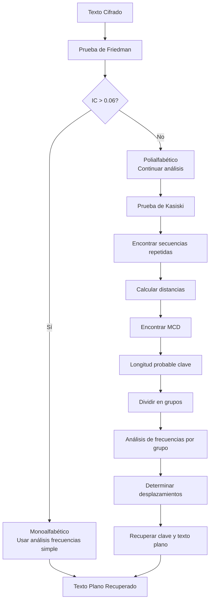

# Criptografía y Seguridad - Sistemas de cifrado clásicos, seguridad perfecta

## 2.2 Análisis de frecuencias, prueba de Kasiski y de Friedman.

---

El análisis de frecuencias constituye una de las técnicas criptoanalíticas más poderosas contra sistemas de cifrado clásicos. Esta guía explora los métodos fundamentales para romper cifrados mediante el estudio estadístico de los textos cifrados.

### Análisis de Frecuencias

#### Definición

El análisis de frecuencias es una técnica criptoanalítica que explota la distribución no uniforme de letras, dígrafos y trigrafos en los lenguajes naturales para descifrar mensajes codificados con sistemas de sustitución.

#### Frecuencias en el Español

**Distribución típica de letras en español:**

| Letra | Frecuencia (%) | Letra | Frecuencia (%) |
| ----- | -------------- | ----- | -------------- |
| E     | 13.68%         | M     | 3.15%          |
| A     | 12.53%         | U     | 2.93%          |
| O     | 8.68%          | G     | 1.64%          |
| S     | 7.98%          | B     | 1.54%          |
| R     | 6.87%          | F     | 1.18%          |
| N     | 6.71%          | Y     | 1.09%          |
| I     | 6.25%          | P     | 1.08%          |
| D     | 5.86%          | C     | 0.99%          |
| L     | 4.97%          | Q     | 0.88%          |
| T     | 4.63%          | H     | 0.70%          |
| C     | 4.68%          | Ñ     | 0.31%          |

**Fórmula de frecuencia relativa:**

$$ f_i = \frac{n_i}{N} \times 100\% $$

Donde:

- $n_i$ es el número de ocurrencias del carácter i
- $N$ es el total de caracteres en el texto
- $f_i$ es la frecuencia relativa del carácter i

#### Implementación de Análisis de Frecuencias

```python
import string
from collections import Counter
import matplotlib.pyplot as plt

def analisis_frecuencias(texto_cifrado):
    # Filtrar solo letras y convertir a mayúsculas
    texto_limpio = ''.join(c.upper() for c in texto_cifrado if c.isalpha())

    # Contar frecuencias
    contador = Counter(texto_limpio)
    total_letras = len(texto_limpio)

    # Calcular frecuencias relativas
    frecuencias = {letra: (count / total_letras) * 100 for letra, count in contador.items()}

    return frecuencias, total_letras

def graficar_frecuencias(frecuencias_observadas, frecuencias_esperadas=None):
    letras = sorted(frecuencias_observadas.keys())
    valores_observados = [frecuencias_observadas.get(letra, 0) for letra in letras]

    plt.figure(figsize=(12, 6))
    plt.bar(letras, valores_observados, alpha=0.7, label='Observado')

    if frecuencias_esperadas:
        valores_esperados = [frecuencias_esperadas.get(letra, 0) for letra in letras]
        plt.plot(letras, valores_esperados, 'ro-', label='Esperado (Español)')

    plt.xlabel('Letras')
    plt.ylabel('Frecuencia (%)')
    plt.title('Análisis de Frecuencias')
    plt.legend()
    plt.grid(True, alpha=0.3)
    plt.show()

# Frecuencias esperadas en español
FRECUENCIAS_ESPAÑOL = {
    'E': 13.68, 'A': 12.53, 'O': 8.68, 'S': 7.98, 'R': 6.87,
    'N': 6.71, 'I': 6.25, 'D': 5.86, 'L': 4.97, 'T': 4.63,
    'C': 4.68, 'U': 2.93, 'M': 3.15, 'P': 1.08, 'B': 1.54,
    'G': 1.64, 'V': 1.05, 'Y': 1.09, 'Q': 0.88, 'H': 0.70,
    'F': 1.18, 'Z': 0.47, 'J': 0.44, 'Ñ': 0.31, 'X': 0.14,
    'K': 0.11, 'W': 0.04
}

# Ejemplo de uso
texto_ejemplo = "EJEMPLO DE TEXTO PARA ANALISIS DE FRECUENCIAS"
frecuencias, total = analisis_frecuencias(texto_ejemplo)
print("Frecuencias observadas:")
for letra, freq in sorted(frecuencias.items(), key=lambda x: x[1], reverse=True):
    print(f"{letra}: {freq:.2f}%")
```

### Prueba de Kasiski

#### Fundamentos Matemáticos

La prueba de Kasiski, desarrollada por Friedrich Kasiski en 1863, permite determinar la longitud de la clave en cifrados polialfabéticos como Vigenère.

**Principio fundamental:** Secuencias idénticas en el texto plano, cuando están separadas por múltiplos de la longitud de la clave, producirán secuencias idénticas en el texto cifrado.

**Fórmula para determinar la longitud probable de la clave:**
$$mcd(d_1, d_2, ..., d_k) \approx L$$

Donde:

- $d_i$ son las distancias entre secuencias repetidas
- $L$ es la longitud de la clave

#### Algoritmo de Kasiski

```python
def encontrar_secuencias_repetidas(texto_cifrado, longitud_minima=3):
    """
    Encuentra secuencias repetidas en el texto cifrado
    """
    texto_limpio = ''.join(c.upper() for c in texto_cifrado if c.isalpha())
    secuencias = {}

    # Buscar secuencias de longitud_minima o más
    for long_sec in range(longitud_minima, min(10, len(texto_limpio)//2)):
        for i in range(len(texto_limpio) - long_sec + 1):
            secuencia = texto_limpio[i:i + long_sec]

            if secuencia in secuencias:
                secuencias[secuencia].append(i)
            else:
                secuencias[secuencia] = [i]

    # Filtrar solo secuencias que aparecen múltiples veces
    secuencias_repetidas = {seq: pos for seq, pos in secuencias.items() if len(pos) > 1}
    return secuencias_repetidas

def calcular_distancias(secuencias_repetidas):
    """
    Calcula las distancias entre secuencias repetidas
    """
    distancias = []

    for secuencia, posiciones in secuencias_repetidas.items():
        for i in range(len(posiciones)):
            for j in range(i + 1, len(posiciones)):
                distancia = posiciones[j] - posiciones[i]
                distancias.append(distancia)
                print(f"Secuencia '{secuencia}': posiciones {posiciones[i]}, {posiciones[j]} -> distancia {distancia}")

    return distancias

def encontrar_divisores_comunes(distancias, max_longitud=20):
    """
    Encuentra divisores comunes para estimar la longitud de la clave
    """
    from math import gcd
    from functools import reduce
    from collections import Counter

    # Calcular MCD de todas las distancias
    if len(distancias) >= 2:
        mcd_total = reduce(gcd, distancias)
    elif len(distancias) == 1:
        mcd_total = distancias[0]
    else:
        return []

    # Encontrar divisores del MCD
    divisores = []
    for i in range(1, min(mcd_total + 1, max_longitud + 1)):
        if mcd_total % i == 0:
            divisores.append(i)

    # Contar frecuencia de divisores en todas las distancias
    conteo_divisores = Counter()
    for distancia in distancias:
        for divisor in range(1, max_longitud + 1):
            if distancia % divisor == 0:
                conteo_divisores[divisor] += 1

    print("\nDivisores más probables (por frecuencia):")
    for divisor, count in conteo_divisores.most_common(10):
        print(f"Longitud {divisor}: aparece en {count} distancias")

    return divisores

def prueba_kasiski(texto_cifrado):
    """
    Aplica la prueba completa de Kasiski
    """
    print("=== PRUEBA DE KASISKI ===")
    print(f"Texto cifrado: {texto_cifrado}")

    # Paso 1: Encontrar secuencias repetidas
    secuencias = encontrar_secuencias_repetidas(texto_cifrado)
    print(f"\nSecuencias repetidas encontradas: {len(secuencias)}")

    # Paso 2: Calcular distancias
    distancias = calcular_distancias(secuencias)

    # Paso 3: Encontrar divisores comunes
    longitud_clave = encontrar_divisores_comunes(distancias)

    return longitud_clave

# Ejemplo de uso
texto_cifrado_ejemplo = "VHVSSPQUCEMUVVGGVHVSSPQUCEMUVHVSVHVSS"
longitudes = prueba_kasiski(texto_cifrado_ejemplo)
print(f"\nLongitudes probables de la clave: {longitudes}")
```

### Prueba de Friedman (Índice de Coincidencia)

#### Fundamentos Matemáticos

Desarrollada por William Friedman en 1920, esta prueba utiliza el índice de coincidencia (IC) para determinar si un texto fue cifrado con sistema monoalfabético o polialfabético.

**Índice de Coincidencia (IC):**
$$IC = \frac{\sum_{i=A}^{Z} n_i(n_i - 1)}{N(N - 1)}$$

Donde:

- $n_i$ es la frecuencia de la letra i
- $N$ es el total de letras en el texto

**Valores esperados del IC:**

- Español/Inglés aleatorio: ≈ 0.0385
- Español/Inglés plano: ≈ 0.074-0.077
- Texto cifrado monoalfabético: ≈ 0.074-0.077
- Texto cifrado polialfabético: ≈ 0.0385 (cuando m es grande)

**Longitud estimada de la clave:**
$$m \approx \frac{0.0265 \times N}{(N - 1) \times IC - 0.0385 \times N + 0.074}$$

#### Implementación de la Prueba de Friedman

```python
def indice_coincidencia(texto):
    """
    Calcula el índice de coincidencia de un texto
    """
    texto_limpio = ''.join(c.upper() for c in texto if c.isalpha())
    N = len(texto_limpio)

    if N < 2:
        return 0

    # Contar frecuencias
    frecuencias = {}
    for letra in texto_limpio:
        frecuencias[letra] = frecuencias.get(letra, 0) + 1

    # Calcular IC
    suma = 0
    for count in frecuencias.values():
        suma += count * (count - 1)

    IC = suma / (N * (N - 1))
    return IC

def estimar_longitud_clave(texto_cifrado):
    """
    Estima la longitud de la clave usando el método de Friedman
    """
    texto_limpio = ''.join(c.upper() for c in texto_cifrado if c.isalpha())
    N = len(texto_limpio)
    IC_observado = indice_coincidencia(texto_limpio)

    # Constantes para español
    kp = 0.077  # IC esperado para texto plano en español
    kr = 0.0385 # IC esperado para texto aleatorio

    if IC_observado <= kr:
        return 1  # Probablemente cifrado simple

    # Fórmula de Friedman para estimar longitud de clave
    if IC_observado > kr and IC_observado < kp:
        m_estimado = (kp - kr) / (IC_observado - kr)
    else:
        m_estimado = 1

    return round(m_estimado)

def prueba_friedman_completa(texto_cifrado):
    """
    Aplica la prueba completa de Friedman
    """
    print("=== PRUEBA DE FRIEDMAN ===")

    IC = indice_coincidencia(texto_cifrado)
    longitud_estimada = estimar_longitud_clave(texto_cifrado)

    print(f"Índice de Coincidencia (IC): {IC:.6f}")
    print(f"IC esperado texto plano español: ~0.077")
    print(f"IC esperado texto aleatorio: ~0.0385")

    if IC > 0.06:
        print("Resultado: Probable cifrado MONOALFABÉTICO")
    elif IC < 0.04:
        print("Resultado: Probable cifrado POLIALFABÉTICO con clave larga")
    else:
        print("Resultado: Cifrado POLIALFABÉTICO")

    print(f"Longitud estimada de la clave: {longitud_estimada}")

    return IC, longitud_estimada

# Ejemplo de uso
texto_mono = "ESTEESUNEJEMPLODETEXTOMONOALFABETICOCIFRADO"
texto_poli = "VHVSSPQUCEMUVVGGVHVSSPQUCEMUVHVSVHVSS"

print("Análisis de texto monoalfabético:")
ic1, l1 = prueba_friedman_completa(texto_mono)

print("\nAnálisis de texto polialfabético:")
ic2, l2 = prueba_friedman_completa(texto_poli)
```

### Ataque Combinado Kasiski-Friedman

```python
def ataque_completo_vigenere(texto_cifrado):
    """
    Ataque completo a cifrado de Vigenère combinando Kasiski y Friedman
    """
    print("=== ATAQUE COMPLETO A VIGENÈRE ===")

    # Paso 1: Prueba de Friedman para confirmar polialfabético
    IC, longitud_friedman = prueba_friedman_completa(texto_cifrado)

    # Paso 2: Prueba de Kasiski para refinar longitud
    longitud_kasiski = prueba_kasiski(texto_cifrado)

    # Paso 3: Combinar resultados
    print("\n=== RESUMEN DEL ANÁLISIS ===")
    print(f"Índice de Coincidencia: {IC:.6f}")
    print(f"Longitud estimada (Friedman): {longitud_friedman}")
    print(f"Longitudes probables (Kasiski): {longitud_kasiski}")

    # Recomendación final
    if longitud_kasiski:
        longitud_final = longitud_kasiski[0]  # Tomar la más probable
        print(f"\nLongitud de clave recomendada: {longitud_final}")
    else:
        longitud_final = longitud_friedman
        print(f"\nLongitud de clave estimada: {longitud_final}")

    return longitud_final

def descifrar_vigenere_con_longitud(texto_cifrado, longitud_clave):
    """
    Una vez conocida la longitud, aplicar análisis de frecuencias por grupo
    """
    texto_limpio = ''.join(c.upper() for c in texto_cifrado if c.isalpha())

    # Dividir en grupos según la posición módulo longitud_clave
    grupos = [[] for _ in range(longitud_clave)]
    for i, letra in enumerate(texto_limpio):
        grupos[i % longitud_clave].append(letra)

    print(f"\nAnálisis por grupos (longitud clave: {longitud_clave}):")
    for i, grupo in enumerate(grupos):
        frecuencias = analisis_frecuencias(''.join(grupo))[0]
        letra_mas_frecuente = max(frecuencias.items(), key=lambda x: x[1])[0]
        print(f"Grupo {i+1}: {''.join(grupo[:10])}... -> Letra más frecuente: {letra_mas_frecuente}")

    return grupos

# Ejemplo completo
texto_cifrado = "VHVSSPQUCEMUVVGGVHVSSPQUCEMUVHVSVHVSSSQQUCEMUVHVS"
longitud = ataque_completo_vigenere(texto_cifrado)
grupos = descifrar_vigenere_con_longitud(texto_cifrado, longitud)
```

### Ejercicios Propuestos

#### Ejercicio 1: Análisis de Frecuencias

Dado el siguiente texto cifrado con sustitución monoalfabética:

```
BPZAR ZJYBO ZJCDP ZJZCK ZEBZC KZRBC DZOBP ZARBD ZOBPK ZEBZC
```

a) Calcule las frecuencias de cada letra
b) Compare con las frecuencias del español
c) Proponga una sustitución probable

#### Ejercicio 2: Prueba de Kasiski

Analice el siguiente texto cifrado con Vigenère:

```
VHVSPSQUCEMVHVSPSQUCEMUVHVSVHVSPSQUCEMUVHVS
```

a) Encuentre secuencias repetidas
b) Calcule distancias
c) Estime la longitud de la clave

#### Ejercicio 3: Prueba de Friedman

Para el texto del ejercicio 2:
a) Calcule el índice de coincidencia
b) Determine si es monoalfabético o polialfabético
c) Estime la longitud de la clave

#### Ejercicio 4: Implementación

Escriba una función en Python que:
a) Automatice el ataque completo a Vigenère
b) Combine Kasiski y Friedman
c) Sugiera la clave probable

#### Ejercicio 5: Análisis Comparativo

Compare los resultados de Kasiski y Friedman para tres textos diferentes y discuta cuándo cada método es más efectivo.

### Diagrama de Flujo del Ataque



### Referencias Bibliográficas

#### Bibliografía Básica

1. **Stallings, William** (2010). _Cryptography and Network Security: Principles and Practice_, 5a Ed., Prentice Hall.
   - Capítulo 2: Técnicas criptoanalíticas clásicas
   - Sección 2.2: Análisis de frecuencias

2. **Forouzan, Behrouz A.** (2008). _Cryptography and Network Security_, McGraw Hill.
   - Capítulo 3: Cifrados clásicos
   - Sección 3.3: Ataques a cifrados polialfabéticos

3. **Pfleeger, Charles P. y Shari L. Pfleeger** (2006). _Security in Computing_, 4a Ed., Prentice Hall.
   - Capítulo 2: Técnicas criptográficas

#### Bibliografía Complementaria

1. **Stallings, William** (2010). _Network Security Essentials: Applications and Standards_, 4a Ed., Prentice Hall.

2. **Ferguson, Niels, Bruce Schneier y Tadayoshi Kohno** (2010). _Cryptography Engineering: Design Principles and Practical Applications_, Wiley.
   - Capítulo 5: Análisis criptoanalítico

3. **Menezes, Alfred, Paul van Oorschot y Scott Vanstone** (1996). _Handbook of Applied Cryptography_, CRC Press.
   - Capítulo 7: Criptoanálisis de cifrados de bloque

4. **Schneier, Bruce** (1996). _Applied Cryptography: Protocols, Algorithms, and Source Code in C_, 2a Ed., Wiley.
   - Capítulo 16: Técnicas criptoanalíticas

### Consejos Prácticos

1. **Tamaño de muestra**: Se necesitan al menos 100 caracteres para análisis confiables
2. **Validación cruzada**: Siempre usar Kasiski y Friedman conjuntamente
3. **Contexto**: Considerar el contexto del mensaje para verificar hipótesis
4. **Iteración**: El criptoanálisis es un proceso iterativo de prueba y error
5. **Herramientas**: Automatizar los cálculos pero mantener interpretación humana
