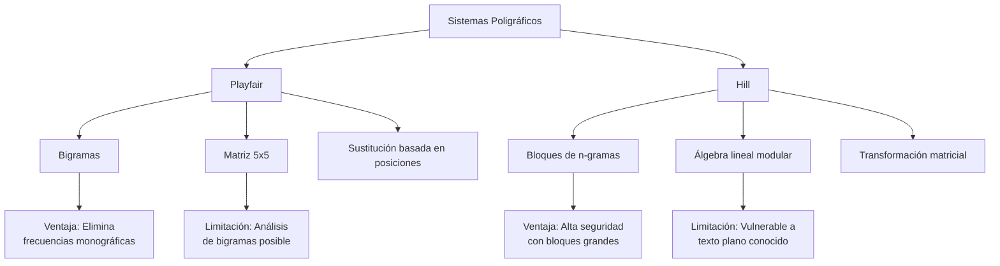

# Criptografía y Seguridad - Sistemas de cifrado clásicos, seguridad perfecta

## 2.3 Sistemas poligráficos, sistema de Playfair y de Hill.

---

Los sistemas poligráficos representan una evolución importante en la criptografía clásica, donde se cifran grupos de caracteres en lugar de caracteres individuales. Esta aproximación proporciona mayor seguridad al eliminar patrones de frecuencia monográficos.

### Sistemas Poligráficos

#### Definición y Fundamentos

Un sistema poligráfico es un cifrado que opera sobre bloques de caracteres (bigramas, trigramas, etc.) en lugar de caracteres individuales. Esto mitiga el análisis de frecuencias simple al eliminar la correspondencia directa entre caracteres planos y cifrados.

**Ventajas principales:**

- Eliminan patrones de frecuencia monográficos
- Aumentan la complejidad del criptoanálisis
- Preservan mejor la estructura del lenguaje natural

### Cifrado de Playfair

#### Historia y Principios

Desarrollado por Charles Wheatstone en 1854 pero popularizado por Lord Playfair, este cifrado opera sobre bigramas (pares de letras) usando una matriz 5×5.

#### Algoritmo de Playfair

**Preparación de la matriz clave:**

1. Eliminar la letra 'J' (o 'W' en algunas versiones)
2. Completar la matriz con la clave sin repetir letras
3. Llenar espacios restantes con el alfabeto en orden

**Reglas de cifrado:**

1. Si las letras están en la misma fila: desplazar a la derecha (cíclico)
2. Si las letras están en la misma columna: desplazar hacia abajo (cíclico)
3. Si forman un rectángulo: intercambiar esquinas opuestas

#### Implementación del Cifrado Playfair

```python
class CifradoPlayfair:
    def __init__(self, clave):
        self.matriz = self._construir_matriz(clave.upper())

    def _construir_matriz(self, clave):
        """Construye la matriz 5x5 de Playfair"""
        alfabeto = "ABCDEFGHIKLMNOPQRSTUVWXYZ"  # Excluye J
        matriz = []
        letras_usadas = set()

        # Agregar clave sin repetir
        for char in clave:
            if char not in letras_usadas and char in alfabeto:
                letras_usadas.add(char)
                matriz.append(char)

        # Completar con el alfabeto
        for char in alfabeto:
            if char not in letras_usadas:
                matriz.append(char)

        # Organizar en matriz 5x5
        return [matriz[i:i+5] for i in range(0, 25, 5)]

    def _encontrar_posicion(self, letra):
        """Encuentra la posición de una letra en la matriz"""
        for i, fila in enumerate(self.matriz):
            for j, char in enumerate(fila):
                if char == letra:
                    return i, j
        return None

    def _preparar_texto(self, texto):
        """Prepara el texto: elimina espacios, agrega X entre letras iguales"""
        texto = texto.upper().replace('J', 'I')
        texto_limpio = ''.join(c for c in texto if c.isalpha())

        # Insertar X entre letras duplicadas consecutivas
        i = 0
        while i < len(texto_limpio) - 1:
            if texto_limpio[i] == texto_limpio[i + 1]:
                texto_limpio = texto_limpio[:i+1] + 'X' + texto_limpio[i+1:]
            i += 1

        # Si la longitud es impar, agregar X al final
        if len(texto_limpio) % 2 != 0:
            texto_limpio += 'X'

        return texto_limpio

    def cifrar(self, texto_plano):
        """Cifra el texto usando Playfair"""
        texto = self._preparar_texto(texto_plano)
        resultado = []

        for i in range(0, len(texto), 2):
            a, b = texto[i], texto[i + 1]
            fila_a, col_a = self._encontrar_posicion(a)
            fila_b, col_b = self._encontrar_posicion(b)

            if fila_a == fila_b:
                # Misma fila: desplazar derecha
                resultado.append(self.matriz[fila_a][(col_a + 1) % 5])
                resultado.append(self.matriz[fila_b][(col_b + 1) % 5])
            elif col_a == col_b:
                # Misma columna: desplazar abajo
                resultado.append(self.matriz[(fila_a + 1) % 5][col_a])
                resultado.append(self.matriz[(fila_b + 1) % 5][col_b])
            else:
                # Rectángulo: intercambiar columnas
                resultado.append(self.matriz[fila_a][col_b])
                resultado.append(self.matriz[fila_b][col_a])

        return ''.join(resultado)

    def descifrar(self, texto_cifrado):
        """Descifra texto cifrado con Playfair"""
        texto = texto_cifrado.upper()
        resultado = []

        for i in range(0, len(texto), 2):
            a, b = texto[i], texto[i + 1]
            fila_a, col_a = self._encontrar_posicion(a)
            fila_b, col_b = self._encontrar_posicion(b)

            if fila_a == fila_b:
                # Misma fila: desplazar izquierda
                resultado.append(self.matriz[fila_a][(col_a - 1) % 5])
                resultado.append(self.matriz[fila_b][(col_b - 1) % 5])
            elif col_a == col_b:
                # Misma columna: desplazar arriba
                resultado.append(self.matriz[(fila_a - 1) % 5][col_a])
                resultado.append(self.matriz[(fila_b - 1) % 5][col_b])
            else:
                # Rectángulo: intercambiar columnas
                resultado.append(self.matriz[fila_a][col_b])
                resultado.append(self.matriz[fila_b][col_a])

        return ''.join(resultado)

    def mostrar_matriz(self):
        """Muestra la matriz clave"""
        for fila in self.matriz:
            print(' '.join(fila))

# Ejemplo de uso
playfair = CifradoPlayfair("CRIPTOGRAFIA")
print("Matriz Playfair:")
playfair.mostrar_matriz()

texto_plano = "ESTO ES UN MENSAJE SECRETO"
texto_cifrado = playfair.cifrar(texto_plano)
texto_descifrado = playfair.descifrar(texto_cifrado)

print(f"\nTexto plano: {texto_plano}")
print(f"Texto cifrado: {texto_cifrado}")
print(f"Texto descifrado: {texto_descifrado}")
```

#### Ejemplo Detallado Playfair

**Clave:** "CRIPTOGRAFIA"  
**Matriz resultante:**

```
C R I P T
O G A F H
K L M N Q
S U V W X
Y Z B D E
```

**Texto plano:** "ESTO ES UN MENSAJE SECRETO"  
**Procesamiento:** "ES TO ES UN ME NS AJ ES EC RE TO"  
**Texto cifrado:** "FQ UQ FQ VO NF QV CI FQ GD SF UQ"

### Cifrado de Hill

#### Fundamentos Matemáticos

Desarrollado por Lester S. Hill en 1929, este cifrado utiliza álgebra lineal y matrices para transformar bloques de texto.

**Función de cifrado:**
$$C = KP \mod m$$

**Función de descifrado:**
$$P = K^{-1}C \mod m$$

Donde:

- $K$ es la matriz clave (debe ser invertible módulo m)
- $P$ es el vector de texto plano
- $C$ es el vector de texto cifrado
- $m$ es el tamaño del alfabeto (26)
- $K^{-1}$ es la inversa de K módulo m

#### Determinante e Inversa Modular

**Determinante módulo m:**
$$\det(K) \mod m$$

**Matriz inversa módulo m:**
$$K^{-1} = (\det(K))^{-1} \cdot \text{adj}(K) \mod m$$

Donde $(\det(K))^{-1}$ es el inverso multiplicativo del determinante módulo m.

#### Implementación del Cifrado de Hill

```python
import numpy as np

class CifradoHill:
    def __init__(self, clave, tam_bloque=2):
        self.tam_bloque = tam_bloque
        self.modulo = 26
        self.clave = self._validar_clave(np.array(clave))

    def _validar_clave(self, clave):
        """Valida que la clave sea invertible módulo 26"""
        if clave.shape != (self.tam_bloque, self.tam_bloque):
            raise ValueError("La clave debe ser matriz cuadrada")

        det = int(np.round(np.linalg.det(clave))) % self.modulo
        if self.mcd(det, self.modulo) != 1:
            raise ValueError("La clave no es invertible módulo 26")

        return clave

    def mcd(self, a, b):
        """Algoritmo de Euclides para MCD"""
        while b:
            a, b = b, a % b
        return a

    def inverso_modular(self, a, m):
        """Calcula el inverso multiplicativo de a módulo m"""
        if self.mcd(a, m) != 1:
            return None

        # Algoritmo extendido de Euclides
        t0, t1 = 0, 1
        r0, r1 = m, a

        while r1 != 0:
            q = r0 // r1
            t0, t1 = t1, t0 - q * t1
            r0, r1 = r1, r0 - q * r1

        return t0 % m

    def matriz_inversa_modular(self, matriz):
        """Calcula la inversa de una matriz módulo 26"""
        det = int(np.round(np.linalg.det(matriz))) % self.modulo
        det_inv = self.inverso_modular(det, self.modulo)

        if det_inv is None:
            return None

        # Matriz adjunta
        adjunta = np.round(np.linalg.inv(matriz) * np.linalg.det(matriz)).astype(int)
        adjunta = adjunta % self.modulo

        # Inversa modular
        inversa = (det_inv * adjunta) % self.modulo
        return inversa

    def texto_a_vector(self, texto):
        """Convierte texto a vector numérico (A=0, B=1, ..., Z=25)"""
        return [ord(c.upper()) - ord('A') for c in texto if c.isalpha()]

    def vector_a_texto(self, vector):
        """Convierte vector numérico a texto"""
        return ''.join(chr(int(v) % self.modulo + ord('A')) for v in vector)

    def cifrar(self, texto_plano):
        """Cifra texto usando el cifrado de Hill"""
        texto_numerico = self.texto_a_vector(texto_plano)

        # Completar con X si es necesario
        while len(texto_numerico) % self.tam_bloque != 0:
            texto_numerico.append(23)  # X = 23

        resultado = []

        for i in range(0, len(texto_numerico), self.tam_bloque):
            bloque = texto_numerico[i:i + self.tam_bloque]
            vector = np.array(bloque).reshape(self.tam_bloque, 1)

            # Cifrado: C = K * P mod 26
            cifrado = np.dot(self.clave, vector) % self.modulo
            resultado.extend(cifrado.flatten())

        return self.vector_a_texto(resultado)

    def descifrar(self, texto_cifrado):
        """Descifra texto cifrado con Hill"""
        texto_numerico = self.texto_a_vector(texto_cifrado)
        clave_inversa = self.matriz_inversa_modular(self.clave)

        if clave_inversa is None:
            raise ValueError("No se puede calcular la inversa de la clave")

        resultado = []

        for i in range(0, len(texto_numerico), self.tam_bloque):
            bloque = texto_numerico[i:i + self.tam_bloque]
            vector = np.array(bloque).reshape(self.tam_bloque, 1)

            # Descifrado: P = K^{-1} * C mod 26
            descifrado = np.dot(clave_inversa, vector) % self.modulo
            resultado.extend(descifrado.flatten())

        return self.vector_a_texto(resultado)

# Ejemplo de uso
clave_hill = [[3, 3], [2, 5]]  # Matriz 2x2
hill = CifradoHill(clave_hill)

texto_plano = "CRIPTOGRAFIA"
texto_cifrado = hill.cifrar(texto_plano)
texto_descifrado = hill.descifrar(texto_cifrado)

print(f"Clave: {clave_hill}")
print(f"Texto plano: {texto_plano}")
print(f"Texto cifrado: {texto_cifrado}")
print(f"Texto descifrado: {texto_descifrado}")

# Verificar inversa
inversa = hill.matriz_inversa_modular(hill.clave)
print(f"\nInversa de la clave módulo 26:")
print(inversa)
```

#### Ejemplo Matemático Detallado - Hill 2×2

**Clave:** $K = \begin{bmatrix} 3 & 3 \\ 2 & 5 \end{bmatrix}$

**Texto plano:** "HI" → H=7, I=8  
**Vector:** $P = \begin{bmatrix} 7 \\ 8 \end{bmatrix}$

**Cifrado:**
$$C = KP \mod 26 = \begin{bmatrix} 3 & 3 \\ 2 & 5 \end{bmatrix} \begin{bmatrix} 7 \\ 8 \end{bmatrix} = \begin{bmatrix} 3×7 + 3×8 \\ 2×7 + 5×8 \end{bmatrix} = \begin{bmatrix} 45 \\ 54 \end{bmatrix} \mod 26 = \begin{bmatrix} 19 \\ 2 \end{bmatrix}$$

**Texto cifrado:** "TC" (T=19, C=2)

### Análisis de Seguridad

#### Fortalezas y Debilidades

**Playfair:**

- (✓) Elimina frecuencia monográfica
- (✓) Resistente a análisis simple
- (X) Vulnerable a análisis de bigramas
- (X) Clave limitada a 25 caracteres

**Hill:**

- (✓) Muy seguro con bloques grandes
- (✓) Base matemática sólida
- (X) Vulnerable a ataques de texto plano conocido
- (X) Complejidad computacional

#### Diagrama Comparativo de Sistemas Poligráficos



### Ejercicios Propuestos

#### Ejercicio 1: Playfair

Dada la clave "SEGURIDADINFORMATICA":
a) Construya la matriz de Playfair
b) Cifre el mensaje "LOS SISTEMAS POLIGRAFICOS SON SEGUROS"
c) Descifre el resultado

#### Ejercicio 2: Hill 2×2

Con la matriz clave $K = \begin{bmatrix} 5 & 8 \\ 17 & 3 \end{bmatrix}$:
a) Verifique que es invertible módulo 26
b) Calcule su inversa módulo 26
c) Cifre el mensaje "CRIPTO"
d) Descifre el resultado

#### Ejercicio 3: Hill 3×3

Dada la matriz clave $K = \begin{bmatrix} 1 & 2 & 3 \\ 4 & 5 & 6 \\ 11 & 9 & 8 \end{bmatrix}$:
a) Calcule el determinante módulo 26
b) Determine si es invertible
c) Cifre "SEGURIDAD"

#### Ejercicio 4: Análisis Criptoanalítico

Para un texto cifrado con Playfair:
a) Describa cómo identificar que se usa Playfair
b) Proponga un método de ataque
c) Estime el espacio de claves

#### Ejercicio 5: Implementación

Extienda la clase Hill para:
a) Manejar bloques de tamaño 3
b) Validar automáticamente claves
c) Procesar texto con espacios y puntuación

### Aplicación Práctica Combinada

```python
def ejemplo_completo():
    """Ejemplo completo comparando ambos sistemas"""

    print("=== COMPARATIVA SISTEMAS POLIGRÁFICOS ===\n")

    texto_plano = "LA CRIPTOGRAFIA PROTEGE LA INFORMACION"

    # Playfair
    playfair = CifradoPlayfair("EJEMPLO")
    cifrado_playfair = playfair.cifrar(texto_plano)

    # Hill
    clave_hill = [[6, 24, 1], [13, 16, 10], [20, 17, 15]]
    hill = CifradoHill(clave_hill, 3)
    cifrado_hill = hill.cifrar(texto_plano)

    print(f"Texto original: {texto_plano}")
    print(f"\n--- PLAYFAIR ---")
    print(f"Texto cifrado: {cifrado_playfair}")
    print(f"Texto descifrado: {playfair.descifrar(cifrado_playfair)}")

    print(f"\n--- HILL (3x3) ---")
    print(f"Texto cifrado: {cifrado_hill}")
    print(f"Texto descifrado: {hill.descifrar(cifrado_hill)}")

    # Análisis de seguridad
    print(f"\n--- ANÁLISIS DE SEGURIDAD ---")
    print("Playfair: Resistente a análisis monográfico, vulnerable a análisis de bigramas")
    print("Hill: Alta seguridad con bloques grandes, vulnerable a texto plano conocido")

# Ejecutar ejemplo
ejemplo_completo()
```

### Referencias Bibliográficas

#### Bibliografía Básica

1. **Stallings, William** (2010). _Cryptography and Network Security: Principles and Practice_, 5a Ed., Prentice Hall.
   - Capítulo 2: Cifrados clásicos
   - Sección 2.3: Cifrados poligráficos

2. **Forouzan, Behrouz A.** (2008). _Cryptography and Network Security_, McGraw Hill.
   - Capítulo 3: Cifrados clásicos
   - Sección 3.4: Cifrado Playfair y Hill

3. **Pfleeger, Charles P. y Shari L. Pfleeger** (2006). _Security in Computing_, 4a Ed., Prentice Hall.
   - Capítulo 2: Técnicas criptográficas históricas

#### Bibliografía Complementaria

1. **Stallings, William** (2010). _Network Security Essentials: Applications and Standards_, 4a Ed., Prentice Hall.

2. **Ferguson, Niels, Bruce Schneier y Tadayoshi Kohno** (2010). _Cryptography Engineering: Design Principles and Practical Applications_, Wiley.
   - Capítulo 5: Criptoanálisis histórico

3. **Menezes, Alfred, Paul van Oorschot y Scott Vanstone** (1996). _Handbook of Applied Cryptography_, CRC Press.
   - Capítulo 7: Cifrados de bloque clásicos

4. **Schneier, Bruce** (1996). _Applied Cryptography: Protocols, Algorithms, and Source Code in C_, 2a Ed., Wiley.
   - Capítulo 15: Cifrados históricos

### Conceptos Clave para Recordar

1. **Playfair** opera sobre bigramas usando una matriz 5×5
2. **Hill** utiliza transformaciones lineales modulares sobre bloques
3. Los sistemas poligráficos eliminan patrones de frecuencia simple
4. La **invertibilidad modular** es crucial para el descifrado en Hill
5. El **análisis de n-gramas** es necesario para atacar estos sistemas
6. La **seguridad** aumenta con el tamaño del bloque pero también la complejidad
