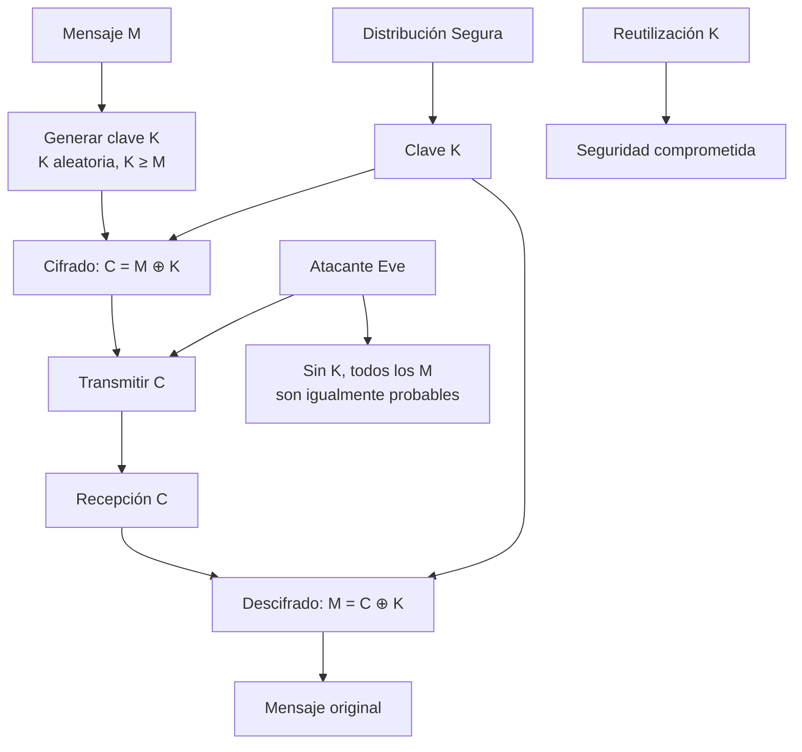

# Criptografía y Seguridad - Sistemas de cifrado clásicos, seguridad perfecta

## 2.4 Cifrado de Vernam, one-time pad y seguridad perfecta.

---

El One-Time Pad (OTP) o libreta de un solo uso representa el punto culminante en la evolución de los sistemas de cifrado clásicos, siendo el único método criptográfico que proporciona seguridad perfecta bajo condiciones específicas.

### Cifrado de Vernam y One-Time Pad

#### Contexto Histórico

- **1917**: Gilbert Vernam desarrolla el cifrado de Vernam en AT&T
- **1918**: Joseph Mauborgne propone el uso de claves verdaderamente aleatorias
- **1949**: Claude Shannon demuestra matemáticamente su seguridad perfecta

#### Definición Formal

Un One-Time Pad es un sistema de cifrado que cumple tres condiciones esenciales:

1. La clave es tan larga como el mensaje
2. La clave es verdaderamente aleatoria
3. La clave se usa una sola vez

### Fundamentos Matemáticos

#### Operación XOR

El OTP utiliza típicamente la operación XOR (OR exclusivo):

**Propiedades del XOR:**

- $A \oplus A = 0$
- $A \oplus 0 = A$
- $A \oplus B = B \oplus A$ (conmutativa)
- $(A \oplus B) \oplus C = A \oplus (B \oplus C)$ (asociativa)

**Tabla de verdad XOR:**

| A   | B   | A ⊕ B |
| --- | --- | ----- |
| 0   | 0   | 0     |
| 0   | 1   | 1     |
| 1   | 0   | 1     |
| 1   | 1   | 0     |

#### Funciones de Cifrado y Descifrado

**Cifrado:**
$$C_i = P_i \oplus K_i$$

**Descifrado:**
$$P_i = C_i \oplus K_i$$

Donde:

- $P_i$ es el i-ésimo bit/carácter del texto plano
- $K_i$ es el i-ésimo bit/carácter de la clave
- $C_i$ es el i-ésimo bit/carácter del texto cifrado

### Implementación del One-Time Pad

```python
import secrets
import string

class OneTimePad:
    def __init__(self):
        self.modulo = 26  # Para versión alfabética

    def generar_clave_aleatoria(self, longitud):
        """Genera una clave verdaderamente aleatoria"""
        return [secrets.randbelow(26) for _ in range(longitud)]

    def texto_a_numeros(self, texto):
        """Convierte texto a números (A=0, B=1, ..., Z=25)"""
        return [ord(c.upper()) - ord('A') for c in texto if c.isalpha()]

    def numeros_a_texto(self, numeros):
        """Convierte números a texto"""
        return ''.join(chr(n + ord('A')) for n in numeros)

    def cifrar_alfabetico(self, texto_plano):
        """Cifrado OTP versión alfabética"""
        texto_numerico = self.texto_a_numeros(texto_plano)
        clave = self.generar_clave_aleatoria(len(texto_numerico))

        # Cifrado: C_i = (P_i + K_i) mod 26
        cifrado = [(p + k) % 26 for p, k in zip(texto_numerico, clave)]

        return self.numeros_a_texto(cifrado), clave

    def descifrar_alfabetico(self, texto_cifrado, clave):
        """Descifrado OTP versión alfabética"""
        texto_numerico = self.texto_a_numeros(texto_cifrado)

        # Descifrado: P_i = (C_i - K_i) mod 26
        descifrado = [(c - k) % 26 for c, k in zip(texto_numerico, clave)]

        return self.numeros_a_texto(descifrado)

    def cifrar_binario(self, texto_plano):
        """Cifrado OTP versión binaria (XOR)"""
        # Convertir a bytes
        bytes_plano = texto_plano.encode('utf-8')

        # Generar clave del mismo tamaño
        clave = secrets.token_bytes(len(bytes_plano))

        # Cifrado XOR
        bytes_cifrado = bytes(b ^ k for b, k in zip(bytes_plano, clave))

        return bytes_cifrado, clave

    def descifrar_binario(self, bytes_cifrado, clave):
        """Descifrado OTP versión binaria"""
        # Descifrado XOR (misma operación que cifrado)
        bytes_plano = bytes(b ^ k for b, k in zip(bytes_cifrado, clave))

        return bytes_plano.decode('utf-8')

# Ejemplo de uso
otp = OneTimePad()

print("=== ONE-TIME PAD ALFABÉTICO ===")
texto_plano = "MENSAJESECRETO"
cifrado, clave = otp.cifrar_alfabetico(texto_plano)
descifrado = otp.descifrar_alfabetico(cifrado, clave)

print(f"Texto plano: {texto_plano}")
print(f"Clave: {otp.numeros_a_texto(clave)}")
print(f"Texto cifrado: {cifrado}")
print(f"Texto descifrado: {descifrado}")

print("\n=== ONE-TIME PAD BINARIO ===")
texto_plano_bin = "Hello World!"
cifrado_bin, clave_bin = otp.cifrar_binario(texto_plano_bin)
descifrado_bin = otp.descifrar_binario(cifrado_bin, clave_bin)

print(f"Texto plano: {texto_plano_bin}")
print(f"Clave (hex): {clave_bin.hex()}")
print(f"Texto cifrado (hex): {cifrado_bin.hex()}")
print(f"Texto descifrado: {descifrado_bin}")
```

### Seguridad Perfecta

#### Definición Matemática

Un sistema de cifrado tiene **seguridad perfecta** si para todo par de mensajes $m_1$, $m_2$ y todo texto cifrado $c$ se cumple:

$$P(C = c | M = m_1) = P(C = c | M = m_2)$$

Es decir, el texto cifrado no proporciona información sobre el texto plano.

#### Teorema de Shannon

Claude Shannon demostró en 1949 que un sistema de cifrado tiene seguridad perfecta si y solo si:

1. $|K| \geq |M|$ (la clave es al menos tan larga como el mensaje)
2. La clave es uniformemente aleatoria
3. Cada clave se usa solo una vez

**Demostración intuitiva:**
Para un texto cifrado $C$ de longitud $n$, cada mensaje posible $M$ de longitud $n$ tiene exactamente una clave $K$ tal que $C = E(K, M)$. Por lo tanto:

$$P(M = m | C = c) = P(M = m)$$

#### Implementación de Verificación de Seguridad

```python
import numpy as np
from collections import Counter

class AnalisisSeguridad:
    def __init__(self):
        self.frecuencias_espanol = {
            'E': 0.1368, 'A': 0.1253, 'O': 0.0868, 'S': 0.0798, 'R': 0.0687,
            'N': 0.0671, 'I': 0.0625, 'D': 0.0586, 'L': 0.0497, 'T': 0.0463
        }

    def analizar_entropia(self, texto):
        """Calcula la entropía de Shannon de un texto"""
        if not texto:
            return 0

        # Calcular frecuencias
        contador = Counter(texto)
        total = len(texto)
        entropia = 0

        for count in contador.values():
            p = count / total
            if p > 0:
                entropia -= p * np.log2(p)

        return entropia

    def test_aleatoriedad(self, texto):
        """Test de aleatoriedad usando prueba de frecuencias"""
        if not texto:
            return 0

        # Calcular distribución de frecuencias
        contador = Counter(texto)
        total = len(texto)

        # Calcular chi-cuadrado respecto a distribución uniforme
        chi_cuadrado = 0
        frecuencia_esperada = total / 26  # Para alfabeto inglés

        for letra in 'ABCDEFGHIJKLMNOPQRSTUVWXYZ':
            observada = contador.get(letra, 0)
            chi_cuadrado += (observada - frecuencia_esperada) ** 2 / frecuencia_esperada

        return chi_cuadrado

    def comparar_distribuciones(self, texto1, texto2):
        """Compara distribuciones de frecuencia entre dos textos"""
        contador1 = Counter(texto1)
        contador2 = Counter(texto2)

        total1 = len(texto1)
        total2 = len(texto2)

        # Calcular distancia entre distribuciones
        distancia = 0
        for letra in 'ABCDEFGHIJKLMNOPQRSTUVWXYZ':
            freq1 = contador1.get(letra, 0) / total1
            freq2 = contador2.get(letra, 0) / total2
            distancia += abs(freq1 - freq2)

        return distancia

# Análisis de seguridad OTP vs otros cifrados
analisis = AnalisisSeguridad()

# Generar textos para análisis
otp = OneTimePad()
texto_plano = "ESTEESUNMENSAJEDEPRUEBACONCONTENIDOSIGNIFICATIVO" * 5

# Cifrar con diferentes métodos
cifrado_otp, clave_otp = otp.cifrar_alfabetico(texto_plano)
cifrado_cesar = ''.join(chr((ord(c) - ord('A') + 3) % 26 + ord('A'))
                       for c in texto_plano if c.isalpha())

print("=== ANÁLISIS DE SEGURIDAD ===")
print(f"Entropía texto plano: {analisis.analizar_entropia(texto_plano):.4f}")
print(f"Entropía OTP: {analisis.analizar_entropia(cifrado_otp):.4f}")
print(f"Entropía César: {analisis.analizar_entropia(cifrado_cesar):.4f}")

print(f"\nTest aleatoriedad OTP: {analisis.test_aleatoriedad(cifrado_otp):.2f}")
print(f"Test aleatoriedad César: {analisis.test_aleatoriedad(cifrado_cesar):.2f}")

dist_otp = analisis.comparar_distribuciones(texto_plano, cifrado_otp)
dist_cesar = analisis.comparar_distribuciones(texto_plano, cifrado_cesar)
print(f"\nDistribución vs texto plano:")
print(f"OTP: {dist_otp:.4f} (ideal: ~1.0)")
print(f"César: {dist_cesar:.4f} (ideal: ~1.0)")
```

### Propiedades de Seguridad Perfecta

#### Demostración de Seguridad Perfecta

Para el OTP, la probabilidad de obtener un texto cifrado $c$ dado un mensaje $m$ es:

$$P(C = c | M = m) = P(K = c \oplus m) = \frac{1}{|K|}$$

Dado que la clave es uniformemente aleatoria, esta probabilidad es constante para todo $m$, demostrando seguridad perfecta.

#### Implicaciones Prácticas

1. **Imposibilidad de criptoanálisis**: Sin información sobre la clave, todos los mensajes son igualmente probables
2. **Independencia del atacante**: La seguridad no depende de la capacidad computacional del adversario
3. **Irrelevancia del algoritmo**: El algoritmo de cifrado puede ser público

### Limitaciones Prácticas

#### Problemas de Implementación

```python
class OTPLimitaciones:
    def demostrar_vulnerabilidades(self):
        """Demuestra vulnerabilidades por mal uso del OTP"""

        print("=== VULNERABILIDADES POR MAL USO ===")

        # 1. Reutilización de clave
        print("\n1. REUTILIZACIÓN DE CLAVE:")
        mensaje1 = "ATAQUEMOSALAMANANA"
        mensaje2 = "RETIRARSEINMEDIATO"

        # Generar clave (correcto)
        clave = [secrets.randbelow(26) for _ in range(len(mensaje1))]

        # Cifrar ambos mensajes con misma clave (ERROR)
        cifrado1 = otp.cifrar_con_clave(mensaje1, clave)
        cifrado2 = otp.cifrar_con_clave(mensaje2, clave)

        print(f"Mensaje 1: {mensaje1}")
        print(f"Mensaje 2: {mensaje2}")
        print(f"Cifrado 1: {cifrado1}")
        print(f"Cifrado 2: {cifrado2}")

        # Ataque por reutilización
        xor_cifrados = ''.join(
            chr((ord(c1) - ord('A') + ord(c2) - ord('A')) % 26 + ord('A'))
            for c1, c2 in zip(cifrado1, cifrado2)
        )
        print(f"XOR de cifrados: {xor_cifrados}")
        print("¡La reutilización revela relación entre mensajes!")

        # 2. Clave no aleatoria
        print("\n2. CLAVE NO ALEATORIA:")
        mensaje = "SECRETOIMPORTANTE"
        clave_debil = "A" * len(mensaje)  # Clave débil

        cifrado_debil = otp.cifrar_con_clave(mensaje,
                        [ord(c) - ord('A') for c in clave_debil])
        print(f"Mensaje: {mensaje}")
        print(f"Clave débil: {clave_debil}")
        print(f"Cifrado débil: {cifrado_debil}")
        print("¡Clave predecible compromete seguridad!")

    def cifrar_con_clave(self, texto, clave):
        """Cifrado con clave específica (para demostración)"""
        texto_numerico = [ord(c) - ord('A') for c in texto if c.isalpha()]
        cifrado = [(p + k) % 26 for p, k in zip(texto_numerico, clave)]
        return ''.join(chr(c + ord('A')) for c in cifrado)

# Demostrar vulnerabilidades
vulnerabilidades = OTPLimitaciones()
vulnerabilidades.demostrar_vulnerabilidades()
```

### Aplicaciones Históricas y Modernas

#### Ejemplos Históricos

- **Línea roja Washington-Moscú**: Comunicación directa entre superpotencias
- **Espionaje de la Guerra Fría**: Agentes en campo
- **Mensajes diplomáticos**: Comunicaciones ultrasensibles

#### Aplicaciones Modernas

```python
class OTPAplicaciones:
    def ejemplo_comunicacion_segura(self):
        """Simula comunicación segura usando OTP"""

        print("=== SIMULACIÓN DE COMUNICACIÓN SEGURA ===")

        # Alice quiere enviar mensaje a Bob
        mensaje_alice = "ENVIAR REFUERZOS NORTE"

        # Generación y distribución segura de clave
        otp = OneTimePad()
        cifrado, clave = otp.cifrar_alfabetico(mensaje_alice)

        print(f"Alice -> Bob:")
        print(f"  Mensaje: {mensaje_alice}")
        print(f"  Clave: {otp.numeros_a_texto(clave)}")
        print(f"  Cifrado: {cifrado}")

        # Bob recibe y descifra
        mensaje_bob = otp.descifrar_alfabetico(cifrado, clave)

        print(f"\nBob descifra:")
        print(f"  Cifrado recibido: {cifrado}")
        print(f"  Clave usada: {otp.numeros_a_texto(clave)}")
        print(f"  Mensaje descifrado: {mensaje_bob}")

        # Eve intenta interceptar
        print(f"\nEve (atacante) intercepta:")
        print(f"  Texto cifrado: {cifrado}")
        print(f"  Sin la clave, Eve no puede descifrar el mensaje")
        print(f"  Todos los mensajes de {len(mensaje_alice)} letras son igualmente probables!")

    def demostrar_seguridad_perfecta(self):
        """Demuestra la seguridad perfecta del OTP"""

        print("\n=== DEMOSTRACIÓN SEGURIDAD PERFECTA ===")

        # Mensaje original
        mensaje_real = "ATAQUE NORTE"
        clave_real = [secrets.randbelow(26) for _ in range(len(mensaje_real))]
        cifrado_real = self.cifrar_con_clave(mensaje_real, clave_real)

        # Mensaje alternativo que produce mismo cifrado con diferente clave
        mensaje_falso = "RETIRADA SUR"
        clave_falsa = [
            (ord(cf) - ord('A') - (ord(mr) - ord('A'))) % 26
            for cf, mr in zip(cifrado_real, mensaje_falso)
        ]

        print(f"Cifrado observado: {cifrado_real}")
        print(f"Con clave K1: '{mensaje_real}' -> {clave_real}")
        print(f"Con clave K2: '{mensaje_falso}' -> {clave_falsa}")
        print("¡Ambos mensajes son igualmente probables dado el cifrado!")

    def cifrar_con_clave(self, texto, clave):
        """Cifrado con clave específica"""
        texto_numerico = [ord(c) - ord('A') for c in texto if c.isalpha()]
        cifrado = [(p + k) % 26 for p, k in zip(texto_numerico, clave)]
        return ''.join(chr(c + ord('A')) for c in cifrado)

# Ejecutar ejemplos
aplicaciones = OTPAplicaciones()
aplicaciones.ejemplo_comunicacion_segura()
aplicaciones.demostrar_seguridad_perfecta()
```

### Ejercicios Propuestos

#### Ejercicio 1: Implementación

Implemente un OTP que:
a) Use operaciones XOR a nivel de bits
b) Genere claves usando `secrets` module
c) Maneje texto en UTF-8

#### Ejercicio 2: Demostración Matemática

Demuestre formalmente que:
a) $P(C = c | M = m_1) = P(C = c | M = m_2)$ para OTP
b) El OTP satisface el teorema de Shannon
c) La reutilización de clave rompe la seguridad perfecta

#### Ejercicio 3: Análisis de Seguridad

Para un cifrado OTP de 100 caracteres:
a) Calcule el número de claves posibles
b) Demuestre que sin la clave, todos los mensajes son igualmente probables
c) Compare con un cifrado de Vigenère de clave corta

#### Ejercicio 4: Ataque por Reutilización

Dados dos mensajes cifrados con la misma clave OTP:
$C_1 = M_1 \oplus K$, $C_2 = M_2 \oplus K$
Demuestre que $C_1 \oplus C_2 = M_1 \oplus M_2$

#### Ejercicio 5: Aplicación Práctica

Diseñe un protocolo seguro para:
a) Distribución inicial de claves OTP
b) Renovación periódica de claves
c) Verificación de autenticidad

### Diagrama de Flujo OTP



### Referencias Bibliográficas

#### Bibliografía Básica

1. **Stallings, William** (2010). _Cryptography and Network Security: Principles and Practice_, 5a Ed., Prentice Hall.
   - Capítulo 2: Cifrados clásicos
   - Sección 2.4: One-Time Pad

2. **Forouzan, Behrouz A.** (2008). _Cryptography and Network Security_, McGraw Hill.
   - Capítulo 7: Confidencialidad mediante cifrado en flujo
   - Sección 7.3: One-Time Pad

3. **Pfleeger, Charles P. y Shari L. Pfleeger** (2006). _Security in Computing_, 4a Ed., Prentice Hall.
   - Capítulo 2: Técnicas criptográficas

#### Bibliografía Complementaria

1. **Stallings, William** (2010). _Network Security Essentials: Applications and Standards_, 4a Ed., Prentice Hall.

2. **Ferguson, Niels, Bruce Schneier y Tadayoshi Kohno** (2010). _Cryptography Engineering: Design Principles and Practical Applications_, Wiley.
   - Capítulo 3: Cifrados en flujo

3. **Menezes, Alfred, Paul van Oorschot y Scott Vanstone** (1996). _Handbook of Applied Cryptography_, CRC Press.
   - Capítulo 6: Cifrados en flujo

4. **Shannon, Claude** (1949). _Communication Theory of Secrecy Systems_ - Paper fundamental que demuestra la seguridad perfecta del OTP

### Conclusiones Clave

1. **Seguridad perfecta**: El OTP es el único sistema con seguridad demostrablemente perfecta
2. **Condiciones críticas**: Clave tan larga como mensaje, aleatoria y de un solo uso
3. **Limitaciones prácticas**: Distribución segura de claves y gestión logística
4. **Base teórica**: Fundamenta los principios de la criptografía moderna
5. **Irrelevancia computacional**: La seguridad no depende de la potencia de cálculo

El One-Time Pad representa tanto el ideal teórico en criptografía como una advertencia sobre las limitaciones prácticas de la seguridad perfecta en aplicaciones del mundo real.
