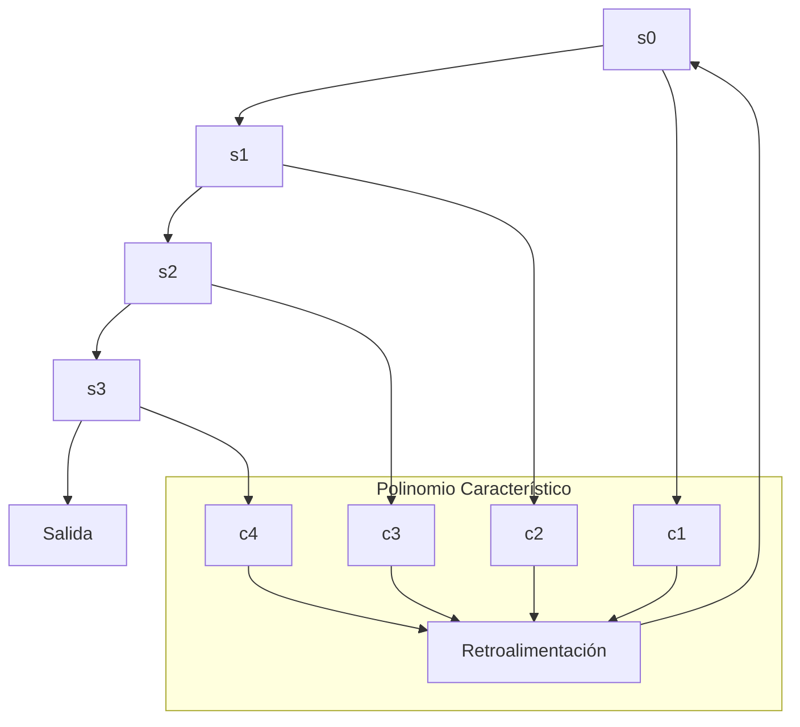
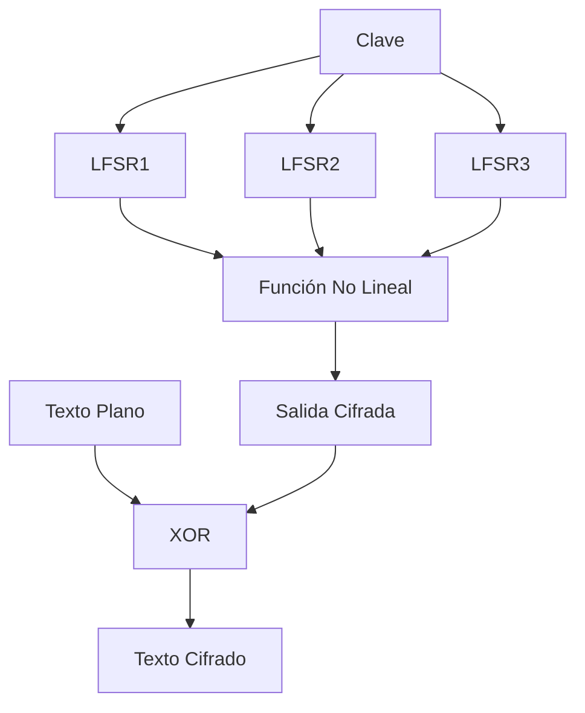

# Criptografía y Seguridad - Sistemas de cifrado clásicos, seguridad perfecta

## 2.5 Registros de desplazamiento de retroalimentación lineal.

---

Los Registros de Desplazamiento de Retroalimentación Lineal (LFSR por sus siglas en inglés) son componentes fundamentales en criptografía para la generación de secuencias pseudoaleatorias, ampliamente utilizados en cifrados de flujo y sistemas de comunicación.

### Conceptos Fundamentales

#### Definición

Un LFSR es un registro de desplazamiento cuya entrada de bit es una función lineal de su estado anterior. Son ampliamente utilizados por su simplicidad hardware y propiedades matemáticas bien entendidas.

#### Estructura Básica

Un LFSR consiste en:

- **Registros**: Celdas que almacenan bits $(s_0, s_1, ..., s_{n-1})$
- **Conexiones de retroalimentación**: Determinan la nueva entrada
- **Polinomio característico**: Define las conexiones de retroalimentación

### Modelo Matemático

#### Representación Matemática

El estado de un LFSR de longitud $n$ puede representarse como:

$$s_{t+n} = c_n s_t \oplus c_{n-1} s_{t+1} \oplus \cdots \oplus c_1 s_{t+n-1}$$

Donde:

- $s_i$ representa el bit en la posición $i$
- $c_i$ son los coeficientes de conexión (0 o 1)
- $\oplus$ representa la operación XOR

#### Polinomio Característico

El polinomio característico se define como:

$$P(x) = x^n + c_1 x^{n-1} + c_2 x^{n-2} + \cdots + c_n$$

#### Periodo Máximo

Un LFSR de longitud $n$ tiene período máximo cuando:

$$2^n - 1$$

Esto ocurre cuando el polinomio característico es primitivo.

### Implementación de LFSR

#### Implementación Básica en Python

```python
class LFSR:
    def __init__(self, semilla, polinomio):
        """
        Inicializa el LFSR

        Args:
            semilla: Lista de bits inicial [s0, s1, ..., sn-1]
            polinomio: Lista de coeficientes [c1, c2, ..., cn]
        """
        self.estado = semilla.copy()
        self.polinomio = polinomio
        self.longitud = len(semilla)

    def desplazar(self):
        """Realiza un desplazamiento y retorna el bit de salida"""
        # Calcular nuevo bit de entrada (retroalimentación)
        nuevo_bit = 0
        for i in range(self.longitud):
            if self.polinomio[i]:
                nuevo_bit ^= self.estado[i]

        # Bit de salida (el que sale del registro)
        bit_salida = self.estado[0]

        # Desplazar todos los bits
        for i in range(self.longitud - 1):
            self.estado[i] = self.estado[i + 1]

        # Insertar nuevo bit al final
        self.estado[self.longitud - 1] = nuevo_bit

        return bit_salida

    def generar_secuencia(self, longitud):
        """Genera una secuencia de bits de la longitud especificada"""
        secuencia = []
        for _ in range(longitud):
            secuencia.append(self.desplazar())
        return secuencia

    def obtener_estado(self):
        """Retorna el estado actual como número entero"""
        return int(''.join(str(bit) for bit in self.estado), 2)

# Ejemplo de uso
print("=== LFSR BÁSICO ===")
semilla = [1, 0, 1, 0]  # Estado inicial
polinomio = [1, 0, 0, 1]  # x^4 + x + 1

lfsr = LFSR(semilla, polinomio)
secuencia = lfsr.generar_secuencia(20)

print(f"Semilla: {semilla}")
print(f"Polinomio: {polinomio}")
print(f"Secuencia generada: {secuencia}")
print(f"Estado final: {lfsr.obtener_estado():04b}")
```

#### Implementación con Polinomios Primitivos

```python
class LFSRAvanzado:
    # Polinomios primitivos comunes para diferentes longitudes
    POLINOMIOS_PRIMITIVOS = {
        3: [1, 0, 1],      # x^3 + x + 1
        4: [1, 0, 0, 1],   # x^4 + x + 1
        5: [1, 0, 0, 1, 0], # x^5 + x^2 + 1
        6: [1, 0, 0, 0, 0, 1], # x^6 + x + 1
        7: [1, 0, 0, 0, 0, 0, 1], # x^7 + x + 1
        8: [1, 0, 0, 0, 1, 1, 1, 0] # x^8 + x^4 + x^3 + x^2 + 1
    }

    def __init__(self, longitud, semilla=None):
        self.longitud = longitud
        self.polinomio = self.POLINOMIOS_PRIMITIVOS[longitud]

        if semilla is None:
            # Generar semilla aleatoria (no todos ceros)
            self.estado = [1] + [0] * (longitud - 1)
        else:
            self.estado = semilla

        self.contador = 0

    def desplazar(self):
        """Desplazamiento con polinomio primitivo"""
        # Calcular retroalimentación
        feedback = 0
        for i in range(self.longitud):
            if self.polinomio[i]:
                feedback ^= self.estado[i]

        output = self.estado[0]

        # Desplazar
        for i in range(self.longitud - 1):
            self.estado[i] = self.estado[i + 1]

        self.estado[self.longitud - 1] = feedback
        self.contador += 1

        return output

    def generar_secuencia_maxima(self):
        """Genera secuencia completa de período máximo"""
        estado_inicial = self.estado.copy()
        secuencia = []
        estados_vistos = set()

        while True:
            estado_actual = tuple(self.estado)
            if estado_actual in estados_vistos:
                break

            estados_vistos.add(estado_actual)
            secuencia.append(self.desplazar())

        # Restaurar estado inicial
        self.estado = estado_inicial
        self.contador = 0

        return secuencia

    def analizar_propiedades(self):
        """Analiza propiedades de la secuencia generada"""
        secuencia = self.generar_secuencia_maxima()
        periodo = len(secuencia)

        # Contar unos y ceros
        unos = sum(secuencia)
        ceros = periodo - unos

        # Calcular autocorrelación
        autocorr = self.calcular_autocorrelacion(secuencia)

        return {
            'periodo': periodo,
            'unos': unos,
            'ceros': ceros,
            'balance': abs(unos - ceros),
            'autocorrelacion': autocorr,
            'secuencia': secuencia
        }

    def calcular_autocorrelacion(self, secuencia):
        """Calcula la autocorrelación de la secuencia"""
        N = len(secuencia)
        autocorr = []

        for tau in range(1, min(11, N)):
            correlacion = 0
            for i in range(N):
                # Convertir 0/1 a -1/+1 para cálculo de correlación
                bit1 = 1 if secuencia[i] == 1 else -1
                bit2 = 1 if secuencia[(i + tau) % N] == 1 else -1
                correlacion += bit1 * bit2

            autocorr.append(correlacion / N)

        return autocorr

# Ejemplo con polinomio primitivo
print("\n=== LFSR CON POLINOMIO PRIMITIVO ===")
lfsr_avanzado = LFSRAvanzado(4)  # LFSR de longitud 4
propiedades = lfsr_avanzado.analizar_propiedades()

print(f"Longitud LFSR: 4")
print(f"Polinomio: {lfsr_avanzado.polinomio}")
print(f"Periodo obtenido: {propiedades['periodo']}")
print(f"Periodo máximo teórico: {2**4 - 1}")
print(f"Balance (unos/ceros): {propiedades['unos']}/{propiedades['ceros']}")
print(f"Autocorrelación: {propiedades['autocorrelacion']}")
```

### Propiedades de las Secuencias LFSR

#### Secuencias MLS (Maximum Length Sequence)

Para un LFSR de longitud $n$ con polinomio primitivo:

1. **Periodo**: $2^n - 1$
2. **Balance**: $2^{n-1}$ unos y $2^{n-1} - 1$ ceros
3. **Propiedad de ejecución**: Las ejecuciones de ceros y unos tienen distribución específica
4. **Autocorrelación**: La autocorrelación es constante excepto en el desplazamiento cero

#### Autocorrelación

Para una secuencia MLS $\{s_t\}$:

$$ R(\tau) = \frac{1}{N} \sum_{t=0}^{N-1} (-1)^{s_t \oplus s_{t+\tau}} = \begin{cases} 1 & \text{si } \tau = 0 \\\ -\frac{1}{N} & \text{si } \tau \neq 0 \end{cases}$$

Donde $N = 2^n - 1$.

### Aplicaciones Criptográficas

#### Cifrado de Flujo con LFSR

```python
class CifradoFlujoLFSR:
    def __init__(self, clave_lfsr, polinomio_lfsr):
        self.lfsr = LFSR(clave_lfsr, polinomio_lfsr)

    def cifrar(self, texto_plano):
        """Cifra texto usando LFSR como generador de keystream"""
        # Convertir texto a bits
        bits_plano = self.texto_a_bits(texto_plano)

        # Generar keystream
        keystream = self.lfsr.generar_secuencia(len(bits_plano))

        # Cifrado XOR
        bits_cifrado = [p ^ k for p, k in zip(bits_plano, keystream)]

        return self.bits_a_texto(bits_cifrado), keystream

    def descifrar(self, texto_cifrado, keystream):
        """Descifra texto usando el mismo keystream"""
        bits_cifrado = self.texto_a_bits(texto_cifrado)
        bits_plano = [c ^ k for c, k in zip(bits_cifrado, keystream)]
        return self.bits_a_texto(bits_plano)

    def texto_a_bits(self, texto):
        """Convierte texto a lista de bits"""
        bits = []
        for char in texto:
            # Convertir cada carácter a 8 bits
            byte = ord(char)
            for i in range(8):
                bits.append((byte >> (7 - i)) & 1)
        return bits

    def bits_a_texto(self, bits):
        """Convierte lista de bits a texto"""
        texto = ""
        for i in range(0, len(bits), 8):
            byte = 0
            for j in range(8):
                if i + j < len(bits):
                    byte = (byte << 1) | bits[i + j]
            texto += chr(byte)
        return texto

# Ejemplo de cifrado de flujo
print("\n=== CIFRADO DE FLUJO CON LFSR ===")
clave = [1, 0, 1, 0, 1]  # Semilla LFSR
polinomio = [1, 0, 0, 1, 0]  # x^5 + x^2 + 1

cifrador = CifradoFlujoLFSR(clave, polinomio)
texto_plano = "HOLA"
texto_cifrado, keystream = cifrador.cifrar(texto_plano)
texto_descifrado = cifrador.descifrar(texto_cifrado, keystream)

print(f"Texto plano: {texto_plano}")
print(f"Keystream: {keystream}")
print(f"Texto cifrado: {texto_cifrado}")
print(f"Texto descifrado: {texto_descifrado}")
```

#### LFSR No Lineales para Mejor Seguridad

```python
class LFSRNoLineal:
    def __init__(self, lfsr1, lfsr2, lfsr3, funcion_no_lineal):
        """
        Combina múltiples LFSR con función no lineal
        """
        self.lfsr1 = lfsr1
        self.lfsr2 = lfsr2
        self.lfsr3 = lfsr3
        self.funcion = funcion_no_lineal

    def generar_bit(self):
        """Genera bit usando función no lineal de múltiples LFSR"""
        b1 = self.lfsr1.desplazar()
        b2 = self.lfsr2.desplazar()
        b3 = self.lfsr3.desplazar()

        # Función no lineal ejemplo: (b1 AND b2) XOR b3
        if self.funcion == "and_xor":
            return (b1 & b2) ^ b3
        elif self.funcion == "majority":
            # Función mayoría
            return (b1 & b2) | (b1 & b3) | (b2 & b3)
        else:
            return b1 ^ b2 ^ b3

    def generar_secuencia(self, longitud):
        """Genera secuencia no lineal"""
        return [self.generar_bit() for _ in range(longitud)]

# Ejemplo LFSR no lineal
print("\n=== LFSR NO LINEAL ===")
lfsr1 = LFSR([1,0,1], [1,0,1])  # Longitud 3
lfsr2 = LFSR([1,1,0], [1,1,0])  # Longitud 3
lfsr3 = LFSR([0,1,1], [0,1,1])  # Longitud 3

lfsr_nl = LFSRNoLineal(lfsr1, lfsr2, lfsr3, "and_xor")
secuencia_nl = lfsr_nl.generar_secuencia(20)

print(f"Secuencia no lineal: {secuencia_nl}")
```

### Ataques y Vulnerabilidades

#### Ataque de Berlekamp-Massey

El algoritmo de Berlekamp-Massey puede reconstruir un LFSR de longitud mínima dada una secuencia de salida.

```python
class AtaqueBerlekampMassey:
    def __init__(self):
        pass

    def encontrar_lfsr_minimo(self, secuencia):
        """
        Implementación simplificada del algoritmo Berlekamp-Massey
        """
        n = len(secuencia)
        C = [1]  # Polinomio de conexión
        B = [1]  # Polinomio auxiliar
        L = 0    # Longitud del LFSR
        m = -1   # Última posición donde L cambió

        for N in range(n):
            # Calcular discrepancia
            d = secuencia[N]
            for i in range(1, L + 1):
                d ^= C[i] & secuencia[N - i]

            if d == 1:
                T = C.copy()
                # Ajustar C(x) = C(x) + B(x) * x^(N-m)
                shift = N - m
                # Extender C si es necesario
                while len(C) < len(B) + shift:
                    C.append(0)

                for i in range(len(B)):
                    if i + shift < len(C):
                        C[i + shift] ^= B[i]

                if L <= N // 2:
                    L = N + 1 - L
                    m = N
                    B = T

        # El polinomio característico es x^L + C[1]x^(L-1) + ... + C[L]
        polinomio = C[1:L+1] if L > 0 else [1]
        return L, polinomio

# Ejemplo de ataque
print("\n=== ATAQUE BERLEKAMP-MASSEY ===")
ataque = AtaqueBerlekampMassey()

# Generar secuencia con LFSR conocido
lfsr_original = LFSR([1,0,1,0], [1,0,0,1])
secuencia_conocida = lfsr_original.generar_secuencia(20)

# Encontrar LFSR mínimo que genera la secuencia
longitud, polinomio = ataque.encontrar_lfsr_minimo(secuencia_conocida)

print(f"Secuencia: {secuencia_conocida}")
print(f"LFSR encontrado - Longitud: {longitud}, Polinomio: {polinomio}")
```

### Ejercicios Propuestos

#### Ejercicio 1: Implementación Básica
Implemente un LFSR de 5 bits con polinomio $x^5 + x^2 + 1$:
a) Genere 50 bits de secuencia
b) Verifique el período
c) Analice el balance de unos y ceros

#### Ejercicio 2: Propiedades MLS
Para un LFSR de 4 bits con polinomio primitivo:
a) Demuestre que el período es 15
b) Verifique la propiedad de balance
c) Calcule la autocorrelación

#### Ejercicio 3: Cifrado de Flujo
Use un LFSR para cifrar el mensaje "CRIPTOGRAFIA":
a) Implemente el cifrador
b) Descifre el mensaje
c) Analice la seguridad

#### Ejercicio 4: Ataque Berlekamp-Massey
Dada la secuencia: `[1,0,1,1,0,0,1,1,1,0,1,0,0,0,1,0,1,1,0,0]`
a) Encuentre el LFSR mínimo
b) Determine el polinomio característico
c) Prediga los próximos 10 bits

#### Ejercicio 5: LFSR No Lineal
Combine tres LFSR diferentes usando:
a) Función mayoría
b) Función AND-XOR
c) Analice la complejidad lineal resultante

### Diagramas de Estructura LFSR





### Referencias Bibliográficas

#### Bibliografía Básica
1. **Stallings, William** (2010). *Cryptography and Network Security: Principles and Practice*, 5a Ed., Prentice Hall.
   - Capítulo 7: Cifrado en Flujo
   - Sección 7.1: Registros de Desplazamiento

2. **Forouzan, Behrouz A.** (2008). *Cryptography and Network Security*, McGraw Hill.
   - Capítulo 7: Cifrado en Flujo
   - Sección 7.2: Generadores de Secuencia Pseudoaleatoria

3. **Pfleeger, Charles P. y Shari L. Pfleeger** (2006). *Security in Computing*, 4a Ed., Prentice Hall.
   - Capítulo 2: Técnicas Criptográficas

#### Bibliografía Complementaria
1. **Stallings, William** (2010). *Network Security Essentials: Applications and Standards*, 4a Ed., Prentice Hall.

2. **Ferguson, Niels, Bruce Schneier y Tadayoshi Kohno** (2010). *Cryptography Engineering: Design Principles and Practical Applications*, Wiley.
   - Capítulo 3: Cifrados en Flujo

3. **Menezes, Alfred, Paul van Oorschot y Scott Vanstone** (1996). *Handbook of Applied Cryptography*, CRC Press.
   - Capítulo 6: Generadores de Secuencia Lineal

4. **Golomb, Solomon W.** (1967). *Shift Register Sequences* - Obra clásica sobre secuencias LFSR

### Aplicaciones Prácticas

#### En Comunicaciones
- Generación de secuencias de spreading en CDMA
- Scrambling en transmisiones digitales
- Synchronización en sistemas de comunicación

#### En Criptografía
- Generadores de keystream en cifrados de flujo
- Generación de números pseudoaleatorios
- Protocolos de autenticación

#### En Testing
- Generación de patrones de test para circuitos digitales
- Verificación de sistemas embebidos

### Consideraciones de Seguridad

1. **LFSR solos son inseguros** para aplicaciones criptográficas
2. **Se requieren combinaciones no lineales** para seguridad práctica
3. **El algoritmo Berlekamp-Massey** puede romper LFSR lineales
4. **La complejidad lineal** debe ser suficientemente alta
5. **Los polinomios primitivos** son esenciales para buenas propiedades estadísticas

Los LFSR representan la base matemática para muchos sistemas criptográficos modernos y su comprensión es fundamental para el diseño de algoritmos seguros.

